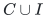
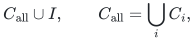
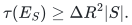
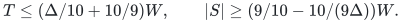
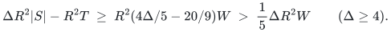
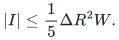

# Fixed path-hitting certificates under insertions and deletions

**Partial transfer lemma, 25 October 2026.** This note records a
positive persistence property of the physical certificates used in
the certified layer algorithm. It does not by itself give a fully
dynamic disjoint-path or hypergraph-matching algorithm.

## 1. A single historical path certificate

Let <code class="math">G_0</code> be an undirected graph with permanent edge-lifetime
identities and positive lengths. Fix a set <code class="math">A_0</code> of named demand
pairs, a comparison length <code class="math">h_0</code>, and a physical edge set <code class="math">C</code>
which intersects every <code class="math">h_0</code>-short path for every demand in <code class="math">A_0</code>.

Form a current graph <code class="math">G</code> by deleting edges, increasing old edge
lengths, and inserting edge lifetimes. Let <code class="math">I</code> contain every
inserted edge lifetime still relevant to this comparison; retaining
already deleted insertion identities in <code class="math">I</code> is harmless.
Then

<!-- math-display: f414e4e611082f3eebcdd2f5
C\cup I
-->

hits every current <code class="math">h_0</code>-short path for every demand in <code class="math">A_0</code>.
Indeed, a current path that avoids <code class="math">I</code> uses only old surviving
edges. Its length in <code class="math">G_0</code> is at most its current length, so the
old hitting property applies. A path using an inserted edge is
already hit by <code class="math">I</code>.

A length decrease can be charged in exactly the same manner:
include the decreased edge identity in <code class="math">I</code>, or retire the old
lifetime and insert a new one. Endpoint retargeting must likewise
be represented as a new lifetime. This assertion is about fixed
demand endpoints; adding new demands does not make an old
certificate cover those new demands automatically.

## 2. One shared update set for many layers

Suppose several surviving layer certificates were built at different
times. Let <code class="math">I</code> contain all edge insertions or decreases after the
oldest relevant birth. A certificate born later can also be enlarged
by this same <code class="math">I</code>; it merely contains some redundant identities.
Consequently the union certificate is

<!-- math-display: 4c81adec73f56639f6f01a5b
C_{\rm all}\cup I,
       \qquad C_{\rm all}=\bigcup_i C_i,
-->

and its cardinality is bounded by
<code class="math">\sum_i&#124;C_i&#124;+&#124;I&#124;</code>. The insertion charge appears once, not once
per surviving layer.

The same observation holds in an explicit hypergraph. If newly
introduced hyperedges have a known hitting set <code class="math">J</code>, enlarge the
old certificates by <code class="math">J</code>. Picking one right resource from each
new nonempty hyperedge is a simple choice, although a smaller
shared <code class="math">J</code> can be preferable. For implicitly represented path
hyperedges, one newly inserted graph edge hits every newly created
path that uses it; enumerating the new paths is unnecessary.

## 3. A quantitative growth margin

Use the notation of the no-superposition layer theorem:
<code class="math">\Delta\ge4</code>, selected rank at most <code class="math">R</code>, a fixed lower
prefix of total blocker count <code class="math">W&gt;0</code>, and the strong condition

<!-- math-display: 77ac090f3949af03800e659d
\tau(E_S)\ge\Delta R^2|S|.
-->

Assume all the layer-state invariants still hold: old selected
objects are valid, exact blocker ownership is correct, lower
prefixes and active left sets retain their stated meanings, and
old layers are noncollapsible. These are separate requirements,
not consequences of the hitting lemma.

If a fresh build had <code class="math">&#124;X_{\rm new}&#124;\le\Delta W/10</code>, put
<code class="math">T=\sum_i&#124;X_i&#124;</code>, including this new layer. The existing growth
proof gives

<!-- math-display: 2edc6ccc138be81c53dcb248
T\le(\Delta/10+10/9)W,\qquad
 |S|\ge(9/10-10/(9\Delta))W.
-->

The updated union certificate has size at most <code class="math">R^2T+&#124;I&#124;</code>.
The difference between the promised lower bound and the old
certificate-size upper bound is at least

<!-- math-display: 8485241aeb6a3d19205586f9
\Delta R^2|S|-R^2T
 \ \ge\
 R^2(4\Delta/5-20/9)W
 \ >\ \frac15\Delta R^2W
       \qquad(\Delta\ge4).
-->

Therefore the same strict growth contradiction remains valid
whenever

<!-- math-display: eab406fb0d1bf7128f6cb4a4
|I|\le\frac15\Delta R^2W.
-->

In particular, a shared insertion budget of at most
<code class="math">\Delta R^2/5</code> suffices at every nonterminal build boundary
with integer <code class="math">W\ge1</code>, provided the other stated invariants
are preserved. One can use a smaller constant to leave further
implementation margins.

## 4. What this lemma does and does not maintain

Inserting graph edges does not invalidate an already selected
path or change which current matching paths intersect it in
physical edge identities. Thus the certificate persistence
claim is compatible with those fixed objects. Deleting an edge
outside all selected and matched paths also leaves those objects
valid, while deletion only strengthens old path-hitting statements.

Deleting an edge used by a selected or matched path can invalidate
the layer state. A path-length increase can also violate a
previous output-length bound even though the hitting assertion
remains true. New demand arrivals can increase the root's
unmatched count. None of these events is paid for by the simple
certificate cardinality estimate above.

In particular, the static weighted lifetime proof assumes that
layers disappear through their own charged collapses and that
the root's unmatched count decreases. Arbitrary invalidation,
rollback, or new-demand insertion need not satisfy either
assumption. Reusing the static proof without charging these
events would be incorrect.

The present lemma isolates a useful positive interface: a large
implicit family of new paths can be covered by the small set
of graph edges that created them, with a single shared update
charge across all historical certificates. A dynamic algorithm
would additionally need a repair and discovery bound for
selected objects, matching recourse, and layer invalidations.
