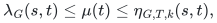
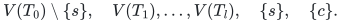
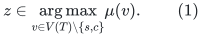
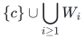
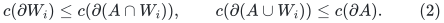
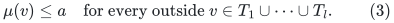
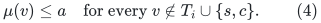

# Independent audit of the global-max leaf repair

**Status: the complete adapter passes this independent audit.** The
complete algorithm and inventory proof are in
[deterministic-fixed-k-tree-mincut-adapter.md](deterministic-fixed-k-tree-mincut-adapter.md), which was read after
the independent derivation below. This document isolates the correctness
argument, including two base-case and guide-tree details that are easy
to miss. It does not silently import the incompatible contractions from
the two source presentations.

Primary references are AKL+, [arXiv:2507.20354v1, Section 5.1]
(https://arxiv.org/html/2507.20354v1), Zhang,
[arXiv:2112.01042v1, Sections 2.2--2.4]
(https://arxiv.org/html/2112.01042v1), and the alternative algorithm of
AKL+, [arXiv:2111.04958v3, Section 2]
(https://arxiv.org/pdf/2111.04958). The repair below is an additional
argument, not a claim that the displayed source pseudocode already
contains it.

## 1. The leaf contract and notation

The graph is undirected with nonnegative capacities. Its guide tree
<code class="math">T</code> spans an arbitrary subset of graph vertices. The source <code class="math">s</code>
is a leaf, with unique neighbor <code class="math">p</code>. A leaf call must return values
<code class="math">\mu(t)</code> satisfying

<!-- math-display: de326dc9f33dea26258341bc
\lambda_G(s,t)\leq\mu(t)\leq\eta_{G,T,k}(s,t),
-->

where <code class="math">\eta</code> is the minimum capacity of an <code class="math">(s,t)</code>-cut that
crosses <code class="math">sp</code> and at most <code class="math">k</code> guide edges. Every returned upper
bound is the capacity of an actual separating graph cut, so the lower
inequality is automatic under contractions and minimum updates.

Take a centroid <code class="math">c</code>. For a nonconstant-size leaf call, <code class="math">c\ne s</code>.
Let <code class="math">T_0</code> be the component of <code class="math">T-c</code> containing <code class="math">s</code>, and
<code class="math">T_1,\ldots,T_l</code> the other components. Compute disjoint isolating
regions <code class="math">W_0,W_1,\ldots,W_l</code> for

<!-- math-display: 25c02debfe64ecb66407e873
V(T_0)\setminus\{s\},\quad V(T_1),\ldots,V(T_l),
 \quad\{s\},\quad\{c\}.
-->

Empty groups are omitted. In particular, every <code class="math">W_i</code> is disjoint
from <code class="math">s,c</code>. The unused parts of <code class="math">V</code> may be arbitrarily large;
no correctness or inventory argument assumes that the <code class="math">W_i</code> cover
the graph.

Before selecting a same-<code class="math">k</code> branch, complete all these operations:

1. Compute <code class="math">\lambda(s,c)</code>.
2. For an ordered-pair separating family of retained outside branches,
   keep <code class="math">T_0,c</code>, prune the other outside branches, and run the
   main or leaf procedure with <code class="math">k-1</code>. Include the choice that
   prunes **all** outside branches.
3. Form <code class="math">T^-</code> by deleting <code class="math">T_0\setminus\{s\}</code>, deleting
   the old source-arm edges, and attaching <code class="math">s</code> directly to <code class="math">c</code>.
   Run the main procedure on <code class="math">(G,T^-,s,k-1)</code>.

The empty retained set in item 2 matters even when <code class="math">l=1</code>: ordered
pair separation alone is then a vacuous condition. Bit positions and
their complementary classes, plus the empty set, give
<code class="math">O(\log(l+2))</code> deterministic calls.

Now choose a maximizer

<!-- math-display: 6a578d86ef6b6f8909f36a53
z\in\mathop{\mathrm{arg\,max}}\limits_{v\in V(T)\setminus\{s,c\}}
                              \mu(v).
 \tag{1}
-->

The maximization includes the source component <code class="math">T_0</code>. This is the
essential change from maximizing over outside components alone.

## 2. The two possible recursive configurations

If <code class="math">z\in T_0</code>, make **one** same-<code class="math">k</code> leaf call. Contract

<!-- math-display: d72aa3f9132b1d306905b345
\{c\}\cup\bigcup_{i\geq1}W_i
-->

to <code class="math">c</code>, retain <code class="math">s</code> separately, and use guide
<code class="math">T_0\cup\{c\}</code> with its original attachment to <code class="math">c</code>.
Call this the full source-component child. Its graph retains the
uncovered Steiner region, but that region is not duplicated into a
second same-<code class="math">k</code> child.

If <code class="math">z\in T_j</code>, <code class="math">j&gt;0</code>, make these two children:

* **Restricted source child:** contract <code class="math">V\setminus W_0</code> to the
  source and use guide <code class="math">T_0</code> itself. In particular, delete the old
  attachment to <code class="math">c</code>; do not use a quotient guide that identifies
  both ends of the source arm. The retained <code class="math">sp</code> edge is still the
  unique source edge. If <code class="math">T_0=\{s\}</code>, this child has no target
  and is omitted.
* **Selected outside child:** contract
  <code class="math">\{c\}\cup\bigcup_{i\ne j}W_i</code> to <code class="math">c</code>, retain <code class="math">s</code>
  separately, and use guide <code class="math">\{s,c\}\cup T_j</code>, with source edge
  <code class="math">sc</code> and the original <code class="math">c</code>-to-<code class="math">T_j</code> attachment.

The uncontracted regions of these two graphs are respectively
<code class="math">W_0</code> and
<code class="math">V\setminus(\{c\}\cup\bigcup_{i\ne j}W_i)</code>. They are
disjoint. This is the place where the previously duplicated uncovered
Steiner region is assigned to only one child.

## 3. Same-side uncrossing preserves the entire guide pattern

Let <code class="math">A</code> be a feasible constrained cut of minimum capacity for a
target. If a complete isolating terminal group lies in <code class="math">A</code>, then
<code class="math">A\cap W_i</code> is a feasible isolating cut for that group. Therefore

<!-- math-display: 39b3feff7bcb6e5cb50832de
c(\partial W_i)\leq c(\partial(A\cap W_i)),
 \qquad
 c(\partial(A\cup W_i))\leq c(\partial A).
 \tag{2}
-->

Moreover, <code class="math">A\cup W_i</code> has exactly the same memberships on all
guide vertices as <code class="math">A</code>. It remains feasible for the constrained
cut problem, so equality holds in the second inequality. If the group
lies in the complement of <code class="math">A</code>, apply the same argument to that
complement. Repeating this over disjoint regions preserves the full
guide cut pattern and capacity, while placing each entire region on
its group's side.

This argument applies to minimum **constrained** cuts, not only to
unconstrained graph mincuts. That distinction is needed for the strong
inductive leaf contract.

## 4. Targets in the source component

Fix <code class="math">t\in T_0\setminus\{s\}</code> and a minimizing leaf cut
<code class="math">A</code>, oriented with <code class="math">s\notin A</code> and <code class="math">p,t\in A</code>. Write
<code class="math">a=c(\partial A)</code>. If an outside component has an incident cut
edge, pruning that component gives a <code class="math">(k-1)</code>-respecting cut while
retaining <code class="math">t,sp</code>. The earlier calls already ensure <code class="math">\mu(t)\leq a</code>.

It remains to consider cuts whose cut edges are all incident to
<code class="math">T_0</code>. Every outside component is then on the same side as <code class="math">c</code>.
There are two subcases.

### 4.1 The centroid lies on the source side

Here <code class="math">c\notin A</code>, so every outside guide vertex is outside <code class="math">A</code>.
The set <code class="math">A\cap W_0</code> has the same guide memberships as <code class="math">A</code>.
Submodularity with the isolating cut <code class="math">W_0</code> shows that it has
capacity <code class="math">a</code>. Hence the restricted source child preserves the cut.
Dropping the old boundary attachment to <code class="math">c</code> only decreases the
number of cut edges and does not delete <code class="math">sp</code>.

If the selected configuration instead uses the full source child,
equation (2) moves every outside <code class="math">W_i</code> to the centroid side while
preserving the cut. Thus either configuration handles this subcase.

### 4.2 The centroid lies on the target side

Here every outside guide vertex is in <code class="math">A</code>. In <code class="math">T^-</code>, the
same graph cut crosses exactly one guide edge, namely <code class="math">sc</code>.
For <code class="math">k\geq2</code>, the earlier main <code class="math">(k-1)</code> call therefore gives

<!-- math-display: 7a9f81f5675706bd9dac787f
\mu(v)\leq a
       \quad\text{for every outside }v\in T_1\cup\cdots\cup T_l.
 \tag{3}
-->

If <code class="math">\mu(t)&gt;a</code>, the global maximizer (1) must consequently lie in
<code class="math">T_0</code>. The algorithm uses the full source child. Applying (2) to
the outside regions puts all of them on the centroid side, without
merging <code class="math">s</code> and <code class="math">c</code>, and preserves this cut. This is precisely
the case for which an unconditional contraction of
<code class="math">V\setminus W_0</code> was invalid.

## 5. Targets in an outside component

Fix <code class="math">t\in T_i</code>, <code class="math">i&gt;0</code>, and a minimizing leaf cut <code class="math">A</code>
with <code class="math">s\notin A</code>, <code class="math">p,t\in A</code>, of capacity <code class="math">a</code>.

If another outside component has an incident cut edge, a pruning call
retains <code class="math">T_i</code> and removes such a component. It already returns
<code class="math">\mu(t)\leq a</code>. Assume henceforth that outside cut edges occur
only at <code class="math">T_i</code>.

If <code class="math">c\notin A</code>, then removing the source component removes at
least the forced edge <code class="math">sp</code>, while the replacement <code class="math">sc</code> is
uncut. The main <code class="math">(k-1)</code> call on <code class="math">T^-</code> handles the target. If
<code class="math">c\in A</code> and at least two source-component edges are cut,
replacing them by the single cut edge <code class="math">sc</code> also lowers the cut
count by at least one. This case is handled as well.

Thus an unresolved target has the following pattern:

* <code class="math">sp</code> is the only cut edge incident to <code class="math">T_0</code>;
* every vertex of <code class="math">T_0\setminus\{s\}</code>, the centroid, and all
  outside components other than <code class="math">T_i</code> lie in <code class="math">A</code>;
* at least one cut edge is incident to <code class="math">T_i</code>, since otherwise
  <code class="math">T^-</code> has only the cut edge <code class="math">sc</code>, already handled for
  <code class="math">k\geq2</code>.

Pruning <code class="math">T_i</code> gives a forced-source <code class="math">(k-1)</code>-respecting cut for
every target in <code class="math">T_0\setminus\{s\}</code>. For any other outside
component, a pruning choice retains that component while removing
<code class="math">T_i</code>. Consequently

<!-- math-display: 7152dba627eabeed4aeade0d
\mu(v)\leq a
        \quad\text{for every }v\notin T_i\cup\{s,c\}.
 \tag{4}
-->

If <code class="math">\mu(t)&gt;a</code>, the global maximizer must lie in <code class="math">T_i</code>.
The algorithm therefore selects exactly this outside component.
Equation (2) absorbs <code class="math">W_0</code> and every other outside <code class="math">W_j</code>
into the centroid side, preserving the complete guide pattern and
capacity. After contraction the source edge is <code class="math">sc</code>, which is
cut, and the original <code class="math">sp</code> plus target-component pattern becomes
the same-size or smaller cut pattern in the selected child.

This also proves that choosing the full source child cannot abandon an
unresolved outside target: such a target would force the maximizer
into its own outside component.

## 6. Base cases and the main procedure

For a leaf call with <code class="math">k=1</code>, the only permissible guide pattern is
<code class="math">s</code> on one side and every other guide vertex on the other. One
deterministic minimum cut separating <code class="math">\{s\}</code> from
<code class="math">V(T)\setminus\{s\}</code> gives exactly the constrained value for
every target. Its graph vertices outside the guide remain unrestricted.

For a main call with <code class="math">k=1</code>, direct physical-edge summation along
the guide is generally invalid, because the guide need not span the
whole graph. Instead use the repaired main procedure's same-<code class="math">k</code>
children, without any lower-<code class="math">k</code> or leaf calls. A one-respecting cut
has its unique cut edge in one centroid component, so the main
procedure's single-component case already covers every target.

In detail, the main source-component child contracts
<code class="math">\{c\}\cup\bigcup_{i\geq1}W_i</code> to <code class="math">c</code>, with guide
<code class="math">T_0\cup\{c\}</code>. This removes redundant quotient-guide cycles
and preserves every source-component-only cut by (2). The child's
answer for the contracted centroid is a valid upper bound for every
outside guide target represented by that supernode, and must be
propagated to those targets when needed. Other main children contract
the complement of their isolating region to the source. The graph
regions for those children are disjoint from the uncontracted region
of the source-component child.

Consequently the same-<code class="math">k</code> children have
<code class="math">\sum_i(n_i-1)\leq n-1</code>, and each guide has at most
<code class="math">&#124;T&#124;/2+1</code> vertices. Their repeated recursion has polynomial
logarithmic aggregate maxflow input size. If <code class="math">c=s</code>, omit the
source-component child and keep just the other children. This supplies
a self-contained main <code class="math">k=1</code> base. An alternative safe base is the
deterministic <code class="math">k=1</code> portion of AKL+22 Section 2, Steps 1--4, which
isolates entire centroid components, including <code class="math">s</code> in its own
component, and introduces a complement port in each child.

## 7. Scope of the audit

No probabilistic cut-threshold routine is needed by this repair.
The alternative AKL+22 algorithm has a valid disjoint-region inventory,
but its general <code class="math">k&gt;1</code> Step 6 uses an exact maximum-connectivity
routine obtained from randomized cut threshold. That step is not
imported here, and the self-contained base above also avoids needing
its <code class="math">k=1</code> portion.

The selection proof and all relevant contractions pass this audit.
The companion construction also supplies the required inventory
argument, which independently checks as follows:

* Main children satisfy <code class="math">\sum_i(n_i-1)\leq n-1</code>.
* The single full leaf child satisfies <code class="math">n_0-1\leq n-1</code>.
* The two leaf children satisfy
  <code class="math">(n_0-1)+(n_1-1)=n-1-\sum_{i&gt;0,i\ne j}&#124;W_i&#124;\leq n-1</code>.
* All these same-type child guides shrink to at most <code class="math">&#124;T&#124;/2+2</code>.
  The one main-to-leaf transition at the same respect parameter does
  not need to shrink the guide: solve the leaf recurrence using
  parameter <code class="math">k-1</code> first, then solve the main recurrence using that
  leaf bound. This adds polynomial logarithms, not an exponential in
  centroid depth.
* Uncontracted physical regions, rather than merely guide target
  sets, are disjoint. Marking every newly contracted port, including a
  port reusing the old centroid name, leaves <code class="math">O(k\log n)</code> marked
  vertices along a recursion branch. After parallel-edge aggregation,
  their edge inventory is charged by the vertex inventory times this
  polynomial logarithm.
* Candidate vectors are local to each call; non-source supernode
  broadcasts are performed only one recursion level upward. Thus a
  singleton centroid value is never misused as a cut value for a
  larger contracted target set, and no hidden repeated top-level
  label expansion occurs.

Accordingly the maxflow instances have aggregate size
<code class="math">(m+n)\log^{O(k+1)}(n+4)</code>. For fixed <code class="math">k</code>, this adds no new
subpolynomial exponent to the Gomory--Hu application. This audit is a
mathematical proof review of the specified adapter, not a claim that
the unmodified source pseudocode already supplied the repaired
contraction and inventory argument.
