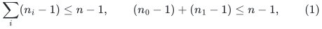
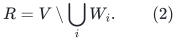
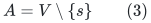
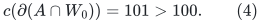

# The fixed-k guide-tree mincut interface: what has and has not closed

**Independent source audit, 25 October 2026.** This note preserves the
source-interface issue found during the construction audit. It is an
audit record, not a claim that a published final theorem is false.

**Resolution.** The issue is now bypassed by the new construction in
[deterministic-fixed-k-tree-mincut-adapter.md](deterministic-fixed-k-tree-mincut-adapter.md). Its global-max leaf
rule, one-child/two-child distinction, non-source target broadcasts,
and parameter-one set-mincut base establish correctness together with
the aggregate inventory. The independent check is
[fixed-k-global-max-leaf-independent-audit.md](fixed-k-global-max-leaf-independent-audit.md). The 7/8 Gomory--Hu
composition is therefore no longer conditional on this interface.
The text below records what motivated the repair and which source
steps were not silently reused.

The sources are:

* AKL+, [arXiv:2507.20354v1](https://arxiv.org/html/2507.20354v1),
  Section 5.1, Theorem 5.2 and its main/leaf recursive procedures.
* Zhang, [arXiv:2112.01042v1](https://arxiv.org/pdf/2112.01042),
  Sections 2.1--2.4, especially the source-arm contractions and the
  aggregate-instance recurrences.

The public theorem statements assert the desired reductions. The audit
below concerns whether their displayed constructive algorithms and
runtime dependencies can be imported together with a fully explicit
subpolynomial factor. An unresolved proof-interface issue is not by
itself a claim that the published final theorem is false.

## 1. The pruning randomness is easy to remove

The following part is closed. At a centroid <code class="math">c</code>, let the prunable
blocks be the off-source components <code class="math">T_1,\ldots,T_l</code>, together
with the forest <code class="math">F</code> attached at <code class="math">s</code> when the main procedure
includes it. No prunable block lies on the retained source-to-centroid
spine. Label these blocks by distinct bit strings.

For each bit position use both of its two classes as the retained
class, pruning all blocks in the other class. Also include the choice
that prunes every prunable block. This is <code class="math">O(\log n)</code> choices.
For any two distinct blocks, one choice retains the first and prunes
the second. For any one block, a choice prunes it while leaving the
unprunable source spine intact.

The random events used in the source correctness proof are listed
below. A cut-bearing block means a block incident to at least one of
the at most <code class="math">k</code> guide-tree cut edges of the cut under consideration.

| Procedure and target location | Event needed from pruning |
|---|---|
| Main procedure, target in <code class="math">F</code> | None: its extra lower-k call on <code class="math">F\cup\{s\}</code> handles cuts with another cut edge |
| Main procedure, target on the source arm <code class="math">T_0</code>, and another cut-bearing block exists | Prune one such off-arm block; the target stays on the unprunable arm |
| Main procedure, target in <code class="math">T_i</code>, and another <code class="math">T_j</code> or <code class="math">F</code> is cut-bearing | Retain <code class="math">T_i</code>, prune one such other block |
| Main procedure, target in <code class="math">T_i</code>, with all remaining cut edges on the source arm | None: the explicit lower-k or leaf call handles this case |
| Leaf procedure, target in the source arm, and an off-arm cut-bearing block exists | Prune one such block; retain the source arm automatically |
| Leaf procedure, target in <code class="math">T_i</code>, and another <code class="math">T_j</code> is cut-bearing | Retain <code class="math">T_i</code>, prune <code class="math">T_j</code> |
| Leaf procedure, the remaining source-arm/target-arm case | None: this uses the explicit lower-k call or the selected maximizer branch |

Pruning other blocks cannot introduce new guide-tree cut edges. It does
not delete the retained target or its path to the source. Thus the bit
family supplies every randomness event used in these cases.

A stronger fixed-k hit-and-miss family would also suffice, but is
unnecessary for this part. If such a family is used through a bound of
<code class="math">(a\log n)^{O(b)}</code> with <code class="math">a,b=O(k)</code>, its branching factor must
be recorded as <code class="math">\log^{O(k)}n</code>; one should not automatically reuse
the numerical <code class="math">\log^{3k}n</code> inventory exponent. Either version is
a fixed polynomial logarithm for fixed <code class="math">k</code>.

## 2. The public inventory calculation and its assumption

Zhang Section 2.4 gives aggregate vertex-inventory functions <code class="math">f_1</code>
and <code class="math">f_2</code> for the main and leaf procedures. The displayed
recurrences use

<!-- math-display: bc6885e956035bfd8fbd6ae6
\sum_i(n_i-1)\le n-1,
 \qquad (n_0-1)+(n_1-1)\le n-1,
 \tag{1}
-->

for the same-k main and leaf recursive children, respectively. Their
guide trees shrink by a fixed fraction. Allowing the extra contracted
root gives <code class="math">&#124;T_i&#124;\le 2&#124;T&#124;/3+O(1)</code>; after treating small trees as
base cases, one may use a uniform factor such as <code class="math">0.9</code>.

The same recurrences apply to original edges not incident to a
contracted vertex. Combining parallel edges, there are only
<code class="math">O(\log n)</code> contracted vertices on a same-k branch, so their
incident-edge inventory contributes another polynomial logarithm.
Under (1), the resulting total maxflow input size is
<code class="math">(m+n)\log^{O(k)}n</code>. Deterministic pruning preserves this argument
if the underlying contraction rules and (1) are both valid.

The important qualification is that (1) is not a consequence of a
centroid reducing the **terminal** count alone. A large set of Steiner
vertices can survive in two children even when their terminal sets are
disjoint. Its repeated processing must still be charged.

## 3. The AKL+ leaf contractions keep an uncovered region twice

Let <code class="math">W_i</code> be the disjoint isolating regions for the centroid
branches, with <code class="math">W_0</code> covering the source-side branch except <code class="math">s</code>.
Set

<!-- math-display: 924c258f05f6001a78a34c86
R=V\setminus\bigcup_iW_i.
 \tag{2}
-->

In the literal AKL+ leaf procedure, Step <code class="math">3^*</code> contracts
<code class="math">\bigcup_{i\ge1}W_i</code>, retaining both <code class="math">W_0</code> and <code class="math">R</code>.
Its selected Step <code class="math">5^*</code> branch contracts
<code class="math">\bigcup_{i\ne1}W_i</code>, retaining both <code class="math">W_1</code> and <code class="math">R</code>.
Thus the two children share the entire region <code class="math">R</code>, which may contain
arbitrarily many nonterminal vertices and internal edges. Their
uncontracted inventories need not satisfy the second inequality in
(1).

Merging the appropriate artificial contraction node with the centroid
can remove redundant parallel guide edges. That small repair does not
remove the duplicated region <code class="math">R</code>. Nor does simply observing that
the guide-tree terminal count halves account for its work.

## 4. The original source-arm contraction needs a correctness check

Zhang's leaf procedure instead forms its source-arm child by
contracting <code class="math">V\setminus W_0</code>. This does make its uncontracted
region <code class="math">W_0</code> disjoint from that of the selected outside child.
However, it identifies the source <code class="math">s</code> with the centroid <code class="math">c</code>.
A target cut that separates these two vertices cannot be preserved by
that identification without an additional argument.

The following elementary example shows that the particular uncrossing
inequality in the source-arm case cannot be used for every such cut.
Let the physical graph and guide tree be a long path, with <code class="math">s</code> an
endpoint, <code class="math">p</code> its neighbor, and <code class="math">c</code> an internal centroid. Give
<code class="math">sp</code> capacity 100 and every other path edge capacity one. Let the
source-arm region contain the vertices strictly between <code class="math">s</code> and
<code class="math">c</code>. Its isolating region <code class="math">W_0</code>, separating it from <code class="math">s,c</code>,
has capacity 101. The cut

<!-- math-display: 6730aff0167a019fc5de9894
A=V\setminus\{s\}
 \tag{3}
-->

has capacity 100, separates <code class="math">s</code> from <code class="math">p</code>, and crosses only the
guide edge <code class="math">sp</code>. Yet

<!-- math-display: b2e3aa089b42850813d70935
c(\partial(A\cap W_0))=101>100.
 \tag{4}
-->

The same issue is visible with every path capacity equal to one: the
two capacities in (4) are then two and one. The cut places both the
centroid and the target on the side opposite the source. Its union
with <code class="math">W_0</code> is not a feasible isolating cut for separating <code class="math">W_0</code>
from both <code class="math">s</code> and <code class="math">c</code>. Therefore isolating-cut minimality does
not supply the comparison invoked in that local argument.

This example identifies a local proof obstruction. It is not used here
to claim that every surrounding procedure or a different implementation
of the published theorem must fail. Other calls or an additional
invariant might supply the required answer, but that invariant has not
yet been established by this audit.

There is also a notation boundary in the main procedure: the source
defines a source-arm set in a way that appears to retain <code class="math">c</code>, while
also listing <code class="math">\{s,c\}</code> as a separate isolating terminal set. A
literal disjoint-block implementation must specify which endpoints are
excluded. Deleting a guide edge after a contraction can remove a cycle
without increasing the number of cut edges; it cannot repair a physical
contraction that identifies opposite sides of a cut.

## 5. The resolution and the alternatives it replaces

The first of the following routes has now been supplied:

1. A corrected main/leaf contraction construction that retains all
   required cuts and proves the aggregate same-k inventory bound.
2. A source-supported different fixed-k reduction with explicit total
   maxflow input size <code class="math">(m+n)\mathrm{polylog}n</code>.
3. A new amortization for the uncovered region <code class="math">R</code> that bounds its
   total processing despite overlap, with all additional oracle work
   below the target 7/8 envelope.

The global-max construction follows route 1. It chooses the full
source-arm child exactly when the remaining hard source-arm cuts
require it, and otherwise permits the restricted source-arm child
without duplicating the uncovered region. Its simultaneous correctness
and inventory proof is separate from the source variants discussed
above. Thus the complete application in
[gomory-hu-seven-eighths-dependency-audit.md](gomory-hu-seven-eighths-dependency-audit.md) no longer has this
conditional boundary. The strong forest, rooted multi-source forest,
packing, sparsifier, and guide construction also retain their separately
audited status.
