# A distance-decrease detector with frozen auxiliary barriers

**Research theorem candidate, 25 October 2026.** This note proposes a
modification of the detector in Yang P. Liu's *Incremental Shortest Paths
in Almost Linear Time via a Modified Interior Point Method*,
arXiv:2506.19207v1, Sections 2--3. The proposed change is to freeze an
auxiliary coordinate when it becomes dangerous, retain its flow and cost
as constants, and delete its positive barrier. This potentially removes
the minimum-ratio oracle's approximation factor from the *cumulative
reporting bound*. It does not remove that factor from the running time.

Primary source: <https://arxiv.org/html/2506.19207v1>.

The construction remains conditional on a correct raw-cycle and
flow-maintenance interface. In particular, it must support retirement
of a logical edge at its exact current value, not only insertion of
zero-flow edges. All claims below concern a single detector lifetime.
The separate outer-recursion note will account for rebuilding.

## 1. Input, numerical scope, and required oracle

Fix a global master size <code class="math">N=2^U\geq64</code>. Let <code class="math">1\leq M\leq N</code> bound the total number of actual ordinary edge records,
auxiliary copies, and vertex records that can be born during this
lifetime. Increasing this bound by a fixed constant to cover all these
categories is harmless. It is an accounting bound; no dummy vertices
or edges are allocated. The cost of this detector is proportional to
its local inventory allowance <code class="math">M</code>, while arithmetic uses the common
master precision <code class="math">U</code>. In particular, a small recursive graph is not
padded to size <code class="math">N</code>.

Here <code class="math">M</code> counts logical flow coordinates and their linear-size
degree-three port lift. It does **not** count the
<code class="math">M E^{O(1)}</code> internal flat-forest occurrences of the raw backend.
Those occurrences are charged only in running time and raw movement.
In particular, neither the potential coefficient <code class="math">AM</code> nor the
reporting bound below is enlarged by the flat-copy multiplicity.

The directed ordinary graph has a source <code class="math">s</code>. Every current vertex is
reachable from <code class="math">s</code>, and all current source distances lie in <code class="math">[1,2]</code>.
Ordinary edges have positive rational costs in <code class="math">[N^{-c},2]</code>, for a
fixed constant <code class="math">c</code>. Edges longer than 2 are irrelevant for this
normalized problem and may be omitted. All supplied costs share a
polynomial-bit grid. Vertices and ordinary edges can be inserted.

Each vertex <code class="math">v\ne s</code> receives one or more *auxiliary units*. Unit
<code class="math">j</code> belongs to a vertex <code class="math">v(j)</code>, has a fixed anchor cost
<code class="math">a_j\in[1,2]</code>, and stores an available source-to-vertex walk of cost
<code class="math">a_j</code>. Thus <code class="math">a_j\geq d(s,v(j))</code> whenever the unit is inserted,
and this remains true as ordinary edges are inserted. In the application,
all units belonging to one vertex during a phase have the same anchor.
New units may arrive later in the lifetime. Let

<!-- math-display: c6f24f5bed98bc9da9f645a9
b_v=|\{j:v(j)=v\}|,\qquad F=\sum_{j\text{ born}}a_j.
-->
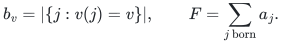

The full flow routes <code class="math">b_v</code> units to each <code class="math">v\ne s</code>, with balancing
source demand. It initially sends one unit on every auxiliary edge
<code class="math">j=(s,v(j))</code>, and zero on ordinary edges. A new auxiliary unit is
inserted at flow one. A new ordinary edge is inserted at flow zero.
These are explicit demand changes. All subsequent numerical changes
are exact circulations in the currently active graph.

Fix detector accuracy <code class="math">\sigma\in(0,1/100]</code>, a phase threshold
<code class="math">0&lt;\alpha\leq\sigma/10^6</code>, and assume
<code class="math">\alpha\geq N^{-1/100}</code>. The last condition is an eventual
parameter restriction for the growing-depth application, not a claim
for arbitrarily small <code class="math">\alpha</code>. Let

<!-- math-display: 8dae006fc24f4615665e8631
p=\lceil20U\rceil,\quad A=1000,\quad
K=\frac{\sigma}{100\alpha},\quad F_*=(1-\alpha)F.
\tag{1}
-->
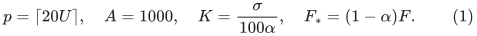

The oracle loss is <code class="math">\rho\geq1</code>, with numerical parameter
<code class="math">\beta=1/(C\rho)</code>, where <code class="math">C</code> is a sufficiently large absolute
constant. Assume <code class="math">\beta\geq N^{-1/100}</code> eventually. Its time,
flat-copy multiplicity, raw answer size, and notification factors are
bounded by a common factor <code class="math">E=N^{o(1)}</code>, with
<code class="math">\rho\leq E^{O(1)}</code>.

For current positive weights <code class="math">w</code> and signed gradient <code class="math">g</code>, the
interface must do one of the following after settlement:

* certify that every circulation has ratio greater than <code class="math">-1/4</code>; or
* return a circulation <code class="math">z</code>, together with an explicit unit-signed raw forest-path
  representation and its positive raw weighted length <code class="math">R</code>, such that
  <code class="math">\&#124;Wz\&#124;_1\leq R</code>, <code class="math">g^Tz\leq-\beta R</code>, and the representation
  can be applied at a dyadic scale <code class="math">\eta</code> with
  <code class="math">\eta R\in[\beta/(C_1p),2\beta/(C_1p)]</code>.

Constant-factor slack permits approximate prices and a common positive
rescaling of the gradient. The true guarantees just stated are what
the potential proof uses. They must be derived from the raw backend,
not from a ratio computed after cancellation. All logarithmic and
power terms below can be differentiated by rational arithmetic; the
algorithm need not evaluate logarithms.

## 2. Active and frozen coordinates

Let <code class="math">J</code> be the auxiliary units that are still active. For a frozen
unit <code class="math">j</code>, write <code class="math">z_j</code> for its immutable frozen flow. The full cost
is

<!-- math-display: 6c53a6282de2c0285f1ce88d
P=c^Tf_{\mathrm{ordinary}}+
  \sum_{j\in J}a_jf_j+
  \sum_{j\text{ frozen}}a_jz_j.
\tag{2}
-->
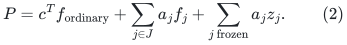

The last sum is an exactly maintained scalar offset. It is part of
the cost and the logarithmic gap throughout the detector lifetime.

The potential is

<!-- math-display: 8742e04430b42d894731dd72
\Phi(f)=AM\log(P-F_*)
-\sum_{e\text{ ordinary}}\log(f_e+\delta_e)
+\sum_{j\in J}V_p(f_j),
\tag{3}
-->
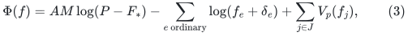
where

<!-- math-display: 8c30c5f10d27a065c0e6e25b
V_p(x)=\begin{cases}x^{-p}/p,&0<x\leq1,\\
1/p-\log x,&x\geq1.
\end{cases}
\tag{4}
-->
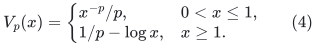

Set <code class="math">r=P-F_*</code>. On active coordinates define

<!-- math-display: 9eb364a9a83bfb33890f8580
w_e=(f_e+\delta_e)^{-1}\quad(e\text{ ordinary}),\qquad
w_j=-V_p'(f_j)\quad(j\in J),
-->
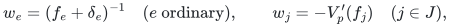
<!-- math-display: 0012489a3562056c03dc90ee
g=\frac{AM}{r}c-w.
\tag{5}
-->
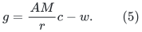

Initially <code class="math">\delta_e=\delta_0=N^{-B}</code>, where <code class="math">B</code> is a sufficiently
large fixed constant depending only on the input cost-bit envelope.
When an ordinary slack approaches <code class="math">\delta_0</code>, increase its
<code class="math">\delta_e</code> by <code class="math">\delta_0</code> and reprice it. Use two separated
thresholds, for example rearm below <code class="math">5\delta_0/4</code> and reset above
<code class="math">2\delta_0</code>, to charge each such event to a constant amount of
weighted absolute motion. This change lowers <code class="math">\Phi</code> and does not
change <code class="math">P</code>, <code class="math">F</code>, or the flow. The event and lifetime guards below
ensure <code class="math">\sum_e\delta_e\leq N^{-20}</code>. Any desired larger fixed
polynomial separation can be obtained by choosing <code class="math">B</code> larger.
An ordinary edge is born with slack <code class="math">\delta_0</code>, so its first
rearming event receives one constant birth credit. Only subsequent
rearming events are charged to separated-threshold motion.

### The freezing operation

Whenever an active auxiliary copy is reported by the stale-flow
maintenance structure as having weight at least <code class="math">K</code>, read its exact
current value and freeze it if its true weight is at least <code class="math">K/2</code>.
Set <code class="math">z_j=f_j</code>, move <code class="math">a_jf_j</code> to the constant offset in (2), and
retire the edge from the active raw graph. Its old coordinate value,
price, endpoint correspondence, and copy counters remain available
until all retirement callbacks are complete.

Because <code class="math">K/2&gt;1</code>, an edge frozen this way satisfies

<!-- math-display: 86b88b2fe7c363af9c024c8d
0<z_j<1.
\tag{6}
-->
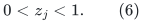

Thus no negative auxiliary flow and no auxiliary flow greater than one
is ever frozen. The active demand at <code class="math">v</code> becomes

<!-- math-display: 4fe06b207c3437a1343873f8
b_v-\sum_{j\text{ frozen},\ v(j)=v}z_j\geq0.
\tag{7}
-->
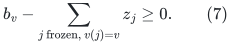

The operation does not change the *full* flow, its full divergence, or
its full cost. The remaining active flow has precisely the residual
demand (7). Future numerical increments are circulations on the
remaining active graph and preserve it.

The positive potential term <code class="math">V_p(z_j)</code> is deleted. No other term of
<code class="math">\Phi</code> changes. Freezing is therefore a potential decrease of
exactly <code class="math">V_p(z_j)</code>.

For a vertex <code class="math">v</code>, report it once all auxiliary units currently
belonging to it have been frozen. Reports are permanent for this
detector lifetime. New units belonging to an already reported vertex
may still be maintained, but do not cause a second vertex report.

## 3. Termination without an external min-cost-flow instance

Use the explicit stopping threshold

<!-- math-display: 88aa58fc866fc97808d9220f
P\leq(1-3\alpha/4)F.
\tag{8}
-->
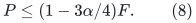

If a proposed complete numerical step would reach this threshold,
the detector may terminate before applying it. The proposed complete
flow is already known to preserve the full demand and all coordinate
lower bounds, so it is an existence certificate for the stopping
argument. No claim about the objective is evaluated between the
individual forest-path operations of a numerical transaction.

Let <code class="math">d(v)</code> be current true source distances. A shortest-path potential
has <code class="math">d(s)=0</code>, <code class="math">d(v)\in[1,2]</code>, and
<code class="math">c_e-(d(v)-d(u))\geq0</code> on every ordinary edge. This reduced cost is
at most 4, because ordinary costs are at most 2. Auxiliary edges also
have nonnegative reduced cost and nonnegative flow. Conservation gives

<!-- math-display: d8a8c65a938da66684c68b9f
P\geq\sum_v b_vd(v)-4\sum_e\delta_e.
\tag{9}
-->
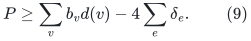

Choose the slack envelope so that
<code class="math">4\sum_e\delta_e\leq\alpha F/8</code>. Then (8) implies

<!-- math-display: 58d003b7811720c09d9ed0da
\sum_vb_vd(v)\leq(1-5\alpha/8)F<(1-\alpha/2)F.
\tag{10}
-->
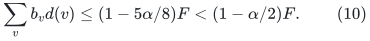

Thus termination is justified by a real decrease in the weighted
shortest-path objective. This removes the fixed-demand restriction
that would arise if the detector called a black-box incremental
min-cost-flow solver while vertices and demand units were being born.

At all settled nonterminal states,

<!-- math-display: 524343b8def9178fac356f34
r=P-F_*>\alpha F/4.
\tag{11}
-->
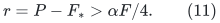

## 4. Why freezing preserves the strong comparison direction

Suppose <code class="math">P&gt;(1+5\alpha)F</code>. Construct a conceptual comparison flow
<code class="math">f^*</code> as follows.

* Keep each frozen unit at exactly <code class="math">z_j</code>.
* For every active auxiliary unit set <code class="math">f_j^*=\min\{f_j,1\}</code>.
* For each auxiliary unit, route its remaining amount
  <code class="math">1-z_j</code> or <code class="math">1-f_j^*</code> along a current ordinary shortest path to
  its owner.

All remaining amounts are nonnegative by (6). Consequently this is a
feasible full flow of the same demand, with nonnegative ordinary flow.
For each unit its fixed/active auxiliary portion uses cost <code class="math">a_j</code>,
while its remaining portion uses current distance at most <code class="math">a_j</code>.
Therefore

<!-- math-display: 769108d161b935ab08bf801e
c^Tf^*\leq\sum_j a_j=F.
\tag{12}
-->
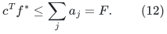

The difference <code class="math">\Delta=f^*-f</code> is an active-graph circulation: it is
zero on every frozen coordinate. For any ordinary edge, positivity of
<code class="math">f_e+\delta_e</code> and <code class="math">f_e^*\geq0</code> give

<!-- math-display: b239a7dc5658d55dee389b2d
-w_e\Delta_e\leq2-w_e|\Delta_e|.
-->
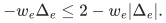

The same inequality holds for an active auxiliary edge. If <code class="math">f_j\leq1</code>
then <code class="math">\Delta_j=0</code>; if <code class="math">f_j&gt;1</code>, its weight is <code class="math">1/f_j</code>.
There are at most <code class="math">M</code> active coordinates. Combining with
<code class="math">(P-F)/(P-F_*)&gt;5/6</code>,

<!-- math-display: e8a362a2deb82230cdc59543
g^T\Delta\leq-\frac56 AM+2M-\|W\Delta\|_1
\leq-\|W\Delta\|_1.
\tag{13}
-->
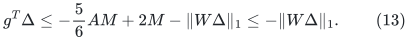

Thus a sound LOW certificate is impossible when
<code class="math">P&gt;(1+5\alpha)F</code>, even after arbitrarily many valid freezes.
At a settled LOW state,

<!-- math-display: dfaa013ba723af965d940afb
P\leq(1+5\alpha)F,\qquad r\leq6\alpha F.
\tag{14}
-->
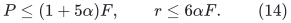

## 5. LOW still certifies all unreported vertices

The required potential follows from the following elementary argument;
no external circulation-duality theorem is needed here. Orient each
active edge <code class="math">e=(u,v)</code> and define <code class="math">(B\pi)_e=\pi(v)-\pi(u)</code>.

**Lemma 5.1 (circulation bound implies a vertex potential).** For positive
weights <code class="math">w_e</code> and <code class="math">\tau\geq0</code>, suppose every signed circulation
<code class="math">z</code> satisfies <code class="math">g^Tz\geq-\tau\sum_e w_e&#124;z_e&#124;</code>. Then there is a
vertex potential <code class="math">\pi</code> with

<!-- math-display: c6146cae0be29c0ee0cc6db8
|g_e-(\pi(v)-\pi(u))|\leq\tau w_e
\qquad\text{for every active edge }e=(u,v).
-->
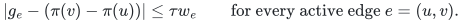

**Proof.** Replace each edge by two directed constraint arcs: <code class="math">u\to v</code>
has length <code class="math">g_e+\tau w_e</code> and <code class="math">v\to u</code> has length
<code class="math">-g_e+\tau w_e</code>. A negative directed closed walk would project to a
signed circulation <code class="math">z</code>. If <code class="math">L</code> is its sum of positive weights,
counting all traversals before cancellation, its length is
<code class="math">g^Tz+\tau L</code> and <code class="math">\sum_e w_e&#124;z_e&#124;\leq L</code>. Hence a negative
length would give <code class="math">g^Tz+\tau\sum_e w_e&#124;z_e&#124;&lt;0</code>, contradicting the
hypothesis. This also excludes a negative loop.

Add a new source with zero-length arcs to every vertex. There are no
negative closed walks, so finite shortest-path distances exist: removing
closed subwalks never increases a path length. Let <code class="math">\pi</code> be these
distances. The two arc inequalities give
<code class="math">g_e-\tau w_e\leq\pi(v)-\pi(u)\leq g_e+\tau w_e</code>, as required.
Conversely, summing the potential inequalities against any circulation
gives the assumed circulation bound because the vertex-potential term
telescopes. Thus the implication is exact. ∎

Apply the lemma with <code class="math">\tau=1/4</code> to a sound LOW statement. The
shortest paths above prove existence only; the detector does not compute
them or charge an unstated fast shortest-path subroutine.

Set <code class="math">\phi=(r/(AM))\pi</code> and normalize <code class="math">\phi(s)=0</code>. On every
ordinary edge and every remaining auxiliary edge,

<!-- math-display: 4cccc17b4b46387e675f5fea
\frac{3r}{4AM}w_e\leq c_e-(\phi(v)-\phi(u))
\leq\frac{5r}{4AM}w_e.
\tag{15}
-->
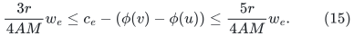

All ordinary edges remain present, so <code class="math">\phi(v)\leq d(s,v)</code> in the
current ordinary graph, regardless of which auxiliary edges were
frozen. If <code class="math">v</code> is unreported, it has at least one remaining auxiliary
copy <code class="math">j</code>. Settle all heavy-copy notifications before returning LOW.
With the stated constant-factor price accuracy, such a remaining
copy has true weight less than <code class="math">2K</code>. Equations (14)--(15),
<code class="math">F\leq2M</code>, and (1) imply

<!-- math-display: 31f7f4a2490b8cf2ab7c2d69
a_j-d(s,v)\leq a_j-\phi(v)
\leq\frac{12\alpha F}{AM}\,2K
\leq\frac{48\alpha K}{A}<\sigma.
\tag{16}
-->
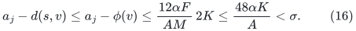

Since <code class="math">a_j\geq1</code>, this gives
<code class="math">d(s,v)\geq(1-\sigma)a_j</code>. When all units of <code class="math">v</code> use one anchor,
this is exactly the required per-vertex certificate.

The argument uses only *one remaining auxiliary copy*. It does not
require a dual constraint on a frozen copy. When a vertex's distance
has genuinely decreased, all of its remaining copies must therefore
be removed before a sound LOW state can be returned.

## 6. Potential accounting and a reporting bound independent of rho

At initialization <code class="math">P=F</code>, all auxiliary flows are one, ordinary flows
are zero, and <code class="math">&#124;\Phi&#124;=O(MU)</code>. An ordinary-edge insertion adds
<code class="math">-\log\delta_0=O(U)</code>.

Inserting an auxiliary unit of anchor <code class="math">a\in[1,2]</code> adds <code class="math">a</code> to
both <code class="math">P</code> and <code class="math">F</code>, hence adds <code class="math">\alpha a</code> to <code class="math">r</code>. By (11),
its potential increase is at most

<!-- math-display: fd3a3f8597965c43f6415b59
AM\log(1+\alpha a/r)+1/p
\leq4AM\,a/F+1/p.
\tag{17}
-->
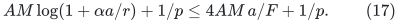

As <code class="math">F</code> grows by these same anchors, the sum of <code class="math">a/F</code> is
<code class="math">O(U)</code>. The empty case is skipped until the first unit is
born. Therefore the *total positive potential injection* from all
births is <code class="math">O(MU)</code>. Rearming ordinary slacks lowers the
potential; freezing lowers it; accepted numerical steps lower it.

For completeness, the potential has a polynomial-state lower bound.
Ordinary negative flow contributes at most
<code class="math">2\sum_e\delta_e</code> negative cost. Because all costs are at least
<code class="math">N^{-c}</code>, any nonnegative coordinate is at most
<code class="math">N^c(P+1)</code>. If <code class="math">P</code> is large, the positive term
<code class="math">AM\log(P-F_*)</code> dominates the at most <code class="math">M</code> negative logarithmic
barrier terms. The upper bound on <code class="math">\Phi</code> consequently gives
<code class="math">P\leq N^{C_2}</code> for one fixed constant <code class="math">C_2</code>. Together with
(11), this proves

<!-- math-display: febc8c1bc439642e2be8ee9c
\Phi\geq-C_3MU
\tag{18}
-->
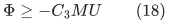

for another fixed constant. This proof does not count a frozen barrier
in the potential. Thus deleting such a barrier does not invalidate
the lower bound.

At a freeze, <code class="math">w_j\geq K/2&gt;1</code>, so

<!-- math-display: d0c73d6a65dcd96b57e4bca6
V_p(z_j)=\frac{w_j^{p/(p+1)}}p
\geq\frac{(K/2)^{p/(p+1)}}p
=\Omega(K/p).
\tag{19}
-->
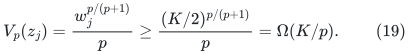

The last equality uses <code class="math">p\geq\log K</code>, which follows from the
parameter range in Section 1. Potential injections, (18), and the
nonnegativity of every other accounted decrease now give

<!-- math-display: 0f0b7edeb7c3d86f74e419af
\#\{\text{frozen auxiliary copies}\}
\leq O\!\left(\frac{MpU}{K}\right)
=O\!\left(\frac{\alpha M U^2}{\sigma}\right).
\tag{20}
-->
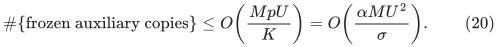

There is **no factor involving <code class="math">\rho</code>, <code class="math">\beta^{-1}</code>, or <code class="math">E</code>**
in (20). This is the proposed improvement over charging each dangerous
copy to the total numerical motion.

The argument does not assert that every true decrease in the weighted
distance sum forces immediate termination. A detector may continue
after that condition becomes true. It must only terminate soundly,
return sound nonterminal certificates, and obey (20). Frozen auxiliary
flow can delay termination without violating any of these properties.

## 7. Why each numerical step and the total work remain controlled

The piecewise barrier (4) is continuously differentiable. On a step
whose raw weighted motion is at most <code class="math">1/(C_1p)</code>, its second-order
remainder is at most a constant times
<code class="math">p\&#124;W\eta z\&#124;_1^2</code>; ordinary logarithmic barriers satisfy the same
bound with a smaller constant. Concavity bounds the global
<code class="math">AM\log r</code> term by its first-order change whenever the final gap is
positive. Consequently the oracle guarantees in Section 1 imply

<!-- math-display: ee305ee26fefeeada2b3a37c
\Phi(f+\eta z)-\Phi(f)\leq-\Omega(\beta^2/p).
\tag{21}
-->
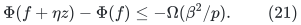

If the proposed final gap is too small, Section 3 terminates the
detector instead. Coordinate positivity holds even during the raw
forest-path transaction, since every partial coordinate change is
bounded by the full raw weighted motion. The global affine cost and
the potential are read only after the transaction is complete.

By the same potential budget, the number of accepted steps is

<!-- math-display: 7450ab808b9b914d69116404
T=O(Mp\beta^{-2}U)=M E^{O(1)}\mathrm{poly}(U).
\tag{22}
-->
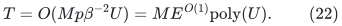

Total raw motion is at most <code class="math">O(T\beta/p)</code>. Together with one
constant birth credit per ordinary edge, this pays all separated
ordinary-slack rearming events. For sufficiently large master <code class="math">N</code>, the
total event count is polynomial in <code class="math">N</code>; choosing <code class="math">B</code> larger
than that fixed horizon keeps <code class="math">\sum_e\delta_e\leq N^{-20}</code>.
This is an acyclic guard: fix the polynomial event horizon first,
then choose the slack exponent. Rearm counters are not reset by
representation changes.

Maintain an anchor <code class="math">\widehat r</code> within relative <code class="math">O(\beta)</code> of
<code class="math">r</code>, and flow anchors accurately enough that every weight changes
by only <code class="math">O(\beta)</code> between refreshes. For auxiliary powers this
requires relative flow accuracy <code class="math">O(\beta/p)</code>. The scaled-gradient
identity

<!-- math-display: 9197b16941135890c7666006
\widehat g-\frac r{\widehat r}g
=\frac r{\widehat r}w-\widehat w
\tag{23}
-->
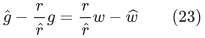

pays for the global cost term without requiring an additive bound on
its potentially large coordinates.

A numerical step with negative gradient has positive relative gap
increase at most <code class="math">O(\beta/(Mp))</code>. Auxiliary births contribute a
total <code class="math">O(U)</code> positive logarithmic increase by (17).
The polynomial upper/lower gap bounds imply that the total negative
logarithmic variation is at most the total positive variation plus
<code class="math">O(U)</code>. Hence full gradient repricing occurs at most
<code class="math">E^{O(1)}\mathrm{poly}(U)</code> times. Each such pass costs
<code class="math">M E^{O(1)}</code>, within the lifetime work bound.

All remaining coordinate refreshes, exact point reads, auxiliary
retirements, and edge births are charged by the raw flow-maintenance
interface. The detector's total time is therefore

<!-- math-display: 23893b399f20d2c5d87c4197
M E^{O(1)}\mathrm{poly}(U).
\tag{24}
-->
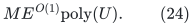

Power evaluation at integer exponent <code class="math">p=O(U)</code> uses polynomially
many bits. Stored prices are rounded to a common integer scale after
evaluation. Their *values* remain polynomially bounded: the potential
bound prevents an active auxiliary flow from becoming so small that
<code class="math">f^{-p}</code> exceeds a fixed polynomial; ordinary slacks are rearmed.
The backend must pay the resulting exact arithmetic or a proved
relative-rounding implementation. No irrational comparisons are
required by (1), (8), the freezing rule, or the update rules.

### 7.1 A common-grid implementation of this particular detector

Here is a more explicit finite-arithmetic choice. Take the master
<code class="math">N=2^U</code>; let costs and anchors have a common dyadic denominator at
most <code class="math">N^{c_0}</code>. Round <code class="math">\alpha</code>, <code class="math">\sigma</code>, and <code class="math">\beta</code> down
to powers of two within fixed constant factors, and retain the slack
in the numerical inequalities above. The power <code class="math">p</code> is an integer.

The potential upper/lower argument gives fixed constants bounding
<code class="math">&#124;f_e&#124;</code>, <code class="math">r^{-1}</code>, <code class="math">w_e</code>, <code class="math">w_e^{-1}</code>, and <code class="math">&#124;g_e&#124;</code> by
polynomials in <code class="math">N</code>, while the ordinary-slack rule bounds all its
negative excursions. These constants may depend on the fixed input
bit envelope and slack exponent, but not on the input size or on a
recursion level. The auxiliary upper-weight bound follows directly
from <code class="math">V_p(f)=f^{-p}/p</code> and the potential budget, so it is still
polynomial when <code class="math">p=\Theta(U)</code>.

Choose one price scale <code class="math">H=N^{C_H}</code> larger than these fixed exponents.
After evaluating the rational weights and gradients at their anchors,
send the raw backend
<code class="math">\ell_e=\lceil H\widehat w_e\rceil</code> and
<code class="math">\gamma_e=\mathrm{round}(H\widehat g_e)</code>.
The rounding error is at most <code class="math">1/H</code>, which can be made less than
<code class="math">\beta w_e/10^6</code> uniformly. The exported integers still have
<code class="math">O(U)</code> bits. The exact evaluation of a power at exponent <code class="math">p</code>
can use <code class="math">O(U^2)</code>-bit temporary integers; their polynomial bit cost
is paid locally and is not an exported edge-label magnitude.

The raw backend supplies at most <code class="math">E^{O(1)}</code> **unit signed** physical-edge
or forest-path pieces in a flat forest of at most <code class="math">M E^{O(1)}</code> records.
Each piece contributes coefficients <code class="math">+1</code> or <code class="math">-1</code> along its traversals,
as explicitly required by the [cycle-to-detector interface](raw-cycle-to-frozen-detector-bridge.md#1-imported-contract-and-master-sizes).
An arbitrary rational-coefficient circulation would not justify the common
flow grid below. With polynomially bounded
root integer prices, its complete raw integer denominator satisfies
<code class="math">1\leq V\leq N^{C_V}</code> for one fixed constant <code class="math">C_V</code>. The usual
degree-three port lift puts zero gradient and sufficiently negligible
priced length on connectors; its linear-size physical port records
and their retired lifetimes are included in the logical allowance.
Internal raw-forest copies are instead paid by <code class="math">E^{O(1)}</code>, without
enlarging the potential or reporting count. Logical raw weighted
motion is bounded by a fixed multiple of <code class="math">V/H</code>.

Choose a power-of-two step <code class="math">\eta</code> by integer comparisons so that
<code class="math">\eta V/H</code> is between two fixed constant multiples of
<code class="math">\beta/p</code>. Since <code class="math">\beta\geq N^{-1/100}</code>, this step has
<code class="math">\eta\geq N^{-C_\eta}</code> for one fixed constant. Taking a common
flow grid <code class="math">N^{-C_f}</code>, with fixed
<code class="math">C_f&gt;\max\{B,C_\eta+c_0+10\}</code>, makes
every accepted step an exact grid circulation. All initial values,
ordinary slack offsets, and auxiliary frozen values lie on that grid.
No coordinatewise rounding of a circulation is performed.

The maintained cost, frozen-cost offset, <code class="math">F</code>, and the affine gap
<code class="math">r</code> then have one fixed polynomial-bit dyadic denominator. Their
tests are exact. A frozen edge is retired only after its exact grid
value has been read and its cost moved to the offset. A point check
of the auxiliary threshold evaluates a positive integer power and
uses cross multiplication. It does not approximate a logarithm or
an irrational root.

All price refreshes and affine-cost reads are postponed until a
numerical transaction settles. An intermediate forest-path update
need not preserve the final circulation or keep the *affine cost gap*
positive. The individual coordinate barriers remain positive by raw
absolute-motion control, and the complete proposed update either
passes the positive final-gap test or triggers sound termination.
The Taylor/concavity proof is applied to the straight segment between
the two complete flows, where a positive final gap is enough.

## 8. Degree-weighted units and vertex birth

For an arbitrary directed parent graph, assign

<!-- math-display: 86c99c9456d7cfa95d4325de
b_v=1+\deg_{\mathrm{in}}(v)+\deg_{\mathrm{out}}(v)
\qquad(v\ne s).
\tag{25}
-->
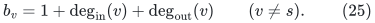

Implement this with separate auxiliary copies, not a large integral
coefficient hidden in the running time. Each parent edge insertion
creates at most two new copies. A vertex birth creates its base copy.
All copies of a vertex share its current phase anchor. The source
itself is never a reported target.

At the moment <code class="math">v</code> is first reported, all its current copies have
been frozen. Different reported vertices own disjoint copies.
Therefore (20) implies

<!-- math-display: 86f2c37d27071829c00f01b4
\sum_{v\text{ reported}}
 \bigl(1+\deg_{\mathrm{in}}^{\mathrm{report}}(v)
          +\deg_{\mathrm{out}}^{\mathrm{report}}(v)\bigr)
\leq O\!\left(\frac{\alpha M U^2}{\sigma}\right).
\tag{26}
-->
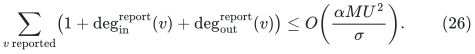

This pays both incoming edges and pending outgoing edges when a
reported vertex is inserted into a recursively maintained graph.
Edges born *after* that report are charged to their ordinary input
insertions. An outer child-size cap handles that separate category.

No bounded-degree assumption and no uncharged degree-reduction
gadget is used in (26). The normalized detector permits new demand
units because their potential injection was paid explicitly in (17).

## 9. Precise remaining review obligations

The mathematical proposal above still requires an independent audit of
its imported raw interface, finite-precision settlement, and its outer
recursive use. In particular:

* frozen values must remain immutable constants until a full phase
  restart, and their cost must remain in (2);
* a full restart runs Dijkstra, rebuilds phase anchors, reinitializes
  unit auxiliary flows, and pays a new <code class="math">O(MU)</code> potential
  budget; no freeze credit is transferred across that restart;
* each LOW answer is issued only after all refreshes, freezes,
  retirements, and demand bookkeeping have settled;
* the right-hand side of (20) counts cumulative frozen copies, not
  only the copies currently deleted;
* arbitrary fresh edge insertions into already reported vertices
  need the separate outer accounting stated after (26).

The note makes no claim about decremental SSSP, negative input lengths,
or a path-query bound proportional to a loop-erased output's length.
