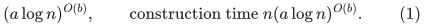
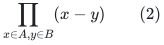
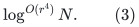
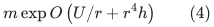
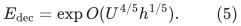
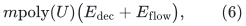
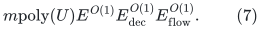

# Quantified outer Gomory--Hu factors and the fixed-k resolution

**Source-interface audit, 25 October 2026.** This note separates the
quantitative public imports from the constructive fixed-parameter
guide-tree mincut interface. The latter is now supplied by the new
global-max leaf adapter in
[deterministic-fixed-k-tree-mincut-adapter.md](deterministic-fixed-k-tree-mincut-adapter.md), with separate
independent audits. The historical filename is retained so existing
checkpoint links remain valid.

Put <code class="math">U=\log(N+4)</code>, <code class="math">h=\log(U+4)</code>. Every graph below has actual
size at most polynomial in the original input bound <code class="math">N</code>. All work
bounds multiply actual sizes; the master parameter does not justify
padding a small recursive instance.

## 1. Hit-and-miss families have a fixed polynomial cost

Theorem 3.5 of
[AKL+, arXiv:2507.20354v1](https://arxiv.org/html/2507.20354v1)
states its precise dependency, citing CP24 Definition 4 and Theorem
3.1. For miss size <code class="math">a</code>, hit size <code class="math">b=O(1)</code>, and universe size
<code class="math">n</code>, the family size is

<!-- math-display: 57f6177c1b9e9cad67d8dbcb
(a\log n)^{O(b)},
 \qquad\text{construction time }n(a\log n)^{O(b)}.
 \tag{1}
-->

The Section 6 calls always use <code class="math">b=2</code> and
<code class="math">a=\widetilde O(\psi^{-1})</code>. Consequently their cost is a fixed
power of <code class="math">\psi^{-1}</code> and of <code class="math">U</code>. There is no additional
unspecified subpolynomial factor from this component.

One can also replace this import by an elementary construction when
only a fixed hit size is needed. Enumerate sufficiently many small
primes <code class="math">p</code>, and for every subset <code class="math">R\subseteq\mathbb Z_p</code> of
size at most <code class="math">b</code>, use the function
<code class="math">x\mapsto 1[x\bmod p\in R]</code>. For fixed disjoint sets <code class="math">A,B</code>,
the nonzero integer

<!-- math-display: f8a1484c4c128078cf9214cc
\prod_{x\in A,y\in B}(x-y)
 \tag{2}
-->

has at most <code class="math">ab\log_2 n</code> distinct prime divisors. Among more than
that many primes, one makes every residue of <code class="math">B</code> distinct from
every residue of <code class="math">A</code>. Choosing <code class="math">R=B\bmod p</code> separates them.
The standard polynomial bound on the first <code class="math">O(ab\log n)</code> primes,
and a deterministic sieve, give family size and time
<code class="math">(a\log n)^{O(b+1)}</code> and
<code class="math">n(a\log n)^{O(b+1)}</code>, respectively. For <code class="math">b=2</code>, these are still
the required fixed polynomial bounds. Empty hit sets are covered by
the zero function.

## 2. Weighted expander decomposition has a uniform parameter

AKL+ Appendix A quotes a fixed-constant accuracy statement and then
uses a vanishing accuracy. To avoid any uncertainty from that wording,
use the original uniform formulation of Li--Saranurak,
[arXiv:2106.01567](https://arxiv.org/pdf/2106.01567), Theorem 2.4 and
Corollary 2.5. The parameter <code class="math">r\ge1</code> is an explicit input. Its
weighted balanced-cut/prune quality is

<!-- math-display: a75a09202329e12254728891
\log^{O(r^4)}N.
 \tag{3}
-->

The stated time is <code class="math">m(mW)^{O(1/r)}</code>, up to logarithms. For a
conservative construction-level estimate, retain also the factors
visible in the proof: its spectral routine has
<code class="math">\log^{O(r^2)}N</code> overhead, and its recursive j-tree work has
<code class="math">\log^{O(r)}(NW)</code> overhead. Neither factor is iterated through a
second growing-depth application. A sufficient uniform bound is

<!-- math-display: 4c674425d28265a2d8bdee65
m\exp O\left(U/r+r^4h\right)
 \tag{4}
-->

for polynomial external weights and demands. The internal capacity
ratios may grow by <code class="math">N^{O(r)}</code>, as explicitly bounded in the proof
of its Theorem 2.14. This uses <code class="math">O(rU)</code> numerical bits and only
polynomial logarithmic arithmetic factors, consistent with (4).

Take <code class="math">r=\Theta((U/h)^{1/5})</code>, rounded to an integer. Both the
work factor and cut-quality factor are bounded by

<!-- math-display: 06fa10f944109e6779e44591
E_{\rm dec}=\exp O(U^{4/5}h^{1/5}).
 \tag{5}
-->

The weaker <code class="math">\exp O(U^{4/5}h^{O(1)})</code> envelope is enough for the
7/8 composition.

For completeness, arbitrary positive target expansion <code class="math">\phi</code> is
compatible with the primitive's normalization <code class="math">\psi\le1</code>. Set
<code class="math">\beta=\max\{1,\phi\}</code>, multiply every nonzero demand by
<code class="math">\beta</code>, and use target <code class="math">\psi=\phi/\beta</code>. The resulting
inequality is exactly the desired <code class="math">\phi</code>-expansion for the original
demands. Recursively applying the balanced-cut/prune primitive gives
the needed decomposition with only a logarithmic factor in its quality
and total actual instance inventory. Demands and capacities remain
polynomially bounded at the external interface. This route does not
need to substitute a parameter outside the range of a fixed-constant
statement.

## 3. The flow-linked refinement in AKL+ Appendix A

The remainder of that appendix uses the preceding decomposition and
exact maxflow on linear-size graphs, followed by recursive calls on
vertex-disjoint induced graphs. Its recursion depth is
<code class="math">O(\log(nW))</code>. Hence its total actual edge inventory is
<code class="math">m\mathrm{poly}(U)</code>.

Choose all displayed approximation envelopes as powers of two. The
target <code class="math">\phi</code> used in Section 6 can also be chosen dyadic. The
auxiliary flow capacities have common factors such as
<code class="math">1/(12\alpha)</code> and <code class="math">\phi/2</code>. Multiplication by one common
polynomially bounded denominator converts each flow call to positive
polynomially bounded integer capacities. There is no accumulation of
unrelated denominators across recursive calls.

With a deterministic exact-flow factor
<code class="math">E_{\rm flow}=\exp O(U^{4/5}h^{O(1)})</code>, the refinement costs

<!-- math-display: ac1dcf6cf9804a7a500b0d43
m\mathrm{poly}(U)
             \bigl(E_{\rm dec}+E_{\rm flow}\bigr),
 \tag{6}
-->

and its source/sink routing guarantee loses only an additional
polynomial logarithm. Both its work and its structural factor therefore
have leading logarithmic power at most <code class="math">4/5</code>.

This paragraph uses the correctness of the public flow-linked
refinement as an imported lemma. The quantitative substitution has been
checked independently: it does not silently use a more expensive
maxflow black box or multiply construction work once per recursion
level in the exponent.

## 4. The terminal-selection loops have bounded fixed nesting

AKL+ Section 6 defines <code class="math">\psi^{-1}</code> as a fixed power of its
expander factor and logarithms. The displayed loops in DetectCC,
DecompFirstStep, and DecompSecondStep have counts polynomial in
<code class="math">\psi^{-1}</code> and <code class="math">U</code>. Their hit-and-miss families are covered by
Section 1. Every isolating-cut invocation reduces to exact maxflow on
graphs of total size <code class="math">m\mathrm{poly}(U)</code>.

Full SSMC makes <code class="math">O(\log(nW))</code> calls to partial SSMC. A call to
GHTreeStep performs a polynomial logarithmic number of the preceding
selection and decomposition operations. None of these levels has depth
growing as <code class="math">\psi^{-1}</code> with a recursively multiplied oracle work
factor. They are finite nested loops with fixed nesting depth.

Consequently, using the partial-SSMC implementation assembled from the
audited guide construction and the new fixed-k adapter, the complete
GHTreeStep work is

<!-- math-display: 4dab9b697b9827167863cbc5
m\mathrm{poly}(U)E^{O(1)}
       E_{\rm dec}^{O(1)}E_{\rm flow}^{O(1)}.
 \tag{7}
-->

## 5. The final recursive inventory

AKL+ Lemma 6.32 gives total vertex and edge inventories
<code class="math">O(dn)</code> and <code class="math">O(dm+dn\log n)</code>, respectively, for recursion
depth <code class="math">d</code>. The terminal sets shrink by a fixed fraction, so
<code class="math">d=O(\log n)</code>. Combining this bound with (7), using actual local
sizes and a common monotone upper envelope for their factors, adds only
a polynomial logarithm.

The term <code class="math">n\log n</code> is harmless on a connected nontrivial input,
where <code class="math">n\le m+1</code>. General inputs are first divided into connected
components and isolated vertices, so their additional processing and
output cost is <code class="math">O(n+m)</code>.

## 6. Resolution of the fixed-parameter mincut interface

The fixed-parameter guide-tree mincut reduction connects the guide
family to partial SSMC. AKL+ Theorem 5.2 states a
deterministic almost-linear bound and refers its runtime analysis to
Zhang,
[arXiv:2112.01042](https://arxiv.org/pdf/2112.01042), Section 2.4.
Zhang's displayed recurrences give polylogarithmic aggregate maxflow
inventory for fixed respect parameter. However, the two papers' source
arm contractions are not identical. Some literal variants preserve
correctness but duplicate an uncovered Steiner region between two
same-parameter recursive calls; other literal variants restore the
inventory inequality while requiring an additional correctness
argument for a cut that separates the two ends of the source arm.

The audit therefore does not transfer the inventory bound by assertion.
Instead, [deterministic-fixed-k-tree-mincut-adapter.md](deterministic-fixed-k-tree-mincut-adapter.md) supplies a
modified construction. After all lower-k calls, its leaf routine
maximizes the candidate value over every non-source, non-centroid guide
target, including the source arm. A source-arm maximizer gets one full
child; an outside maximizer gets two children with disjoint
uncontracted regions. The proof establishes both the required cut
cases and <code class="math">\sum_i(n_i-1)\le n-1</code>. Correct contracted-target
broadcasts and a set-mincut parameter-one base complete the interface.

The resulting aggregate maxflow input size is
<code class="math">(m+n)\log^{O(k+1)}n</code>. For the fixed <code class="math">k=16</code>, it multiplies
the exact-flow factor by only a fixed polynomial logarithm. This new
construction is independently checked in
[fixed-k-global-max-leaf-independent-audit.md](fixed-k-global-max-leaf-independent-audit.md). It closes the earlier
conditional boundary and, together with the preceding factors,
completes the explicit 7/8 Gomory--Hu proof assembly.
