# A quantified Gomory--Hu transfer of the strong forest

**Research proof assembly, 25 October 2026.** This note completes the
application interfaces that are deliberately kept separate in
[separated-metric-forest-and-strong-sssp.md](separated-metric-forest-and-strong-sssp.md). It uses a strong
decremental forest with overhead

<!-- math-display: 775874dc16e8f8b81d8f2780
E(N)=\exp O\bigl((\log(N+4))^{7/8}
                         (\log\log(N+16))^{1/8}\bigr).
 \tag{1}
-->
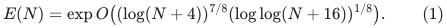

The resulting research theorem is a deterministic exact Gomory--Hu tree
for a general undirected graph with polynomially bounded positive integer
capacities, in

<!-- math-display: bf4eeaa8415e3425903de012
O(n+m)+(m+1)E(m+n).
 \tag{2}
-->
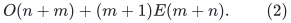

As usual, constants in the exponent absorb a fixed power of <code class="math">E</code>.
This is a proof assembly from named public constructions and the new
strong-forest construction, not an implemented or externally certified
algorithm. The public Gomory--Hu theorem already has almost-linear
running time. The proposed gain concerns its explicit subpolynomial
factor. The baseline comparison includes a public parameter retuning to
<code class="math">62/63</code>, rather than using only the printed <code class="math">83/84</code> forest
exponent.

**Construction status.** Sections 2--8, including the rooted forest,
degree adapters, terminal sparsifier, finite arithmetic, and Li
skeleton, have independent construction audits. The remaining
fixed-parameter mincut interface is now supplied by the new global-max
leaf construction in [deterministic-fixed-k-tree-mincut-adapter.md](deterministic-fixed-k-tree-mincut-adapter.md).
Its correctness and aggregate inventory have separate independent
audits. Thus no unresolved application interface remains in (2), beyond
the explicitly named component constructions in the strong-forest
proof. This status is a completed mathematical proof assembly, not an
external certification of a newly established research theorem.

The construction here avoids a physical zero-length super-source. It
also avoids feeding an arbitrary long rational expansion into the
shortest-path oracle. Both distinctions matter to the claimed bound.

## 1. The application dependency chain

Write AKL+ for Abboud, Kyng, Li, Panigrahi, Probst Gutenberg, Saranurak,
W. Yuan, and W. Yuan,
[*Deterministic Almost-Linear-Time Gomory-Hu Trees*](https://arxiv.org/html/2507.20354v1).
The public components used are identified below, rather than treated as
one unspecified <code class="math">m^{1+o(1)}</code> black box.

| Component | Source location | Cost charged here |
|---|---|---|
| Implicit Steiner packing and terminal sparsifier | AKL+ Section 4.1 and its augmented dynamic trees in Section 4.2 | A fixed power of the strong-forest overhead, times the input size and a polynomial logarithm |
| Deterministic unweighted skeleton | Li, arXiv:2106.05513v2, Theorem 1.5 and Sections 3.4--3.5; AKL+ Theorem 4.22 uses an earlier version | <code class="math">F_L=\exp O(U^{5/6}h^{O(1)})</code> in both work and reciprocal skeleton scale |
| Tree packing | AKL+ Theorem 4.23 | <code class="math">\widetilde O(m_H\lambda_H)</code>, with <code class="math">\lambda_H\le F_L</code> at constant accuracy |
| Mincuts respected by one guide tree | New global-max leaf adapter in [deterministic-fixed-k-tree-mincut-adapter.md](deterministic-fixed-k-tree-mincut-adapter.md), using the public centroid framework | A fixed polynomial logarithm times deterministic exact maxflow, with proved aggregate actual-instance inventory |
| Partial to full single-source mincuts | AKL+ Algorithm 8 | <code class="math">O(\log(nW))</code> partial calls |
| Terminal expander decomposition | AKL+ Appendix A | Work factor <code class="math">\exp O(U^{5/6}h^{O(1)})</code>; structural factor <code class="math">\exp O(U^{4/5}h^{O(1)})</code> |
| Terminal selection and cut decomposition | AKL+ Section 6 | Fixed powers of the preceding factors, of <code class="math">\psi^{-1}</code>, and of logarithms |
| Final Gomory--Hu recursion | AKL+ Lemma 6.32 and Claim 6.33 | Polylogarithmic total instance inventory |

Here <code class="math">U=\log(N+4)</code>, <code class="math">h=\log(U+4)</code>, and <code class="math">N</code> is a common
upper bound on the actual record inventories in the application. It is
polynomially related to the original input size. A small recursive call
is charged by its actual size, never padded to <code class="math">N</code>.

The deterministic exact maxflow used here comes from Theorem 6.17 of
van den Brand and coauthors,
[*Almost-Linear Time Algorithms for Decremental Graphs: Min-Cost Flow
and More via Duality*](https://arxiv.org/html/2407.10830v1).
Its printed leading logarithmic power <code class="math">5/6</code> already
fits below the forest overhead. The self-contained
[capacity-bit reduction](published-flow-capacity-scaling.md) applies that
theorem to small recursive graphs whose capacities are polynomial in the
original input size. Every solver call has capacities bounded by its own
actual edge count; no graph is padded to the original size. This
application therefore has no dependency on a four-fifths flow retuning.

## 2. A cut-preserving bounded-degree input for each packing call

The strong-forest proof requires bounded physical degree. A degree bound
on the initial Gomory--Hu input would not suffice, because subsequent
cut contractions create high-degree vertices. We therefore perform the
following linear-size expansion separately at the entrance to each
terminal-sparsifier or guide-packing call.

Let the current undirected graph be <code class="math">G=(V,E,c)</code>, with terminal set
<code class="math">S</code>. Work on its connected components; if distinct terminals lie in
different components, the zero terminal cuts are handled directly. For
each vertex <code class="math">v</code>, replace its <code class="math">d(v)</code> edge incidences by ports in a
path. Attach each original edge to its corresponding port. Connect
successive ports by edges of capacity

<!-- math-display: f95fe72cb45fdaa2a95fb9e3
C=1+\sum_{e\in E}c_e.
 \tag{3}
-->
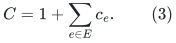

Use one permanent designated port <code class="math">q(v)</code> for each original vertex.
Degree-zero vertices receive an isolated designated node; degree-one
vertices need no connector. The resulting graph <code class="math">G^\circ</code> has
maximum degree three and <code class="math">O(n+m)</code> vertices and edges. Its capacities
remain positive polynomially bounded integers.

**Cut preservation.** Every original cut lifts by putting all ports of
a vertex on the same side. The lifted cut has the same capacity. Every
cut that splits a port path has capacity at least <code class="math">C</code>, whereas the
minimum cut separating any two original terminals has capacity at most
<code class="math">\sum_e c_e&lt;C</code>. Consequently,

<!-- math-display: 3549cf9aa7f0e2577465712b
\lambda_{G^\circ}(q(u),q(v))=\lambda_G(u,v)
 \quad (u,v\in S),\qquad
 \lambda_{G^\circ}(q(S))=\lambda_G(S).
 \tag{4}
-->
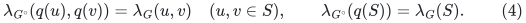

Run the terminal-sparsifier construction on
<code class="math">(G^\circ,q(S))</code>. Its output has only the designated terminals as
vertices. Rename them back to <code class="math">S</code>. Its lower terminal-cut guarantee
uses (4). Its upper bound for a cut <code class="math">X\subseteq V(G)</code> follows by
applying that guarantee to the whole-fiber lift of <code class="math">X</code>; the lift
has exactly <code class="math">c_G(\partial X)</code> capacity. Thus the output satisfies
the original terminal-sparsifier contract on the current general-degree
graph. The rest of the Gomory--Hu recursion can operate on its ordinary
unexpanded graphs.

This per-call expansion is intentional. No claim is made that a single
initial expansion keeps all recursively contracted inputs bounded in
degree. The public recursive inventory bound pays for the linear-size
expansion at every actual call.

All physical null contractions described below take place relative to
this bounded-degree <code class="math">G^\circ</code>, not relative to the original graph
whose degrees may be arbitrarily large.

## 3. The rooted multi-source and explicit-label interface

For a fixed nonempty terminal set <code class="math">S</code> in a connected positive-length
graph, the forest oracle used here maintains the following objects.

* A flat forest <code class="math">F</code> whose edges map to current physical edges.
* A permanent canonical node <code class="math">\iota(v)</code> for every physical vertex.
* A stable physical-image map for every auxiliary occurrence.
* An explicit upper distance estimate <code class="math">\widehat d(v)</code> satisfying
  <code class="math">d(v,S)\le\widehat d(v)\le(1+\epsilon_0)d(v,S)</code>.
* In the component of each source-reachable canonical vertex, exactly
  one **canonical** member of <code class="math">S</code>. The path to it has physical
  length at most <code class="math">(1+\epsilon_0)d(v,S)</code>.
* Total work, forest changes, vertex/edge occurrence congestion, and
  explicit distance-label changes at most <code class="math">mE^{O(1)}</code>.

Unreachable canonical vertices are retained as permanent isolated nodes.
An auxiliary alias of a source is not another canonical source.

The construction-level proof is
[multisource-rooted-approximate-ball-forest.md](multisource-rooted-approximate-ball-forest.md). It exposes BGS's
nested monotone ES candidates, selects the minimum label, and breaks a
tie in favor of the smallest distance scale. A positive dummy-source
shortcut cannot be selected: if it won, a smaller-scale candidate would
attain the same label. Every selected nonsource parent is therefore a
real positive-length original or hopset edge along which the global
selected label strictly decreases. This gives one source per finite
component. KMG's independent tree substitutions preserve that component
property while flattening the hopsets.

The explicit labels come from those candidate heaps. We do not obtain
them by recomputing all root-path lengths whenever a forest edge moves.
Every candidate-label or selected-parent change is already charged by
the approximate-ball construction, with an additional polynomial
logarithmic heap cost. This is essential: forest recourse by itself
would not bound the number of vertex-distance updates.

At the end of a settled update, both forest and label changes are
reported. Since the current physical graph is <code class="math">G^\circ</code> of degree
three, one changed label alters only a constant number of the helper
edge keys used in Section 5.

## 4. Length increases through fixed positive-length copies

We first give this adapter for positive integer target lengths in
<code class="math">[1,N^b]</code>, where <code class="math">b</code> is any fixed constant. Section 7 supplies
exactly this range to the application.

Fix a small constant <code class="math">\eta&gt;0</code>. Choose an integer <code class="math">D\ge4/\eta</code>,
put <code class="math">a_0=D</code>, and define

<!-- math-display: 349a723a41d2cd791b9583b0
a_{j+1}=a_j+\max\{1,\lfloor\eta a_j\rfloor\}.
 \tag{5}
-->
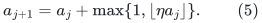

Continue until <code class="math">a_Q\ge DN^b(1+\eta)</code>. The ratio of consecutive
terms lies between <code class="math">1+\eta/2</code> and <code class="math">1+\eta</code>. Hence
<code class="math">Q=O(\eta^{-1}\log N)</code>, and every threshold is a polynomially
bounded integer.

For every physical edge <code class="math">e</code>, preallocate one edge copy at every
threshold <code class="math">a_j</code>. At current target length <code class="math">\ell_e</code>, retain
precisely the copies with <code class="math">a_j\ge D\ell_e</code>. Increasing
<code class="math">\ell_e</code> only deletes copies. The minimum live copy satisfies

<!-- math-display: 7d55dcafdd720f4ae05f3919
D\ell_e\le \min\{a_j:a_j\ge D\ell_e\}
                 \le(1+\eta)D\ell_e.
 \tag{6}
-->
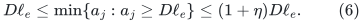

There are <code class="math">O(mQ)</code> copy deletions over the entire length-increase
sequence. A target update that crosses no threshold makes no structural
change. Locating its threshold costs a polynomial logarithm even when
the numerical update sequence is much longer than <code class="math">mQ</code>.

### 4.1 Fixed port trees restore degree three

The parallel copies would raise physical degree to <code class="math">O(Q)</code>. Replace
each physical vertex's copy incidences by a fixed balanced binary port
tree, retaining its root as the canonical representative <code class="math">q(v)</code>.
Every original copy attaches to a separate leaf. Give port-tree edges
length one, and give a real copy of threshold <code class="math">a_j</code> length
<code class="math">Ha_j</code>, where

<!-- math-display: 73349f880060e48c5c368161
H\ge c_0\eta^{-1}\log(Q+2)
 \tag{7}
-->
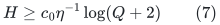

is an integer. The resulting graph has maximum degree three and actual
size <code class="math">O(mQ+n)</code>. Every length is a positive integer of polynomial
size. The fixed port trees are never deleted. Only real copies are
deleted.

Projecting a proxy walk to the physical graph discards its port edges
and maps a real copy to its physical edge. Consequently its proxy
length divided by <code class="math">HD</code> is at least the physical target length of
the projected walk. Conversely, lift a simple physical shortest path
using the cheapest live real copy at each edge and the corresponding
port-tree paths. The extra connector length per physical edge is
<code class="math">O(\log Q)</code>, and its real length is at least <code class="math">HD</code>. Equations
(6)--(7) therefore give, for canonical vertices,

<!-- math-display: 49675b80abba0dd02fd48307
d_G(u,v)\le \frac{d_{\rm proxy}(q(u),q(v))}{HD}
           \le(1+O(\eta))d_G(u,v).
 \tag{8}
-->
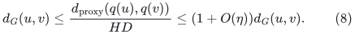

Apply the strong forest to this decremental proxy, with source set
<code class="math">q(S)</code> and a suitably smaller internal accuracy. Its explicit
labels divided by <code class="math">HD</code> give the estimates needed in Section 3.
The forest's real-copy edges project to physical edges. Its port edges
become typed true-null edges.

### 4.2 Projecting back without moving canonical nodes

Keep internal typed-null edges until the final physical projection.
Among proxy canonical vertices, only <code class="math">q(v)</code>, one for each physical
vertex <code class="math">v</code>, is a distinguished final canonical vertex. All other
proxy canonical vertices become ordinary auxiliary occurrences.

Every connected true-null component has one physical image and contains
at most one distinguished final canonical node. Contract that component,
choosing this node as its representative when it is present. Otherwise
use a deterministic auxiliary representative. When a component splits,
the piece containing a distinguished node keeps it. This is the
root-only null-quotient construction of the strong-forest proof.

An original edge has <code class="math">O(Q)</code> real-copy types, so simultaneous physical
edge and vertex occurrence counts increase by only a polynomial
logarithm. The current physical graph is the degree-three expansion of
Section 2. Rebuilding the incidences of an affected physical null fiber
therefore costs a fixed power of its occurrence bound, rather than an
unbounded original degree. All map changes, forest changes, and label
changes remain bounded by <code class="math">mE^{O(1)}</code>.

This also preserves the source-root property. Contracting existing null
edges cannot merge different forest components. There is still only one
distinguished canonical source in each relevant component.

## 5. A Steiner helper graph without a zero-source assumption

Use the multi-source forest of Section 3 directly. Give its edges
**helper length zero**, while retaining their positive physical lengths
in the augmented dynamic-tree records. Add, for every physical edge
<code class="math">e=uv</code>, a helper edge between <code class="math">\iota(u)</code> and <code class="math">\iota(v)</code>
with key

<!-- math-display: f7314889958aadb69d282a7f
\widehat d(u)+\ell_e+\widehat d(v).
 \tag{9}
-->
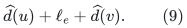

Let <code class="math">A</code> be this helper graph and <code class="math">M</code> a minimum spanning forest
of <code class="math">A</code>. A minimum spanning forest contains all zero-length edges of
<code class="math">F</code>: they are acyclic, and every additional helper edge has positive
key. After contracting each relevant component of <code class="math">F</code>, its
nonzero edges form a minimum spanning tree on the canonical sources.
Let <code class="math">M^S</code> be the minimal subtree connecting those canonical sources.

Here and below an auxiliary component containing no canonical physical
vertex may remain in the maintained forest. It has no role in <code class="math">M^S</code>
and does not affect the argument.

### 5.1 Helper cost versus the minimum Steiner cost

For any bipartition <code class="math">(B,S\setminus B)</code>, take a shortest physical
path between the two parts. Along this path, the forest's canonical
source assignment changes sides at some physical edge <code class="math">uv</code>.
For that edge, using the prefix to one endpoint terminal and the suffix
to the other gives

<!-- math-display: 08b9edebbdd95705067064e6
\widehat d(u)+\ell(uv)+\widehat d(v)
       \le (1+\epsilon_0)\mathrm{dist}_G(B,S\setminus B).
 \tag{10}
-->
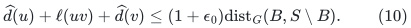

Thus the helper graph's minimum crossing key is no larger than the
corresponding metric-closure minimum crossing key times
<code class="math">1+\epsilon_0</code>. Equivalently, at each Kruskal threshold its terminal
components can only coalesce earlier than in that rescaled metric
closure. Integrating the component count, or applying the ordinary MST
cut-exchange argument, gives

<!-- math-display: 5ab031ae858b6941311921b9
\mathrm{key}(M^S)
 \le (1+\epsilon_0)\mathrm{MST}_{d_G}(S)
 \le 2(1+\epsilon_0)\mathrm{OPT}_{\rm Steiner}(G,S).
 \tag{11}
-->
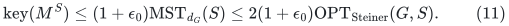

### 5.2 The physical cost of the maintained Steiner tree

For every nonzero helper edge, add the forest paths from its endpoints
to their unique canonical roots. Their physical length is at most
<code class="math">(1+\epsilon_0)(\widehat d(u)+\widehat d(v))</code>. The union of
these paths and the physical helper edges contains <code class="math">M^S</code>, possibly
counting some physical edges more than once. Therefore

<!-- math-display: 8fe66934da1a8b60dbe4402f
\mathrm{len}_{\rm physical}(M^S)
 \le(1+\epsilon_0)\mathrm{key}(M^S)
 \le(2+O(\epsilon_0))\mathrm{OPT}_{\rm Steiner}.
 \tag{12}
-->
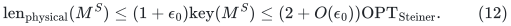

Its projection is an allowed physical multigraph. Its multiplicity on
each edge is at most the forest occurrence bound plus one. Choose an
integer cap <code class="math">\alpha</code> larger than that bound once for this packing
run.

This proof does not claim that a zero-length path between two aliases
of physical super-source neighbors has one edge. The exact rooted
component property replaces that unsupported inference.

## 6. Counts in the implicit packing

Fix a sufficiently small positive **constant** <code class="math">\epsilon</code>. Choose
<code class="math">\alpha</code> to be a power of two bounding all physical edge
multiplicities in the helper graph, with generous constant slack. Then
<code class="math">\alpha=E^{O(1)}</code> and <code class="math">\log\alpha=O(U^{7/8}h^{1/8})</code>.
At every packing iteration add

<!-- math-display: 88dcc56cabdc838c81640ec6
v=\frac{\min\{c_e:e\text{ occurs in }M^S\}}{\alpha}.
 \tag{13}
-->
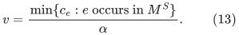

Every physical normalized load increases by at most one. At least one
minimum-capacity witness increases by at least <code class="math">1/\alpha</code>.
The monotone MWU potential bounds every edge's total normalized load by
<code class="math">O(\log(NW)/\epsilon^2)</code>. Hence the number of packing iterations is

<!-- math-display: e878f7f4fb1f206c615d399d
I\le m\alpha\mathrm{poly}(U).
 \tag{14}
-->
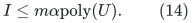

Store pending load separately on each helper occurrence, exactly as in
the public augmented-tree construction. Flush an occurrence when its
pending load reaches <code class="math">c_e/(C_1\alpha)</code>, with <code class="math">C_1</code> a sufficiently
large fixed constant. Charge a threshold flush to that much new physical
load. Thus there are at most
<code class="math">m\alpha\mathrm{poly}(U)</code> threshold flushes. An occurrence
retired by a forest or helper edit is also flushed, but that flush is
charged to the explicit deletion record rather than to a threshold.

Recomputing a physical price may require updating every current copy of
that physical edge. This costs <code class="math">\alpha</code> times a polynomial
logarithm. Paying this factor explicitly is harmless:
<code class="math">m\alpha^2\mathrm{poly}(U)</code> is still <code class="math">mE^{O(1)}</code>.

There is no uncharged feedback loop between retirement flushes and the
forest. The forest sees only deletions of the fixed geometric copies
from Section 4. Their total number is <code class="math">O(m\mathrm{poly}(U))</code>,
regardless of how adaptively the numerical prices are chosen. All
resulting forest recourse is already bounded by the decremental oracle.
An MST change changes the maintained <code class="math">M</code> and <code class="math">M^S</code>, but does not
by itself change the underlying graph <code class="math">A</code> or create a new physical
price. During a settled-update transaction, no new packing load is
inserted. Flushes merely move existing load from pending to flushed.

The helper keys also receive explicit updates whenever a canonical
distance label changes. By Section 3 and physical degree three, these
cost at most <code class="math">mE^{O(1)}</code>. The augmented dynamic trees, deterministic
dynamic MST, and Euler-tour sparsifier extraction then incur only fixed
polynomial logarithmic factors in their actual update counts.

The terminal sparsifier consequently has at most <code class="math">mE^{O(1)}</code> edges
and is constructed within the same bound. This accounting does not
replace all public <code class="math">m^{o(1)}</code> terms by <code class="math">E</code> without examining their
role: iteration count, copy count, label recourse, retirement flushes,
and dynamic-tree updates have each been charged separately.

## 7. Finite arithmetic on one common load grid

The most convenient implementation does not store a product such as
<code class="math">(1+\eta)^j</code> exactly. That product can have far more bits than its
numerical magnitude suggests.

### 7.1 Exact loads and bounded accumulators

All physical capacities are positive polynomially bounded integers.
Since <code class="math">\alpha</code> in (13) is a fixed power of two, every inserted load
lies on the common grid <code class="math">1/\alpha</code>. The Euler-tour terminal-edge
weights before final normalization lie on <code class="math">1/(2\alpha)</code>.
By (14), every accumulator numerator has
<code class="math">O(\log(IW)+\log\alpha)=O(U+\log\alpha)</code> bits. Dynamic-tree
lazy sums, pending loads, flush totals, and the packed output therefore
have polynomial logarithmic bit length.

Let

<!-- math-display: 265facc426cffbd7b89482c2
\delta=2^{-b},\qquad
 b=\left\lceil C_2\log_2(2N)/\epsilon\right\rceil,
 \tag{15}
-->
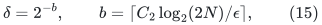

where <code class="math">C_2</code> is a sufficiently large absolute constant. Since
<code class="math">\epsilon</code> is fixed for this application, <code class="math">\delta=N^{-O(1)}</code>.
For analysis, if <code class="math">L_e</code> is the exact total physical load already
inserted, define the conceptual price

<!-- math-display: 23f41c187509027b7f3c90f3
Q_e=\frac{\delta}{c_e}
                    \exp(\epsilon L_e/c_e).
 \tag{16}
-->
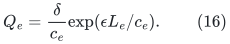

Only the exact flushed total <code class="math">A_e\le L_e</code> is used to recompute the
stored price. Per-occurrence thresholds and the multiplicity cap keep
<code class="math">L_e-A_e\le C_3c_e</code> for a sufficiently small fixed <code class="math">C_3</code>, apart
from the bounded one-step overshoot processed atomically. Thus the
flushed conceptual price and <code class="math">Q_e</code> differ by <code class="math">e^{O(\epsilon)}</code>.

### 7.2 Certified exponential approximations with no drift

Choose one global dyadic quantum

<!-- math-display: 52c062cfab270a01bf3299a5
0<g\le\frac{\epsilon\delta}{C_4 W},
     \qquad \log(1/g)=O(U),
 \tag{17}
-->
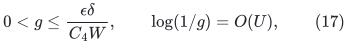

where <code class="math">W</code> bounds capacities of the current degree-three input.
At a flush, compute a certified upper approximation to
<code class="math">(\delta/c_e)\exp(\epsilon A_e/c_e)</code>, with additive error at
most a fixed multiple of <code class="math">g</code>, expressed on the grid <code class="math">g</code>.
Set the stored price to the maximum of its old value and this new
upper approximation.

Because <code class="math">A_e</code> is nondecreasing, the maximum operation preserves the
same upper-error bound. It also makes the stored price monotone. There
is no multiplication of old approximation errors: each value is
recomputed from the exact cumulative flushed load. Since the exact
price is at least <code class="math">\delta/W</code>, (17) bounds its relative numerical
error by <code class="math">O(\epsilon/C_4)</code>.

A certified interval is enough. The implementation need not decide
which side of an arbitrarily close transcendental grid boundary an
exact exponential lies on. An interval of width <code class="math">g/10</code>, followed by
rounding its upper endpoint upward, supplies the required approximation.
The exponent is a rational of polynomial logarithmic bit length and
has magnitude <code class="math">O(U)</code>. Standard range reduction and a Taylor series
with a certified tail compute such an interval using polynomial
logarithmic bit work.

### 7.3 Termination, feasibility, and quality under numerical error

Let <code class="math">D_Q=\sum_e c_eQ_e</code>, and let <code class="math">D_p</code> be the same sum using
stored prices. Pending-load lag and (17) give

<!-- math-display: 4f81ccf9a49f372478ac7190
e^{-O(\epsilon)}D_Q
                     \le D_p\le e^{O(\epsilon)}D_Q.
 \tag{18}
-->
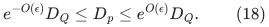

Run while <code class="math">D_p&lt;1</code>, processing all associated forest and flush
changes before the next iteration. A single iteration changes every
normalized load by at most one, so it multiplies <code class="math">D_Q</code> by at most
<code class="math">e^\epsilon</code>. At termination,

<!-- math-display: 4a2f80b646439ddb31df0d41
e^{-O(\epsilon)}\le D_Q\le e^{O(\epsilon)}.
 \tag{19}
-->
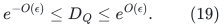

Let <code class="math">P^*</code> be the optimum fractional Steiner packing, and let
<code class="math">V=\sum_t v_t</code> be the unscaled inserted value. The public
Steiner-packing mincut relation gives <code class="math">P^*\ge\lambda(S)/2</code>.
The selected physical multigraph is a
<code class="math">(2+O(\epsilon))</code>-approximate minimum-price Steiner subgraph under
the stored prices, and hence also under <code class="math">Q</code> by (18). Writing that
factor as <code class="math">\gamma=2+O(\epsilon)</code>, the elementary MWU estimate is

<!-- math-display: d409b94b34b2f240d22c2a25
D_Q^{\rm next}-D_Q
 \le(\epsilon+O(\epsilon^2))v_t
                      \sum_e a_{t,e}Q_e
 \le(\epsilon+O(\epsilon^2))\gamma v_tD_Q/P^*.
 \tag{20}
-->
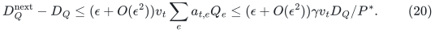

Here <code class="math">a_{t,e}\le\alpha</code> is the physical multiplicity. Summing
logarithmic increases, using initial <code class="math">D_Q=m\delta</code>, and using
(19) yields

<!-- math-display: d2c08f7c97f2864d5a6a6654
V\ge\frac{P^*}{\gamma(\epsilon+O(\epsilon^2))}
                  \bigl(\log(1/(m\delta))-O(\epsilon)\bigr).
 \tag{21}
-->
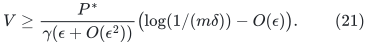

Equation (16) and the upper bound in (19) give
<code class="math">L_e/c_e\le (\log(1/\delta)+O(\epsilon))/\epsilon</code>.
Choose a common rational upper approximation <code class="math">Z</code> to this last
quantity, with an additional <code class="math">1+O(\epsilon)</code> relative slack, and
scale every packed weight by <code class="math">1/Z</code>. Then the packing is feasible.
Taking <code class="math">C_2</code> sufficiently large in (15) makes the ratio of the two
logarithms in (21) at least <code class="math">1-O(\epsilon)</code>. The feasible output
value is therefore

<!-- math-display: 8a824e04410d6d189de49fa8
V/Z\ge\lambda(S)/(4+O(\epsilon)).
 \tag{22}
-->
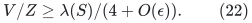

A fixed sufficiently small <code class="math">\epsilon</code> gives the <code class="math">4.1</code>-type
constant used by the guide-tree argument. The rational <code class="math">Z</code> can be
computed from <code class="math">b\log 2</code> with polynomial logarithmic precision;
no exact logarithm is stored.

### 7.4 Structural length range and integer skeleton input

Throughout the computation, (19) and the same pre-termination estimate
give <code class="math">p_e\le2</code>, after increasing the harmless fixed bound if
necessary. Also <code class="math">p_e\ge\delta/W</code>. Consequently every oracle
length

<!-- math-display: f9e9d7163fce703f44704a36
p_e/g
 \tag{23}
-->
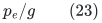

is a positive integer in <code class="math">[1,N^{O(1)}]</code>. This is an explicit
common-grid aspect-ratio proof, not an inference from the magnitude of
an exact rational product. The geometric-copy adapter therefore has
only <code class="math">O(\log N)</code> levels. Its structural <code class="math">\log L</code> is <code class="math">O(U)</code>
and never receives an <code class="math">E</code>-bit denominator.

The fixed accuracy is useful here. The original public implementation
rounds lengths relative to the current Steiner optimum because its
quoted oracle uses the narrower interval <code class="math">[1,n^4]</code>. Our oracle
accepts every fixed polynomial aspect ratio; the fixed constant in
(15) may be large, without changing the exponent in (1). No optimum
scale epochs are needed for this application.

Every final terminal-sparsifier edge has weight

<!-- math-display: fba41482a9a15aa0b56cc3f7
b_e/(2\alpha Z)
 \tag{24}
-->
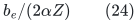

for a nonnegative polynomially bounded integer <code class="math">b_e</code>. Supply the
integer graph with weights <code class="math">b_e</code> to Li's skeleton construction.
This is one common rescaling of every capacity. It preserves all
relative cut statements and near-mincut families. There is no product
of unrelated denominators. The scale is tracked symbolically only when
the final cut guarantees are interpreted.

## 8. Li's skeleton and the size of the guide family

Use the updated primary source
[Li, arXiv:2106.05513v2](https://arxiv.org/pdf/2106.05513),
Theorem 1.5. Its quantitative factor is

<!-- math-display: fd62819ed194a16404590ddc
F_L=\exp O(U^{5/6}h^{O(1)}),
 \tag{25}
-->
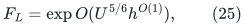

with <code class="math">\epsilon^{-7}</code> work and scale factors. AKL+'s earlier quoted
<code class="math">\epsilon^{-4}</code> dependence should not be substituted for that
updated theorem. Accuracy is a fixed constant here, so the difference
does not change the leading logarithmic power.

Two construction-level modifications justify the fixed
<code class="math">c</code>-near-mincut version needed by AKL+.

1. In Li's unbalanced-cut analysis, increase the threshold <code class="math">\tau</code>
   by a fixed factor <code class="math">c</code>. The bound on canonical volumes is linear
   in the cut capacity, so cuts of capacity at most <code class="math">c\lambda</code>
   satisfy the required unbalanced condition with the same asymptotic
   factor.
2. In the final weight preprocessing, clip an edge at
   <code class="math">c\widetilde\lambda</code>, not merely at <code class="math">\widetilde\lambda</code>.
   This leaves every cut of capacity at most <code class="math">c\lambda</code>
   unchanged. The edge-splitting count increases by only the fixed
   factor <code class="math">c</code>.

The second change is necessary: clipping at a lower threshold could
change a near-mincut even though it preserves the minimum cut itself.
For the guide application <code class="math">c</code> is an absolute constant, so both
changes are absorbed into (25).

Let <code class="math">m'\le mE^{O(1)}</code> be the terminal-sparsifier size and let
<code class="math">H</code> be the unweighted skeleton. The scale guarantee gives

<!-- math-display: 897f78b154374410cc658e15
m_H\le m'F_L^{O(1)},\qquad
                \lambda_H\le F_L^{O(1)}.
 \tag{26}
-->
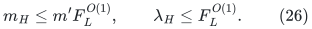

The second estimate must be retained: the guide-tree family size and
the deterministic tree-packing time depend on <code class="math">\lambda_H</code>, not
only on <code class="math">m_H</code>. AKL+ Theorem 4.23 therefore costs at most

<!-- math-display: 2a8b3482bcf4ffbcb863cb9a
\widetilde O(m_H\lambda_H)
                    \le mE^{O(1)}F_L^{O(1)}.
 \tag{27}
-->
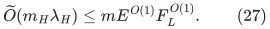

Since <code class="math">5/6&lt;7/8</code>, every fixed power of (25) is absorbed by (1),
even with an unspecified fixed power of <code class="math">h</code>. In particular, the
skeleton is not an exponent bottleneck in this transfer.

## 9. The fixed-parameter mincut adapter and the outer reductions

The respect parameter is a fixed absolute constant (the guide
construction uses 16). The new construction in
[deterministic-fixed-k-tree-mincut-adapter.md](deterministic-fixed-k-tree-mincut-adapter.md) proves the needed
<code class="math">(m+n)\log^{O(k+1)}n</code> aggregate maxflow inventory. Its leaf routine
chooses its maximizer over all guide targets after completing the
lower-k calls. It uses one full source-arm child when the maximizer is
on that arm, and otherwise two children with disjoint uncontracted
regions. This preserves the required source-arm cuts while preventing
duplication of an uncovered Steiner region. Non-source contraction
targets are broadcast to their original parent targets, and parameter
one has a separate set-mincut leaf base.

These are new construction arguments in this research assembly. We do
not treat them as an automatic consequence of the public theorem
statement. The proof separately establishes cut preservation and
<code class="math">\sum_i(n_i-1)\le n-1</code> for same-parameter children. Lower-k
branching is only <code class="math">O(\log n)</code>, so the fixed-k cost is a polynomial
logarithm times exact maxflow. The maxflow factor is not raised to the
centroid depth.

The remaining source factors are quantified in
[gomory-hu-external-factors-except-fixed-k.md](gomory-hu-external-factors-except-fixed-k.md). In particular, the
weighted expander primitive uses the uniform parameter <code class="math">r</code> in
Li--Saranurak's original theorem, rather than substituting a vanishing
accuracy into a statement phrased only for fixed constants.

Running it for all guide trees contributes the factor in (26).
Algorithm 8 adds <code class="math">O(\log(nW))</code> calls. The terminal-selection and
cut-decomposition stages in Section 6 use the explicit expander factor

<!-- math-display: cf21792fc02e2b12a5613724
\gamma_{\rm exp}
                   =\exp O(U^{4/5}h^{O(1)}).
 \tag{28}
-->
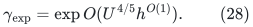

Their choice of <code class="math">\psi</code> has reciprocal bounded by a fixed power of
<code class="math">\gamma_{\rm exp}</code> and logarithms. The hit-and-miss calls in these
stages use a fixed hit-set cardinality two; their size and construction
time are polynomial in the miss parameter <code class="math">L</code>, with
<code class="math">L=\widetilde O(\psi^{-1})</code>. Thus these calls contribute a fixed
power of (28), not an exponential in <code class="math">\psi^{-1}</code>.

The resulting work for one actual recursive input of size <code class="math">m_*</code> is

<!-- math-display: 7d43bf877d470bbd75d0eace
m_*\mathrm{poly}(U)\,
       E(N)^{C_5}F_L(N)^{C_6}
       \gamma_{\rm exp}(N)^{C_7}E_{\rm flow}(N)^{C_8},
 \tag{29}
-->
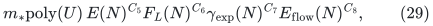

where all <code class="math">C_i</code> are fixed constants and
<code class="math">\log E_{\rm flow}=O(U^{5/6}h)</code>.
The [capacity-bit reduction](published-flow-capacity-scaling.md) pays
the actual inventory and bit stages of every recursive flow call,
including small calls and explicit cut output. Equation (29) is its
uniform upper envelope, multiplied by the actual input size.

AKL+ Lemma 6.32 bounds the sum of all recursive edge inventories by a
polynomial logarithm times the original size, because the terminal
recursion depth is <code class="math">O(\log n)</code>. Summing (29), and using
<code class="math">4/5,5/6&lt;7/8</code>, yields (2). Disconnected inputs are handled component
by component and joined with zero-weight tree edges. Isolated vertices
cost only their input/output size.

## 10. Audit status and statements not implied by this note

The strong-forest proof and the following application adapters are
separate, inspectable obligations:

* source-rooted multi-source parent selection, including the smaller
  scale tie rule and explicit label-change inventory;
* per-packing degree-three cut expansion;
* fixed positive-length geometric copies, binary port trees, and final
  root-only null contraction;
* the helper-MST argument under the actual multi-source contract;
* MWU iteration, threshold-flush, retirement, copy-update, and label
  counts;
* common-grid finite arithmetic and one common output capacity scale;
* the updated Li skeleton factor, its fixed-near-mincut extension, and
  the guide-family size;
* the new global-max leaf mincut construction, its contracted-target
  broadcasts, and its disjoint same-parameter inventory;
* fixed-power external overheads in the SSMC and Gomory--Hu reductions.

An independent audit of the first item is in
[multisource-rooted-approximate-ball-forest.md](multisource-rooted-approximate-ball-forest.md). The companion
[finite-mwu-and-li-skeleton-independent-audit.md](finite-mwu-and-li-skeleton-independent-audit.md) records an independent
check of the numerical and skeleton items. The strong-forest arithmetic
and map construction are independently checked in
[Separating metric stretch, forest congestion, and work](separated-metric-forest-and-strong-sssp.md).
The global-max construction is independently checked in
[fixed-k-global-max-leaf-independent-audit.md](fixed-k-global-max-leaf-independent-audit.md) and
[A deterministic fixed-k guide-tree mincut adapter](deterministic-fixed-k-tree-mincut-adapter.md); the primary source
interface issue and its resolution are retained in
[fixed-k-tree-mincut-source-interface-audit.md](fixed-k-tree-mincut-source-interface-audit.md).

The result is not obtained from faster numerical distance labels alone,
nor from a faster static flow oracle alone. It requires the explicit
rooted forest, its low simultaneous congestion, its stable canonical
nodes, and its bounded representation recourse. The claim is an exact
cut tree for general weighted undirected graphs; only internal metric
and packing computations are approximate.

The current public baseline audit is
[public-strong-forest-retuning-baseline.md](public-strong-forest-retuning-baseline.md). Retuning only the outer
public parameters already gives
<code class="math">\exp O(U^{62/63}h^{1/3})</code> for the strong forest, improving its
printed <code class="math">83/84</code> bound. That is the conservative audited comparison
for the new strong forest. It is not asserted to optimize all possible
public combinations. The exact Gomory--Hu composition includes the new
Section 9 construction as an explicit contribution, and remains labeled
as a research proof assembly when reporting the result.
