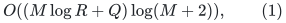
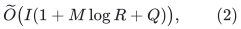
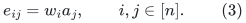
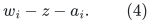
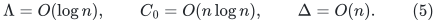
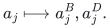
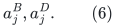
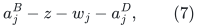

# Grouped choices inside a fixed-base router: a precise partial bridge

**Research status, 25 October 2026.** The one-resource selection lemma
does apply to a real selected-central-ID subtask. It does not by itself
give the ambient route-congestion contract. This note separates those
claims, supplies a legal fixed-route counterexample to the missing
implication, and records the relevant public selection interfaces.

The accepted general-graph matching exponent remains **4/5**.

## 1. A genuine parallel-bundle subtask

Fix an initial native route table. At a later time, some input IDs may
have the same two first-touched projected anchors. They form a parallel
bundle in the projected graph. Selecting one such ID is enough to
represent that bundle as an unweighted projected edge; the selected
object is the genuine central native ID, not a newly invented edge.

Suppose, during a restricted interval, that each bundle has a fixed
identity and each candidate representative has one designated origin.
An origin touch removes its candidates from these old bundles. New
projected obligations created by that touch are handled separately.
In this restricted subtask:

* groups are the old parallel bundles;
* resources are the still-untouched origin identities;
* an option is a current central native ID belonging to that origin;
* an origin touch deletes that resource from the old groups;
* a group retires when no old-origin option remains.

After coalescing multiple IDs from one origin within one group, the
lemma in [decremental-choice-recourse-lemma.md](decremental-choice-recourse-lemma.md) applies directly. It
maintains one representative per live group with prefix recourse

<!-- math-display: eb03fc2c558ebf5e87c6bc5e
O((M\log R+Q)\log(M+2)),
 \tag{1}
-->

where <code class="math">M</code> is the initial group count, <code class="math">R</code> the origin universe,
and <code class="math">Q</code> the number of origin touches in the prefix. A disappeared
representative can remain a live native edge elsewhere; its departure
from this selected role is still counted.

This is useful when <code class="math">M</code> is already at the permitted sparse-child
scale. It is not permissible to create one group per original demand
and then call <code class="math">M</code> a sparse credit. It is also not permissible to
ignore the new endpoint pairs created by an origin touch.

## 2. Discovery work is a separate bound

Let <code class="math">I</code> be the initial group--origin incidence inventory. The
dyadic loads and capacity changes in the one-resource lemma take
<code class="math">\widetilde O(I)</code> bookkeeping time. Its short alternating path
has <code class="math">O(\log M)</code> changes, but a naive search can examine all
<code class="math">I</code> incidences. The direct implementation therefore has only the
conservative total bound

<!-- math-display: ba5d91807150215ea8704e5b
\widetilde O\bigl(I(1+M\log R+Q)\bigr),
 \tag{2}
-->

besides the already bounded representative changes. Formula (2) is
not a useful near-linear router bound in general.

The known local scan of affected frozen native route occurrences can
identify which options have disappeared. That scan does not also
discover a short alternating reassignment. The two searches have
different state spaces and must be paid separately.

## 3. Origin balancing does not imply ambient balancing

The following example satisfies the basic initial-route size, length,
native-degree, and congestion scales. Its bad selected assignment is
perfectly balanced over origins. Nevertheless, representing its
parallel bundles by that assignment creates quadratic ambient
congestion.

### 3.1 A legal short initial route table

Let <code class="math">n=2^b</code>. Use a <code class="math">b</code>-dimensional hypercube with vertices
<code class="math">x_1,\ldots,x_n</code>. Attach a row terminal <code class="math">w_i</code> and a column
terminal <code class="math">a_i</code> to <code class="math">x_i</code>. Add a further vertex <code class="math">z</code>, together
with the edges <code class="math">zw_i</code> and <code class="math">za_i</code>, for every <code class="math">i</code>.
These edges and the hypercube form the initial selected base.

Add all native demand edges

<!-- math-display: 755771302cd1bc68c5642546
e_{ij}=w_i a_j,
                  \qquad i,j\in[n].
 \tag{3}
-->

The native graph is simple and loopless. The base has
<code class="math">O(n\log n)</code> edges, the native graph has <code class="math">\Theta(n^2)</code>
edges, and its maximum native degree is at most <code class="math">2n+O(\log n)</code>.

For <code class="math">i\ne j</code>, route <code class="math">e_{ij}</code> through
<code class="math">w_i,x_i</code>, then the hypercube path fixing differing coordinates
in a fixed order, and finally <code class="math">x_j,a_j</code>. For <code class="math">i=j</code>, instead
use the route

<!-- math-display: de6e3929dec013151cb7e7c8
w_i-z-a_i.
 \tag{4}
-->

Base edges use their identity routes. Every route has length at most
<code class="math">b+2</code>. Every row or column terminal appears only at a route's
endpoint. At any fixed coordinate stage, at most <code class="math">n</code> ordered
pairs have a specified hypercube vertex as their current position:
the already fixed coordinates specify destination bits, and the
remaining coordinates specify source bits. Summing over stages shows
that every hypercube vertex has occurrence congestion
<code class="math">O(n\log n)</code>. The vertex <code class="math">z</code> is used by just the <code class="math">n</code>
diagonal demand routes, plus its identity base-edge routes.

Thus the initial table has

<!-- math-display: 8db7f19846562b86ac33e271
\Lambda=O(\log n),\qquad C_0=O(n\log n),\qquad
 \Delta=O(n).
 \tag{5}
-->

For example, <code class="math">k=\Theta(n)</code> and <code class="math">\Gamma=\Theta(\log n)</code>
fit the intended scales <code class="math">C_0\leq k\Gamma</code> and
<code class="math">&#124;E(\text{base})&#124;=O((m/k)\Gamma)</code>.

### 3.2 Native splits create the parallel groups

For each column terminal, make an actual native split

<!-- math-display: e4dac904528b33255304db17
a_j\longmapsto a_j^B,a_j^D.
-->

Its two base incidences stay at <code class="math">a_j^B</code>; all demand edges move
to <code class="math">a_j^D</code>. Both descendants are touched. No other column
terminal was internal to an initial demand route. Consequently every
<code class="math">e_{ij}</code> has projected endpoints

<!-- math-display: e1c724a14d870344237b79e9
a_j^B,a_j^D.
 \tag{6}
-->

There are exactly <code class="math">n</code> parallel groups, each with <code class="math">n</code> row-origin
options. This is the old-bundle configuration from Section 1, obtained
from a low-congestion route table rather than from a congested star.

### 3.3 A balanced assignment with large physical congestion

Choose the representative of group <code class="math">j</code> to be <code class="math">e_{jj}</code>.
Every row origin is selected exactly once. With uniform options the
one-resource fractional load of each origin is one, so this choice
even satisfies capacities two.

The preliminary current physical image of this representative is

<!-- math-display: ea5fdc0c9725bfd875b72c90
a_j^B-z-w_j-a_j^D,
 \tag{7}
-->

where the last edge is the selected native central ID <code class="math">e_{jj}</code>.
Represent every projected edge of group <code class="math">j</code> by that representative.
Each of the <code class="math">n</code> original demands in the group then traverses (7),
in addition to its own exterior initial prefix. For every off-diagonal
demand the exterior prefix avoids <code class="math">z</code>, so at least <code class="math">n(n-1)</code>
current demand routes genuinely use <code class="math">z</code>. Cancellation or deleting
the diagonal routes does not remove this count.

The selected support has only <code class="math">n</code> central IDs, and its origin
loads are perfectly balanced. Its ambient vertex-occurrence
congestion is nevertheless <code class="math">\Omega(n^2)</code>, rather than the
<code class="math">k\mathrm{polylog}n</code> scale of (5).

This is not a lower bound against all possible representative choices:
other choices can avoid the diagonal paths. It proves that the
one-resource assignment invariant and low membership recourse alone
do not establish the ambient router clause. The additional resources
must include the actual physical route occurrences.

## 4. The relevant public interfaces

Fine--Kaplan--Stemmer,
[ICALP 2025, Section 3, Theorem 8]
(https://drops.dagstuhl.de/storage/00lipics/lipics-vol334-icalp2025/html/LIPIcs.ICALP.2025.77/LIPIcs.ICALP.2025.77.html),
already consider a group choosing one hyperedge of resources; deleting
any resource invalidates every option containing it. Their randomized
resampling algorithm has adaptive recourse
<code class="math">O((M+Q)\log N)</code> and deletion time <code class="math">O(\Delta\log N)</code>,
under the stated lower bound on option probabilities. This closely
matches the multiple-resource choice shape, but supplies neither a
deterministic implementation nor a prescribed instantaneous ambient
congestion bound.

Bernstein--Bhattacharya--Kiss--Saranurak,
[arXiv:2504.20780v2, Section 5]
(https://arxiv.org/html/2504.20780v2),
maintain left-perfect matchings in degree-gap graphs using residual
shortest paths and epochs. An ordinary factor-two Hall surplus is not
the same input interface as their fixed degree-gap graph. Capacity
growth and the cost of exposing resource copies require an adapter.

Their later
[arXiv:2610.23768v1, Theorems 1.1--1.2 and Section 7]
(https://arxiv.org/html/2610.23768v1)
gives fast decremental fractional load balancing and a randomized
integral rounding result. The displayed integral theorem does not
provide the missing deterministic multiple-resource update rule.

Bucić--He--Huang--Saranurak,
[arXiv:2511.02214v1, Theorem 1.5 and Sections 3, 5]
(https://arxiv.org/html/2511.02214v1),
gives fast static perfect hypergraph matching under strong Haxell
expansion. Its forest can start at unmatched groups, but each
half-layer is a global computation and its theorem charges total
static input, rather than changes per new orphan. It also requires an
implicit oracle if resource capacities are represented by Cartesian
products of clone choices. The capacity-majorant lemma and a precise
cascade obstruction are developed in
[multiresource-choice-majorant-and-cascade.md](multiresource-choice-majorant-and-cascade.md).

## 5. What would complete this restricted bridge

For the old-bundle subtask, an adequate new theorem would jointly
provide all of the following:

1. at most a small number of selected genuine central IDs per group;
2. the actual current physical images, with appropriate ambient
   congestion, including multiplicities when a representative serves
   many demands;
3. prefix selected-support recourse paid by the sparse initial group
   credit and actual resource touches;
4. discovery and update reporting within the frozen-route local-work
   budget.

Even that theorem would only solve the old-bundle portion. The full
fixed-base router still needs an inventory and routing argument for
the new endpoint pairs created by multiple-origin extraction, plus the
native degree-feedback accounting. The example above is useful
because it identifies a genuine remaining clause without asserting
that a large number of changed projected endpoints forces equally
many selected central-ID births.
