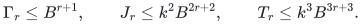
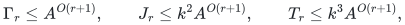

# Growing-depth recurrence bounds with controlled numerical aspect

**Abstract.** We prove a radius-specific cover reduction for arbitrary positive rational input lengths and a conditional growing-depth recurrence bound. The cover reduction exposes only polynomial-range integer lengths to the imported constant-degree primitive. For the recursive backend, explicit depth-independent recurrence and lifetime hypotheses imply a factor with logarithmic exponent <code class="math">335/336</code>.

The metric lemma and recurrence solution are mathematical results below. Complete realization of the required dynamic geometry, provenance, and retirement interfaces remains a hypothesis; a fixed-depth subpolynomial bound is not substituted for a uniform growing-depth proof. The [current matching theorem](../../problems/general-matching/proof.md) separately retains complete deterministic cycle-search realization as an explicit hypothesis.

## 1. Source interfaces and the aspect constraint

The source is Chen, Kyng, Liu, Meierhans and Probst Gutenberg,
*Almost-Linear Time Algorithms for Incremental Graphs: Cycle Detection,
SCCs, s-t Shortest Path, and Minimum-Cost Flow*,
<https://arxiv.org/abs/2311.18295v1>.

Its Theorem 4.1 gives a fully dynamic sparse neighborhood cover on a
constant-degree graph with polynomially bounded positive lengths. The
cover has a flat forest, an explicitly maintained marked subset, and
factor

    gamma_SNC = exp(O((log m)^(41/42) log log m)).

Theorem 4.5 constructs an HRG from such covers at increasing radii.
Definitions 4.2 and 4.30 and Lemma 4.32 specify the routing tree family.
Theorem 4.9's routing factor is

    O(kappa * gamma_HRG^6 * gamma_diam).

The exponent six is relevant here; the conclusion only needs that it
is an absolute constant. The number of routing trees is at most

    (O(gamma_HRG^2 log m))^kappa.

Theorem 5.13, in contrast to the cover theorem, explicitly exposes its
length-range dependence as factors of `log L`. It allows lengths in
`[1,L]` and has the insertion, deletion, vertex-split, and vertex-birth
API used in [portal-alias-api-reconstruction.md](portal-alias-api-reconstruction.md).

The fixed-depth Steiner construction introduces a factor `M^10` in
the real geometric lengths and gradients at each outer recursion
level. With growing depth, the resulting lengths need not be
polynomial in the *local* graph size. Invoking Theorem 4.1 directly on
these lengths would therefore exceed its stated hypothesis. The next
wrapper avoids that invocation.

All local size bounds below count vertices and edges. Isolated
vertices can be kept as singleton records outside the nontrivial
cycle solver. The nominal local size `m` is fixed during an instance
and bounds every current graph size in that instance.

## 2. A radius-specific polynomial-length cover wrapper

### Lemma 1: radius-specific cover reduction

**Lemma 1.** Let `m>=2`, let a dynamic constant-degree graph have positive rational
lengths, and fix a radius `D>0`. Suppose the published cover routine,
when run on an input of size `O(m)` with lengths in `[1,m^8]`,
has cover, diameter, occurrence, and update factor at most `gamma`.
Assume `gamma<=m^3/2`. In addition to the marked-set and occurrence guarantees, require an explicit forest-edge record identifying either an oriented real private-input edge or a true-null edge. The metric of a real forest occurrence must dominate its private-input edge length. Updates report forest, map, and mark changes, with old records available until their exported retirements complete. These provenance and transaction requirements are part of the wrapper interface; a vertex map alone does not specify them.

There is a wrapper with the same combinatorial update transcript up
to constant factors which maintains a flat forest and marked subset
such that:

* every original ball of radius `D/(2 gamma)` is covered;
* every marked tree diameter is at most `2 gamma D`;
* occurrence multiplicity is at most `gamma`;
* every exported real edge length dominates its literal original
  edge length, and every exported null edge has zero physical
  projection and positive stored length;
* the number of explicit forest, map, and marked-set changes is the
  published bound, up to constant factors.

The original aspect ratio affects only exact arithmetic on the
input lengths and the exported metric. The internal cover routine
sees only integers between one and `m^8`; genuine rounded edges
have lengths at most `m^4`.

### Construction

**Proof.** Discard an input edge whose length exceeds `D`. For each remaining
edge define

    delta = D/m^4,
    w_D(e) = ceil(ell_e/delta).

Then `1<=w_D(e)<=m^4`. To make the source's initialization and
disconnected-component convention literal, add a fixed artificial
path through all declared vertex slots, with every artificial edge
of length `m^8`. This gives a connected graph of size O(m) and
constant degree (at most five when the genuine input has degree
three). Run Theorem 4.1 on it at diameter parameter `m^4`.

An individual cover instance has fixed declared vertex slots,
including allocated inactive slots. It uses the source's edge-only
update API on those slots. A needed new slot beyond that bounded
inventory starts a new local instance under the nominal-size and
restart accounting of Section 7; it is not an uncharged source
vertex insertion. The artificial path is fixed for this instance.

Keep its internal data structure and internal edge lengths unchanged.
Remove every artificial-backbone edge occurrence from the EXPORTED
forest; the source continues to maintain its own forest unchanged.
On the remaining exported copy, give a real occurrence of
input edge `e` the length `delta*w_D(e)`, and give a true null edge
the length `delta`. Keep the real input edge identity and orientation;
a genuine input loop is not a null edge. The gradient of a real
occurrence is the corresponding original gradient and that of a
null edge is zero.

Every source marked-to-marked forest path has length at most
`gamma m^4 < m^8`. An occurrence of a backbone edge has length
at least `m^8`, so no such path uses one. Consequently removing
backbone occurrences does not separate any two marked vertices
that were in the same source tree. It may produce additional
unmarked components, which are harmless. Covering, marked diameter,
and multiplicity are all preserved, with at most one filtered
output operation per source forest log. In particular this does
not assume a bound on the number of disconnected small components.

The source's HRG construction explicitly uses flat-forest lengths
which are no shorter than the associated input lengths. The more
detailed primitive statements in Theorems 6.2 and 6.3 give the same
physical path-length convention. Thus the real part of this exported
metric is no larger than the source's supplied forest metric scaled
by `delta`. This is an exported-metric wrapper, not a change to the
SNC's internal metric or state.

### Cover and diameter proof

A shortest original path of length at most `D/(2 gamma)` is simple,
uses at most `m` edges, and contains no edge discarded above. Its
rounded length is at most

    m^4/(2 gamma) + m <= m^4/gamma.

The published cover therefore places every vertex of the original
ball in one marked cluster.

The artificial path also cannot shorten a rounded path of length
at most `m^4/gamma`, since any artificial edge already has length
`m^8`. Thus the preceding cover argument applies to genuine balls.
Before assigning positive lengths to null edges, the exported
diameter is at most `gamma D`. There are at most `m gamma` vertices
in the flat forest, so a simple forest path has fewer than that many
null edges. Changing each null length to `delta` adds at most

    m gamma delta = gamma D/m^3.

The resulting diameter is at most `2 gamma D`. Every real exported
length is at least the original physical length by upward rounding;
the physical charge of a null edge is zero. These statements hold
for literal traversal before cancellation.

### Dynamic and numerical details

An original edge birth or death gives at most one rounded edge birth
or death. A repricing is represented by deletion followed by insertion;
crossing the threshold `D` is handled in the same way. A gradient
change can likewise be given a fresh input-edge lifetime. The same
explicit provenance and deletion-first callback discipline as in the
fixed-depth construction is retained.

The ceiling is an exact rational/integer calculation. If its input
has `B` bits, a standard multiword implementation costs a polynomial
in `B`; it is not a unit-cost instruction on an unbounded integer.
The cover's own distance computations still use polynomially bounded
integer lengths. In the application below all radii and units are
dyadic.

This proves the stated metric and log-volume bounds. ∎

The condition `gamma<=m^3/2` holds eventually throughout the recursion range below. A finite-size implementation can suspend this branch
when its declared guards fail; this observation is not a finite-size
quality certificate.

## 3. HRG scales without a polynomial original aspect assumption

Write `M=2^u` for an outer size bound, and let a local nominal size
be a power of two `m=2^v`. The range of interest will have

    v >= (1/2) u^(335/336).

One can use a computable global cover envelope, for example

    Gamma = 2^ceil(u^(41/42) (log_2(u+4))^2).

For every sufficiently large outer size this dominates the source's
fixed hidden constants uniformly over all local sizes at most `M`.
It is also smaller than any fixed positive power of every local size
in the indicated range. Let `gamma_HRG=2 Gamma` and take

    kappa = max(3, ceil(v^(1/84))+2).

Suppose the current general-cycle input has integral lengths in
`[1,2^b]`. Choose a dyadic `gamma_diam=2^d`, where

    d = ceil(max(log_2(8 gamma_HRG^2),
                 (b+2v+log_2(gamma_HRG))/(kappa-1))).

Use the radius wrapper at radii `D_j=gamma_diam^j`, for
`j=1,...,kappa-1`. Its factor-two cover and diameter losses are already
absorbed in `gamma_HRG`. This supplies the properties of the HRG
definition, including the final connected-component cover, because

    gamma_diam^(kappa-1) >= gamma_HRG m^2 2^b.

The HRG construction and the combinatorial tree-family enumeration
use `kappa` and the cover occurrence bound. They do not enumerate
the integer distance range. Consequently their combinatorial factors
remain bounded by

    exp(O(u^(83/84) (log u)^2)),

independently of `b`. The routing-quality factor additionally contains
`gamma_diam`, whose logarithm is

    O(log Gamma + b/kappa + v/kappa).

This calculation uses the explicit powers in the source's routing
proof, rather than silently substituting a large aspect into the
published polynomial-aspect corollary.

The square in the first branch is deliberate. A cluster at scale
`D_i` has diameter at most `gamma_HRG D_i`, so it is insufficient
to reason as if its diameter were only `D_i` when comparing it with
the next radius. The stronger separation has no effect on any
exponent below. For a cluster containing an entire connected
component, an analysis-only distance-to-complement weight is made
finite by clipping `dist(v,V\C)/D_i` at one, with a clipped infinite
distance defined to be one. This avoids an undefined normalization
and preserves the padding and Lipschitz estimates used in the
routing proof. The maintained graph and all numerical gradients
are unchanged by this choice of analytical routing weights.

The complete direct argument is
[`hrg-routing-from-rounded-covers.md`](hrg-routing-from-rounded-covers.md).
For its normalized cluster distributions a_i, it proves
`||a_i(u)-a_i(v)||_1 <= (16/3) gamma_HRG^2 dist(u,v)/D_i`.
Consecutive-level distributions are tensor products, giving total
routing norm `O(kappa gamma_HRG^3 gamma_diam)`, within the looser
sixth-power allowance above. The bottom singleton and top whole-component
distributions are handled explicitly. Thus no unspecified routing
lemma with a polynomial-original-aspect premise is needed at this
step, and the weights are never computed by the maintained algorithm.

## 4. Length and gradient growth per outer recursion

For sufficiently large local sizes, the definition above gives

    log_2 D_(kappa-1) <= b+O(v).

Indeed, if the second branch defines `d`, rounding it upward costs
at most `kappa` additional bits. If the first branch defines it, the
logarithm is at most `O(kappa log Gamma)`, which is smaller than `v`
in the local-size range under consideration.

In the exported cover forest, a real length is at most
`2^b+D_(kappa-1)/m^4`, and a null length is at least `m^-4`, since
every radius is at least one. Linking and paired HRG edges have
length at most `gamma_HRG D_(kappa-1)` times an absolute constant.
Multiply every length and gradient in a tree-cycle instance by the
same factor `m^4`. All these lengths become positive integers,
their maximum logarithm is at most `b+O(v)`, and all ratios are
unchanged. On lifting, divide both the numerator and its certified
denominator by this factor.

Next apply the existing alias/Steiner construction. A compressed
tree path adds at most the logarithm of its number of edges to the
length bit bound. The frozen gradient gauge adds a sum of at most
the local number of gradients; a newly inserted tree edge retains
its actual frozen-gauge residual. It is never silently assigned
gradient zero. The `M^10` port scaling adds `10u` bits. Thus both the
length and gradient bit bounds satisfy

    B_(i+1) <= B_i + O(u).

The constants here concern a fixed number of sums, dyadic scalings,
and local graph transformations per outer level. They do not grow
with the outer recursion depth. A base input with `O_a(u)` bits
therefore gives

    B_i = O_a((i+1)u).

The source's internal cover computations have already been reduced
to polynomial-length inputs. The spanner's explicit `log L` factors
and the wrapper's multiword arithmetic contribute only powers of
`B_i`. They do not contribute a factor exponential in `B_i`.

## 5. Conditional growing-depth arithmetic

Let

    beta = 167/168 = 334/336,
    alpha = 335/336,
    k = 2^ceil(u^alpha).

Keep the computable port capacity `C=2^ceil(u^beta)` from the
fixed-depth bridge. The HRG degree bound is still at most C
eventually, since its logarithm is bounded by `O(log Gamma+log kappa)`.
All recursive general-cycle inputs remain degree three.

The local factor can be conservatively bounded by

    A_* = exp(O_a(u^beta (log u)^2)).

Since `log A_*=o(log k)`, the size reduction `m A_*/k` decreases
the logarithm of the local size by at least `(1/2)log k` until the
base case. The number of outer levels is therefore

    D_depth = O(u^(1/336)).

Section 4 gives `B_i=O_a(u^(337/336))`. At the smallest nonbase
sizes, `kappa=Omega(u^(alpha/84))`. Hence

    B_i/kappa = O_a(u^(1+1/336-alpha/84)).

The exponent is strictly smaller than beta:

    beta - (1+1/336-alpha/84) = 83/28224 > 0.

Thus the larger aspect's contribution to `log gamma_diam`, and
therefore to routing quality, fits inside the same local envelope.
The product of one local envelope per level has logarithm at most

    O_a(u^alpha (log u)^2).

If the explicit recurrences of the alias/Steiner construction are
used uniformly at these parameters, their safe envelope

    k^10 A_*^{O(D_depth)}

is consequently

    exp(O_a((log M)^(335/336) (log log M)^2)).

This is the conditional factor for amortized backend
updates, queries, quality loss, and exported multiplicity; an
additional factor M pays for initialization. The number of returned
edge/path pieces obeys the same envelope. The recurrence has no
factor k on recursive child update volume and no factor k on each
recursive forest-edge log. Those two properties are essential;
replacing either by a naive geometric path expansion would invalidate
the calculation.

## 6. Proof obligations and scope

Lemma 1 establishes the metric wrapper, including the positive-null-length adjustment. The backend theorem additionally requires the following complete interfaces. Section 7 derives the quantitative consequences of their explicit operation counts; it does not establish a complete implementation from a bare cover or min-ratio guarantee, and it does not settle item 5.

1. The recursive maintenance proof must use the *explicit* alias,
   Steiner, path-pool, active-image pruning, and deletion-first
   lifetime recurrences with constants independent of the depth.
   A black-box fixed-depth `M^{o_a(1)}` statement is insufficient.
2. Nominal-size and update-horizon management must be charged. The
   cover source itself permits rebuilding after m updates. A longer
   execution is divided into such instances, with initialization and
   old flat-forest retirement charged to those updates. No single
   primitive is assumed to tolerate an unstated superpolynomial
   local update horizon.
3. All exact arithmetic on the now `O_a(u^(337/336))`-bit data must
   be simulated and charged. Integer roots, powers, dyadic scaling,
   and exact ceilings are finite computations. The certificate's
   numerator and denominator are divided by every introduced common
   scale on lifting; leaving either scale in only one quantity would
   destroy the quality claim.
4. A nonzero returned numerator still implies a nonzero physical
   circulation. Pure null-fiber cycles have zero gradient; real
   self-loops retain their real edge identities. Suppression occurs
   only for an entirely physically null inactive fiber after its
   formerly real pools have retired.
5. This does not supply a quantitative choice of a growing OAI
   matching-phase parameter. The fixed-a input bit constant and all
   other a-dependent driver constants remain fixed in the displayed
   backend calculation. The independently sound verified-portfolio
   matching statement does not need this extra quantitative claim.

The accumulated numeric aspect therefore does not by itself force a
polynomial loss. The next section makes this statement uniform in the
recursion depth without treating a fixed-depth little-oh term as a
uniform estimate.

## 7. A master-size backend contract with explicit recurrences

### 7.1 Statement and parameters

**Uniform realization hypothesis.** The portal, Steiner, path-pool, and active-image constructions must jointly support every stated old-to-final transaction, with explicit provenance, signed and absolute retirement transfers, and the depth-independent recurrences in Section 7.2. Initialization is charged to actual inventory, local primitive histories obey their polynomial horizons, and query answers have the literal unit-piece representation used in Section 7.4. These obligations are stronger than ordinary approximation quality. The theorem below is conditional on their realization.

Fix an absolute input-bit constant `c0`. Let `S=2^U` be a master
bound, and suppose a degree-three dynamic general-cycle input has at
most `S^2` resident vertices and edges and integral lengths and
gradients satisfying

    1 <= ell_e <= S^c0,       |g_e| <= S^c0.

The exponent two is only a convenient fixed size guard; any fixed
constant would work. There is no array indexed by every integer up
to S. A local instance is allocated from its actual graph and from
the nominal size budgets of its children, as described below.

Use the SAME master U at every recursive instance. Set

    alpha = 335/336,                  beta = 167/168,
    k = 2^ceil(U^alpha),              C = 2^ceil(U^beta),
    L_U = ceil(log_2(U+4)),
    A(U) = 2^(ceil(U^beta) L_U^2).

The cover envelope is `2^(ceil(U^(41/42)) L_U^2)`. Integer powers
and integer-root comparisons compute these parameters; the displayed
formulas do not require a real-number oracle. For all sufficiently
large S, depending on c0 and the fixed published primitives, A
dominates every fixed power needed in ONE combined reduction. In
particular it absorbs the HRG family, all source recourse factors,
the port fibers, alias inventories, scalar arithmetic, and local
polylogarithms. It is not redefined with a depth-dependent power.

To verify that this one envelope suffices, note the following bounds.

* The logarithm of the HRG-family factor is
  `O(U^(83/84) (log U)^2)`, strictly smaller than `U^beta` eventually.
* Any fixed power of the port capacity contributes `O(U^beta)`.
* The multiword aspect contribution to routing quality is at most
  `O_c0(U^(1+1/336-alpha/84))`, whose exponent is less than beta.
* Powers of the bit length and of the hierarchy depth contribute only
  `O(log U)` to the logarithm of a local factor.

Consequently the actual local factor is bounded by
`exp(O_c0(U^beta))`; the computable extra factor `L_U^2` in log A
eventually absorbs its fixed hidden coefficient. This is stronger
than assuming a separate, unquantified `S^o(1)` factor at each depth.

Stop the recursion when the local nominal size is at most `4k`.
Otherwise the local logarithmic size satisfies
`log_2 m >= log_2 k`, so all radius-wrapper and aspect estimates
hold uniformly. An empty recursive graph is not initialized merely
because its parent has a nominal upper bound. A nonempty child may
be initialized against that bound, and its cost is charged to the
parent's initialization or period credit.

For a formal simultaneous bound on aspect and depth, impose the
computable depth guard `ceil(8U/log_2 k)+10`. The per-level bit
growth bounds every input within this guard by
`O_c0(U^(337/336))`; that bound proves the local A estimate.
The resulting size shrink in Section 7.2 then gives at most
`4U/log_2 k+O(1)` levels, so the depth guard is not reached
eventually. This removes any circular use of an assumed final
depth to justify its own local factor.

**Theorem 2 (conditional recurrence bound).** Under the uniform realization hypothesis and the stated cover/spanner primitives, the parameters above give an eventually valid backend with common factor

    E(S) = exp(O_c0(U^alpha (log U)^2))

for quality loss, occurrence multiplicity, answer-piece count,
amortized update time, and query time. Initialization and storage
are bounded by the actual root size times E(S), with the usual
additive unit for an empty input. The constants in this statement
are independent of any matching parameter a. A finite branch can
check sizes, degrees, allocated counts, and bit limits and suspend
on overflow; such checks alone are not a finite-size quality
certificate. The outer exact optimality verifier remains necessary
if finite inadequacy is handled by a verified portfolio.

### 7.2 Recurrences with constants independent of depth

**Proof of Theorem 2.** Write r for the number of remaining outer levels. Enlarge the
computable envelope A by a fixed factor if needed for small absolute
constants. At a general-cycle node of nominal size m, the sum of the
nominal sizes of ALL its recursive children is at most

    m A/k.

This counts the HRG tree-family multiplicity, all allocated child
slots, retained isolated port fibers, and history records still
resident during the parent period. It does not use a bound on the
number of connected components of a spanning forest. Portal-free
small components stay in parent local-candidate storage, as proved
in [disconnected-routing-components.md](disconnected-routing-components.md).

Let `Gamma_r` bound exposed occurrence multiplicity, let `I_r(m)` be
the total initialization allowance, and let `J_r=I_r(m)/m`. Let T_r
bound amortized edit work, query work, and the explicit forest-log
work, after the local source factors are absorbed into A. The
proofs of the alias and Steiner constructions give, with ABSOLUTE
constants,

    Gamma_r <= A (Gamma_(r-1)+1),
    J_r <= A (Gamma_(r-1)+1) + (A/k) J_(r-1),
    T_r <= A T_(r-1)
           + O(k^2 A (Gamma_(r-1)+1) + A J_(r-1)).

The A multiplying child time is the TOTAL number of child input
edits and child query calls, summed over the local tree family.
There is no additional k there. The term `A J_(r-1)` pays for
initializing all children at a period restart: their total size is
at most `m A/k`, and a restart is amortized over `m/k` local parent
edits. The `k^2 A Gamma` term pays local alias maintenance,
geometric-input-lifetime pool creation and retirement, and candidate
score bookkeeping. Its k power is additive local work.

The input-edge pool distinction is essential to these equations.
Each child FOREST edge log only attaches or detaches a previously
allocated path copy. A whole length-O(k) path pool is created or
retired only when its underlying child INPUT edge lifetime changes.
Observed pool doubling during a lifetime costs at most a constant
times its maximum simultaneous occurrence demand. Thus initialization
credits can pay a later doubling without multiplying recursive
forest-log volume by k. Dormant copies remain exposed and retain
their signed and absolute counters throughout.

The direct base has at most `4k` vertices and edges. Test for zero
cycle gradients with a spanning-forest potential. Otherwise use
doubling/halving trials and Bellman--Ford on the two orientations of
each edge to find a factor-two minimum-ratio cycle, exactly as in
the constant-depth base. Multiword costs are included in A. A safe
bound is

    Gamma_0 = O(1),       J_0 <= k^2 A,       T_0 <= k^3 A.

The base may return the cycle as explicit input edges and maintain
an empty exported lift forest. It does not allocate k records if
its actual graph is smaller. A queried explicit child input edge
lifts using that edge's canonical physical path-pool copy, so the
empty base forest does not break the path representation.

More explicitly, if its actual graph has t vertices and edges,
the base initialization writes only `O(t)` records and its direct
query work is bounded by `O((t+1)^3 poly(B_r))`, or the sharper
Bellman--Ford bound. Empty and acyclic inputs exit after the actual
spanning-forest work. The displayed `k^3 A` is an upper bound for
ONE query, not a bare startup fee. Even if a base query is included
in initialization, `(t+1)^3<=O((t+1)k^2)` for `t<=4k`.
Consequently an engine instance with a tiny actual graph and a
very large master U does not pay a mandatory k-cubed allocation or
initialization. It stores no port fibers or HRG trees at the base.

**Lemma 3 (recurrence solution).** After absorbing the fixed recurrence coefficients into <code class="math">A\ge8</code>, let <code class="math">B=4A</code> and <code class="math">k\ge2</code>. The displayed recurrences and base bounds imply
<!-- math-display: b549b1d0ad8723bd0638e380
\Gamma_r\le B^{r+1},\qquad
J_r\le k^2B^{2r+2},\qquad
T_r\le k^3B^{3r+3}.
-->

**Proof.** The three bounds hold at <code class="math">r=0</code>. The first recurrence is bounded by <code class="math">2A B^r\le B^{r+1}</code>. In the second, substitute the first bound and <code class="math">J_{r-1}\le k^2B^{2r}</code>; both resulting summands are bounded by the claimed <code class="math">k^2B^{2r+2}</code> with room for their sum. In the third, substitute the two previous estimates and <code class="math">T_{r-1}\le k^3B^{3r}</code>. Its terms total at most <code class="math">4Ak^3B^{3r}\le k^3B^{3r+3}</code>. This proves the induction with exponents independent of the depth. ∎

Thus
<!-- math-display: e61c76450ce5f421b04c55ad
\Gamma_r\le A^{O(r+1)},\qquad
J_r\le k^2A^{O(r+1)},\qquad
T_r\le k^3A^{O(r+1)},
-->

with absolute constants in all three exponents. Candidate quality
and piece recurrences have the same form, with base quality two
and base piece count at most `4k`. The loose common envelope

    k^10 A^(O(r+1))

therefore covers every exposed interface quantity. It contains no
`k^r` term.

For clarity, the quality recurrence is obtained by multiplying
only the HRG comparison loss, one spanner comparison loss, and the
constant geometric/port/raw-certificate losses at this level. All
are at most A in aggregate, so `Q_r<=A Q_(r-1)` with `Q_0=2`.
The HRG tree family is an explicit candidate family; taking its
best answer does not concatenate every answer. A spanner correction
uses at most A explicit parent tree paths and edges. A child input
edge becomes one canonical pool path, and a child forest path
becomes one parent forest path. Thus the safe piece recurrence
`P_r<=A(P_(r-1)+1)` has no factor depending on r.

The forest-log recurrence is already charged in T: after the
input-lifetime pools exist, every recursive forest log creates
only a fixed number of attachments/cuts at the next lift. HRG
family copies multiply the log volume by the SAME local A already
used for child edits. Their count is not multiplied again by a
global quality or occurrence bound. Local copy creation/retirement
has the separate `k^2 A Gamma_(r-1)` allowance. These fixed code
operations account for the absolute constants in the recurrence;
there is no new depth-dependent theorem constant at each level.

For sufficiently large S, `log A <= (1/2) log k`. A nonbase size
therefore shrinks by a factor at least `sqrt(k)` per level. Starting
with `m<=S^2` yields

    r <= 4U/log_2 k + O(1) = O(U^(1/336)).

Substitution gives exactly the displayed E(S) factor, uniformly
over these depths. The local size/degree guards ensure that the
same computation is a finite executable family even before its
eventual guarantees apply.

### 7.3 Nominal sizes, update horizons, and restart charges

A nominal size is a bound on resident vertices AND edges, not the
number of nonisolated vertices. The root chooses a power-of-two
bound within a constant factor of its actual initial size, or uses
the direct base for a small graph. Doubling/halving rebuilds handle
a later constant-factor change in the root size; their ordinary
initialization and retirement costs are charged to the intervening
edge/vertex edits. No root is padded to size S.

Inside a parent period, each child receives its predetermined
nominal bound from the parent's recourse allowance. The sum of
these bounds is `m A/k`, already charged in J. A child with no
retained input edge or relevant vertex can be omitted. First
activation may consume its prepaid initialization credit. The
implementation allocates actual records one at a time and can
represent sparse dictionaries on nominal ID spaces without
initializing the entire space.

Each portal period contains at most `floor(m/k)` local parent
edits. Over it the legal alias-spanner transcript has

    q_all <= m A,          q_bad <= (m/k) A,

including initialization allowances, with the master-degree
inventory bound from [portal-alias-api-reconstruction.md](portal-alias-api-reconstruction.md).
Every nonbase nominal m is at least k, while A is eventually less
than any fixed positive power of k. Hence these are polynomial
LOCAL horizons, for example at most `m^2` after increasing the
finite threshold. They are not merely polynomial in the larger
master S. The source spanner is therefore used only within its
stated polynomial-update scope. Empty old slots and master
ancestries are retired when their whole parent instance ends;
deletions do not reset a master's cumulative-degree counter early.

The cover construction in source Section 6.2 explicitly permits
rebuilding after m updates. Invoke that rule whenever necessary.
The old exported forest is fully retired with its signed/absolute
counter transfers before its mapping metadata is discarded. Its
size is `m A Gamma`, so retirement and initialization divided by m
updates contribute `A Gamma`, already in T. A shorter outer portal
restart is instead paid by the `k A Gamma` and `A J` terms above.

Every retirement visits ACTUALLY allocated old records. Neither
the master S nor an unused k-sized base buffer is enumerated. The
sum of actual records over all children is bounded by their
initialization allowances and observed pool doubling. At a tiny
root base the exported forest is empty, and retiring it costs only
the actual graph/dictionary records. At a nonbase root, its
`m E(S)` initialization and retirement bounds use its own nominal
m, within a constant factor of its actual root size, not S.

The same rule applies recursively. A parent can cause many updates
to a child, but they are charged child input updates; when a child's
own local period ends it restarts under its own budget. There is no
assumption that one small primitive instance survives all updates
in the master algorithm. A single large parent edit can cause a
large explicit child batch; all recourse and restart estimates are
prefix-total/amortized bounds, not an unsupported worst-case bound
on every batch.

This supports any fixed polynomial MASTER lifespan, such as
`S^200` external edits and queries, even when a particular local
graph has only a few edges. A small local instance is repeatedly
restarted as just described, rather than given an `S^200`-operation
lifespan in one invocation of a local primitive. Initialization
and retirement on these restarts are included in the amortized
bound. Timestamp and lifetime IDs use `O(log S)` bits over this
master lifespan, with an absolute constant depending on 200.

### 7.4 Numerical data and the final certificate

The input-bit constant c0 is the only external numeric constant.
The per-level estimate in Section 4 is uniform, so

    B_r = O_c0((r+1)U) = O_c0(U^(337/336)).

All internal arithmetic is performed on arrays of O(U)-bit words.
Integer multiplication, exact division, comparisons, ceilings,
path-sum updates, and rational-score comparisons cost a fixed
polynomial in B_r. This is absorbed by A. Source SNC calculations
continue to use their own polynomial integer metric: `[1,m^4]`
on genuine rounded edges and length `m^8` on the fixed artificial
backbone. The spanner's
explicit length-range factors are polynomial in B_r; there is no
hidden call to a polynomial-aspect cover on the unrounded lengths.

Input IDs and addresses have O(U) bits over any fixed polynomial
master lifespan, since the total size/work factor E(S) is
subpolynomial. Over a longer execution, recycling a completed
instance's private ID space gives the same local arithmetic bound;
the matching client only requires a polynomial master lifespan.

At every lift divide BOTH the numerator and raw denominator by
the common metric/gradient scale. Gauge potentials telescope on
a circulation. True null edges have gradient and physical charge
zero; real loops retain their input edge identity. A nonzero
selected numerator therefore projects to a nonzero physical
circulation, not to a purely null walk.

Although an internal rational certificate may use B_r bits, the
final backend answer on the original integral input can be given
with O_c0(U)-bit numbers. Its exact physical numerator is an
integer. Every returned path or edge piece has coefficient +1
or -1, with repeated pieces listed separately. Equivalently an
integer coefficient is allowed only if its absolute value counts
toward the piece budget. The base returns a simple directed cycle;
local fundamental cycles and spanner corrections also have unit
edge/path coefficients. Recursive substitution replaces a unit
piece by its unit physical walk and does not rescale its traversal
coefficient. An optional net-cycle decomposition can select a
unit simple cycle after removing integral repetitions. The
fractional routing probabilities used to prove HRG comparison
are analysis-only and are never returned coefficients. Dividing
the common length/gradient scale changes the scalar certificate,
not the returned physical circulation.

Its raw path/edge representation has at most E(S) pieces,
and every simple path in the final flat forest has at most
`m E(S)` edges, so the numerator has polynomial magnitude in S.
If the optimum ratio is nonzero, a simple integral-input cycle
has nonzero integer gradient and length at most `m S^c0`; hence

    OPT >= 1/(m S^c0).

The quality guarantee implies that the returned certified
denominator is at most its numerator times E(S)/OPT, also
polynomial in S. The physical raw length of a nonzero circulation
walk is at least one. Replacing its rational certified denominator
U_cert by `ceil(U_cert)` consequently loses at most a factor two,
preserves the upper bound on literal raw traversal, and yields an
O_c0(U)-bit integer. Computing this ceiling and the rescaled
numerator is charged multiword work; no physical path is expanded
to compute it.

The recurrence, restart, bit, and certificate bounds establish Theorem 2 under its realization hypothesis. ∎

### 7.5 Relevance to a growing matching parameter

This master-size contract does not use a matching parameter a.
Therefore, if the matching engine supplies a uniform absolute
price bound such as `S^1122`, the same E(S) guarantee applies even
when a grows. Local instances of size near B or below k are simply
direct bases with O(U)-bit input data; their price bound is not
mistakenly interpreted as a fixed power of that tiny local size.

The literal local cap `M^(10/a)` from the original fixed-parameter
engine is not sufficient for this conclusion on tiny local M.
One must reprove the client using master-based capacity and quality
guards, for example `S^(c/a)` and `S^(-c/a)`, with an explicit
absolute c. If `a=floor(U^(1/336)/(log U)^3)`, then
`U/a` exceeds `U^alpha (log U)^2` by a logarithmic factor, so the
backend fits such master-based guards eventually. That arithmetic
comparison alone does not reprove the priced client, projection
budget, resets, or the outer matching phase for varying a. Those
are separate proof obligations and are not asserted here.
