# Entropy progress for balanced cuts and half-matchings

**Mathematical replacement lemma, 24 October 2026.** This note proves
the exact cut-matching progress statement needed by the sequential
virtual hierarchy. A continuing cut player is required to return a
balanced cut of sparsity at most <code class="math">1/8</code>. The matching player need
only match half of its source side. Both constants are absolute.
No induced-subgraph property of a successful terminal object is used.

This small threshold change repairs a literal error in the half-matching
calculation in Chang--Saranurak,
[arXiv:2007.14898v1](https://arxiv.org/pdf/2007.14898), Appendix F.2.
Their displayed total-mass estimate uses the full source cardinality
where the half-matching assumption gives only half. The replacement
below supplies a complete proof at the threshold actually used by the
new construction.

## 1. Exact combinatorial interface

Fix <code class="math">N</code> abstract vertices. Let <code class="math">M_1,\ldots,M_{i-1}</code> be previously
added matchings; parallel occurrences in different rounds have
distinct edge IDs. Let <code class="math">H_{i-1}</code> be their multigraph union. A
continuing cut player returns <code class="math">S\subseteq V</code>, <code class="math">T=V\setminus S</code>,
with
<!-- math-display: 0ce545d39b8f7950c35ef71f
N/4\leq s:=|S|\leq N/2,\qquad
                    |\partial_{H_{i-1}}S|\leq \eta s,
                    \quad 0\leq\eta\leq1/8.
 \tag{1}
-->
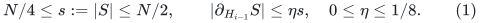
Do not deduplicate equal endpoint pairs during the game: its cut
boundary counts every past matching occurrence.
The next matching <code class="math">M_i</code> joins <code class="math">S</code> to <code class="math">T</code> and has size at
least <code class="math">s/2</code>. Write <code class="math">S_*\subseteq S</code>, <code class="math">T_*\subseteq T</code> for
its endpoints. Its edges give a bijection <code class="math">k\mapsto\ell(k)</code>
from <code class="math">S_*</code> to <code class="math">T_*</code>.

Let <code class="math">F_{i-1}</code> be the transition matrix obtained by successively
averaging the two coordinates of every edge of
<code class="math">M_1,\ldots,M_{i-1}</code>. Equivalently, at each matching a walk
stays or crosses its matching edge with probability <code class="math">1/2</code>.
Write <code class="math">p(j,k)</code> for the probability of being at <code class="math">k</code> when
starting at <code class="math">j</code>. The matrix is doubly stochastic.

Define the entropy, using natural logarithms and <code class="math">0\log(1/0)=0</code>,
by
<!-- math-display: 91daae283e53cfc57322eed8
{\cal E}_{i-1}
                  =\sum_{j,k}p(j,k)\log(1/p(j,k)).
 \tag{2}
-->
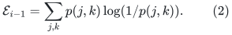
It is always in <code class="math">[0,N\log N]</code>.

**Lemma.** Every continuing round satisfying (1) increases (2)
by at least <code class="math">5N/1024</code>. Consequently there are at most
<code class="math">(1024/5)\log N</code> such rounds.

## 2. The cross-cut mass bound

Initially place one unit of load at every vertex of <code class="math">S</code>, and
zero outside <code class="math">S</code>. Apply the previous matching averages.
All loads stay in <code class="math">[0,1]</code>. An occurrence of an edge crossing
<code class="math">(S,T)</code> can increase the total load in <code class="math">T</code> by at most <code class="math">1/2</code>.
Counting every previous crossing occurrence therefore gives
<!-- math-display: dc14b5b1553b3478c8b39b9b
\sum_{j\in S,k\in T}p(j,k)
                         \leq\frac12|\partial_{H_{i-1}}S|
                         \leq\frac{\eta s}{2}.
 \tag{3}
-->
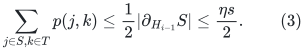
Starting instead with unit loads on <code class="math">T</code> proves
<!-- math-display: e06bc266d4e0ebb64e20993f
\sum_{j\in T,k\in S}p(j,k)
                         \leq\frac{\eta s}{2}.
 \tag{4}
-->
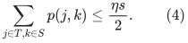
These statements hold for any earlier matching sequence, even
if edges or endpoint pairs have been repeated.

## 3. Enough matched mass has a nontrivial imbalance

For <code class="math">j\in S</code> and <code class="math">k\in S_*</code>, call the triple
<code class="math">(j,k,\ell(k))</code> good when
<!-- math-display: 5a4b67debb391a268c1b1284
p(j,k)\geq2p(j,\ell(k)).
 \tag{5}
-->
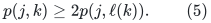
The total <code class="math">p(j,k)</code> mass over all these triples is
<!-- math-display: 3753f8d7e7c94d8d6f172302
\begin{split}
 \sum_{j\in S,k\in S_*}p(j,k)
   &=|S_*|-\sum_{j\in T,k\in S_*}p(j,k)\\
   &\geq\left(\frac12-\frac{\eta}{2}\right)s.
 \end{split}
 \tag{6}
-->
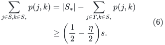
The term <code class="math">&#124;S_*&#124;\geq s/2</code>, rather than <code class="math">s</code>, is essential.
Over bad triples the total is bounded by
<!-- math-display: 9e6f37c3341098cd1e45b723
\begin{split}
 \sum_{\rm bad}p(j,k)
    &\leq2\sum_{j\in S,\ell\in T_*}p(j,\ell)\\
    &\leq\eta s.
 \end{split}
 \tag{7}
-->
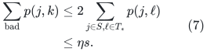
Subtracting yields
<!-- math-display: 55c36e9a0849fd840e34c70c
\sum_{\rm good}p(j,k)
             \geq\left(\frac12-\frac{3\eta}{2}\right)s
             \geq\frac{5s}{16}
             \geq\frac{5N}{64}.
 \tag{8}
-->
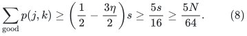
Thus the claimed positive mass follows from an absolute threshold
strictly below <code class="math">1/3</code>. The chosen <code class="math">1/8</code> leaves substantial slack.

## 4. Entropy gained by one good pair

Let <code class="math">a,b\geq0</code>, and average the two masses to <code class="math">(a+b)/2</code>.
With <code class="math">h(z)=z\log(1/z)</code>, concavity always gives
<!-- math-display: 4c514150c5b9a2a110c161b7
2h((a+b)/2)-h(a)-h(b)\geq0.
 \tag{9}
-->
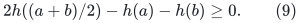
If <code class="math">b\leq a/2</code>, the gain is at least
<!-- math-display: ba77c0baf919020d3e48a90d
\frac{a}{16}.
 \tag{10}
-->
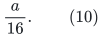
For <code class="math">a&gt;0</code>, put <code class="math">u=b/a</code>. The gain divided by <code class="math">a</code> is
<!-- math-display: e542ef1fa1931d6ec353c5ce
f(u)=(1+u)\log2-(1+u)\log(1+u)+u\log u.
 \tag{11}
-->
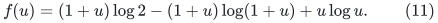
Its derivative is <code class="math">\log(2u/(1+u))\leq0</code> on <code class="math">0&lt;u\leq1/2</code>.
Hence its minimum there is
<!-- math-display: 675509820217cb210e62287e
f(1/2)=\tfrac12\log(32/27)
       \geq\tfrac12\frac{5}{32}
       =\frac5{64}>\frac1{16},
 \tag{12}
-->
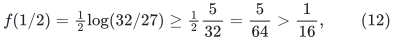
using <code class="math">\log(1+x)\geq x/(1+x)</code>. The case <code class="math">a=0</code> is immediate.

For each starting vertex <code class="math">j</code>, the new matching averages the
disjoint coordinate pairs <code class="math">(k,\ell(k))</code>. Apply (10) to
every good triple, and (9) to all remaining pairs and starts.
Equation (8) gives
<!-- math-display: c94b4d7a0f33c9a279044341
{\cal E}_i-{\cal E}_{i-1}
                      \geq\frac1{16}\frac{5N}{64}
                      =\frac{5N}{1024}.
 \tag{13}
-->
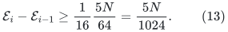
Since <code class="math">{\cal E}_0=0</code> and <code class="math">{\cal E}_i\leq N\log N</code>,
the lemma follows.

## 5. A literal obstruction to the old threshold

The same per-round assertion is false with threshold <code class="math">1/2</code>
and only half-matching. Let <code class="math">N</code> be divisible by four, choose
<code class="math">&#124;S&#124;=&#124;T&#124;=N/2</code>, and let <code class="math">M</code> be a matching of size <code class="math">N/4</code>
from <code class="math">S</code> to <code class="math">T</code>. After one round <code class="math">H_1=M</code>, so
<!-- math-display: 76ec4b929302b6391a560eb3
|\partial_{H_1}S|=|S|/2.
 \tag{14}
-->
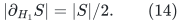
The same cut is allowed by the threshold <code class="math">1/2</code>, and a second
round may choose the same matched pairs, with new edge occurrence
IDs. Averaging on those pairs is idempotent, so <code class="math">F_2=F_1</code>
and the entropy increase is zero.

This example concerns the asserted PER-ROUND proof. It does not
claim that every weaker global conclusion in the source is false.
The new construction uses (1)--(13) directly and therefore does
not require such a conclusion.

## 6. Use by the sequential virtual hierarchy

At every nonroot recursive cut-player call, set the requested
balanced-cut sparsity threshold to at most <code class="math">1/8</code>, rather than
<code class="math">1/2</code>. The strong balance wrapper still returns either a cut
with smaller side in <code class="math">[N/4,N/2]</code>, or a successful virtual
expander on at least <code class="math">2N/3</code> vertices. Changing one absolute
threshold preserves every stated polynomial-work and expansion
recurrence.

A successful virtual output stops that abstract game. It is not
inserted into the previous matching graph. The proof above uses
only continuing cuts and matchings, so it imposes no inducedness
requirement on the success object. Abstract matching endpoints
must be distinct within a round; physical embedding paths may
overlap according to their separately charged congestion.

An executable round cap of
<!-- math-display: 1acf6b64f464b78e53f875bd
512\lceil\log_2(N+2)\rceil
 \tag{15}
-->
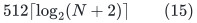
is more than sufficient. The implementation need not compute
entropy; (2) is only an analytical potential.

The outer full-host matching adapter uses cutoffs
<code class="math">\psi/(16j^2)</code> to control failure-cut unions in its CURRENT
embedding host. That parameter is distinct from the <code class="math">1/8</code>
threshold of a recursive cut player on an abstract matching
graph. Both interfaces now have their own explicit proofs.

The earlier 5/6 threshold-router composition uses the
Chuzhoy--Saranurak decremental path oracle and its CGLN
decomposition dependencies. It does not use this new
Chang--Saranurak sequential hierarchy or the half-matching
entropy assertion repaired here. The threshold change is
therefore part of the additional 4/5 route.
