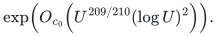
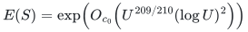

# A master-controlled hierarchy with exponent 209/210

**Abstract.** We give a conditional parameter balance for the master-size recurrence with common factor
<!-- math-display: 6c05863dd099272e78f24079
\exp\!\left(O_{c_0}\!\left(U^{209/210}(\log U)^2\right)\right).
-->

The proof varies the number of HRG levels, the reduction parameter, and the port capacity together. It relies on the explicit uniform realization hypothesis of [the master-size recurrence](growing-depth-metric-recurrence.md), including legal dynamic transactions and literal traversal certificates. The algebra below does not establish that complete implementation.

The [separate outer composition](quantitative-matching-209-210-composition.md) uses additional matching-client hypotheses. This historical parameter specialization remains scoped to that cover/HRG route. The stronger [main matching theorem, Theorem 11.6](../../problems/general-matching/proof.md#116-deterministic-cycle-search-realization), realizes the distance-sparsifier route with its own dynamic and numerical proofs; it does not inherit the cover/HRG realization hypothesis below.

The numerical primitive imports remain the constant-degree sparse
neighborhood cover and the legal dynamic spanner of
[Chen, Kyng, Liu, Meierhans and Probst Gutenberg,
arXiv:2311.18295v1](https://arxiv.org/abs/2311.18295v1).
The paper's specialized HRG corollary chooses a particular number of
levels. We instead use its explicit HRG construction and tree-family
enumeration with an independently chosen level count. This parameterized
step is proved below; it is not an invocation of the specialized
corollary outside its stated parameters.

## 1. Parameters and conditional theorem

Let `S=2^U` be the common master bound. Assume the root degree-three
input has size at most `S^2`, and its positive integral lengths and
integral gradients have at most `c0 U` bits for one absolute c0.
Write

    p = 41/42,         alpha = 209/210,
    t = 1/70,          beta = 104/105,
    L_U = ceil(log_2(U+4)).

Use the following computable integer parameters at EVERY outer
recursive level:

    k       = 2^ceil(U^alpha),
    Gamma   = 2^(ceil(U^p) L_U^2),
    kappa   = max(3, ceil(U^t/L_U)),
    C_port  = 2^ceil(U^beta),
    A       = 2^(ceil(U^beta) L_U^2).

An integer-root comparison followed by integer division computes
kappa with the stated asymptotic bounds. It is harmless to round the
numerator upward first; this changes kappa by at most a constant.
No local instance allocates an S-sized array merely because it uses
these master parameters. Stop the outer recursion at nominal size
at most `4k`, and use the direct actual-size base solver there.

The balancing identities are

    p+t = beta,
    2-alpha-t = beta,
    beta+1-alpha = alpha.

The division by L_U in kappa is useful. It leaves logarithmic slack
for a computable A to dominate fixed hidden coefficients rather than
equating its exponent to an unknown constant times the same expression.

**Theorem 1.** Assume the uniform recurrences, cover/spanner primitives, and complete lift/lifetime interface specified in the master-size analysis, including the parameterized HRG enumeration described in Section 2. The above parameters give a common backend factor
<!-- math-display: 254e0e8c6a0533ba31b8cbbe
E(S)=\exp\!\left(O_{c_0}\!\left(U^{209/210}(\log U)^2\right)\right)
-->

for quality, occurrences, pieces, and amortized update/query/log work, with actual-inventory initialization multiplied by the same factor. The theorem is eventual in <code class="math">S</code>, with finite resource guards and exact charged arithmetic.

## 2. The parameterized HRG construction

**Proof.**

Suppose a current general-cycle input has nominal size `m=2^v`,
maximum degree three, and integral lengths at most `2^b`. The
nonbase condition gives `v>=log_2 k`. Set `gamma_HRG=2 Gamma` and

    d = ceil(max(log_2(8 gamma_HRG^2),
                 (b+2v+log_2(gamma_HRG))/(kappa-1))),
    gamma_diam = 2^d,
    D_i = gamma_diam^i,        1<=i<=kappa-1.

At each radius use the radius-specific cover wrapper of the
335/336 note. Its private graph has a finite heavy backbone on
fixed local slots, polynomial internal lengths, and constant degree.
Artificial edges are filtered from its exported forest. Every
exported genuine edge metric dominates the original input length,
and every true null edge has zero physical charge. The cover factor,
marked diameter factor, and occurrence factor are bounded by
`gamma_HRG` at every local nonbase size for sufficiently large S.

The source HRG construction now makes kappa copies of the input
vertex slots, kappa-1 exported routing forests, and their linking
edges. These are literal finite loops over the supplied levels:

* each marked occurrence receives its outgoing linking edge;
* each marked forest component receives one upward root attachment;
* the root is maintained from that component's marked vertices by
  ordinary dynamic-tree aggregates;
* empty marked components receive no such attachment.

The source construction and its explicit log proof use no iteration
over the distance range. Their work is bounded by a fixed polynomial
in kappa, Gamma and log m, times the cover work. Increasing kappa
therefore increases this explicit finite loop count, rather than
changing a hidden constant in a black-box HRG theorem.

The largest radius obeys

    D_(kappa-1) >= gamma_HRG m^2 2^b.

Every genuine connected component is consequently contained in a
last-level marked cluster. This is per connected component and
requires no connectedness promise on the input.

### Routing comparison

[`hrg-routing-from-rounded-covers.md`](hrg-routing-from-rounded-covers.md)
proves the needed analytical routing statement for ANY integer
number of levels. The scale separation `gamma_diam>=8 gamma_HRG^2`
ensures that consecutive clusters supporting a path are nested.
Clipped distance-to-complement weights handle whole-component
clusters without infinities. Their normalized distributions satisfy

    ||a_i(u)-a_i(v)||_1
       <= (16/3) gamma_HRG^2 dist(u,v)/D_i.

The tensor-product transition bound gives an abstract routing norm
`O(kappa gamma_HRG^3 gamma_diam)`, and literal HRG path realization
costs another absolute constant. These distributions are used only
to prove existence and are never computed by the dynamic algorithm.

The monotone-cycle decomposition in the source's Lemma 4.22 proceeds
once through the kappa levels. Its proof only requires geometrically
increasing scales and contributes a factor `O(kappa)`. It does not
assume `kappa=log^(1/84)m`, and it does not contribute `Gamma^kappa`
at this step. Thus the comparison with a fundamental tree cycle
loses at most

    O(kappa^2 gamma_HRG^3 gamma_diam),

or the more conservative sixth-power Gamma allowance used in the
335/336 note.

### Explicit tree-family size and maintenance

For each level the source's Definition 4.30 chooses one bit position
of a vertex ID and two outgoing-edge positions. Enumerating all
tuples gives

    Lambda <= (O(gamma_HRG^2 log m))^kappa.

The constructive proof of Lemma 4.31 shows that these choices
capture every monotone comparison cycle, for every kappa: at most
two distinct vertices at each level need prescribed outgoing
choices, and one distinguishing ID bit separates them. A missing
outgoing position uses the source's consistent fallback edge.

Each family member is a subforest on the explicitly maintained HRG
vertices. A cover/linking edit can be processed in every member,
and paired edges contribute only a fixed polynomial in Gamma per
edited outgoing incidence. Therefore initialization, edit/log volume,
and total maintained size are bounded by

    Lambda * poly(kappa, Gamma, log m)

times the nominal input size or number of updates. The polynomial
degree is absolute. There is no second factor `Gamma^(kappa^2)`.
Even a bookkeeping factor `kappa^O(kappa)` could be absorbed into
the displayed family bound, since `log kappa=O(log U)` and
`log Gamma` is much larger. The literal construction needs only
the displayed single family enumeration.

This supplies the combinatorial counting for the parameterized extension: all candidate choices are enumerated once, and each local update is charged to that inventory. Its complete dynamic realization must still provide the explicit provenance and lifetime interfaces assumed by Theorem 1. The published specialized level prescription alone is not used as a theorem permitting arbitrary parameter substitution.

## 3. Degree, largest scale, and bit growth

The degree lemma of the Steiner bridge depends on kappa only
multiplicatively. An HRT vertex has at most

    4 kappa (gamma_HRG+1) + 2 gamma_HRG + 3

tree and off-tree neighbors when the genuine general-cycle input
has degree three. Its logarithm is `O(log Gamma+log kappa)`, so
the computable port capacity C_port dominates this degree
eventually. The genuine flat forest remains over a degree-three
graph after filtering the private cover backbone.

This variant MUST replace the old hard-coded port exponent
`167/168` by `beta=104/105`. Retaining the former port capacity
would exceed the new local A and invalidate this balance. The
smaller capacity suffices because the actual degree has logarithm
only `O(U^(41/42) L_U^2)`, strictly below `U^beta` eventually.

For every nonbase local size, `v>=U^alpha` up to harmless integer
rounding. Also

    kappa log Gamma = O(U^(p+t) L_U)
                    = O(U^beta L_U) = o(v).

Thus the first branch in d does not force an excessive largest
scale. The second branch contributes b+O(v), and integer rounding
of d contributes at most kappa more bits. Altogether

    log_2 D_(kappa-1) <= b+O(v).

Multiplying every HRG length and gradient by m^4 clears the
radius-wrapper denominators. The geometric path sums, frozen
gradient gauge, and master port factor S^10 add only O(U) further
bits per outer level, with absolute constants. Consequently

    B_(i+1) <= B_i+O(U).

Once the depth bound below is proved, this gives

    B_max = O_c0(U^(211/210)).

At that depth the aspect-dependent routing factor satisfies

    B_max/kappa = O_c0(U^(2-alpha-t) L_U)
                = O_c0(U^beta L_U).

The tree-family logarithm has the same bound:

    log Lambda = O(kappa(log Gamma+log log m))
               = O(U^(p+t) L_U)
               = O(U^beta L_U).

Both are strictly smaller than `log A=Theta(U^beta L_U^2)`
eventually, including their fixed unknown coefficients. Fixed
powers of C_port, multiword bit costs, master-degree inventories,
and the dynamic spanner's explicit log-aspect factors fit the
same A. No source cover is called on the unrounded large-aspect
metric; its private metric still has the fixed polynomial bound
from the radius-specific wrapper.

## 4. Closing the uniform recurrences

Use the same nominal-size, actual-record, legal-spanner, path-pool,
active-image pruning, and deletion-first recurrences as Section 7
of the 335/336 note. One combined outer reduction has total child
nominal size at most `m A/k`, and total recursive input recourse
at most A per parent edit in the amortized/prefix sense. The
uniform recurrences are

    Gamma_r <= A(Gamma_(r-1)+1),
    J_r <= A(Gamma_(r-1)+1) + (A/k)J_(r-1),
    T_r <= A T_(r-1)
           + O(k^2 A(Gamma_(r-1)+1) + A J_(r-1)).

The base uses only its actual t records, with initialization
O(t poly(bits)), query cost O((t+1)^3 poly(bits)), and no bare
k-cubed startup fee. Its exported forest may be empty. Quality
and piece recurrences have one local A factor. Returned pieces
retain unit traversal coefficients; analytical routing weights
are not returned coefficients.

These are the same depth-independent recurrences as before.
Since `beta<alpha`, eventually `log A<=(1/2)log k`. Starting
from size at most S^2, the recursion depth is therefore

    d_outer <= 4U/log_2 k+O(1) = O(U^(1/210)).

This proves the depth bound used in Section 3 without circular
use of a running-time conclusion. For formal simultaneous
induction, allow at most `ceil(8U/log_2 k)+10` levels as a
computable depth guard, use that bound in B_max, and then derive
the sharper size-shrink bound; the guard is not reached
eventually.

The safe common envelope becomes

    k^10 A^O(d_outer)
       = exp(O_c0(U^(209/210) (log U)^2)).

It bounds amortized updates, queries, logs, quality loss,
occurrence multiplicity and piece count. Actual-size root
initialization is multiplied by this factor. Local periods have
polynomial LOCAL horizons, even over a fixed polynomial master
lifespan; all restarts and actual forest retirements are charged
as in the preceding note. The internal O(U^(211/210))-bit
arithmetic costs a fixed polynomial in that bit length and is
absorbed by A. Final integral-input certificates still have
O(U)-bit numerator and rounded raw denominator, by the same
unit-piece and nonzero-optimum argument.

The preceding depth, bit, recurrence, and certificate estimates prove Theorem 1 under its stated realization hypotheses. ∎

## 5. Matching-client scope

The parameter balance improves the backend exponent because the
HRG level count now depends on the common master, rather than a
specialized local preset. It does not improve the exponent of
the imported sparse-neighborhood-cover primitive. The proof
requires the same already identified cover, spanner, geometric
lift, path-pool and numerical-lifetime contracts.

For the matching client, the natural separate parameter is

    a = floor(floor(s^(1/210))/ceil(log_2(s+4))^3).

Then `s/a=Theta(s^(209/210)(log s)^3)` dominates the new backend
log-overhead, while `a^2=o(s/a)` and `2^a` is also absorbed.
The complete substitution, including its finite guards and final
deterministic program, is given in
[quantitative-matching-209-210-composition.md](quantitative-matching-209-210-composition.md). It derives the same
fixed B-power bounds from the explicit client inequalities. The earlier <code class="math">335/336</code> calculation is a separate, weaker parameter specialization of the same conditional recurrence framework.
