# Routing from covers with arbitrary original length range

This lemma supplies the analytical routing step for
[the growing-depth backend](growing-depth-metric-recurrence.md).
It uses the hierarchical routing graph topology of
[Chen et al., arXiv:2311.18295v1, Definitions 4.2–4.3](https://arxiv.org/abs/2311.18295v1),
but proves the routing estimate directly. The argument accommodates
disconnected graphs and clusters that already contain a whole
connected component. Its distributions are used only in the proof;
the dynamic algorithm does not compute them.

## 1. Cover hypotheses and scale separation

Let <code class="math">G</code> have positive edge lengths at least one. Write <code class="math">d_G</code> for
its shortest-path metric, allowing infinite distance between distinct
connected components. Let <code class="math">\Gamma\ge3</code>, <code class="math">\rho\ge8\Gamma^2</code>,
<code class="math">D_i=\rho^i</code>, and <code class="math">h\ge2</code>. At each level
<code class="math">1\le i\le h</code>, suppose a collection of clusters <code class="math">\mathcal C_i</code>
has these properties:

1. Each vertex lies in at most <code class="math">\Gamma</code> clusters.
2. Every ball <code class="math">B_G(v,D_i/\Gamma)</code> is contained in some cluster.
3. Each cluster has diameter at most <code class="math">\Gamma D_i</code>.
4. Each cluster lies inside one connected component and has a chosen
   root belonging to the cluster.

Repeated clusters can be treated as distinct records; the first
condition counts their multiplicities. Suppose the final level has,
for each connected component <code class="math">A</code>, a designated cluster containing
all of <code class="math">A</code>. Condition 4 makes its vertex set equal to <code class="math">A</code>.
This is supplied, for example, by the last cover radius in the
growing-depth note.

Cluster labels index the analytical transitions below. If several
clusters choose the same physical root at the same level, their root
labels are identified with the one corresponding vertex of the source
HRG. It includes a directed upward edge from the root of <code class="math">C</code> at
level <code class="math">i-1</code> to the root of <code class="math">C'</code> at level <code class="math">i</code> whenever
<code class="math">C\subseteq C'</code>; using the full source HRG can only add edges.
Such an edge has length <code class="math">\Gamma D_i</code>. Different labelled transitions
may use the same actual abstract edge; summing them can only decrease
the weighted absolute-flow norm. No maintained vertex is required for
each cluster label. Level zero consists of the singletons <code class="math">\{v\}</code>,
with their actual vertices as roots.

For the source HRG, <code class="math">C\subseteq C'</code> guarantees that the root of
<code class="math">C</code> has an occurrence in the marked tree representing <code class="math">C'</code>.
The upward edge is therefore realized by its two linking edges and
the marked-tree path between them. Its literal length is at most
<code class="math">3\Gamma D_i</code>, and its physical projection joins the correct
root images.

## 2. Finite weights and their Lipschitz bound

For <code class="math">1\le i&lt;h</code>, define
<!-- math-display: f6b965c5e572d1c802c9c555
p_{i,C}(v)=\max\left\{0,
       \min\left\{1,\frac{d_G(v,V\setminus C)}{D_i}\right\}
                           -\frac1{4\Gamma}\right\},
 \qquad W_i(v)=\sum_{C\in\mathcal C_i}p_{i,C}(v).            \tag{1}
-->
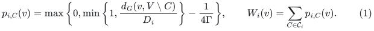
The convention is <code class="math">\min\{1,\infty\}=1</code>. If <code class="math">C</code> contains the
entire component of <code class="math">v</code>, its weight is thus finite. If <code class="math">v\notin C</code>,
its weight is zero. A covering cluster has weight at least
<code class="math">3/(4\Gamma)</code>; hence
<!-- math-display: 3c76d7cdfb348bbc77bc8d8a
\frac3{4\Gamma}\le W_i(v)\le\Gamma.             \tag{2}
-->
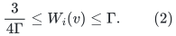
Define the probability vector
<code class="math">a_i(v)_C=p_{i,C}(v)/W_i(v)</code>. Let <code class="math">a_0(v)</code> be the point mass
on the singleton <code class="math">\{v\}</code>, and let <code class="math">a_h(v)</code> be the point mass
on its designated whole-component cluster.

Fix vertices <code class="math">u,v</code> in the same connected component and write
<code class="math">\delta=d_G(u,v)</code>. Each clipped distance in (1) is
<code class="math">1/D_i</code>-Lipschitz within this component. If the relevant outside
set is unreachable, the clipped distance is identically one on the
component, so the same statement holds. At most <code class="math">2\Gamma</code>
coordinates are nonzero at either endpoint. Therefore
<!-- math-display: 9506080456b408388eb0064c
\|p_i(u)-p_i(v)\|_1\le\frac{2\Gamma\delta}{D_i}.       \tag{3}
-->
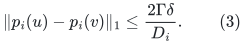
For nonnegative vectors <code class="math">p,q</code> of positive sums <code class="math">P,Q</code>,
<!-- math-display: 5ac594923fb8885140eabf75
\left\|\frac pP-\frac qQ\right\|_1
 \le \frac{\|p-q\|_1+|P-Q|}{P}
 \le \frac{2\|p-q\|_1}{P}.
-->
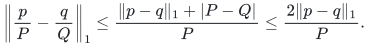
Applying this and (2)–(3) gives
<!-- math-display: a215c0b262f8c2ce1a34e34c
\boxed{\qquad
 \|a_i(u)-a_i(v)\|_1
       \le\frac{16}{3}\Gamma^2\frac{\delta}{D_i}.
 \qquad}                                                    \tag{4}
-->
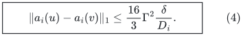
The left side is also at most two. At level <code class="math">h</code>, it is zero
because <code class="math">u,v</code> belong to the same connected component.

## 3. Every supported consecutive pair is available

Suppose <code class="math">a_{i-1}(v)_C a_i(v)_{C'}&gt;0</code> with <code class="math">i&lt;h</code>. Then
<!-- math-display: 4a5b0792046d95411833a78a
d_G(v,V\setminus C')>\frac{D_i}{4\Gamma}
       \ge2\Gamma D_{i-1}.                                 \tag{5}
-->
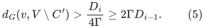
Also <code class="math">v\in C</code>, and every point of <code class="math">C</code> is within
<code class="math">\Gamma D_{i-1}</code> of <code class="math">v</code>. Consequently <code class="math">C\subseteq C'</code>.
For <code class="math">i=1</code>, the previous cluster is the singleton <code class="math">\{v\}</code>,
and the containment is immediate. For <code class="math">i=h</code>, the final cluster
is the entire connected component, so containment is again immediate.

Thus independently sampling one cluster from <code class="math">a_i(v)</code> at each
level gives a distribution on valid upward root-to-root paths. Every
such path starts at <code class="math">v</code> and ends at the same designated root for
its connected component. The stronger scale separation
<code class="math">\rho\ge8\Gamma^2</code> explicitly accounts for the factor
<code class="math">\Gamma</code> in cluster diameter.

## 4. Cost of routing one edge demand

The expected upward flow at transition <code class="math">i</code> for a unit at <code class="math">v</code>
is the tensor-product probability vector
<!-- math-display: 2253d54f6b2c01e21260ef41
a_{i-1}(v)\otimes a_i(v).
-->
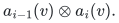
For probability vectors <code class="math">a,b,c,d</code>,
<!-- math-display: 2f1f62c1c1dcdee2e66a04d9
\|a\otimes b-c\otimes d\|_1
       \le\|a-c\|_1+\|b-d\|_1.                            \tag{6}
-->
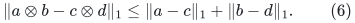
For an input edge <code class="math">e=(u,v)</code>, route its unit incidence demand by
subtracting the upward distribution of <code class="math">v</code> from that of <code class="math">u</code>.
The common terminal root cancels. For interior transitions, (4)
and (6) bound the absolute edge mass by
<code class="math">O(\Gamma^2\delta/D_{i-1})</code>.

At the bottom transition, the two singleton distributions differ
by at most two. For distinct endpoints, <code class="math">\delta\ge1=D_0</code>,
because all input lengths are at least one; the same bound therefore
holds there. A loop has equal endpoints and zero routed demand.
At the final transition, the last probability vectors are identical,
so only the preceding level contributes.

Multiplying by the transition length <code class="math">\Gamma D_i</code> gives cost
<code class="math">O(\Gamma^3\rho\delta)</code> per level. Summing the <code class="math">h</code> levels
and using <code class="math">\delta\le\ell_e</code>,
<!-- math-display: e3bc4ca16ede2062f4131853
\text{abstract routing length for the edge demand}
            \le O(h\Gamma^3\rho)\,\ell_e.                  \tag{7}
-->
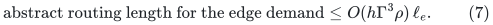
Replacing every abstract edge by its HRG realization costs at most
another factor three, including literal traversal multiplicities.

By linearity and the triangle inequality, the same operator norm
bound holds for any demand decomposed into input-edge flows. Adding
the original edge to its oppositely oriented routed demand yields
the cycle projection estimate
<!-- math-display: 5fe5d5abce9c4c7a2e969705
1+O(h\Gamma^3\rho).                    \tag{8}
-->
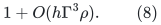
This is within the looser <code class="math">O(\kappa\Gamma^6\rho)</code> allowance
used by the existing HRG-to-cycle reduction, with <code class="math">h=\kappa-1</code>.

## 5. Interface consequences

The proof uses the cover, diameter and occurrence properties,
the number of levels, and the geometric scale ratio. It does not
require polynomial original edge lengths. The entire original
aspect enters only through the choice of the last radius and of
<code class="math">\rho</code>. No shortest-path query, cluster-distance calculation,
or probability normalization from (1) is part of the maintained
algorithm.

The dynamic HRG still maintains precisely the source forest copies,
marked memberships and linking edges. Clipping the analytical
weights changes none of these records, and the stronger choice of
<code class="math">\rho</code> changes only the supplied radii and stored labels. Thus
these two repairs add no uncharged recourse or initialization work.
Isolated vertices are valid singleton components; the argument
never routes demand between distinct components.

## 6. A finite connected private graph for each rounded cover

The radius wrapper can invoke the published cover primitive without
using an infinite-length convention for disconnected inputs. Fix one
local cover instance and let <code class="math">m\ge2</code> be a nominal bound counting
its resident vertex slots and genuine edges, enlarged by a fixed
constant factor for the private graph below. All its vertex slots are
fixed during this instance. Source-factor envelopes are evaluated at
this enlarged size; their fixed constant-factor changes are absorbed
by the declared <code class="math">\Gamma</code> envelope.

For a requested original radius <code class="math">D</code>, set <code class="math">\delta=D/m^4</code>,
discard genuine edges longer than <code class="math">D</code>, and replace each remaining
genuine length by <code class="math">w_e=\lceil\ell_e/\delta\rceil\le m^4</code>.
Add a permanent path through every fixed vertex slot, using fresh
artificial edge IDs of length
<!-- math-display: 1e49f6bdeb895716a2abc2bd
H=m^8.
-->
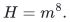
The private graph is connected under every genuine-edge update.
Its degree is at most five when the genuine graph has degree at
most three, so it still satisfies the source's constant-degree
hypothesis. Its size is <code class="math">O(m)</code>, including isolated genuine
vertices, and its lengths lie in <code class="math">[1,m^8]</code>. The cover call uses
radius <code class="math">m^4</code>, with the usual factor <code class="math">\gamma\le m^3/2</code> after
the eventual size threshold.

Maintain the source primitive unchanged on this private graph.
From its exported forest, exclude every edge occurrence whose
source image is one of the artificial path edges. Keep the
remaining occurrence vertices, genuine edges and null edges, and
the marked set. This is an output filter, not a deletion supplied
to the source data structure.

To prove correctness, every source forest edge mapping to an
artificial edge has length at least <code class="math">H</code>. Any path between two
marked vertices in one source tree has length at most
<code class="math">\gamma m^4&lt;H</code>. Such a path therefore contains no excluded
edge. All the marked vertices of a source tree remain in the same
filtered tree, and their diameter bound is preserved. Also a
private-graph ball of radius <code class="math">m^4/\gamma&lt;H</code> cannot traverse an
artificial edge. Consequently the same covered balls are present
in the genuine rounded graph. The filtered forest is a flat
embedding of that graph; extra unmarked components may simply
remain as dormant records.

Scale genuine exported lengths by <code class="math">\delta</code>, and give retained
null edges length <code class="math">\delta</code>, exactly as in the radius wrapper.
The rounding and positive-null-length proofs are unchanged.
Artificial path edges have never been genuine matching edges or
raw-cycle input edges, and **no artificial occurrence is output
as a real physical traversal**. They carry no numerical flow
counter in the exported structure.

Filtering costs at most constant work per explicitly reported
source record change. It neither duplicates occurrences nor
adds a scan on a genuine update. Initialization and storage are
<code class="math">O(m\gamma)</code>, with the usual logarithmic bookkeeping overhead.
The larger fixed polynomial length exponent eight changes no
subpolynomial source exponent.

### Reserved slots and small inputs

If isolated-vertex births are needed, a local instance can reserve
<code class="math">O(m)</code> private slots at initialization and end after at most
<code class="math">m</code> wrapper events. A birth activates one unused slot; a true
retirement suppresses its now entirely null exported fiber only
after every formerly real incident occurrence has completed its
signed and absolute retirement transfers. An unused slot's
occurrences stay private. Since all its genuine incidences are
absent and all artificial occurrences are filtered out, its
remaining forest components are null fibers, disjoint from any
active marked-tree path. Activation or suppression visits only
the <code class="math">O(\gamma)</code> occurrences of that slot and gives newly
exposed records fresh immutable image lifetimes. The primitive's
own vertex set and permanent path remain fixed; no unsupported
source vertex-insertion or vertex-deletion operation is invoked.
All reserved slots and private occurrences are counted in <code class="math">m</code>
and its initialization allowance.

A period's reserved capacity can be chosen as a constant multiple
of its initial resident size. A period restart or an ordinary
size-doubling rebuild supplies later capacity, charged to the
intervening local events. The master-size construction uses its
direct cycle solver when the actual local graph is below the
base threshold. It never pads a small root to size <code class="math">S</code> merely
to initialize this private backbone or its cover routine.
