# An elementary balanced weighted witness from a hypercube

**Optional local replacement, 24 October 2026.** This note replaces
the fixed-expander-family call used to construct a balanced weighted
witness in the static routing sparsifier. It loses only polynomial
logarithmic factors. It does not change the 4/5 quantitative rate.
The existing constant-degree witness remains a valid alternative.

The only graph fact used is the elementary cube cut induction in
[hypercube-port-adapter.md](hypercube-port-adapter.md), Section 2:
every cut of the <code class="math">q</code>-dimensional cube has at least its smaller
vertex-side cardinality many crossing edges.

## 1. Literal weighted interface

Let <code class="math">V</code> have at least two vertices. Suppose the explicitly given
positive rational weights satisfy
<!-- math-display: 979a6f57004a7d2ccd4f409b
w_v\geq1,\qquad
             w_v\leq\sum_{u\ne v}w_u
                         \quad(v\in V).
 \tag{1}
-->
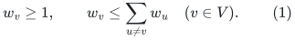
Put <code class="math">W=\sum_v w_v</code>. There is a deterministic construction of
a loopless undirected multigraph <code class="math">F</code>, on vertex set exactly
<code class="math">V</code>, such that
<!-- math-display: 6fa9de24950921bfe4a57f2c
\begin{split}
       w_v\leq\deg_F(v)&\leq4q\,w_v,\\
                    \Phi(F)&\geq1/q,\\
                    |E(F)|&=O(W\log(W+2)),
 \end{split}
 \tag{2}
-->
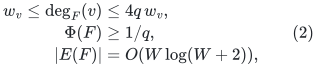
where <code class="math">q=\lceil\log_2\sum_v\lceil w_v\rceil\rceil\geq1</code>.
The work is <code class="math">O(W\log(W+2))</code> elementary record operations,
plus the bit cost of the explicit input and integer arithmetic.
Every parallel output edge retains its own ID. There are no
output self-loops.

The balance condition is automatic for the weights
<!-- math-display: cb5ab085001b7a27ab8c1d0f
w_v=\deg_J(v)/\rho
 \tag{3}
-->
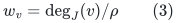
of a loopless native graph, whenever <code class="math">\rho&gt;0</code> is no larger
than its minimum positive degree. Indeed every edge incident
to <code class="math">v</code> contributes the same degree mass at another vertex.
The isolated-vertex cases are omitted before making this call.

## 2. Rounding the port count without an oversized fiber

Let
<!-- math-display: 0291844b8cdda2971ec0e67b
p_v=\lceil w_v\rceil,\qquad N=\sum_v p_v,\qquad
                   M=2^{\lceil\log_2 N\rceil}.
 \tag{4}
-->
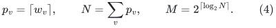
Rounding preserves balance:
<!-- math-display: e24b5d0bdae75db08f471b09
p_v\leq\left\lceil\sum_{u\ne v}w_u\right\rceil
                      \leq\sum_{u\ne v}\lceil w_u\rceil .
 \tag{5}
-->
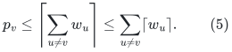
Thus <code class="math">p_v\leq N/2</code>. We will allocate integer group sizes
<!-- math-display: ad9fb7a353fab1ff02a735e9
p_v\leq p'_v\leq\min\{2p_v,M/2\},
                 \qquad \sum_vp'_v=M .
 \tag{6}
-->
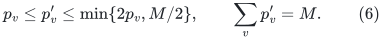
Such sizes always exist. Their lower bounds sum to <code class="math">N\leq M</code>.
To check that their upper bounds sum to at least <code class="math">M</code>, consider
the number of indices with <code class="math">p_v&gt;M/4</code>.

* With none, the upper bounds sum to <code class="math">2N\geq M</code>.
* With at least two, their two upper bounds already sum to <code class="math">M</code>.
* With exactly one, say <code class="math">v</code>, the sum is
  <!-- math-display: 9ebe7c444148245e66f0a7c3
  M/2+2(N-p_v)\geq M/2+N\geq M,
  -->
  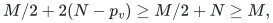
  using <code class="math">p_v\leq N/2</code> and <code class="math">N\geq M/2</code>.

Start with <code class="math">p'_v=p_v</code> and distribute the remaining <code class="math">M-N</code>
ports in a fixed order, up to the displayed integer capacities.
This is a linear scan of the actual vertex inventory. No
unassigned dummy group remains. In particular every final group
has at most half of the cube's ports.

## 3. The witness graph and its proof

Construct the <code class="math">q=\log_2 M</code> dimensional cube on its <code class="math">M</code>
bit strings. Partition these vertices into groups of sizes
<code class="math">p'_v</code>, in a fixed order. Contract each group to <code class="math">v</code>,
discard every cube edge whose two endpoints belong to the
same group, and retain all other cube edges with distinct IDs.
This defines <code class="math">F</code>.

For one group, the cube cut inequality and (6) give
<!-- math-display: b92499dd3b6fc5bd970fa21a
\deg_F(v)\geq p'_v\geq p_v\geq w_v.
 \tag{7}
-->
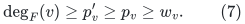
Its degree is at most the total degree of its ports, namely
<!-- math-display: a991fa4a67555db792475949
\deg_F(v)\leq q p'_v
               \leq2q\lceil w_v\rceil\leq4q w_v .
 \tag{8}
-->
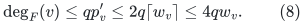
The last inequality uses <code class="math">w_v\geq1</code>.

For a nontrivial vertex cut <code class="math">A\subset V</code>, let
<code class="math">P_A=\sum_{v\in A}p'_v</code>. Its boundary in <code class="math">F</code> is
exactly the boundary in the cube of the corresponding port
union, so it is at least <code class="math">\min\{P_A,M-P_A\}</code>.
On the other hand
<!-- math-display: 8b032e53b379e7fb877ac96c
\min\{\mathrm{vol}_F(A),
             \mathrm{vol}_F(V\setminus A)\}
                 \leq q\min\{P_A,M-P_A\}.
 \tag{9}
-->
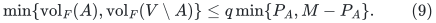
This proves conductance at least <code class="math">1/q</code>.
In particular the witness is connected and has no isolates.

Finally <code class="math">M&lt;2N\leq4W</code>, with the harmless equality cases
handled by the same upper bound. Enumerating each cube edge
once by bit flips costs <code class="math">O(Mq)</code>. This is
<code class="math">O(W\log(W+2))</code>, and bounds the number of retained IDs too.
The graph is generated at its actual port count, never padded
to an unrelated master bound.

## 4. Quantitative use in the linear-parameter static sparsifier

The existing degree-band witness uses balanced weights (3)
with <code class="math">w_v\geq1</code>. In
[linear-parameter-static-sparsifier.md](linear-parameter-static-sparsifier.md),
replace its constant upper-degree multiplier <code class="math">D_w</code> by
<!-- math-display: c00107df9c890aac3f37d90d
D_w=4q=O(U).
 \tag{10}
-->
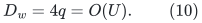
The actual weight inventories there obey
<code class="math">\log(W+2)=O(U)</code>. The witness size and its weighted edge
mass gain at most the same <code class="math">O(U)</code> factor:
<!-- math-display: 2ea296887242d75fa137f6fb
\sum |E(F)|\leq O(U)\sum O(W),\qquad
 \sum\rho\,|E(F)|\leq O(U)\sum O(|E(J)|).
 \tag{11}
-->
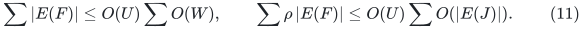
Its inverse conductance is now <code class="math">q=O(U)</code>, rather than a
fixed constant.

Forward token loading on the native component acquires the
factor <code class="math">D_w=O(U)</code>. Reverse token loading still uses the
lower degree inequality <code class="math">\deg_F(v)\geq w_v</code>, so the
same reverse load bound is valid; its total query volume
only gains the witness's <code class="math">O(U)</code> edge-volume factor.
Routing inside <code class="math">F</code> pays a fixed polynomial of <code class="math">q</code>.
The normalized weighted path selection and its input
congestion accounting are unchanged except for these
explicit polynomial factors.

More explicitly, write <code class="math">m_J,n_J</code> for the original static
instance and <code class="math">\phi</code> for its common band conductance. The
three sums displayed in the existing constant-<code class="math">D_w</code> proof
become the conservative bounds
<!-- math-display: 4588b97b85e39558aed3ee76
\begin{split}
 \sum_i|E(F_i)|&=O(n_J\phi^{-1}U^2),\\
 \sum_i|E(F_i)|&=O(m_J\phi^{-1}U),\\
 \sum_i\rho_i|E(F_i)|&=O(m_JU).
 \end{split}
 \tag{11a}
-->
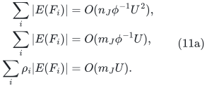
For forward witness tokens the executable endpoint-load
parameter is <code class="math">D_{1,i}=\lceil2D_{w,i}/\phi\rceil =O(U/\phi)</code>. Its aggregate full-host query volume is
<code class="math">O(m_JU/\phi)</code>. The actual forward-token count satisfies
the same bound, by
<code class="math">\lceil\rho_i\rceil\leq\rho_i+1</code> and (11a).
For reverse routing keep
<code class="math">D_{2,i}=\max\{1,\lceil\rho_i\rceil\}</code>; then
<!-- math-display: 5d6edd51dd82a13a2efc1ecd
\sum_i|E(F_i)|D_{2,i}
          \leq\sum_i(\rho_i+1)|E(F_i)|
                      =O(m_JU/\phi).
 \tag{11b}
-->
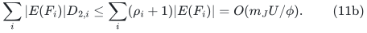
There is still one preprocessing call per actual witness
component, not one call per load unit.

With a common simple-path quality bound <code class="math">Q</code>, the forward
candidate occurrence load on <code class="math">J</code> is now <code class="math">O(UQ/\phi)</code>.
After the immediate ambient normalization it gives expected
resource load <code class="math">O(UQC_0/\phi)</code>. A single candidate's weighted
resource increment is still at most
<code class="math">O((\Delta(J)+1)(Q+1))</code>; the changed witness degree does
not increase the edge weight <code class="math">\rho_i</code>. The path-selection
bound therefore acquires the displayed polynomial <code class="math">U</code>
factor in its <code class="math">C_0</code> term, while retaining the ADDITIVE
dependence on <code class="math">C_0+\Delta(J)</code>. This is the precise place
where (10), rather than an unchanged absolute constant,
enters the congestion proof.

Since <code class="math">h=\lceil\log_2(U+4)\rceil</code>, all these factors fit
<!-- math-display: 9d514cb160bf63d64eb227d4
\Gamma=\exp O((p+r)h)
 \tag{12}
-->
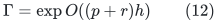
and the existing local construction factor. The powers of
<code class="math">U</code> have fixed exponents independent of <code class="math">p,r</code>.
They do not introduce <code class="math">p^2</code>, a new repair-depth factor,
or a dependence on the length of an ambient route into
the congestion guarantee.

This is a proof of one optional local replacement. Applying
it to an already delivered checkpoint would require a new
version explicitly using (10), rather than silently treating
the former <code class="math">D_w</code> as an absolute constant.
