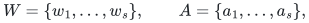
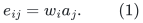
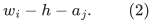
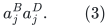
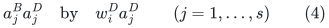
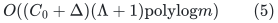
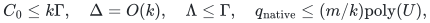
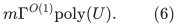
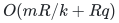

# What changes when all repairs use the initial route table

**Separate interface analysis, 24 October 2026.** A possible route
to better dynamic quality is to retain one initial short route table,
keep all touched vertices since its creation, and maintain its
projected demand graph dynamically. If that projected graph could be
handled with little selected-central-edge recourse, its preliminary
ambient images would retain the initial length bound. This note
identifies the exact update operation that needs a new theorem.
It does not rule out such a theorem and does not change the reviewed
<code class="math">4/5</code> construction.

## 1. The proposed benefit

Let <code class="math">R_0(e)</code> be a fixed initial route of length at most <code class="math">\Lambda</code>
for each input edge <code class="math">e</code>. Current insertions may separately receive
their identity routes. At time <code class="math">t</code>, keep every native vertex
touched since initialization. For a surviving input edge, take the
first touched anchor from each current endpoint of its old route,
using the split/deleted-path convention of
[normalized-projected-route-composition.md](normalized-projected-route-composition.md).

The preliminary image of the resulting projected edge consists of
two still-valid exterior prefixes and the current central input
edge. Its length is at most <code class="math">2\Lambda+1</code>, independently of how
many later static repairs have occurred. A sufficiently strong
dynamic sparsifier on this projected graph could therefore give
quality controlled by <code class="math">\Gamma\Lambda</code>, rather than by
<code class="math">\Gamma^{O(K)}</code>.

This observation alone is not an update algorithm. The current
projected graph is not, in general, an insertion-only graph with
ordinary native vertex splits.

## 2. A constant-length example of multiple-origin extraction

Fix an integer <code class="math">s\geq2</code>. Let the original graph have a hub <code class="math">h</code>,
sets
<!-- math-display: c0a67902510610d7d96b9bca
W=\{w_1,\ldots,w_s\},\qquad
             A=\{a_1,\ldots,a_s\},
-->

every star edge <code class="math">hw_i,ha_j</code>, and every edge
<!-- math-display: 759facc96fdc01ee83529edc
e_{ij}=w_i a_j.
 \tag{1}
-->

All edge IDs are distinct, and the graph is loopless and simple.
It has <code class="math">\Theta(s^2)</code> edges and maximum degree <code class="math">2s</code>.

Take the star as the initial selected base. Every demand in (1)
has the two-edge initial route
<!-- math-display: e94fc3523311adac3557a9e3
w_i-h-a_j.
 \tag{2}
-->

Star edges have their identity routes. Thus the initial route
length bound is the absolute constant two.

First, for each <code class="math">j</code>, split <code class="math">a_j</code> into <code class="math">a_j^B</code> and <code class="math">a_j^D</code>:
put the edge <code class="math">ha_j</code> at <code class="math">a_j^B</code>, and all edges <code class="math">e_{ij}</code> at
<code class="math">a_j^D</code>. Both new endpoints are touched. These are genuine
native splits; they do not introduce new edge IDs.

The initial route of <code class="math">e_{ij}</code> is now broken. From its <code class="math">w_i</code>
endpoint, its first touched anchor is <code class="math">a_j^B</code>; from its current
<code class="math">a_j^D</code> endpoint, the first anchor is <code class="math">a_j^D</code> itself. Hence all
edges <code class="math">e_{1j},\ldots,e_{sj}</code> currently project to parallel edges
<!-- math-display: 77a07c21c8d28b54c07e9a79
a_j^B a_j^D.
 \tag{3}
-->

The hub is not touched by these splits.

Next split one <code class="math">w_i</code> into <code class="math">w_i^B,w_i^D</code>, leaving <code class="math">hw_i</code> at
<code class="math">w_i^B</code> and all <code class="math">e_{ij}</code> at <code class="math">w_i^D</code>. Its current endpoint is
touched, so the projected graph now replaces, simultaneously,
<!-- math-display: adf9d4232f304737b82bdc16
a_j^B a_j^D
                    \quad\hbox{by}\quad
             w_i^D a_j^D
                \qquad (j=1,\ldots,s)
 \tag{4}
-->

for the central IDs <code class="math">e_{ij}</code>.

Before the last such operation, each <code class="math">a_j^B</code> still has other
projected incidences from rows not yet split. Operation (4)
extracts proper subsets of incidences from <code class="math">s</code> different old
vertices and identifies those extracted endpoints with ONE new
physical anchor <code class="math">w_i^D</code>. It is not one native vertex split.

The example uses actual broken initial paths. It is not caused
merely by deciding to repair a still-valid path after an unrelated
touch.

## 3. Why ordinary splits do not implement this operation

Under insertions of vertices and ordinary vertex splits, with no
edge deletion/reinsertion or vertex identification, every current
vertex has a unique ancestral vertex. Distinct old ancestry classes
never combine. This is an immediate induction: a new isolated vertex
starts a new class, and splitting partitions one existing class.

The endpoint in (4) combines incidences whose old endpoint vertices
were the distinct <code class="math">a_j^B</code>. Therefore preserving all projected edge
IDs and all physical anchor identities requires at least one
operation outside that insertion/split-only interface:

* endpoint relocation through edge deletion and reinsertion;
* identification of the <code class="math">s</code> extracted endpoint groups; or
* distinct auxiliary copies that are identified only after the
  auxiliary sparsifier.

The third option is legitimate in principle, but requires a size
bound. In this example, retaining immutable old-origin identities
creates one <code class="math">w_i^D</code>-copy for each old <code class="math">a_j^B</code>-origin. After all
<code class="math">s</code> row splits there can be <code class="math">\Theta(s^2)</code> such origin slots,
despite only <code class="math">O(s)</code> actual touched anchors and initial base size
<code class="math">O(s)</code>. The slots arise even though every original route has
length two. Thus the total number of initial route occurrences is
not an adequate substitute for the small-child vertex bound.

This count applies to that straightforward immutable-origin
adapter. It is not a proof that every auxiliary representation
needs so many slots.

## 4. Central memberships and projected endpoints are different

The current child graph contains selected CENTRAL native IDs,
with their native physical endpoints. It does not contain every
current projected endpoint pair. Thus all movements in (4) may be
processed as local projected-graph work while the same selected
central IDs remain selected. A large number of anchor changes does
not by itself imply equally many child edge changes.

The example intentionally does not prove a large selected-membership
lower bound. Its final projected graph contains a complete
bipartite pattern, which has easy sparse spanning supports. Suitable
membership choices can add only a few central edges per new row.
Consequently it would be incorrect to infer impossibility from
Section 3.

What is missing is a constructive theorem that maintains a sparse
selected CENTRAL-ID set under these multiple-origin refinements,
with both:

1. short explicit current projected routes and low ambient
   occurrence congestion; and
2. selected-ID births and deaths bounded by a subpolynomial factor
   per actual touched-anchor event, independent of the native
   degree <code class="math">s</code>.

Its local work may scan all affected initial-route occurrences,
as long as the total work over the parent period is paid. A
<code class="math">k</code>-sized local scan is permitted by the existing numerical
recurrence; a <code class="math">k</code>-fold multiplier on propagated child membership
changes is the dangerous term.

## 5. A positive local-work bound and two accounting distinctions

Assume the initial table has length at most <code class="math">\Lambda</code>, current
ancestor vertex-occurrence congestion at most <code class="math">C_0</code>, and the
current native degree is at most <code class="math">\Delta</code>. Dead input demands
are removed from its inverse lists; later edge births get identity
routes. At a current split descendant, the retained initial records
still contribute <code class="math">O(C_0)</code>: a fixed old occurrence has at most its
two path-side incidences and any endpoint annotation. Splitting
partitions these incidences rather than manufacturing additional
live sides. Current identity-route records contribute <code class="math">O(\Delta)</code>.

Maintain inverse occurrence and endpoint lists on those CURRENT
native identities. One native deletion or split can enumerate
all affected old route IDs through its constantly many touched
vertices and incidences. Deduplicate the IDs, then scan each
affected route's at most <code class="math">\Lambda</code> original positions, with its
current split/deletion annotations, to recover both first anchors.
This deliberately simple implementation costs
<!-- math-display: 0b51c432d71919ca09eea9c5
O((C_0+\Delta)(\Lambda+1)\mathrm{polylog}m)
 \tag{5}
-->

per native edit, plus that edit's explicit native incidence
transcript. It includes anchor changes that leave the path position
fixed but change its descendant ID. All resulting projected
endpoint replacements can be reported at this cost.

For the proposed parent period, if
<!-- math-display: 82fe05fbdbc6f3d361ec4c44
C_0\leq k\Gamma,\quad \Delta=O(k),\quad
 \Lambda\leq\Gamma,\quad q_{\rm native}\leq(m/k)\mathrm{poly}(U),
-->

then initialization plus all these anchor updates costs
<!-- math-display: 41ece8546d4e860ccdfef44d
m\Gamma^{O(1)}\mathrm{poly}(U).
 \tag{6}
-->

No monotone-position proof is needed for this conservative bound.
It is local projected-graph work. A theorem about its selected
memberships is still needed before feeding changes to the recursive
child. In particular, (6) assumes the stated native edit bound; it
does not establish a new degree-feedback termination argument.

### Monotone positions versus native descendant identities

With no native splits, a newly marked vertex can only move the first
anchor toward the original endpoint along a fixed initial route.
Each route has at most <code class="math">\Lambda+1</code> positions. Native splits add a
distinct issue: the anchor's position can stay fixed while its
current descendant identity changes. A bound on position changes
does not count those updates. They must be charged to a concrete
split-incidence implementation, or maintained implicitly with an
explicit query and output transcript.

The example already exhibits many position changes with
<code class="math">\Lambda=2</code>, but its total explicit route inventory is
<code class="math">\Theta(s^2)</code>, so linear work in that inventory remains feasible.
It is the selected-membership/auxiliary-size requirement that
needs an additional proof.

### Total work is not prefix recourse

A bound of <code class="math">O(m\Lambda\mathrm{polylog}m)</code> on all initial
anchor records over a period is compatible with amortized local
work <code class="math">k\Lambda\mathrm{polylog}m</code> when that period has
<code class="math">\Theta(m/k)</code> parent updates. It does not imply the needed
selected-child prefix bound
<!-- math-display: d154d644f465db7e2e0646fd
O(mR/k+Rq)
-->

after <code class="math">q</code> actual updates. That prefix, including its single
initial credit, remains a separate interface obligation.

The global-initial-route idea therefore remains a meaningful
candidate. The exact new operation is multiple-origin incidence
extraction with physical identification, not ordinary insertion
and vertex splitting.

The follow-up [ambient bulk-deactivation example](../mechanism-boundaries/ambient-bulk-deactivation-obstruction.md)
also isolates a separate support problem: simply capping normalized
ambient loads and deactivating every image using a saturated resource
can retain quadratically many selected IDs, even on a static input.
That counterexample concerns the generic fixed-image rule; it is not
asserted to be an actual first-touched matching trajectory.
