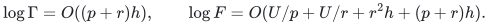
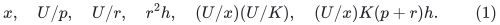
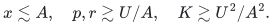
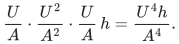
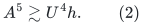
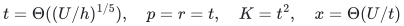
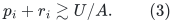
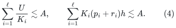
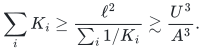
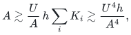

# The 4/5 balance in the current linear-router backend model

**Scope.** This is an optimization of the positive expressions explicitly
charged by the reconstructed backend. It is not a lower bound on
matching, dynamic ratio cycles, expander routing, or the actual running
time of a primitive whose available upper bound may be loose.

Write <code class="math">U=\log M</code>, <code class="math">h=\log(U+2)</code>. The current sequential router and
static construction give
<!-- math-display: 6a29d56a534a2298d5ce4ab8
\log\Gamma=O((p+r)h),\qquad
 \log F=O(U/p+U/r+r^2h+(p+r)h).
-->

With uniform recursive shrink logarithm <code class="math">x=\log k</code>, repair depth <code class="math">K</code>,
and <code class="math">d=O(U/x)</code> recursive levels, the relevant charged expressions
include
<!-- math-display: 4ab6301722056917cf7615a7
x,\quad U/p,\quad U/r,\quad r^2h,\quad
 (U/x)(U/K),\quad (U/x)K(p+r)h.
 \tag{1}
-->

The last expression is FULL recursive quality, not merely one local
distance certificate.

## 1. Uniform parameters

Suppose a logarithmic budget <code class="math">A</code> pays every expression in (1), up to
fixed positive constants. Then
<!-- math-display: 82a0caea7ffc89c58bdd0a4a
x\lesssim A,\quad p,r\gtrsim U/A,\quad
 K\gtrsim U^2/A^2.
-->

Consequently the last expression in (1) is at least a fixed multiple of
<!-- math-display: 787f7f56faa493ff5ffa1864
\frac U A\cdot\frac{U^2}{A^2}\cdot\frac U A\,h
       =\frac{U^4h}{A^4}.
-->

It follows that
<!-- math-display: 6ef3260c454d946b22f76d63
A^5\gtrsim U^4h.                 \tag{2}
-->

The choice
<!-- math-display: dfa7478739c20cf3775f49af
t=\Theta((U/h)^{1/5}),\quad
 p=r=t,\quad K=t^2,\quad x=\Theta(U/t)
-->

attains <code class="math">A=O(U^{4/5}h^{1/5})</code>. Its additional local construction term
<code class="math">r^2h</code> and its local quality term <code class="math">K(p+r)h</code> are smaller. Thus this
choice optimizes both the power and leading logarithm in this stated
uniform-parameter model.

## 2. Different parameters at different levels

The same obstruction persists if parameters vary by recursive level,
provided the same positive charged expressions are retained. Let
<code class="math">u_i</code> be the logarithmic SIZE ENVELOPE at level <code class="math">i</code>, with
<code class="math">u_0=U</code>, shrink logarithm <code class="math">x_i</code>, repair depth <code class="math">K_i</code>, and router
parameters <code class="math">p_i,r_i</code>.

Assume the envelope loses at most <code class="math">c x_i</code> at a level and a sublinear
budget <code class="math">A=o(U)</code> cannot terminate before its envelope falls below
<code class="math">U/2</code>. This is the size-envelope model generated by the current
recurrence. It is not an assertion that an easy actual graph cannot
shrink much faster.

A budget <code class="math">A</code> paying local shrink work forces <code class="math">x_i\lesssim A</code>.
Hence at least <code class="math">\ell\gtrsim U/A</code> levels have <code class="math">u_i\ge U/2</code>.
Paying their local router work forces
<!-- math-display: e84ffa5a486f5bf062c37c9d
p_i+r_i\gtrsim U/A.              \tag{3}
-->

The propagated recourse charge and full quality charge respectively
require
<!-- math-display: 1794ef99bd10d19c92143a18
\sum_{i=1}^{\ell}\frac{U}{K_i}\lesssim A,\qquad
 \sum_{i=1}^{\ell}K_i(p_i+r_i)h\lesssim A.                  \tag{4}
-->

By Cauchy--Schwarz,
<!-- math-display: 8e1a10550bc3f90ca2800f30
\sum_iK_i\ge
 \frac{\ell^2}{\sum_i1/K_i}
 \gtrsim\frac{U^3}{A^3}.
-->

Equations (3)--(4) then force
<!-- math-display: 8e80f27405edf312dc7fa18f
A\gtrsim \frac U A\,h\sum_iK_i
       \gtrsim\frac{U^4h}{A^4},
-->

again proving (2). The argument already grants each source call its
smaller local size rather than charging the full master size.

## 3. What a further improvement would need to change

This calculation isolates possible changes of mechanism. Improving
only fixed polynomial exponents, choosing nonuniform <code class="math">k_i,K_i</code>, or
reducing the local <code class="math">r^2h</code> construction term does not improve (2)
while (1) remains the charged model. A further power improvement can
come from changing at least one of:

* the preprocessing/output tradeoff <code class="math">U/p</code> versus <code class="math">ph</code>;
* the propagated recourse <code class="math">u_i/K_i</code>;
* the multiplication of a <code class="math">K_i\log\Gamma_i</code> quality loss over levels;
* the size-envelope or terminal-solver relation used to count levels.

These are research targets, not impossibility claims. In particular,
a sharper source algorithm can justify replacing a currently charged
upper expression even when the corresponding old expression was not
known to be attained on any input.
