# Literal top-ledger serial routes and the semantic scope of the obstruction

**Research analysis, 25 October 2026.** This note strengthens the algebraic
scope of the earlier serial route-quality example while narrowing what that
example can legitimately rule out. The graph below has actual subcubic
physical bin records, row degree three, integral row sums, feasible ledgers
at every floor, the prescribed phase constants, and only tiny top debt. Its
literal positive-log gradient admits a constant-ratio root cycle but
arbitrarily poor terminal cycles under a chain of zero-gradient corrections.

Nevertheless the represented matching is already maximum, and the cheap
matching-semantic upper certificate from
[matching-semantic-oracle-and-contact-reserve.md](matching-semantic-oracle-and-contact-reserve.md) recognizes LOW without
finding the hidden cycle. Thus a generic raw-cycle obstruction is not, by
itself, an obstruction to every matching-specific numerical replacement.

This is a legal settled-state and routing-interface construction. It does not
prove that the exact canonical numerical trajectory or the actual maintained
sparsifier chooses this state and these route tables.

## 1. The underlying core and its serial shortcuts

Fix an integer `b>=2` and depth `k>=1`, and put `n0=b^k`. Make a core path
with vertices `v_0,...,v_(n0)`. Include shortcuts

<!-- math-display: ce615661b2d93b2bfc8a6e85
v_{j b^{k-i}}v_{(j+1)b^{k-i}},
       \qquad 0\le i<k,\quad 0\le j<b^i.
-->
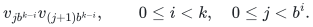

Also include one distinguished return connection between `v_0` and `v_(n0)`.
It is a separate connection identity from the top shortcut. Call all other
connections ordinary. There are at most `2n0` connections altogether and
maximum core degree `O(k)`.

At stage `i`, the length-`b^(k-i)` shortcuts will be replaced by their `b`
children, with base path connections at the final stage. In the final core
only the base path and the return connection remain cyclic.

## 2. Real row/bin ledgers with one common row sum

Choose an integer

<!-- math-display: da993872ac67ae17694fd3f7
A>120000+16(2k+4),\qquad D=A-120000.
-->
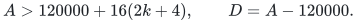

Add isolated core-bin identities, if necessary, so the total number `v` of
core bins is a multiple of `D` and is at least `n0+1`. The added bins will be
separate physical odd-cycle components. Write `z=v/D`.

Every core connection `e={u,v}` becomes a distinct row `r_e`, incident to its
two core endpoint bins and one private bin `d_e`. Let

<!-- math-display: 7c4b35ef3847e6ab04917d97
L=CA.
-->
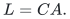

For an ordinary row, set its two core allocations to `8C` and its private
allocation to `L-16C`. For the return row, set the allocation to `v_0` to `C`,
the allocation to `v_(n0)` to `8C`, and the private allocation to `L-9C`.
Every allocation is a positive integer and every row sum is exactly `L`.

Give an ordinary private bin weight 16 and the return private bin weight 9.
Give a core bin `u` weight

<!-- math-display: cbb26e1fadb0a872e68130b3
w_u=A-8\deg(u)+7\,1_{u=v_0}.
-->
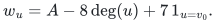

The displayed choice of `A` makes all weights positive and leaves enough
physical ports. Every bin has residual `L-load=Cw`.

Choose the master `S` from the final physical size, put `delta=S^(-1000)` and
`sigma=8delta`, and set top debt and slack to `sigma` at every core or private
bin. The top equation

<!-- math-display: edec24f0e5e36283f3cdda11
s_d=L-\mathrm{load}(d)+p_d-Cw_d
-->
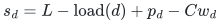

holds exactly. These slacks are above the positivity-service trigger. Total
top debt is below the existing `S^(-800)` allowance for sufficiently large
instances.

At every integral floor `c<=C`, use the same integral allocation and zero
debt. Residual `Cw` meets floor `cw`. If the integral carrier is required to
be acyclic, ordinary integral transportation pivots normalize it while
preserving all row and column margins. The top allocation itself is not
changed by that normalization.

## 3. Physical realizability and exact phase parameters

Realize each weight-`w` bin by an odd cycle of length `2w-1`. Use distinct
cycle vertices for the row contacts. The large core weights accommodate all
core incidences; a private bin has only its one row contact. Rows are physical
singleton vertices of degree three. The resulting physical graph is simple
and has maximum degree three. Every bin has its explicit factor-critical
odd-cycle witness.

The core and private weights sum to `vA`. If there are `e` connection rows,
the physical order before padding is

<!-- math-display: 806c4f5afe41c19b11f0496b
n_{\rm core}=2vA-(v+e)+e=v(2A-1).
-->
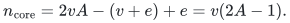

Assign each row injectively to its private bin. There are exactly `v` free
bins. Add

<!-- math-display: f6bebdea578644ff80d0686d
t=z(79999A-40000)
-->
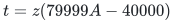

disjoint triangle bins, with no rows incident to them. Their weights are two,
their top debts are zero, and their top slacks are `L-2C>0`.

The total physical order and free-bin count are exactly

<!-- math-display: 14a6d0a63b77d1bcd77baead
N=2A(A-2)z,
                 \qquad F=80000(A-2)z.
-->
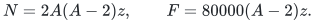

The represented matching has cardinality `(N-F)/2`. Therefore the direct
driver's initial numerical upper bound on its possible remaining improvement
is `F/2`, and its first target can be

<!-- math-display: 928e3c872d83f76dc89284c1
K=F/4=20000(A-2)z.
-->
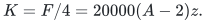

The prescribed phase formula is then literal:

<!-- math-display: 9e6f97b8fc00cb263aea5c33
\left\lceil\frac{10000CN}{K}\right\rceil
                                =CA=L.
-->
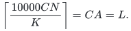

The value of `C`, for example `log_2 S+1` in the binary hierarchy, can be
fixed after constructing the physical graph: all bin weights and `N` are
independent of `C`, and the allocation values are then its stated integral
multiples.

There are no original isolated vertices, distinct-bin physical contacts, or
paired-remainder contacts. This confirms the state and parameter scope. It
does not assert that the phase's literal initialization already contains
these nontrivial row and bin records.

## 4. Exact logarithmic prices and zero correction gradients

The top objective includes all allocation and slack logarithms. Put
`a=1/(8C)`. Every ordinary core incidence has gradient and price `a`. The
exceptional return incidence has gradient and price `8a`; its other core
incidence has price `a`. Each private incidence has its own positive
reciprocal price and is a leaf attachment in the allocation graph.

Give every core bin potential `a` and every ordinary row potential zero.
Give each private bin the potential required by its one private incidence.
On the ordinary allocation graph, all gradients are exact potential
differences. The sole exceptional return incidence is retained throughout.

To remove an ordinary shortcut connection, retain one of its two core
incidences as an anchor and remove only the other. Route the removed
incidence through that anchor and the `b` child connections. The route has
`2b+1` ordinary core incidences. Its signed gradient is `a`, just like the
removed incidence, because every complete bin-to-bin child traversal has
zero signed gradient. Thus every correction has gradient exactly zero.

After a connection is removed, its row, private bin, retained anchor, and
private incidence remain as a tree attachment. They do not create a new
allocation cycle. The one-stage weighted stretch is at most `2b+1`.

## 5. Root and terminal cycle ratios

The four-incidence cycle using the top shortcut and the return row has
numerator `7a` and length `11a`. Thus its ratio is

<!-- math-display: b8c5ae9982cb128df7f421ff
\beta_0=7/11>1/2.
-->
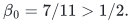

Every allocation cycle not using the return has numerator zero. At the
terminal stage, the only nontrivial allocation cycle uses all `n0` base
connections and the return. Its ratio is

<!-- math-display: 87a7d08d47c6ad5cd447e100
\beta_k=\frac7{2n0+9}.
-->
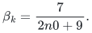

The ratio loss is exponential in the serial depth `k`.

The slack-source arcs do not repair this example. Within the main component
all slack gradients equal `1/sigma`. A simple cycle through the slack source
uses two such arcs with opposite signs, so their gradients cancel, while
their raw charge is at least `2/sigma`. The remaining allocation path has
`O(n0)` incidences with polynomially bounded reciprocal prices. Its ratio is
`O(n0 sigma/C)`, smaller than the terminal ratio for the chosen master.
Padding triangle components and the extra isolated core bins contribute only
slack leaves and no cycles.

The official integer prices preserve the zero-gradient corrections exactly:
all ordinary core incidences receive the same rounded gradient. The large
common numerical price scale also makes the additional degree-three port
connector charge negligible. Therefore the same constant root ratio and
serial exponential loss hold in the finite priced representation, up to
absolute factors.

## 6. Why this is not a matching-semantic lower bound

The represented matching is already maximum. Any physical matching uses at
most one edge incident to each row, and at most `w_d-1` internal edges of
each odd-cycle bin. Our represented matching attains the sum of these upper
bounds by assigning every row to its private bin and matching internally in
every bin. The triangle padding does not change that conclusion.

Moreover, the cheap row-side semantic certificate detects this without
solving the hidden cycle problem. Apply it separately to original physical
components. In the main component let `v0=n0+1`; its physical order is
`v0(2A-1)` and it has at most `2v0` rows. All slack arguments are equal, so
the slack-sum part of the certificate cancels the number of slack terms.
An ordinary row's smallest allocation is `8C`, while the return row's
smallest allocation is `C`. Therefore

<!-- math-display: c92abf8ad6869c3c14e50b04
\begin{split}
 \mathcal G(f)
 &\le L\left(\frac{e-1}{8C}+\frac1C\right)-3e\\
 &\le A\left(\frac{v0}{4}+1\right)
   <v0(2A-1)
 \end{split}
-->
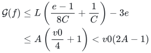

for the stated sizes. All components with no rows have exact linearized gain
zero. Safe anchored integer rounding and its small register error keep the
sum below `8N` with ample slack.

Thus the new semantic screen can return matching LOW even though the generic
raw-cycle criterion would insist on processing a ratio-`7/11` circulation.
This is an explicit example of the gap between the two interfaces, not merely
a logical possibility.

## 7. What remains unproved and what the example does establish

The example establishes that row degree three, exact row sums, physical
subcubicity, factor-critical realizations, integral lower ledgers, tiny debt,
literal positive logarithms, and valid phase constants do not themselves
remove the serial raw-quality product.

It does not establish that the particular structural and priced trajectory
reaches this exact state, that the selected dynamic sparsifier chooses the
displayed route tables, or that a matching-semantic comparator with gain
above `8N` can be hidden in the same manner. The last issue is the relevant
remaining opening for the weaker oracle discussed in the companion semantic
note.

The slack-only objective of [slack-only-one-sided-matching-client.md](slack-only-one-sided-matching-client.md) also
avoids this example's ordinary allocation-cycle objective entirely. Its new
obligation is a directed donor/receiver path problem, for which a fast dynamic
implementation remains open in this checkpoint.
