# Contact-rank odd crowns and exact matching-value preservation

<!-- review-status:start -->
**Ready for review.** Complete canonical contact-rank/min-cut characterization, exact physical matching offset, the numerical LOW consequence and the explicit retained-mass counterexample. Independent small-instance checks validate the structural identities.

**Dependencies and scope.** The input state supplies constructive factor-critical witnesses. Ordinary bipartite matching suffices; the named published almost-linear flow theorem is an optional faster construction. A bound on the remaining optimum gap does not bound the entire retained graph.

The [verification note](verify/README.md) identifies executable coverage. This status does not claim external peer review or proof-assistant verification.
<!-- review-status:end -->

**Structural result.** A row/bin state with constructive factor-critical odd bins admits a canonical contact envelope. The bins outside that envelope form a removable odd crown with an explicit optimum offset. This is an exact maximum-matching identity, valid before any numerical LOW assumption is added.

**Theorem 1 (canonical odd crown).** Suppose the physical graph is partitioned into odd factor-critical bins <code class="math">D</code>, singleton rows <code class="math">A</code>, an explicitly paired remainder <code class="math">U</code>, and unmatched blockers <code class="math">B</code>. Every row is covered by an injection into adjacent bins, and there is no edge joining distinct bins. Let <code class="math">Z</code> be the bins touching <code class="math">U∪B</code>. The algorithm below constructs the maximum number <code class="math">r</code> of simultaneously free contact bins, the unique inclusion-minimal minimizer
<!-- math-display: bd7b8d90d91e12ae316c22a2
S=\min_{\subseteq}\mathop{\mathrm{argmin}}\limits_{X\supseteq Z}
      \bigl(|X|-|A(X)|\bigr),
\qquad
r=|S|-|A(S)|,
-->
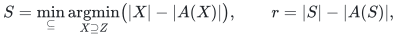
where <code class="math">A(X)</code> denotes the rows whose entire bin-neighbor set lies in <code class="math">X</code>. With <code class="math">T=D∖S</code> and <code class="math">H=N(T)</code>, deleting the bins of <code class="math">T</code> and the rows of <code class="math">H</code> gives
<!-- math-display: 8a2e79a92cf882db46fb5817
\nu(G)=\sum_{d\in T}(w_d-1)+|H|+\nu(G[R]).
-->
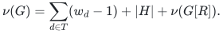
It returns the row assignment, reachability set, finite integral min-cut certificate, and the physical matching contribution attaining the offset. The combinatorial work is one outside bipartite matching plus linear input work; materializing the supplied bin witnesses is charged separately.

**Theorem 2 (quantitative consequence of LOW).** In the settled subcubic ledger state specified in Section 6, the same construction gives
<!-- math-display: 94d58c8067b49a3bd7bf069f
r\le\left\lfloor\frac{67CN}{L}\right\rfloor+3b,
\qquad
\nu(G[R])-|M_R|\le\left\lfloor\frac{r+b}{2}\right\rfloor,
\qquad b=|B|.
-->
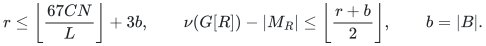
Thus the historical phase choices leave half-deficiency below <code class="math">0.044K</code>. This controls unmatched vertices and the remaining optimum gap; it does not bound the number of matched vertices retained. The appendix supplies the complete historical counterexample to that additional inference.

Both results and the appendix were already proved in the 24 October 2026 checkpoint. They are restored here with their full proofs and explicit cost/dependency choices. The current [four-fifths maximum-matching theorem](../../problems/general-matching/proof.md) does not rely on crown removal. The core contact-rank and offset proofs below are elementary; the named almost-linear flow import is only a choice for computing the one bipartite matching faster.

## 1. The state and the contact set

First consider any state with the structural properties below. Sections 2–5 require no numerical LOW answer. Assume there is no edge joining distinct bins. Section 6 additionally assumes a settled numerical state, no eligible expansion to the paired remainder, and the precise LOW exclusion defined there.

Use the notation:

* `D`: factor-critical odd bins, with physical size `2w_d-1`;
* `A`: singleton rows, covered by an injection into adjacent bins;
* `U`: the remainder consisting of explicitly matched pairs;
* `B`: the set of unmatched blocker vertices, with `b=|B|`.

Let `Z_U` be bins with a physical neighbor in `U`, let `Z_B` be bins
with a physical neighbor in `B`, and set `Z=Z_U union Z_B`. In the subcubic matching-state application,

<!-- math-display: 04545aa7682bf74c86b2b0cb
|Z_B|\le3b.
-->
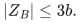

The current injection can be changed without altering the matching size:
every assignment still chooses a physical row–bin edge, and each bin has
its constructive factor-critical witness.

## 2. Maximize the number of free contact bins

Choose a row-covering injection `mu*` that maximizes the number `r` of
free bins in `Z`. This is a static bipartite optimization, not a general
graph matching problem.

There is a particularly direct construction. Compute a maximum matching
`M_out` between the rows and the bins in `D\Z`. If its cardinality is
`q_out`, then

<!-- math-display: da707d2bf25b9faec8fb5d0a
r=|Z|-|A|+q_{\mathrm{out}}.\tag{1}
-->
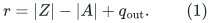

To construct the required full injection, extend `M_out` using the union
of `M_out` and the old row-covering injection `mu`. This union has maximum
degree two. From every row unmatched by `M_out`, follow the alternating
path that starts with its `mu` edge. Because `mu` covers every row, the
path ends at a bin unmatched by `M_out`. That bin must belong to `Z`:
otherwise the path would augment the matching restricted to `D\Z`,
contradicting maximal cardinality of `M_out`.

The paths from distinct unmatched rows are vertex-disjoint components of
the union. Flip them simultaneously. The result covers every row and
retains exactly `q_out` occupied bins outside `Z`. It therefore minimizes
the number of occupied bins in `Z`, proving (1), and is obtained in linear
additional time.

After the linear scan of the supplied physical graph, the construction uses <code class="math">O(N+I+T_bip)</code> work, where <code class="math">I</code> is the row/bin incidence input size and <code class="math">T_bip</code> is the time for the single outside bipartite matching. The subcubic state has <code class="math">I=O(N)</code>. The ordinary deterministic Hopcroft–Karp algorithm gives <code class="math">O(N^(3/2))</code> total time here; its [phase proof and implementation](../../problems/general-matching/reference/bipartite-proof.md) are available locally.

The stronger almost-linear version uses a named independent flow theorem. Build the unit-capacity source–row–bin–sink network and use van den Brand, Chen, Kyng, Liu, Meierhans, Probst Gutenberg, and Sachdeva, [*Almost-Linear Time Algorithms for Decremental Graphs: Min-Cost Flow and More via Duality*](https://arxiv.org/abs/2407.10830v1), **Theorem 6.17**, through the [exact maximum-flow reduction](published-flow-capacity-scaling.md). The result is deterministic <code class="math">N^(1+o(1))</code> work, including initialization, on this linear-size network. Unit capacities need only one positive bit stage. This is a published min-cost-flow dependency, not an invocation of the four-fifths general-matching result and not a claim that the near-linear primitive is implemented in this repository. Either choice produces the same structural output.

## 3. Reachability exposes a crown

Construct the directed escape graph on bins. For every assigned bin
`d=mu*(a)`, add arcs from `d` to every bin adjacent to its unique assigned
row `a`; self-arcs can be ignored. Free bins have no outgoing row. Let

<!-- math-display: 77a58d618f45001e8ded242b
S=\mathrm{Reach}(Z),\qquad T=D\setminus S.
-->
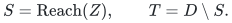

This reachability computation takes <code class="math">O(N+I)</code> time for an explicitly listed row/bin incidence graph. In the subcubic application, row degree is at most three and <code class="math">I=O(N)</code>.

**Lemma 1.** Every free bin in `S` belongs to `Z`. Thus `S` contains exactly
`r` free bins.

**Proof.** If a free bin outside `Z` were reachable, choose a simple path
from a bin in `Z` to that free bin. Its start must be assigned, since free
bins have no outgoing arc. Reassign each row of the path to the next bin.
The start becomes free and the final bin becomes occupied; intermediate
bins remain occupied. This increases the number of free bins in `Z`,
contradicting the choice of `mu*`. All `r` free bins in `Z` belong to `S`
by definition, proving equality.

**Lemma 2.** The rows adjacent to `T` are exactly `mu*^{-1}(T)`.

**Proof.** A row assigned into `T` is certainly adjacent to `T`. Conversely,
if a row adjacent to `T` were assigned into `S`, its escape arc from that
assigned bin would make the neighboring bin reachable, contradicting the
definition of `T`.

Write `H=N(T)=mu*^{-1}(T)`. The bins in `T` have no physical neighbor
outside their own vertices and the rows `H`:

* there is no edge joining distinct bins anywhere in the settled state;
* no bin of `T` touches `U` or `B`, because `T` is disjoint from `Z`;
* every other possible neighbor is a row in `N(T)=H`.

Moreover, `mu*` matches all rows `H` into distinct bins of `T`. This is
the required odd-crown structure.

## 4. An exact minimum-cut certificate

For a bin set `X`, write `A(X)` for its captive rows (all their
neighbors belong to `X`) and `h(X)=|X|-|A(X)|`. Then the contact rank
has the exact characterization

<!-- math-display: de326313732301e7c01288b2
r=\min_{X\supseteq Z}h(X).\tag{2}
-->
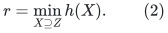

For any row-covering injection, the number of its free bins in `X`
is at most `h(X)`, because every captive row occupies a distinct bin
of `X`. Thus its number of free contact bins is at most `h(X)` for
every `X` containing `Z`, proving one inequality in (2).

For the optimizing injection `mu*`, every row assigned into the
reachable set `S` has all its neighbors in `S`. Conversely, every
captive row of `S` is assigned inside `S`. Since `S` has exactly `r`
free bins, `h(S)=r`. This proves the reverse inequality.

There is a stronger canonicality statement: **`S` is the unique
inclusion-minimal minimizing set in (2)**. Indeed, let `X` contain
`Z` and satisfy `h(X)=r`. The `r` free contact bins of `mu*` already
belong to `X`. The preceding inequality forces `X` to have exactly
`r` free bins. Hence the number of rows assigned into `X` equals
`|X|-r=|A(X)|`; every row assigned into `X` must be captive. Thus
`X` is closed under escape arcs and contains `Reach(Z)=S`.

In particular, changing the optimal injection or choosing a different
minimum-cut tie-break cannot reduce this retained contact envelope.
The resulting `S` is independent of those choices.

For an explicit cut certificate, construct the directed network with
one vertex for each row and bin, source `s`, and sink `t`:

* `s -> a` has capacity one for each row;
* `a -> d` has capacity `M` for each row--bin incidence;
* `d -> t` has capacity one for each bin;
* `s -> z` has capacity `M` for each contact bin `z in Z`.

Here <code class="math">M=&#124;A&#124;+&#124;D&#124;+1</code>. Putting every row and bin on the source side gives a cut of capacity <code class="math">&#124;D&#124;&lt;M</code>, so no minimum cut crosses an arc of capacity <code class="math">M</code>. For a cut avoiding such arcs, its source-side bin set <code class="math">X</code> contains <code class="math">Z</code>, and its optimal source-side rows are precisely the captive rows <code class="math">A(X)</code>. Its capacity is <code class="math">&#124;A&#124;+&#124;X&#124;-&#124;A(X)&#124;=&#124;A&#124;+h(X)</code>. Thus the minimum cut value is <code class="math">&#124;A&#124;+r</code>. This uses an explicit finite integer capacity, not a symbolic infinity.

The optimizing injection gives an integral maximum flow directly:
send one unit along each `s -> a -> mu*(a) -> t` path and one unit
along `s -> z -> t` for each free contact bin. Residual reachability
from `s` reaches exactly the bins of `S`: reverse assigned incidences
and forward row incidences reproduce the escape arcs. This gives
both a primal and a dual certificate for the canonical crown.

## 5. Exact maximum-matching preservation

Let `X` be the union of the physical vertices in bins `T`, and let `R`
be the remaining graph after deleting `X union H`. Define

<!-- math-display: 2a13f7f156955d4b0f33ad9a
\mathrm{offset}(T)=\sum_{d\in T}(w_d-1)+|H|.\tag{3}
-->
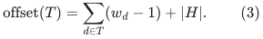

Then

<!-- math-display: c54cf19bfcbd436858e4d19a
\nu(G)=\mathrm{offset}(T)+\nu(G[R]).\tag{4}
-->
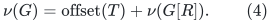

For the lower bound, match every row of `H` through its `mu*` edge to its
assigned bin. Expose precisely that endpoint in each assigned bin and
match all its other vertices internally. In every free bin of `T`, use
its factor-critical witness and leave one exposure unmatched. These
matches have total cardinality (3), and can be combined with any matching
in `G[R]`.

For the upper bound, take any matching of the entire graph. It has at
most `w_d-1` internal edges inside each odd bin `d`. There are no edges
between different bins of `T`. Every other matching edge touching `X`
uses a row in `H`, and every remaining edge touching `H` also uses a
vertex of `H`. Since these matching edges are vertex-disjoint, at most
`|H|` such edges exist altogether. The matching restricted to `R` has
size at most `nu(G[R])`. Summing proves the upper bound in (4).

The existing represented matching, after replacing its injection by
`mu*`, attains exactly `offset(T)` inside the deleted crown. Materialize
and store those actual edges. The deletion therefore preserves both an
actual matching and its precise remaining optimum gap. The permanently
unmatched exposures in free bins of `T` can be left out of the output.

All these steps are constructive. The factor-critical witnesses are those supplied by the input matching state; their [arbitrary-exposure construction and materialization](factor-critical-contractions.md) are proved separately. Permanent crown
deletions across phases remove disjoint physical vertices, so their total
materialization work is linear in the original physical graph size, up
to existing witness bookkeeping factors.

## 6. An explicit bound obtained from LOW

Here LOW has an exact mathematical meaning: the top priced-step answer excludes every feasible comparison direction whose signed logarithmic derivative is more than one half of the sum of its absolute individual logarithmic derivative contributions. This is the strong-direction property in the [matching proof, Section 8.2](../../problems/general-matching/proof.md). It is not merely a failed finite search.

The top ledger has positive allocation and slack coordinates, row total <code class="math">L</code>, nonnegative fixed bin debts <code class="math">p_d</code>, and positive bin slack
<!-- math-display: 6cb2dea6515e81238a77e6d7
\sigma_d=L+p_d-Cw_d-\mathrm{load}_d.
-->
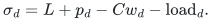
The physical state supplies <code class="math">Σ_d w_d≤N</code> and at most <code class="math">4N</code> top coordinates. Ineligibility for expansion supplies <code class="math">σ_d≤5C</code> on bins touching the paired remainder. The source-state formulas and their reconstructed proofs are mapped in [the matching-state source interface](oai-baseline-and-imports.md), Sections 3 and 5; the following argument proves the comparison bound directly.

Let <code class="math">r_U</code> be the maximum number of bins in <code class="math">Z_U</code> that can be made free simultaneously. Choose an injection attaining that number and put all <code class="math">L</code> units of each row on its assigned bin. The target top column capacity is <code class="math">L+p_d-Cw_d</code>, nonnegative because the current top ledger is feasible. A used bin receives only one assigned row. Clipping its load to that capacity removes at most <code class="math">Cw_d</code>; thus at most <code class="math">CN</code> mass is removed in total.

The clipped allocation is a feasible partial flow in the ordinary bipartite network with source-to-row capacity <code class="math">L</code> and bin-to-sink capacity <code class="math">L+p_d-Cw_d</code>. The current top ledger is a full feasible flow of value <code class="math">L&#124;A&#124;</code>. Residual augmentation can therefore restore all removed source mass. It may be chosen as simple source-to-sink paths, so no augmentation uses a reverse sink arc. Each bin's sink flow is nondecreasing during this completion, and the total newly delivered mass is at most <code class="math">CN</code>. This is an existence proof for the comparison allocation; the algorithm need not solve this additional flow problem.

The <code class="math">r_U</code> freed contact columns had zero load before completion, and afterward receive altogether at most <code class="math">CN</code>. Their total capacity is at least <code class="math">Lr_U-CΣw_d</code>, since debts are nonnegative. Their final slack is therefore at least <code class="math">Lr_U-2CN</code>. Summing over the larger contact set, whose other slacks are nonnegative, proves
<!-- math-display: d624764ba0eafd5230dd3923
\sigma'(Z_U)\ge Lr_U-2CN.
-->
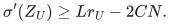
Alternative minus current allocation/slack coordinates is a circulation. For a positive coordinate <code class="math">x</code> and nonnegative alternative <code class="math">x′</code>, its logarithmic derivative contribution is <code class="math">(x′-x)/x≥-1</code>. There are at most <code class="math">4N</code> coordinates, so the total absolute negative contribution is at most <code class="math">4N</code>. If an alternative coordinate is zero, take a strict convex mixture with the current positive vector; this scales every contribution by the same factor and leaves the derivative ratio unchanged.

On contact slacks, <code class="math">σ_d≤5C</code> and <code class="math">σ′_d≥0</code>. The sum of the positive parts is at least the sum of the signed contributions, which is at least <code class="math">σ′(Z_U)/(5C)-&#124;Z_U&#124;</code>. Since <code class="math">&#124;Z_U&#124;≤N</code>, the total positive contribution is at least

<!-- math-display: 3bc03f50bde8c74b53cc6976
\frac{Lr_U-2CN}{5C}-N.
-->
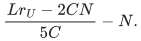

Write <code class="math">P</code> and <code class="math">Q</code> for the positive and absolute negative contributions. If <code class="math">P&gt;3Q</code>, then <code class="math">(P-Q)/(P+Q)&gt;1/2</code>, contradicting valid LOW. Hence <code class="math">P≤3Q≤12N</code>. The previous lower bound on <code class="math">P</code> consequently implies

<!-- math-display: 01fbae0d1b78ba8b7c17298e
Lr_U\le67CN.\tag{5}
-->
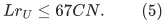

Adding the blocker contacts can increase the number of free contact bins
by at most their cardinality, giving

<!-- math-display: 0c96a0f0d78b58e0c5067fe7
r\le\left\lfloor\frac{67CN}{L}\right\rfloor+3b.\tag{6}
-->
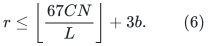

After deleting the crown, the represented matching has only `r+b`
unmatched physical vertices: one in each free bin of `S` and the `b`
blockers. Hence a directly checkable stronger improvement upper bound is

<!-- math-display: 4be2939d25e5828a05a4cb0f
\nu(G[R])-|M_R|\le\left\lfloor\frac{r+b}{2}\right\rfloor.\tag{7}
-->
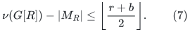

The phase accounting gives `b<=2C(g_*-1)`, and
`L>=10000 C N/K`. Thus (6) and (7) are `O(K)` bounds. If no gain has
occurred, `b=0` and the numerical constant in (5) makes (7) much smaller
than the original attempted target `K`.

More explicitly, `b<=K/50` whenever `g_*>1`, and `b=0` otherwise.
Consequently

<!-- math-display: 53722f0a6f8c2bd7f3fa4591
r+b\le\frac{67CN}{L}+4b\le0.0067K+0.08K=0.0867K.
-->
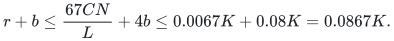

The retained matching's actual half-deficiency is therefore at most
`0.04335 K < 0.044 K`; its true improvement gap is at most the floor
of that number. This remains meaningful when the retained graph has
odd order and the half-deficiency is a half-integer. When `g_*=1`,
the sharper half-deficiency bound `0.00335 K` holds.

The exact computed `r` is preferable to the conservative analytic bound.
If `r+b<=1`, the retained matching is maximum immediately, and so is
the reconstructed original matching after adding all stored crown edges.

## 7. Why this is not yet an exponent improvement

The crown removal identifies vertices that can be safely separated from
the remaining optimization, and it restores a bound on the *number* of
unmatched vertices in the remaining graph. It does not bound the entire
retained graph by `O(K)` vertices.

Indeed, the retained graph can have a nearly perfect matching and still
contain `Theta(N)` matched vertices. Even the bottom ledger only implies
that the retained bin weight is at most `L r`; with `L=Theta(N/K)` and
`r=Theta(K)` this permits linear weight. The paired remainder can also
retain linear size.

The explicit family in the [appendix](#retained-mass-example) realizes
this obstruction with valid positive ledgers on a subcubic graph:
the canonical contact envelope is all bins, a LOW state exists, and
no vertex is removed by this crown rule. Its actual matching gap is
a small constant fraction of `K`, but the retained matched mass is
the whole graph. This is a limitation of the localization rule,
not a running-time lower bound or a claim about a forced driver run.

There is a further worst-case limitation: on a perfect-matchable graph,
when the target `K` does not exceed the true gap, the phase cannot issue
LOW. Therefore a speedup that only triggers after LOW cannot by itself
improve the hard perfect-matchable case underlying the current worst-case
bound.

What is obtained is an exact localization theorem and an implementable
stronger gap certificate. A better exponent would still require a bound
on the retained matched mass, a faster treatment of successful phases,
or a further deterministic compression preserving the interactions of
the retained contacts.

## Appendix B. A valid historical LOW state that retains the entire graph

This example uses the original fixed-parameter engine, with constant integer <code class="math">a≥1000</code> and the explicit <code class="math">q</code> given in Section B.4. It proves a limitation of the structural localization rule under those stated ledger/LOW hypotheses. It does not assert that every retuned engine has the same threshold, that every driver must reach this state, or that these graphs are hard to match. Equation numbers in this appendix retain their local historical numbering.

### B.1. Parameters

Fix an admissible constant `a>=1000` and put `C=a+1`. Let `p` be a
sufficiently large power of two, put

<!-- math-display: ecc28024def0a7273bc9bdbc
t=p^2,\qquad N=2tp=2p^3,\qquad K=20000t-1.
-->
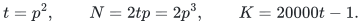

and take the master bound `S=N`, itself a power of two. All fixed
parameter guard thresholds hold when `p` is sufficiently large. In
particular choose `p>=20000` and `Cp<20000p^2-1`.

The phase scale is exactly

<!-- math-display: a59a3e48f55bb6a5e3723ab0
L=\left\lceil\frac{10000CN}{K}\right\rceil=\left\lceil Cp+\frac{Cp}{20000p^2-1}\right\rceil=Cp+1.\tag{1}
-->
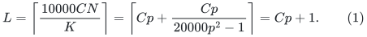

Also `K<=N/2`. Thus `K=Theta(N^(2/3))`, the scale relevant to the
first middle phase of the sparse-graph warm-start composition.

### B.2. A subcubic physical graph and represented matching

For each `j=1,...,t`, create `p` singleton bins

<!-- math-display: db12f33a297be3a44b432aca
d_{j,1},\ldots,d_{j,p}.
-->
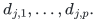

and `p-1` row vertices `a[j,1],...,a[j,p-1]`. Join row `a[j,i]`
to exactly bins `d[j,i]` and `d[j,i+1]`. This is an alternating
odd path on `2p-1` physical vertices.

Pair the paths as `(2h-1,2h)`. For each pair add two vertices
`u[h],v[h]` in the matched remainder `U`, and match them together.
Join both endpoint bins of path `2h-1` to `u[h]`, and both endpoint
bins of path `2h` to `v[h]`.

Every row and every internal bin has physical degree two. Endpoint
bins have degree two, while each remainder vertex has degree three.
There are no edges between distinct bins and no blockers. The total
number of vertices is

<!-- math-display: c302963ccfeb372d13d106b8
t(2p-1)+t=2tp=N.
-->
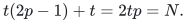

Match each row to its bin on the right. This leaves the first bin
of each odd path free. Together with the `t/2` remainder edges,
the represented matching has cardinality

<!-- math-display: 838da9c666393c510c0bcb62
q_0=t(p-1)+\frac t2=\frac N2-\frac t2.\tag{2}
-->
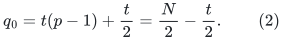

The graph has a perfect matching: in each paired component, match
`u[h]` to an endpoint of the first path and `v[h]` to an endpoint
of the second path; match each remaining even path internally.
Therefore the actual optimum gap is exactly

<!-- math-display: 0ef5742f43271697fe74f908
\nu(G)-q_0=\frac t2=\frac{K+1}{40000}.\tag{3}
-->
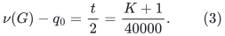

Every bin has weight one and a trivial factor-critical witness.
The selected forest on a row/bin component is forced to be its
entire path because every row has exactly two neighbors.

### B.3. All the ledger invariants hold

Use zero debt in every ledger. For the top ledger, write `x_i` for
row `i`'s allocation to its left bin, independently in every path.
Set

<!-- math-display: 77d1398ba6ac6e6212fca85e
x_i=\frac{L(p-i)}p,\qquad x_i^{\mathrm{right}}=\frac{Li}p,\qquad s_i=\frac1p.\tag{4}
-->
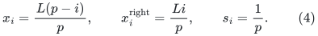

The row sums are `L`. Every bin's residual is `C+1/p`, so its top
slack is precisely `1/p`. All allocation coordinates are at least
`L/p=C+1/p`. They are positive dyadic numbers on the engine's
`epsilon=S^(-3000)` grid.

For every integral ledger, including the bottom ledger, use

<!-- math-display: 9b56085bba2800eb89a81878
x_i=L-Ci,\qquad x_i^{\mathrm{right}}=Ci.\tag{5}
-->
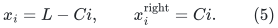

Its first `p-1` bin residuals are `C` and its last residual is
`C+1`. Consequently (5) satisfies every floor `c_j<=C` with zero
debt. In particular the bottom ledger is feasible and settled.

Every nonempty bin set has strict Hall surplus. More concretely,
on each path `h(X)=|X|-|A(X)|` is the number of nonempty connected
runs of selected bins in that path. The bottom weight inequalities
also follow directly from the feasible ledger (5).

There is no priority bin--bin action. The only bins with neighbors
in `U` are the path endpoints, whose top slacks are `1/p<4C`.
With exact cached values, no expansion is eligible. Thus this is a
valid state at which the driver requests top pricing.

### B.4. Explicitly small cycle ratios force LOW

The construction gives more than a feasible allocation. Its exact
top gradients have uniformly small circulation ratios.

Consider any circulation direction on the top allocation/slack
graph. On one path let `z_i` be the change to the left allocation
of row `i`; its right allocation changes by `-z_i`. Write `v_j`
for the change to slack `s_j`. The column equations give

<!-- math-display: edf84956b925171b01fbd96c
v_1=-z_1,\qquad v_j=z_{j-1}-z_j\ (2\le j\le p-1),\qquad v_p=z_{p-1}.
-->
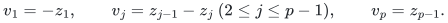

Hence `sum_j v_j=0` and `z_i=-sum_{j<=i}v_j`. The slack gradients
are all `p`, so their total directional contribution vanishes
on each path. The remaining contribution is

<!-- math-display: 35495ababd32d0a245c6a31e
\sum_i z_i c_i,\qquad c_i=\frac1{x_i}-\frac1{L-x_i}=\frac pL\left(\frac1{p-i}-\frac1i\right).\tag{6}
-->
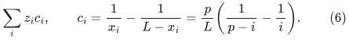

Let `H_(p-1)` be the harmonic number. Since `p/L<=1/C`,

<!-- math-display: 28abeaba4edd19eeccb7b480
\sum_i|c_i|\le\frac{2H_{p-1}}C.
-->
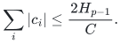

Thus the absolute gradient contribution on this path is at most

<!-- math-display: b20098715a2d8e828d5c6bf2
\frac{2H_{p-1}}C\sum_j|v_j|.
-->
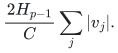

The derivative-sum length of the direction is at least its slack
contribution `p sum_j |v_j|`. Summing across all paths therefore
proves, for every nonzero circulation `d`,

<!-- math-display: 2d439361331f84b9147a0e10
\frac{|g^{\mathsf T}d|}{\|\lambda d\|_1}\le\rho:=\frac{2H_{p-1}}{Cp}.\tag{7}
-->
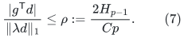

The common auxiliary slack vertex does not change this argument:
the separate row and bin conservation equations already imply
`sum_j v_j=0` within each path. If all slack changes on a path are
zero, its row changes are zero as well.

For the original fixed-parameter engine parameters

<!-- math-display: 118a66a26f1a43c14d2a7a8d
B=2^{\lceil(\log_2S)/a\rceil},\qquad q=B^{-100}.
-->
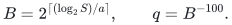

we have `q>=2^(-100)S^(-100/a)`. Since `S=2p^3` and `a>=1000`,

<!-- math-display: 9fb36aafc7e76a2bffa6eb3a
\rho=O_C\left(\frac{\log p}{p}\right)=o(q).\tag{8}
-->
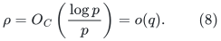

Choose `p` sufficiently large that `rho<q/10`. Every successful
priced step must simultaneously obey

<!-- math-display: 415f6a77d0012be284244420
\|\lambda h\|_1\le\frac q{100},\qquad g^{\mathsf T}h\ge\frac{q^2}{1000}.
-->
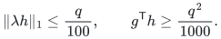

These inequalities require its ratio to be at least `q/10`,
contradicting (7). Thus a complete deterministic pricing
implementation satisfying the stated interface cannot take a
successful step here. Its positive arguments are between `1/p`
and `L`, comfortably inside the guarded numerical range, and its
static size is `O(N)`. For sufficiently large parameters its
adequate, failure-free branch therefore returns LOW.

This argument uses the exact engine interface, not an assumption
that the displayed state is the unique optimizer or an informal
claim that the state is "near a center." It also applies to a raw
length certificate, because raw motion can only increase the
denominator relative to the net circulation length used in (7).

### B.5. The canonical minimum-cut envelope contains every bin

The contact set `Z=Z_U` consists of both endpoint bins of every
path. There are exactly `t` free bins in every row-covering
injection, one per path. Each path can expose either endpoint,
so the maximum free-contact rank is

<!-- math-display: d0afd7b62863968cd0fad660
r=t.\tag{9}
-->
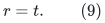

For any `X` containing `Z`, each path contributes at least one
to `h(X)`. Equality `h(X)=t` is possible only if the selected bins
form one connected run in every path. Because both endpoints
are selected, that run must contain all `p` bins of the path.

Consequently the minimum in

<!-- math-display: f843ca416ce8c7c7f1ae1c23
r=\min_{X\supseteq Z}h(X).
-->
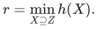

has the unique minimizer `X=D`. The canonical reachable envelope
`S` is all bins, and the removable crown `T=D\S` is empty.
No choice of optimal injection or minimum-cut tie-break changes
this conclusion.

The residual graph retains all `N` vertices, although the actual
half-deficiency is only `t/2=(K+1)/40000`. In particular, a
claim that LOW and the contact-rank crown always leave `O(K)`
physical vertices is false: here `N/K=Theta(p)` is unbounded.

### B.6. Scope of the obstruction

This family rules out a matched-mass reduction based only on
the canonical contact-rank envelope and the listed ledger/LOW
invariants. It does not rule out a stronger reduction using the
physical matching graph: these particular components have
immediately visible perfect matchings.

It also does not conflict with the strengthened static Conflt
tails. Each forced row-forest component has normalized weight
`p/L<1/C`; none is heavy. Tail control limits the mass of heavy
components, while this family retains many light components.

No claim is made that every phase initialized from the matching
(2), or every deterministic pricing choice, must reach exactly
the represented state (4). The statement is that the structural
and numerical hypotheses of the LOW localization theorem admit
this state, so a stronger retained-mass theorem needs additional
hypotheses or an additional operation.

## Finite validation added during restoration

The standalone [independent small-instance checker](verify/check_odd_crown.py) enumerates every row/bin graph with at most four bins and three rows that admits a row-covering injection. It checks 3,677 graphs, 56,249 contact sets, and 138,470 optimal injections against exhaustive captive-set minimization and an independent partial bipartite-matching enumeration. Reachability must equal the intersection of all minimum-deficit supersets of the contacts, for every optimal injection.

It also expands 615 seeded cases into physical graphs with singleton or triangle bins, paired-remainder contacts, blockers, and extra edges meeting rows. A separate subset dynamic program computes both physical maximum-matching values and verifies the exact crown offset, on graphs of up to 18 vertices. These identity checks do not use the repository's blossom implementation. The extra row edges exercise the degree-independent structural identity; the quantitative LOW bound additionally uses the stated subcubic ledger hypotheses.

Run <code>python3 manuscripts/graph-backends/verify/check_odd_crown.py</code> from the repository root. The script explicitly refuses optimized Python mode. This is finite validation of the structural identities, not a proof of the arbitrary-size theorem, the numerical LOW interface, or the near-linear imported flow runtime. The proofs above supply those separate arguments and dependencies.

## Source and restoration record

These results were already present in the 24 October 2026 uniform checkpoint. This page restores their full arguments in a semantic location; it does not claim that they were discovered during the repository reorganization. The original UTF-8 bytes were recovered and checked against the archive inventory. See the [checkpoint restoration record](../../provenance/checkpoint-restoration.md).

| Original note | SHA-256 of recovered source |
|---|---|
| `low_odd_crown_localization.md` | `737e2dc3bc14c795bdd9f4fa9abab97c9a778baea247c299bdc814f23b1e39ff` |
| `low_localization_mass_barrier.md` | `66d4e096c989b2462a66d87ee90eac246ad8444b95509ed4b9254d24b5dbc32e` |
