# Continuing the arbitrary-general-matching 4/5 route

**Research continuation, 25 October 2026.** The target of this note is
still deterministic exact explicit maximum matching in arbitrary general
graphs. None of the partial results below changes the currently assembled
4/5 running-time exponent. The new shortest-path applications do not
silently replace this original target.

This continuation focuses on removing the serial repair depth from raw
cycle quality. It records three new, concrete conclusions:

1. The positive-auxiliary freezing argument used by the new distance
   detector does not transfer to ordinary circulation coordinates without
   a new comparator-extension theorem. A three-edge instance already
   shows the failure.
2. A native shortcut can safely improve a returned raw cycle without
   adding a selected child membership. The exact acceptance inequality is
   given below. However, even exhaustive shortcut improvement confined to
   the one returned terminal cycle can retain an exponential quality gap.
3. The serial-quality counterexample can be strengthened to a bipartite
   graph with **every real edge satisfying** <code class="math">g_e=\ell_e&gt;0</code>, with
   constant integer labels before a standard port expansion. All local
   correction gradients vanish, the root optimum is <code class="math">3/5</code>, and the
   terminal optimum is exponentially small. Thus positivity and the
   one-sided logarithmic relation alone do not remove the factor.

The last example is an interface counterexample. It is not claimed to be
a reachable state of the full OAI ledger trajectory or the exact selected
support produced by the present repair code.

## 1. The specific cost that has to change

Use <code class="math">U=\log M</code>, <code class="math">h=\Theta(\log(U+4))</code>, static structural
logarithm <code class="math">g=O((p+r)h)</code>, local repair depth <code class="math">K</code>, reduction
parameter <code class="math">k=2^x</code>, and recursive depth <code class="math">d=O(U/x)</code>.

The current local provider has

<!-- math-display: f386863fbf29a34632684645
\begin{aligned}
 \log P&=O(U/K+g+h),\\
 \log W&=O(x+U/K+f+Kg+h),\\
 \log Q_{\rm local}&=O(Kg+h),
\end{aligned}
 \tag{1}
-->
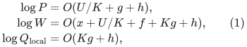

where <code class="math">P</code> bounds propagated selected changes and pool occurrences,
<code class="math">W</code> bounds local work, and <code class="math">Q_{\rm local}</code> is the inverse raw
cycle quality. The costly quality contribution is <code class="math">dKg</code>.

The present continuation does not try to make ordinary reparenting of
the same chronological windows look like a shorter dependency. The
actual first-touched validity certificate inherits the preceding
window, as proved in
[repair-window-depth-tradeoff.md](repair-window-depth-tradeoff.md). It also does not
infer route-change notifications or ambient congestion from the already
proved small central-ID recourse of a greedy native spanner.

## 2. Why the successful auxiliary freezing proof is special

In the distance detector, retiring an auxiliary coordinate has a semantic
meaning: its vertex is reported and removed from the remaining distance
obligations. The comparison flow can retain that auxiliary's current
value. Deleting its positive barrier contribution then gives a genuine
potential charge for this operation.

An ordinary flow or matching-exchange coordinate has no such automatic
permission. A target comparison may need to change it. Keeping its exact
cost and divergence in an external register does not restore the lost
direction.

### A minimal exact counterexample

Take a directed three-edge cycle. Every edge has capacity one, lower
bound zero, and cost <code class="math">-1</code>. The prescribed demand is zero. Thus every
feasible flow is

<!-- math-display: 601bfc325a9c37ff8abd9549
f=(z,z,z),\qquad 0\leq z\leq1.
 \tag{2}
-->
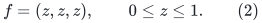

The exact optimum is <code class="math">z=1</code>, of cost <code class="math">-3</code>. Let the current flow
be <code class="math">z=\eta</code>, where <code class="math">0&lt;\eta&lt;1/10</code>, and consider the feasible
target cost <code class="math">F=-2</code>. With a small lower pad, its lower-bound barrier
price can be arbitrarily large as <code class="math">\eta</code> tends to zero.

Freeze just the first ordinary edge at <code class="math">\eta</code>, retaining its exact
cost and divergence. Conservation forces both remaining flows also to
equal <code class="math">\eta</code>. The active graph is a path and has no nonzero
circulation direction. A perfect active-coordinate cycle oracle returns
LOW, even though the original target <code class="math">F=-2</code> is feasible.

This failure occurs after one freeze. A bound on the number of freezes,
or a potential decrease paying for them, cannot repair correctness.
The large lower-bound price does not imply that the edge can safely be
fixed near zero; here every successful comparison increases it almost
to one.

### The exact missing semantic condition

For a frozen set <code class="math">Z</code>, one would need a constructive statement of the
following form:

> Whenever the original comparison target is feasible, there is a target
> comparison agreeing with the current flow on every edge of <code class="math">Z</code>,
> and its difference from the current state is a circulation entirely
> on active coordinates.

For arbitrary ordinary coordinates this statement is false by (2).
For matching ledgers, an analogous restriction must be justified by the
actual structural action, such as an exact locked projection or a
proved tight-set contraction. Backend route length or route congestion
does not by itself provide such a structural certificate.

This distinguishes **freezing a numerical variable** from keeping a
short direct route permanently available. The latter preserves the
original optimization problem and is examined next.

## 3. A positive local shortcut lemma

Consider a current native circulation represented as an oriented closed
walk with positive raw charge <code class="math">C</code> and improving numerator <code class="math">N&gt;0</code>.
Its ratio is <code class="math">\beta=N/C</code>. Suppose one occurrence of a subwalk
<code class="math">P:u\leadsto v</code> is replaced by a current native edge or walk
<code class="math">Q:u\leadsto v</code> with exactly the same immediate native endpoints.
All lengths, gradients, and physical lifts use current lifetime metadata.

Let

<!-- math-display: 5e296b6ac7891c428de31d5d
D=C(P)-C(Q)>0,
 \qquad \Delta=g^{\mathsf T}Q-g^{\mathsf T}P.
 \tag{3}
-->
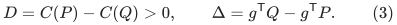

The new object is again a native circulation. Its numerator and charge
are <code class="math">N+\Delta</code> and <code class="math">C-D</code>. Direct cross-multiplication gives

<!-- math-display: 7ec4e255d6da060f0bd6e0fa
\frac{N+\Delta}{C-D}\geq\frac NC
       \quad\Longleftrightarrow\quad
                    \Delta\geq-\beta D.
 \tag{4}
-->
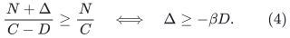

Thus the replacement is certified safe whenever (4) holds. In
particular, if <code class="math">P-Q</code> has zero gradient, every genuine reduction in
raw charge improves the ratio. The test uses the sum of charged
traversals before cancellation; it does not substitute a net physical
norm for that charge.

If <code class="math">Q</code> is an unselected original central edge, its normal stable-core
lift is already a valid real-edge-plus-tree-path object. Using it in
this returned parent circulation does not require inserting its ID into
the persistent selected child graph. The replacement is therefore
compatible with the existing raw-answer interface, provided its native
location in the returned walk and its complete current lift are supplied.
It is not a claim that all useful replacements can be discovered within
the required time.

This is a genuine local improvement mechanism. It can reverse a
particular unnecessary route expansion and can be applied repeatedly.
The next two sections show precisely why it is not yet a new worst-case
quality theorem.

## 4. A bipartite positive-gradient serial-quality example

Fix an odd integer <code class="math">b\geq3</code> and a depth <code class="math">K\geq1</code>. Let
<code class="math">N=b^K</code>. Make vertices

<!-- math-display: fac49b6fdfa500eb56405786
v_0,v_1,\ldots,v_N,z_1,z_2.
 \tag{5}
-->
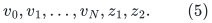

Give <code class="math">v_j</code> the row color for even <code class="math">j</code> and the bin color for odd
<code class="math">j</code>. Let <code class="math">z_1</code> have the bin color and <code class="math">z_2</code> the row color.
Include the base path <code class="math">v_0v_1\cdots v_N</code>, the three-edge return
path <code class="math">v_0z_1z_2v_N</code>, and the shortcut edges

<!-- math-display: ba018a56b58ee2efb6f8ed65
e_{i,r}=v_{r b^{K-i}}v_{(r+1)b^{K-i}},
 \qquad 0\leq i<K,\quad0\leq r<b^i.
 \tag{6}
-->
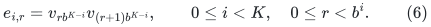

Every span in (6) is odd, so the graph is bipartite. It is simple:
the spans are at least three, all shortcut pairs are distinct, and the
return path uses new internal vertices. The total number of vertices
and edges is <code class="math">O(N)</code>.

Orient every edge from its row endpoint to its bin endpoint. Give
every base or shortcut edge gradient and length one. The outer two
return edges also have gradient and length one; the middle return
edge <code class="math">z_2\to z_1</code> has gradient and length seven. Therefore

<!-- math-display: a09ca6cb77d8355b7b580935
g_e=\ell_e>0
                       \quad\text{for every edge }e,
 \tag{7}
-->
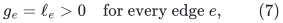

and all labels belong to <code class="math">\{1,7\}</code>.

On the graph excluding the return path, <code class="math">g</code> is the exact vertex
potential difference for
<code class="math">p(\text{row})=0</code>, <code class="math">p(\text{bin})=1</code>.

At stage <code class="math">i</code>, remove the shortcuts of level <code class="math">i</code> and route each
through its <code class="math">b</code> consecutive children, or through <code class="math">b</code> base edges
at the final stage. All other edges keep their identity routes. This
is an endpoint-preserving simple route of stretch <code class="math">b</code>. Because
both the shortcut and its route lie in the same potential subgraph,

<!-- math-display: 1a870d9fb0bf073fc8bec0d4
g^{\mathsf T}\bigl(e-R_i(e)\bigr)=0
                      \quad\text{for every }i,e.
 \tag{8}
-->
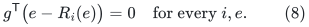

The same holds for a composite correction from an original edge to
its fully expanded route. Splitting these corrections into simple
cycles cannot produce a nonzero gradient, since every such cycle lies
entirely inside the potential subgraph.

### Root and terminal optima

Traversing the return path from <code class="math">v_0</code> to <code class="math">v_N</code> has gradient
<code class="math">1-7+1=-5</code> and length nine. Any nonreturn path between those
vertices has gradient one. Thus every simple cycle with nonzero
gradient uses the entire return path and has absolute gradient six.

At the root, the top shortcut has length one. The best cycle therefore
has

<!-- math-display: 277fb0db75c62f3b998ccb9f
\beta_0=\frac6{1+9}=\frac35.
 \tag{9}
-->
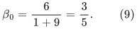

After all shortcuts are removed, the graph has a single nontrivial
cycle, consisting of the base path and the return path. Its optimum is

<!-- math-display: c0505a9fcc30abce2bc70640
\beta_K=\frac6{N+9}.
 \tag{10}
-->
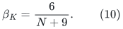

The exact loss is <code class="math">(N+9)/10=\Theta(b^K)</code>. Equations (7)--(10)
show that an all-positive gradient equal to the price length, together
with a root comparator above the matching client's constant LOW
threshold, does not remove the serial product at this abstract route
interface.

The example does not specify the numerical row sums, bin capacities,
or past trajectory of the full matching ledger. A theorem exploiting
those additional facts remains possible. The statement refuted here
uses only positivity, <code class="math">g=\ell</code>, and local route comparison.

### Bounded-degree and port form

Replace each vertex by a complete binary incidence tree of the same
sufficient height <code class="math">a=O(\log(K+2))</code>. Its leaves contain all old
incidences; unused leaves may remain. The maximum degree is three.
Choosing the same height at every vertex preserves bipartiteness.

Multiply each old real length and gradient by
<code class="math">H\geq100(a+1)</code>. Give every incidence-tree connector length one
and gradient zero. Extend the old potential constantly over each
fiber. Route substitutions still have zero correction gradient and
constant one-stage stretch <code class="math">O(b)</code>, including the connector walks.

The root cycle has numerator <code class="math">6H</code> and length at most
<code class="math">10H+8a</code>, so its ratio remains above <code class="math">1/2</code>. Every terminal
nonzero circulation has ratio at most <code class="math">6/(N+9)</code>. This is the same
positive-real-edge/zero-gradient-port form used by a numerical degree
reduction. Native endpoints and lifetimes remain literal; no aliases
are identified merely because their physical images agree.

## 5. Why repairing only the returned terminal cycle is insufficient

In the preceding example, if the terminal cycle itself is supplied,
the shortcut rule of Section 3 can recognize complete expanded
shortcut subpaths and recover the short root cycle. This is useful,
but it does not give a universal reduction from a terminal ratio oracle.

For an explicit obstruction, call that graph <code class="math">A</code>, take
<code class="math">N\geq128</code>, and add a disjoint four-cycle <code class="math">B</code>. Orient <code class="math">B</code>
according to its bipartition. Give three of its edges equal gradient
and length

<!-- math-display: 34fa0f55228cc2b6082cfcde
L=\lfloor N/64\rfloor
 \tag{11}
-->
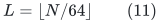

and give the fourth gradient and length <code class="math">L+1</code>. Its unique cycle
has absolute gradient one and ratio

<!-- math-display: 70fe6b2385485d63a1080793
\beta_B=\frac1{4L+1}.
 \tag{12}
-->
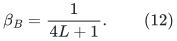

For these choices <code class="math">\beta_B&gt;6/(N+9)</code> and
<code class="math">\beta_B=\Theta(1/N)</code>. Keep every edge of <code class="math">B</code> at every
stage. If a connected input is required, join one vertex of <code class="math">A</code>
to one vertex of <code class="math">B</code> by a single bridge, choosing compatible
bipartition colors. The bridge belongs to no circulation and changes
none of the ratios.

Every exact terminal ratio oracle now returns a cycle in <code class="math">B</code>,
since it is strictly better than the terminal cycle in <code class="math">A</code>.
All separate local correction scores are still zero. A procedure that
only shortens subwalks of the returned <code class="math">B</code>-cycle has no opportunity
to introduce the missing <code class="math">A</code>-cycle. Even an exact optimization over
the returned cycle's induced component or support has value
<code class="math">\Theta(1/N)</code>, while the root optimum remains at least <code class="math">3/5</code>.

Thus postprocessing one best terminal answer is not enough. A useful
new theorem must either expose more global candidates, change the
terminal objective so that the hidden short cycle is selected, or
control the composition quality before the terminal query. This is
different from merely improving the local safe-shortcut implementation.

## 6. A sufficiently weak new lemma that would improve matching

The needed improvement can be stated without demanding a faster
static construction or a better bound on local ambient congestion.
Keep the existing actual-size initialization, selected-only child
transcript, stable lifetimes, degree feedback, and local work
<code class="math">\exp O(x+U/K+f+Kg+h)</code>.

A new **one-period cycle-comparison** lemma would suffice if, at every
settled parent state, each original circulation <code class="math">c</code> admits an exact
decomposition into available local correction answers and lifted
recursive circulation answers whose total positive raw charge is at
most

<!-- math-display: b6b0bb1424eaa8c52d456ac8
\Gamma^{O(\sqrt K)}\mathrm{poly}(U)
                         \|\ell c\|_1.
 \tag{13}
-->
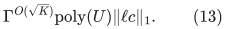

The available family must be maintained with the same prescribed child
prefix and work bounds; an exponentially large uncharged family does
not satisfy this requirement. The numerical numerator must telescope
exactly. Equivalently, a new direct route provider with length
<code class="math">\Gamma^{O(\sqrt K)}</code> and the same metadata and work bounds
would be a stronger sufficient statement.

The comparison form (13) is weaker than an edgewise short-route
guarantee. It allows a small deterministic family of maps or a
comparator-sensitive decomposition, provided the whole available family
is maintained and queried within the bound. It leaves local congestion
as large as <code class="math">k\Gamma^{O(K)}</code>; that cost is already permitted by
the local work envelope.

With (13), choose

<!-- math-display: 2db14dd5a13a2cf39fa84eb8
t=(U/h)^{1/4},\qquad p=r=\Theta(t),\qquad
 K=\Theta(t^2),\qquad x=\Theta(U/t),\qquad d=O(t).
 \tag{14}
-->
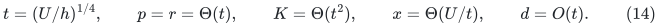

Then the local work, propagated selected recourse, and accumulated
quality all fit <code class="math">\exp O(U^{3/4}h^{1/4})</code>. This is a conditional
consequence, not an algorithm or an asserted matching theorem. The
missing substance is (13), not the balancing of (14).

One promising stronger route-level target is to keep the original
short route table throughout a parent period, maintain its current
first-touched projection, and select central native IDs with the
existing sparse prefix bound. Initial-route anchor updates already
have a paid local-work bound. What remains is sparse selected-ID
maintenance under **multiple-origin incidence extraction**, together
with actual ambient route records. This is more general than native
splits, as the explicit example in
[initial-route-projection-updates.md](initial-route-projection-updates.md) shows.

## 7. What the freeze potential would have to pay for on the router side

Keeping a direct central ID alive is semantically safe, unlike freezing
an ordinary flow coordinate. But a per-demand potential does not
automatically give a small child graph. The native input can have
<code class="math">m</code> demand IDs while the permitted selected child has only about
<code class="math">m/k</code> vertices and a subpolynomial factor more edges. Paying one
new selected ID for each individually retired long route can use
<code class="math">\Theta(m)</code> IDs even when many of those routes are parallel and
one shared central representative would suffice.

Therefore a useful router-freezing theorem needs a **grouped selected-
support charge**, not just a bound on the number of expensive demand
routes. Its budget must be proportional to actual new touched anchors
and the allowed one-time initial selected credit. It must also pay for
the ensuing native-degree feedback and report the changed route owners.
Deleting a positive term from a potential does not establish those
properties by itself.

The earlier central greedy lemma already supplies small membership
recourse for actual native splits. Its missing clauses remain ambient
congestion, explicit current-route notification, and fast discovery.
The current investigation has not found a recent primary-source theorem
that supplies all of them at a quantitatively useful rate. The January
2026 Chuzhoy--Parter dynamic low-congestion spanner remains a distinct
interface: its published parameter range, existential native embedding,
and lack of the needed split/ambient/notification clauses are recorded in
[chuzhoy-parter-2026-interface-boundary.md](../mechanism-boundaries/chuzhoy-parter-2026-interface-boundary.md).

The next substantive advance must prove a comparison such as (13), or
the grouped fixed-base maintenance statement just described. Neither
the new auxiliary freeze potential nor local shortcut recovery currently
does so. The accepted arbitrary-general-graph matching exponent remains
4/5.
