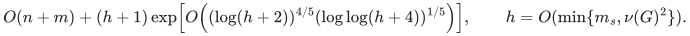
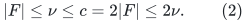
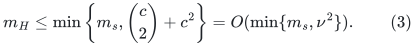
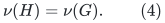
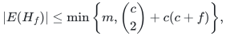
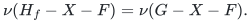
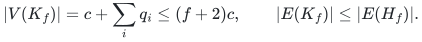

# An exact matching-size kernel and the current time corollary

**Deterministic reduction and instantiated fast composition.**
The kernel proof below is independent of the matching phase and the
numerical backend. It preserves maximum matching exactly in linear
preprocessing time. Substitution into the realized construction of
[Theorem 11.6](../../problems/general-matching/proof.md#116-deterministic-cycle-search-realization)
gives the solve time

<!-- math-display: f5b067538b1d3f0b5246e821
O(n+m)+(h+1)\exp\!\left[O\!\left(
  (\log(h+2))^{4/5}(\log\log(h+4))^{1/5}
\right)\right],\qquad h=O(\min\{m_s,\nu(G)^2\}).
-->

Here m_s is the number of distinct nonloop edges after cleanup. The
kernel itself needs no cycle-search primitive; the improved solve time
uses the explicit local realization and named published dependencies in
[Deterministic Exact General Matching through Persistent Integral Carriers and Normalized Routing](../../problems/general-matching/proof.md).
No publication-priority claim is made for this elementary reduction.

## 1. A linear-time quadratic edge kernel

First scan the input, discard loops and duplicate edge copies if needed,
and construct any deterministic maximal matching `F` by greedy edge
order. Retain original edge identifiers. Let

    C = V(F),     c = |C| = 2|F|,     U = V\C.

If `F` is empty, there are no useful edges. Otherwise `c>=2`. Maximality
implies that `U` is independent, so `C` is a vertex cover. Therefore

<!-- math-display: baaecd6597c1f79fb75d9a30
|F|\le\nu\le c=2|F|\le2\nu.      \tag{2}
-->

Construct a subgraph `H` retaining:

1. every edge with both endpoints in `C`;
2. for each `u in C`, any `min(deg_U(u),c)` incident edges to distinct
   vertices of `U`.

All choices use fixed edge order. Scanning adjacency lists constructs
`H` in `O(n+m)` time. Its edge count `m_H` obeys

<!-- math-display: 419404475c4bb8077cb6b86e
m_H\le \min\left\{m_s,\binom c2+c^2\right\}
      =O(\min\{m_s,\nu^2\}).                        \tag{3}
-->

Delete isolated vertices of `H`; its remaining vertex count `n_H` is
at most `2m_H`.

### Exact matching preservation

Every matching has at most `c` edges, since `C` is a vertex cover. Take
any maximum matching `M` of the original graph. If an edge `uv` of `M`
was omitted from `H`, it must have `u in C` and `v in U`, because all
`C-C` edges were retained. Temporarily remove `uv`. The vertex `u` has
`c` retained neighbors in `U`, and at most `c-1` vertices of `U` are
matched by the remaining matching. One retained neighbor `w` is therefore
unused. Replace `uv` by `uw`.

The replacement keeps the matching cardinality, creates no conflict,
and decreases the number of edges outside `H`. Repeat until no omitted
edge remains. This is an existence proof; the algorithm does not need
to know `M` or perform these replacements. Since `H` is a subgraph,
it follows that

<!-- math-display: 12e403dae6049ecaadcc4e18
\nu(H)=\nu(G).         \tag{4}
-->

Every edge of the greedy matching `F` belongs to `H`, because its
endpoints lie in `C`. Thus all bounds in (2) remain valid for `H`.

### Why the cutoff cannot be reduced to c-1

For even <code class="math">c\geq2</code>, take <code class="math">K_{c,c}</code> with parts <code class="math">C,U</code> and add a perfect
matching on <code class="math">C</code>. The added edges form a valid initial maximal matching.
The original graph has matching number <code class="math">c</code>. If every vertex of <code class="math">C</code>
retains the same <code class="math">c-1</code> vertices of <code class="math">U</code>, then the kernel has only <code class="math">2c-1</code>
nonisolated vertices. Its matching number is exactly <code class="math">c-1</code>. Thus a
universal arbitrary-choice cutoff below <code class="math">c</code> cannot preserve exactness.

## 2. Composition and independent acceptance

Build and compact <code class="math">H</code> once. Its nonempty compact size is
<code class="math">q_H=n_H+m_H=\Theta(m_H)</code>, and all retained edges carry original IDs.
Apply the exact odd-path degree reduction and uniform solver in
Sections 3.2 and 12 of the main theorem. Its geometric, lifetime,
initialization and finite-arithmetic interfaces are instantiated by
Theorem 11.6 and the companion proofs identified there. These are explicit
proof dependencies, rather than additional unfulfilled backend premises.

Every branch of the uniform program shares the same read-only H.
Validate a proposed matching and search for an augmenting path in H.
Absence of an augmenting path proves optimality in H; the independent
identity nu(H)=nu(G) then proves optimality in G. The verifier need not
rescan the original graph on each proposal. Map the final matching's
edge IDs back once, after acceptance.

The uniform instruction scheduler and its independent acceptance check
are already charged in Section 12 of the main theorem. Cleanup, greedy
construction, kernelization and final translation are charged once in
<code class="math">O(n+m)</code>. No correctness or running-time property of the required cycle-search implementation follows
from kernelization itself.

If nu=0, the greedy scan finds no nonloop edge and returns the empty
matching. The added one in the displayed expressions handles this
case uniformly. No supplied value or estimate of nu is needed: c is
computed by the greedy matching and lies between nu and 2nu.

## 3. Independent components

Kernelizing nonempty connected components separately retains
<code class="math">h_i=O(\min\{m_i,\nu_i^2\})</code> edges in component <code class="math">i</code>. The preprocessing
still totals <code class="math">O(n+m)</code>, and the solver cost is the sum of its costs on
the individual <code class="math">h_i</code>. The union of their maximum matchings is maximum
in the original graph. This can improve the parameter bound from
<code class="math">(\sum_i\nu_i)^2</code> to <code class="math">\sum_i\nu_i^2</code>, as well as reducing the
logarithmic overhead to each component's actual size.

## 4. One kernel for mixed vertex and edge failures

This extension uses a **fixed simple loopless graph**. A failure removes
one native vertex or one native edge; it is not an arbitrary label that
may remove many edges at once. In particular, discarding parallel edge
records before a record-level failure query is not justified by ordinary
matching-preserving normalization.

**Theorem 4.1 (simultaneous mixed-failure preservation).** Let <code class="math">C</code> be any
vertex cover of size <code class="math">c</code>, let <code class="math">I=V\setminus C</code>, and let <code class="math">f\geq0</code> be an
integer failure budget. Retain every edge inside <code class="math">C</code>. At each <code class="math">u\in C</code>,
retain any <code class="math">\min\{c+f,&#124;N(u)\cap I&#124;\}</code> edges to distinct vertices of <code class="math">I</code>.
Call the resulting subgraph <code class="math">H_f</code>. Then

<!-- math-display: 95dbd1643bd441ecaff344a5
|E(H_f)|\leq\min\left\{m,\binom c2+c(c+f)\right\},
-->

and, simultaneously for every vertex set <code class="math">X</code> and edge set <code class="math">F</code> with
<code class="math">&#124;X&#124;+&#124;F&#124;\leq f</code>,

<!-- math-display: 3ef64ae3bc02607b0eac7d13
\nu(H_f-X-F)=\nu(G-X-F).
-->

The graph <code class="math">H_f</code> is constructed deterministically in <code class="math">O(n+m)</code> time and
retains original identifiers. Taking the endpoints of a greedy maximal
matching gives <code class="math">c\leq2\nu(G)</code> without knowing <code class="math">\nu(G)</code>. The budget
can be clipped to <code class="math">n+m</code>; reading a longer binary encoding is charged
separately. The construction never allocates unused slots up to <code class="math">f</code>.

**Proof.** Fix any permitted failure pair <code class="math">(X,F)</code> and a maximum matching
<code class="math">M</code> of <code class="math">G-X-F</code>. Since <code class="math">I</code> is independent, <code class="math">&#124;M&#124;\leq c</code>. If an edge
<code class="math">uv\in M</code> is absent from <code class="math">H_f</code>, it has <code class="math">u\in C\setminus X</code> and
<code class="math">v\in I\setminus X</code>, and <code class="math">u</code> originally retained <code class="math">c+f</code> distinct
outside neighbors. A deleted outside vertex removes at most one of
these choices. A failed retained edge also removes at most one choice.
A deleted cover vertex other than <code class="math">u</code> removes none of them; <code class="math">u</code> itself
is not deleted because <code class="math">uv\in M</code>. Counting all failures, including
any overlap, therefore leaves at least <code class="math">c</code> retained choices alive.

Remove <code class="math">uv</code> temporarily. At most <code class="math">c-1</code> outside vertices are matched,
so one of those <code class="math">c</code> surviving choices is free. Matching <code class="math">u</code> to it
restores cardinality and decreases the number of edges outside <code class="math">H_f</code>.
Repeat until all matching edges lie in <code class="math">H_f-X-F</code>. The opposite
inequality follows from the subgraph relation. The argument applies to
every failure pair for this one fixed <code class="math">H_f</code>; no random choice or
query-dependent reconstruction is used. The edge and construction
bounds follow by scanning adjacency lists. ∎

**Sharpness of the local cutoff.** For even <code class="math">c\geq2</code>, take <code class="math">K_{c,c+f}</code>
with left side <code class="math">C</code> and add a perfect matching inside <code class="math">C</code>. Let every
cover vertex retain the same <code class="math">c+f-1</code> outside neighbors. Delete any <code class="math">f</code>
of those neighbors. The original surviving graph still has a matching
of size <code class="math">c</code>, but the retained graph has only <code class="math">2c-1</code> nonisolated vertices
and matching number <code class="math">c-1</code>. Thus the cutoff <code class="math">c+f</code> is necessary for
arbitrary independent neighbor choices in the mixed-failure model.

This theorem is a size and exact-preservation guarantee. Computing a
maximum matching after a query still requires a solver on the retained
graph; the theorem does not supply a constant-time sensitivity oracle.

### A simultaneous linear-vertex refinement

The [layered cover compression](../../problems/general-matching/reference/fault-tolerant-cover-compression.md)
now reduces the same fixed <code class="math">H_f</code> further before any failure query is known.
Compute <code class="math">f+1</code> successive maximum crossing matchings, removing the right
endpoints selected in each round before the next.  If a round has size
<code class="math">q_i</code>, keep all their right endpoints and <code class="math">C</code>.  The induced subgraph <code class="math">K_f</code>
has

<!-- math-display: f836759241de9ba309e9a859
|V(K_f)|=c+\sum_iq_i\leq(f+2)c,
\qquad |E(K_f)|\leq|E(H_f)|.
-->

For a cover obtained from a maximal matching this also gives
<code class="math">&#124;V(K_f)&#124;\leq(f+3)\nu(G)</code>, and at <code class="math">f=0</code> the existing reference solver
has the sharper bound <code class="math">3\nu(G)</code>.  The construction preserves every
surviving matchable cover subset, so arbitrary additional cover-vertex
deletions and arbitrary graphs attached through the cover are permitted.
Each layer has a maximum-matching certificate checked by matching/cover
duality.  The executable constructor and its independent universal verifier
are linked in the proof; no failure scenarios are enumerated to validate
the certificate.

The order <code class="math">O(\nu f)</code> in vertices and <code class="math">O(\nu^2+\nu f)</code> in edges for
positive budgets is already established by
[Banerjee, Gupta, Raman and Saurabh, CSR 2022](https://doi.org/10.1007/978-3-031-09574-0_8).
The local refinement supplies precise counts, the stronger subset/context
guarantee and a complete executable certificate.  Its crossing-matching
construction has a separate polynomial work bound; it is not charged
as part of the linear-time neighbor kernel above.

## 5. Finite evidence

The independent exhaustive checker
[check_reductions.py](../../problems/general-matching/verify/check_reductions.py)
compares matching numbers before and after the kernel on all simple
graphs of at most six vertices, checks both fixed edge orders, and
verifies the sharp-cutoff example. It also checks the separate subcubic
gadget on small graphs and all mixed failures of total size at most two
on every graph through four vertices, in both fixed edge orders.
These checks cover the listed finite instances;
the proofs above establish the general statements.
