# Multiple-resource choices: a monotone charge and a repair obstruction

**Research analysis, 25 October 2026.** A monotone majorant successfully
extends the fractional deletion charge to multiple-resource options.
It does not make arbitrary feasible old assignments cheaply repairable.
Both facts are proved below. Neither is a general matching improvement.

## 1. Model

There are <code class="math">M</code> groups. Group <code class="math">g</code> has a finite initial option
family <code class="math">\mathcal P_g</code>, of size at most <code class="math">L</code>. Each option
contains at most <code class="math">D</code> resources. Resource deletions remove every
option containing that resource. A group retires after its final
option disappears. Among its surviving options it has the uniform
fractional distribution.

Write <code class="math">s_g</code> for its current option count and

<!-- math-display: 6a8ae55467ff8ab3b5443c24
\mu_e=\sum_{g:s_g>0}
       \frac{|\{P\in\mathcal P_g:e\in P\text{ and }P
                        \text{ survives}\}|}{s_g}.
 \tag{1}
-->
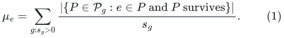

Unlike the single-resource case, <code class="math">\mu_e</code> can decrease while
<code class="math">e</code> survives: another resource can kill an option that also used
<code class="math">e</code>. Define a monotone majorant on each surviving resource by

<!-- math-display: 9d6d4ec3e825b7857fb974d1
\widehat\mu_e(0)=\mu_e(0),\qquad
 \widehat\mu_e\leftarrow\widehat\mu_e+
                              \max\{0,\mu_e^{new}-\mu_e^{old}\}.
 \tag{2}
-->
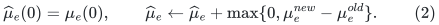

The majorant is discarded only when its resource is deleted. It
always dominates the current fractional load.

## 2. The majorant mass is small over the complete history

Consider one group with <code class="math">s</code> options before an update, of which
<code class="math">r</code> disappear. When <code class="math">r&lt;s</code>, every surviving option's weight
increases by

<!-- math-display: b4c403f40a69fd00345f658b
\frac1{s-r}-\frac1s
                         =\frac{r}{s(s-r)}.
-->
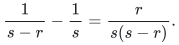

The sum of positive resource-load changes attributable to this group
is at most the total increase contributed by surviving options;
negative contributions from removed options can only reduce it. Since
the surviving options have at most <code class="math">D(s-r)</code> resource occurrences,

<!-- math-display: 3d9a0d2fd130c4a7e4cd5485
\sum_e\max\{0,\Delta\mu_{e,g}\}
          \leq D(s-r)\frac{r}{s(s-r)}=D\frac rs.
 \tag{3}
-->
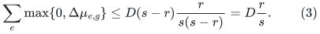

If <code class="math">r=s</code>, the group retires and every contribution decreases to
zero, so the positive change is zero. Summing groups can only reduce
the sum of positive coordinate changes:

<!-- math-display: 6b344884200d94f00dcaf52a
\sum_e\max\{0,\sum_g\Delta\mu_{e,g}\}
       \leq\sum_g\sum_e\max\{0,\Delta\mu_{e,g}\}.
-->
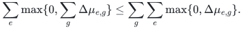

For each group, batched deletions have

<!-- math-display: f6d277bb5b51d3c8f8016545
\sum_{\text{its updates}}\frac rs
        \leq \sum_{j=1}^{s_g(0)}\frac1j
        \leq 1+\log L.
 \tag{4}
-->
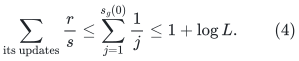

Indeed, a deletion of <code class="math">r</code> from a set of size <code class="math">s</code> charges no
more than <code class="math">\sum_{j=s-r+1}^{s}1/j</code>, and these ranges do not
overlap over the group's lifetime.

The initial mass is at most <code class="math">DM</code>. Equations (3)--(4) prove

<!-- math-display: dce7eb1327f8c52ac2cbafee
\text{total mass ever created in all }\widehat\mu_e
                      =O(DM(1+\log L)).
 \tag{5}
-->
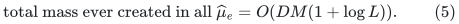

In particular, the sum of majorants charged immediately before their
resources are deleted obeys the same bound: each unit of created
majorant mass is charged at most once. Formula (5) is also valid at
every chronological prefix, with the same one-time initial credit.

The proof extends to nonnegative occurrence multiplicities whose sum
on any option is at most <code class="math">D</code>. Thus an option can be a walk whose
resource accounting counts repeated occurrences, if deletion kills
the whole option whenever it uses the deleted resource.

### Consequence if an integral assignment is maintained

Suppose one could maintain one option per live group while respecting
monotone capacities

<!-- math-display: ca61223aa4c221d69bd2e3a8
c_e=\lceil C\widehat\mu_e+b\rceil,
                  \qquad C\geq1,\ b\geq1.
 \tag{6}
-->
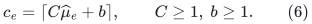

At a resource deletion, at most <code class="math">c_e</code> selected groups lose their
option. Consequently the total number of directly forced orphan
events after <code class="math">Q</code> deletions is

<!-- math-display: 48e7b27a60b0d148dfce42c3
O(CDM\log(L+2)+(b+1)Q).
 \tag{7}
-->
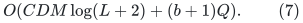

Equation (7) counts directly invalidated choices. It does not count
other groups moved to restore feasibility, nor the work of finding
those moves. Those are separate obligations.

### A finite dyadic implementation of the majorant

The exact uniform expressions above are convenient for analysis, but
adding many unrelated fractions <code class="math">1/s_g</code> should not be treated as
constant-word arithmetic. There is a simple dyadic replacement.
Give each surviving option of group <code class="math">g</code> weight

<!-- math-display: 17c1c38c4cd821cc3ebb3a93
w_g=2^{-\lfloor\log_2 s_g\rfloor}.
-->
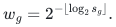

Its total group mass lies between one and two. Initialize the resource
majorant with these dyadic option loads. When options disappear, do
not subtract their mass from surviving-resource majorants. When
<code class="math">w_g</code> increases, add its increase once for each occurrence of
each still-surviving option of that group. This majorant dominates
both the current dyadic load and the current uniform load.

At a dyadic weight change, the total newly added mass for one group
is at most <code class="math">2D</code>. There are at most <code class="math">1+\log_2 L</code> such changes.
Thus (5)--(7) remain valid up to absolute constants. Every value has
a common power-of-two denominator at most <code class="math">2L</code>, and its numerator
has <code class="math">O(\log(DML+2))</code> bits. Scanning surviving option occurrences
at these changes costs at most the initial occurrence inventory times
<code class="math">O(\log L)</code>. No fast integral-repair procedure is hidden in this
bookkeeping claim.

## 3. The capacity condition gives a static strong-Haxell instance

For completeness, the majorant has a useful static interpretation.
Replace resource <code class="math">e</code> by <code class="math">c_e</code> disjoint slots. For every option,
allow all choices of one slot for each resource it uses. These are
rank-at-most-<code class="math">D</code> hyperedges, with one group vertex on the left.

If a set <code class="math">X</code> of slots hits every clone realization of a particular
option, it must contain *all* slots of at least one resource in that
option. Otherwise one could choose an unhit slot independently for
every resource of that option. Let

<!-- math-display: 0e5569a045a0958dc30aed06
F=\{e:\text{every slot of }e\text{ lies in }X\}.
-->
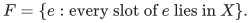

If <code class="math">X</code> hits all options of a group set <code class="math">S</code>, every option of
every group in <code class="math">S</code> contains a resource of <code class="math">F</code>. Averaging over
their fractional distributions yields

<!-- math-display: d97eb7302da65150489c6c92
|S|\leq \sum_{e\in F}\mu_e
      \leq \sum_{e\in F}\widehat\mu_e,
 \qquad
 |X|\geq\sum_{e\in F}c_e\geq C|S|.
 \tag{8}
-->
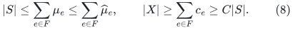

Thus the clone hypergraph satisfies strong Haxell expansion at least
<code class="math">C</code>. Taking <code class="math">C\geq dD^2</code> fits the static regime of
Bucić--He--Huang--Saranurak,
[arXiv:2511.02214v1, Theorem 1.5]
(https://arxiv.org/html/2511.02214v1).

That theorem is not yet a router update theorem. An option with
<code class="math">D</code> resources has a Cartesian product of slot realizations, so
the explicit hypergraph can be huge. Their implicit half-layer
interface would need an implementation. More importantly, neither
(8) nor the static theorem promises low reassignment recourse after
each new deletion.

## 4. A layered counterexample to arbitrary-state short repair

Here is an explicit obstruction to the statement:

> Any old assignment feasible for (6) can be repaired after one
> resource deletion using only <code class="math">O(D\mathrm{polylog}M)</code>
> other group changes.

The obstruction works for every integer <code class="math">C\geq1</code>, including
<code class="math">C\geq dD^2</code>. Set

<!-- math-display: 7df9f0045e1c7fdfa5eb1587
A=4C-1,\qquad D\geq2,\qquad b=3t,
 \tag{9}
-->
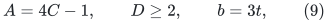

where <code class="math">t\geq1</code> is an integer. We may choose <code class="math">b</code> to be a
sufficiently large multiple of the logarithm of the resource universe;
the construction does not depend on a small additive reserve.

### 4.1 Resources and groups

There is a top group <code class="math">g_*</code>, a private resource <code class="math">x</code>, and
<code class="math">A</code> disjoint blocks of <code class="math">D</code> level-zero resources. The options
of <code class="math">g_*</code> are its singleton <code class="math">\{x\}</code> and those <code class="math">A</code> blocks.

Each internal resource <code class="math">v</code> at level <code class="math">j</code> has <code class="math">c_j</code>
resident groups. Every resident group of <code class="math">v</code> has the same
<code class="math">A+1</code> options:

* the singleton <code class="math">\{v\}</code>;
* <code class="math">A</code> disjoint blocks, each containing <code class="math">D</code> fresh child
  resources at level <code class="math">j+1</code>.

The child blocks of distinct parent resources are disjoint. All
groups use the uniform distribution on their surviving options.
There are <code class="math">h</code> levels of internal resources, numbered
<code class="math">0,\ldots,h-1</code>. Their level-<code class="math">h</code> child resources have no
resident groups and will provide the final free capacity.

Define the resident counts by

<!-- math-display: a2fc531cbc9d42ed1c811d7a
c_0=4t+1,\qquad
 c_j=\left\lceil\frac{c_{j-1}+4b}{3}\right\rceil
                       \quad(1\leq j<h).
 \tag{10}
-->
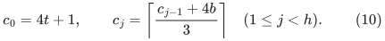

All these counts are <code class="math">\Theta(b)</code>; they remain between positive
constant multiples of <code class="math">b</code>.

### 4.2 The old assignment exactly fills the internal capacities

Initially choose <code class="math">\{x\}</code> for <code class="math">g_*</code>, and choose the
singleton <code class="math">\{v\}</code> for every resident group of every internal
resource. Thus resource <code class="math">v</code> at level <code class="math">j</code> has selected load
exactly <code class="math">c_j</code>.

For a non-root internal resource, its fractional load is

<!-- math-display: 52ba145aedd732e77f5a6bdb
\mu_v=\frac{c_j+c_{j-1}}{A+1}
                         =\frac{c_j+c_{j-1}}{4C}.
-->
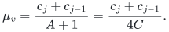

Consequently its capacity in (6) is exactly

<!-- math-display: 2809b2a52932333750aef8db
\left\lceil C\mu_v+b\right\rceil
 =\left\lceil\frac{c_j+c_{j-1}}4+b\right\rceil=c_j.
 \tag{11}
-->
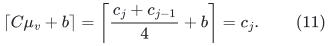

The last equality follows directly from (10):
<code class="math">0\leq3c_j-(c_{j-1}+4b)\leq2</code>.

Before deleting <code class="math">x</code>, each level-zero resource has

<!-- math-display: 6016ff2520ee9885f56a2af4
\mu_v^{old}=\frac{c_0+1}{4C}.
-->
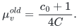

Its capacity is

<!-- math-display: c64f8fa0e870039a0ac8372d
\left\lceil\frac{c_0+1}{4}+3t\right\rceil
        =\lceil4t+1/2\rceil=4t+1=c_0.
 \tag{12}
-->
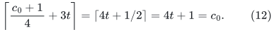

The private resource has ample capacity for its single selected group.
Leaf resources have no selected groups. The entire old assignment is
therefore feasible, and every internal resource is full.

### 4.3 One deletion leaves the relevant capacities unchanged

Delete <code class="math">x</code>. Only <code class="math">g_*</code>'s singleton option disappears. The
top group is the only directly forced orphan. Its remaining options
are the <code class="math">A</code> level-zero blocks.

At a level-zero resource, its new fractional load, and hence its
majorant after this first update, is

<!-- math-display: 03edcde070a8cabad58d8fb2
\widehat\mu_v
                     =\frac{c_0}{4C}+\frac1{4C-1}.
-->
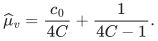

Its capacity is still <code class="math">c_0</code>, because

<!-- math-display: 0975d625bd02fcae6e9bb9d1
\left\lceil C\widehat\mu_v+b\right\rceil
  =\left\lceil4t+\frac14+\frac{C}{4C-1}\right\rceil
  =4t+1.
 \tag{13}
-->
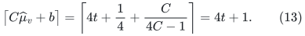

Here <code class="math">1/4&lt;C/(4C-1)\leq1/3</code>. No lower-level fractional load
or majorant changes. Thus there is no newly available capacity at an
internal resource that could absorb the new choice for free.

The example also works with the finite dyadic majorant above. Choose
<code class="math">C</code> to be a power of two. Every initial group has exactly
<code class="math">4C</code> options, so its dyadic weight initially equals its uniform
weight. After deleting <code class="math">x</code>, only the top group's weight doubles,
to <code class="math">1/(2C)</code>. A level-zero resource's capacity then becomes

<!-- math-display: 360e8887446cac2a8c93756b
\left\lceil c_0/4+1/2+b\right\rceil
                    =\lceil4t+3/4\rceil=c_0.
-->
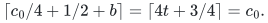

All other calculations are unchanged. The obstruction therefore does
not depend on using large rational denominators.

### 4.4 Every repair changes a branching number of groups

Any new option for <code class="math">g_*</code> occupies <code class="math">D</code> full level-zero
resources. At least <code class="math">D</code> resident groups must therefore leave
their old singletons. Each such changed resident must use a block of
<code class="math">D</code> child resources. Those resources were also full.

Let <code class="math">R_j</code> be the number of level-<code class="math">j</code> resident groups whose
final selected option is no longer their singleton. Counting final
resource loads, rather than following a particular repair algorithm,
gives

<!-- math-display: 00326229879c19e0d996f892
R_0\geq D,\qquad
                    R_{j+1}\geq D R_j.
 \tag{14}
-->
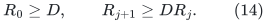

There is no cancellation in this count: only resident groups of a
resource can free its original capacity, and each moved group uses
exactly <code class="math">D</code> resources one level below. Any additional rearrangement
can only increase the required departures. Hence

<!-- math-display: e4afd8e56b1241d3d365e7c3
R_{h-1}\geq D^h,
 \qquad
              \text{total changed groups}\geq
                              D+D^2+\cdots+D^h.
 \tag{15}
-->
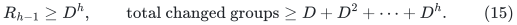

Feasible repairs exist, since the final child resources are initially
empty. They can be obtained by moving the necessary groups down the
tree. The lower bound is a recourse obstruction, not an infeasibility
example.

There are <code class="math">\Theta((AD)^h)</code> internal resources up to constant
factors, and

<!-- math-display: 1784348df2aeb8b74c161fbb
M=\Theta(b(AD)^h)
-->
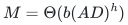

resident groups. For fixed <code class="math">C,D</code>, (15) is polynomial in
<code class="math">M/b</code>, with exponent <code class="math">\log D/\log(AD)&gt;0</code>. In particular,
<code class="math">D=2</code> and fixed <code class="math">C</code> contradict a logarithmic per-orphan
repair bound even when <code class="math">b=\Theta(\log R)</code>.

## 5. What the counterexample does and does not exclude

The example rules out deriving short individual repairs from just
capacity feasibility and a strong-Haxell surplus. A dynamic algorithm
would need an additional invariant, or an amortized potential that
pays for large cascades from its initial credit and replenishes that
credit under actual updates.

It does **not** refute a total bound such as
<code class="math">(M+Q)\mathrm{polylog}(MR)</code>. One cascade in (15) can be
paid from an <code class="math">O(M)</code> initialization allowance. Nor does it force
every algorithm to start in this saturated old assignment. A carefully
chosen maintained assignment could avoid this particular state.

The static hypergraph algorithm's alternating forest is rooted at
the currently unmatched groups, but its half-layer calls may inspect
the full option graph and move many matched groups. Its static
signature argument does not directly pay for restarting that forest
after every deletion. A useful dynamic import would have to prove a
single history-wide potential, together with the costs of its implicit
half-layer oracle and the complete reassignment transcript.

The monotone majorant (5) supplies a real part of that potential
accounting: direct failures and capacity growth have a finite grouped
charge. It does not supply the missing bound on the branching repair
process. This distinction remains essential before using the result
to remove the repeated-quality factor in the general matching router.
