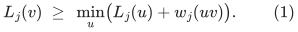
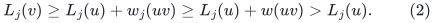
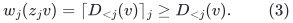
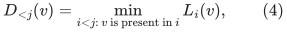
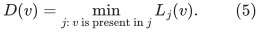
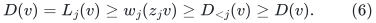
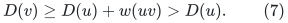
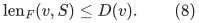

# A source-rooted strengthening of the approximate-ball forest

**Independent construction audit, 25 October 2026.**

This note fills a small but consequential interface between the strong
decremental shortest-path forest and the Gomory--Hu application. It does
not infer a rooted multi-source forest from a statement about distances
to a set alone. Instead, it exposes the parent pointers already maintained
by the public approximate-ball construction and gives an explicit rule for
combining its distance scales.

The conclusion is that the forest in KMG Theorem 5.14 can be required to
have exactly one current source in every component containing a vertex
with finite maintained label. Sources are parentless. Its canonical
original vertices are fixed. The strengthening costs a polynomial
logarithmic factor and does not add a virtual source or zero-length edge
to the physical bounded-degree input graph.

## 1. Primary sources and the distinction being checked

The two public sources are:

* Bernstein--Probst Gutenberg--Saranurak (BGS),
  [arXiv:2101.07149v2](https://arxiv.org/pdf/2101.07149), Sections
  II.5.1--II.5.4, especially Definition II.5.2, Algorithm 5,
  Proposition II.5.4, Lemma II.5.8, and Proposition II.5.9. The base
  exact ES forest is also stated in Proposition III.2.11.
* Kyng--Meierhans--Probst Gutenberg (KMG),
  [arXiv:2311.06402v1](https://arxiv.org/pdf/2311.06402), Definition
  5.13, Theorem 5.14, and Algorithm 10.

KMG Definition 5.13 says that a maintained forest approximates
<code class="math">\mathrm{dist}_G(S,v)</code>. Taken literally, that property alone
does not forbid two vertices of <code class="math">S</code> from lying in the same tree.
This extra fact must therefore come from the construction.

There is a second trap. BGS's internal dummy source is connected not
only to the current sources by zero-weight edges, but also to vertices
of a smaller approximate ball by positive-weight edges. Simply removing
that dummy source from one MES tree would leave extra roots. The rule
below removes this problem without expanding a smaller-scale path each
time a parent changes.

## 2. The public parent inequality

For one monotone Even--Shiloach instance, write <code class="math">L_j(v)</code> for its
maintained label and <code class="math">w_j(uv)</code> for its rounded edge length. BGS
Algorithm 5 maintains neighbor heaps. After a settled update, Lemma
II.5.8(3) gives

<!-- math-display: 75c9d1b3b5ad83a669f61be9
L_j(v)\ \geq\ \min_u\bigl(L_j(u)+w_j(uv)\bigr).
 \tag{1}
-->

Choose a deterministic minimizing neighbor as this instance's parent.
An actual original or hopset edge has positive length, and its length
<code class="math">w(uv)</code> in the unrounded graph is no larger than <code class="math">w_j(uv)</code>.
Consequently, if the chosen parent is an actual graph vertex,

<!-- math-display: 1257b2c049f53f7268c17f62
L_j(v)\geq L_j(u)+w_j(uv)
          \geq L_j(u)+w(uv)>L_j(u).
 \tag{2}
-->

Definition II.5.2(3) also gives artificial edges from a dummy source
<code class="math">z_j</code> to regular vertices <code class="math">v</code> of a smaller approximate ball.
Their lengths are rounded up from the smaller instance's answer:

<!-- math-display: 8f077c7e25bedb0ef6175c79
w_j(z_jv)=\lceil D_{<j}(v)\rceil_j
             \geq D_{<j}(v).
 \tag{3}
-->

Here the notation <code class="math">\lceil\cdot\rceil_j</code> means rounding to the
quantum used by that MES instance. Every instance in this recursion uses
the same current source set <code class="math">S</code>. The returned answer is the minimum
of its own MES label and the smaller approximate-ball answer. Unrolling
this recursion therefore gives

<!-- math-display: cedbcfe99c32bf101c5841bb
D_{<j}(v)=\min_{i<j:\,v\text{ is present in }i} L_i(v),
 \tag{4}
-->

where index zero denotes an exact ES base instance. A missing candidate
has value infinity. This minimum concerns only the nested source-ball
instances used to answer this particular approximate-ball call. It does
not mix independently sourced cover-ball instances.

## 3. Selecting one real parent for each vertex

For each regular or cover-center vertex <code class="math">v</code> occurring in the nested
instances, define

<!-- math-display: 6c0a398709dc3d26582d8b66
D(v)=\min_{j:\,v\text{ is present in }j}L_j(v).
 \tag{5}
-->

Among the instances attaining this minimum, select the smallest scale
index <code class="math">j</code>. Additional ties are broken by fixed identifiers. If
<code class="math">v\in S</code>, make it parentless. If <code class="math">D(v)=\infty</code>, give it no
parent either. For any remaining vertex, take the selected instance's
parent.

**Lemma 1.** A finite, nonsource vertex selected by this rule never has
a dummy source as its parent.

**Proof.** A cover-center vertex has no dummy-source edge. Suppose a
regular vertex <code class="math">v</code> selects instance <code class="math">j&gt;0</code> and that this instance
selects its dummy source. Since its dummy source has label zero, (1),
(3), (4), and (5) give

<!-- math-display: be556269ce44ba428634a33b
D(v)=L_j(v)
 \geq w_j(z_jv)
 \geq D_{<j}(v)
 \geq D(v).
 \tag{6}
-->

All inequalities are equalities. A smaller-scale candidate therefore
attains <code class="math">D(v)</code>, contradicting the rule of selecting the smallest
scale. At the exact ES base, the dummy source is adjacent only to the
actual sources by zero-weight edges. A nonsource cannot choose it.
This proves the claim. <code class="math">\square</code>

**Lemma 2.** Every chosen parent edge is an actual positive-length
original or hopset edge and satisfies

<!-- math-display: f0fc438ca0894412cc77fc09
D(v)\geq D(u)+w(uv)>D(u).
 \tag{7}
-->

**Proof.** Lemma 1 rules out the artificial edges. If instance <code class="math">j</code>
is selected for <code class="math">v</code>, then (2) and <code class="math">D(u)\leq L_j(u)</code> imply
(7). <code class="math">\square</code>

Orient each selected edge from child to parent. Strict decrease in (7)
precludes a directed cycle. Because every finite nonsource has one
parent and every source has none, every finite component terminates at
a source. There is exactly one such source in a component: an acyclic
connected graph with one parent edge at each nonsource has exactly one
parentless vertex. In particular, two current sources cannot be linked
by the selected forest.

Summing (7) along the path from <code class="math">v</code> to its source gives

<!-- math-display: d33bf80cd14befd70f8f7ef2
\mathrm{len}_F(v,S)\leq D(v).
 \tag{8}
-->

For a regular vertex, the minimum in (5) is the approximate-ball answer
obtained by the public recursive minimum rule, or an even smaller valid
upper certificate if redundant candidates are retained. The public
distance guarantee bounds it by
<code class="math">(1+\epsilon)\mathrm{dist}_G(v,S)</code> wherever that approximate
ball promises an answer. The parent path uses actual edges of the same
original-plus-hopset graph used in KMG Definition 5.13. Thus it is a
forest certificate with the required cost and the additional source-root
property.

The minimum need not be interpreted as a new distance-maintenance
algorithm. It is a way to expose one consistent forest from labels the
public construction already computes. The proof uses local labels to
select parents and uses the global minimum only to certify those
choices. A change of <code class="math">D(u)</code> therefore does not trigger scans of all
vertices that have previously used <code class="math">u</code>.

## 4. Update time and fixed original vertices

For every candidate instance-vertex pair, store its current label and
current minimizing neighbor. A heap over candidates at each vertex
selects the minimum lexicographic pair <code class="math">(L_j(v),j)</code>. An update of a
local label or a local minimizing neighbor changes one candidate and
costs a logarithmic factor. Every such update is charged to the source
MES algorithm's existing neighbor-heap operations, level changes,
edge updates, or instance initialization. The total number of candidate
records is bounded by the explicit inventory already charged in the
recursive approximate-ball construction.

Changing the selected parent changes at most one old and one new
forest edge. Maintain the forest using a dynamic-tree structure if
needed. During one settled source update, first remove every old
selected edge that is to change, then insert its replacement. The final
edge set is a forest by Lemma 2; after those removals the remaining
edges are a subset of that final forest, so any order of replacement
insertions is safe. No public observation is required midway through
the transaction.

Thus the cost of exposing this source-rooted forest is the public
approximate-ball work times a fixed polynomial in <code class="math">\log n</code>. The
number of scales is already a polylogarithmic factor in the parameter
range used in the current strong-forest construction.

Keep one permanent node for each original vertex for the lifetime of
the approximate-ball instance. A vertex whose label becomes infinity
is retained as an isolated canonical node rather than being assigned
a new identity. Vertices outside the initial source-reachable set can
likewise be added as permanent isolates. This costs <code class="math">O(n)</code> for a
top-level all-distance call. For a local finite-radius ball it is enough
to keep its initial ball's original vertices and explicitly retain only
the client-required canonical nodes; no local instance is padded to
the full master graph.

An isolated unreachable component has no source. Accordingly, the
precise statement is "one source in every finite component," not "one
source in every component including permanently unreachable isolates."

## 5. Preservation under the KMG flattening construction

Now call the top approximate ball with a fixed source set <code class="math">S</code> and
infinite radius, using the forest above instead of an arbitrary forest
whose distances happen to approximate the same set. KMG Algorithm 10
replaces each occurrence of a cover-center vertex by its own copy of a
connected replacement tree. Different occurrences receive different
copies. Existing original-vertex nodes retain their identities.

Substituting a tree for one vertex of a forest cannot merge two old
components. Nor can it introduce a second distinguished original source
into a component: copies of a source's physical image inside replacement
trees are auxiliary aliases, not the globally distinguished canonical
source node. Unused preallocated replacement copies are auxiliary
components and do not count as finite source components of the exposed
terminal forest.

The root-only contraction of true-null links in
[separated-metric-forest-and-strong-sssp.md](separated-metric-forest-and-strong-sssp.md) also preserves components.
It contracts existing edges within one component and preserves the
distinguished representative whenever it is present. It does not merge
all nodes having the same physical image.

Consequently, after all hopset levels are flattened, every source-
reachable distinguished vertex belongs to a tree with exactly one
distinguished source. Its source path has the same
<code class="math">(1+\epsilon)\mathrm{dist}_G(v,S)</code> cost bound, and every edge
projects to one current original edge.

The construction adds no physical zero-length star, no high-degree
physical super-source, and no repeated shortest-path expansion. It
therefore preserves the <code class="math">\exp O(U^{7/8}h^{1/8})</code> congestion, work,
and recourse envelopes of the audited strong-forest construction.

## 6. Scope for a Gomory--Hu use

This note establishes the rooted multi-source forest interface. It
does not by itself quantify the rest of a Gomory--Hu algorithm. A
subsequent application must still account for its skeleton construction,
packing-size dependence, edge-length increases, original degree
reduction, and any exact-flow or minimum-cut calls.

In particular, the conclusion does not rely on claiming that a path
between two canonical zero-star neighbors in an arbitrary flat forest
must be one edge. Flat forests can contain aliases of the same physical
vertex, so such a claim needs additional structure. The construction
above provides the required structure directly at the source-rooted
approximate-ball stage.
