# Exact flow and local projection by rounding near-feasible circulations

**Separate mathematical construction, 24 October 2026.** This note
replaces the static maximum-flow calls in the projection client by an
explicit rounding algorithm and the same priced logarithmic interface
already used by that client. It does not alter the frozen 167/168,
209/210, or 335/336 compositions. Its algorithmic dependencies are the
stated priced-step contract and ordinary dynamic trees; it does not
invoke a new exact maximum-flow solver during recovery.

The distinction between an exactly conserved vector and an approximately
conserved one is essential throughout. The numerical client supplies
exact conservation. Merely having small capacity violation without this
conservation would not imply the rounding theorem below.

## 1. Integral rounding with less than one unit of total violation

Let an oriented multigraph have integral lower and upper bounds
<code class="math">l_e\le u_e</code>. Let a rational vector <code class="math">f</code> satisfy integral vertex
demands exactly; a circulation is the zero-demand special case. Define

<!-- math-display: a818c8e78550a9bdd0142ede
\mathrm{viol}(f)=
 \sum_e\bigl((l_e-f_e)_+ +(f_e-u_e)_+\bigr).
 \tag{1}
-->
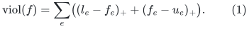

**Rounding theorem.** If <code class="math">\mathrm{viol}(f)&lt;1</code>, a deterministic
algorithm produces an integral vector with the same demands and
<code class="math">l\le f'\le u</code>, using <code class="math">O(m)</code> dynamic-tree operations and
<code class="math">O(n+m)</code> input/demand bookkeeping if isolated vertices are supplied.
After compacting nonisolated vertices, standard logarithmic-time
dynamic trees give <code class="math">O(m\log(m+2))</code> scalar/data-structure operations,
each with its charged arithmetic cost. With dyadic input of <code class="math">b</code> bits,
all arithmetic uses <code class="math">O(b+\log(m+2))</code> bits. The running time includes
the corresponding ordinary integer-arithmetic overhead.

Here is a constructive proof. Put

<!-- math-display: 25a11358b90b2121424fa613
a_e=\lfloor f_e\rfloor,\qquad b_e=\lceil f_e\rceil,
 \qquad
 c_e=\begin{cases}
 -1&f_e<l_e,\\
 +1&f_e>u_e,\\
 0&l_e\le f_e\le u_e.
 \end{cases}
 \tag{2}
-->
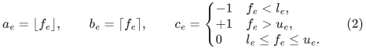

For every vector <code class="math">x\in[a,b]</code>, its total violation of the ORIGINAL
bounds is an affine function

<!-- math-display: d096bf3845bb8c9bc26e5c2c
\mathrm{viol}(x)=c^{\mathsf T}x+K
 \tag{3}
-->
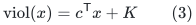

with a fixed integer constant <code class="math">K</code>. Indeed, a lower-violating input
coordinate lies in <code class="math">(l_e-1,l_e)</code>, so its rounding interval is
<code class="math">[l_e-1,l_e]</code>. Its violation is exactly <code class="math">l_e-x_e</code>. The upper
case is symmetric. An initially feasible coordinate has its entire
rounding interval within the integral original bounds.

Round <code class="math">f</code> within <code class="math">[a,b]</code> while preserving demands and never
increasing <code class="math">c^{\mathsf T}f</code>. A direct dynamic-tree implementation is
as follows.

1. Integral coordinates are frozen permanently. Maintain a forest of
   currently nonintegral edges. Process the remaining nonintegral edge
   IDs in a fixed order, linking an edge when its endpoints are in
   different forest components.
2. An edge whose endpoints are already connected creates an undirected
   fundamental cycle. Regard it as a signed circulation. Choose the
   sign with nonpositive scalar cost, and push as far as possible
   within <code class="math">[a,b]</code>. At least one cycle edge becomes integral.
3. Freeze and remove every newly integral forest edge. If the processed
   off-forest edge remains nonintegral, link it after these cuts. Its
   endpoints are now disconnected. A self-loop is a one-edge cycle;
   distinct parallel IDs can form a two-edge cycle.

Signed path-cost sums choose the sign. Orientation-sensitive residual
minima and lazy path addition compute and apply the maximal push.
List all newly integral forest edges BEFORE cutting any of them:
repeatedly find a zero residual key on the exposed path, record its
edge ID, and mask that edge's minimum keys to infinity. Then cut the
collected edges. Otherwise the first cut could disconnect the path
needed to enumerate its remaining zero keys. Each edge
is processed once, linked at most once, and removed at most once, so
the total work is <code class="math">O(m\log(m+2))</code>. There is one mutable history;
no persistent or branching amortization is being assumed here.

After every edge has been processed, the remaining nonintegral support
is a forest. If it were nonempty, one of its nontrivial components
would have a leaf. At that leaf the divergence of the unique incident
nonintegral edge could not be an integer, whereas the vertex demand
and every frozen incident edge are integral. This is impossible.
Thus the resulting vector <code class="math">f'</code> is integral. Equation (3) gives

<!-- math-display: 5d86512167ac3f97385a07c3
0\le\mathrm{viol}(f')
 \le\mathrm{viol}(f)<1.
-->
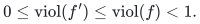

The left-hand quantity is an integer, hence zero. This proves the
theorem. The largest push is a difference of dyadic coordinates and
integer endpoints; no new denominator is introduced.

Ordinary cost-nonincreasing flow rounding is also a published primitive:
van den Brand et al., [arXiv:2309.16629v1, Lemma 4.1](https://arxiv.org/abs/2309.16629),
credits the dynamic-tree construction
in [Kang and Payor, Section 4](https://arxiv.org/abs/1507.08139).
The argument above specifies the extra penalty that extends this
primitive to a small total bound violation. An arbitrary cost-free
rounding would not suffice: it can round a coordinate just below an
integral lower bound down by a whole unit.

## 2. The local threshold state used below

Use the region construction in
[local exact projection from priced steps](local-exact-projection-from-priced-steps.md).
The parent allocation
and physical partition stay frozen throughout the call. Let
<code class="math">P\ge1</code> be its integral debt total and <code class="math">\beta\le P</code> the total
deficit. A threshold <code class="math">1\le b\le\beta</code> runs on a growing local
optimistic network. Ordinary capacities are multiplied by 16, and a
return arc <code class="math">t\to s</code> has current value <code class="math">z</code>. Put

<!-- math-display: b4fc354e08cc71616d9ee413
T=16b,\qquad W=20000(P+1).
 \tag{4}
-->
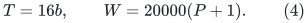

The numerical circulation is exactly conserved. Its ordinary
unpadded bound violation is at most <code class="math">\alpha</code>, where the existing
pad/guard proof gives <code class="math">\alpha&lt;S^{-800}</code>. We only need, say,
<code class="math">\alpha&lt;1/100</code> below. Its objective is

<!-- math-display: 57250d9fd095d528ab69cf9b
\Phi(F,z)=\sum_{e\text{ ordinary}}
  \bigl[\log(F_e-l_e+\zeta_e^-)
       +\log(U_e+\zeta_e^+-F_e)\bigr]
       -W\log(T-z).
 \tag{5}
-->
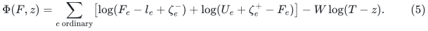

The region has fewer than <code class="math">1000(P+1)</code> ordinary arcs and fewer than
<code class="math">2000(P+1)</code> ordinary logarithmic terms. Expanded boundary sink
arcs can have locks <code class="math">l_d=4u_d</code>; every other ordinary lower bound
is zero. Before the test ends, the locks and upper bounds are
integral. Every still unexpanded boundary has flow below <code class="math">10u_d</code>,
including just after the final successful step, while its TRUE
scaled upper capacity is <code class="math">16u_d</code>.

Success means <code class="math">z\ge T-1/4</code>. A valid LOW obeys the existing priced
contract: LOW is impossible if a circulation direction has logarithmic
directional derivative at least one half of its sum of absolute
individual logarithmic derivatives. The sums count the two ordinary
logarithms separately, even when their signed derivatives cancel.

These are exactly the already proved locality and numerical hypotheses.
The following recovery operations run only after the iterate is frozen.
They cannot change the region or the parent while reading its values.
All maximum-flow residual searches below use only the ordinary arcs.
The numerical return arc records the flow value and is omitted from
those residual graphs.

## 3. A success gives an explicit integral true flow

At a successful threshold, discard every lower lock and use the TRUE
ordinary capacities. Divide the current circulation, including its
return coordinate, by 16. Impose integral ordinary intervals
<code class="math">[0,\mathrm{cap}_e]</code> and return interval <code class="math">[b,\beta]</code>.

No unexpanded boundary violates its new upper capacity, because its
scaled flow is below <code class="math">10u_d&lt;16u_d</code>. Removing lower locks can only
decrease violation. Thus the ordinary violation after division is at
most <code class="math">\alpha/16</code>. The return lower violation is at most <code class="math">1/64</code>,
and its upper violation is at most <code class="math">\alpha/16</code>, from source
conservation. The total is at most

<!-- math-display: 8471739bc3a2ffe8f510bdc2
\frac1{64}+\frac\alpha8<1.
 \tag{6}
-->
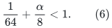

Apply Section 1 directly to this UNscaled instance. It returns an
explicit integral true-region flow of value at least <code class="math">b</code>. This
avoids a second rounding step or an exact max-flow call. Its extension
by zero is a full exchange-network flow, so it is an unconditional
positive threshold certificate after ordinary feasibility checks.
In fact its value is exactly <code class="math">b</code>: the logarithmic domain has
<code class="math">z&lt;T=16b</code>, and the return coordinate is rounded within its own
floor/ceiling interval, whose upper endpoint after division is <code class="math">b</code>.

Reading every numerical coordinate in the region costs <code class="math">O(P)</code>
exact point reads. This is charged once to the completed test, not
once per numerical iteration. The rounding itself has
<code class="math">O(P\log(P+2))</code> dynamic-tree work.

## 4. LOW immediately above the optimum is sufficiently accurate

Suppose a failure-region test has threshold <code class="math">b=v+1</code>, where its
UNlocked optimistic maximum is exactly the integer <code class="math">v</code>. Assume
<code class="math">v&lt;\beta</code>. Write

<!-- math-display: 89d3f0de81dfc6c66a4ca423
d=16v-z.
-->
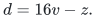

There is a scaled feasible circulation of value <code class="math">16v</code> respecting
all current locks. To see this, first apply Section 1 to the current
scaled ordinary bounds and return interval <code class="math">[0,16\beta]</code>.
Their total violation is below <code class="math">2\alpha&lt;1</code>, so these locked
bounds are feasible. From any feasible locked flow, ordinary simple
source-to-sink residual augmentations can reach the unlocked maximum:
the only positive lower bounds are on sink arcs, and their reverse
arcs leave the sink and cannot occur on such a simple augmenting path.
This is an existence proof for the comparator, not an instruction to
run all those augmentations during recovery.

Take the comparator minus the current iterate as a direction. Every
negative ordinary logarithmic contribution has magnitude below one.
Hence their total is below <code class="math">2000(P+1)</code>. If <code class="math">d\ge8</code>, the
positive return contribution is

<!-- math-display: ed38c16e03a71ab03fca78da
\frac{W d}{16+d}\ge\frac W3
           >3\cdot2000(P+1).
 \tag{7}
-->
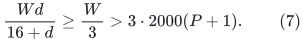

The ratio of total signed derivative to total absolute derivative is
therefore greater than one half, which forbids valid LOW. Consequently

<!-- math-display: 833ae95606462df44552647b
z>16v-8.
 \tag{8}
-->
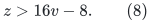

A minimum optimistic cut of scaled capacity <code class="math">16v</code>, together with
the total violation bound, also gives <code class="math">z\le16v+\alpha</code>.
No cut needs to be found to use this inequality in the proof.

Now discard the locks, divide the iterate by 16, and impose ordinary
integral optimistic bounds and return interval <code class="math">[v,\beta]</code>.
Its total violation is less than

<!-- math-display: f9ddd4a50c21b40a118f54f3
\frac12+\frac\alpha8<1.
 \tag{9}
-->
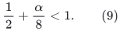

Section 1 gives an integral optimistic flow of value at least <code class="math">v</code>.
Since its maximum is <code class="math">v</code>, that flow is maximum and has value
exactly <code class="math">v</code>. A residual graph search returns its minimum source
side in linear work.

It is important that this LOW threshold is immediately above the
optimum. A LOW test at a much larger threshold need not have a
near-maximum iterate. The present proof does not round every arbitrary
negative test into a maximum flow.

## 5. Exact local projection with no fresh max-flow call

Run the same <code class="math">O(\log(\beta+1))</code> threshold search. Each success is
rounded as in Section 3 and supplies a positive certificate. A LOW
answer is used provisionally as a negative threshold answer; its
validity for the fast-branch proof is the existing priced-step lemma.
It is not yet treated as an independently checked cut.

Let the resulting proposed optimum be <code class="math">v</code>. Retrieve the following
final tests if they were not retained from the search.

* If <code class="math">v&gt;0</code>, run success threshold <code class="math">v</code>, obtaining an explicit
  integral flow <code class="math">F^+</code> in a true region.
* If <code class="math">v&lt;\beta</code>, run failure threshold <code class="math">v+1</code>, and perform the
  recovery of Section 4 on that optimistic region. Obtain an integral
  optimistic flow <code class="math">F^-</code> and its residual source side <code class="math">Q</code>.
* When <code class="math">v=0</code>, the true flow is the zero flow; only the failure
  region is needed. When <code class="math">v=\beta</code>, the success flow and the
  total source capacity certify optimality; no <code class="math">\beta+1</code> test
  is needed.

Under the priced contract, true-region containment and optimistic
domination imply that both final region maxima equal <code class="math">v</code>. The
recovered flows therefore have value exactly <code class="math">v</code>.

### Explicit final checks

The finite program verifies conservation, integrality and capacities
of the recovered vectors. Before invoking Section 1 it also verifies
its exact-conservation and total-violation prerequisites. For
<code class="math">v&lt;\beta</code>, it requires that the residual search from <code class="math">s</code>
in the optimistic graph does not reach <code class="math">t</code>, and checks that the
resulting cut capacity equals the proposed flow value <code class="math">v</code>.
Any failure suspends the candidate branch.

An optimistic boundary cannot lie in <code class="math">Q</code>: its outgoing sink arc
alone has capacity <code class="math">\beta+1&gt;v</code>. Thus every bin of <code class="math">Q</code> was
fully expanded. All full arcs leaving those bins, all outgoing
incidences of its represented rows, and every positive source arc
are represented. On <code class="math">Q</code>, optimistic and true sink capacities
agree. Therefore <code class="math">Q</code> is the SAME capacity-<code class="math">v</code> cut in the full
exchange graph. This statement can be checked from the bounded local
lists and their original identifiers; an unexpanded bin is never
scanned to verify it.

The true flow <code class="math">F^+</code>, extended by zero, is feasible in the full
graph and has value <code class="math">v</code>. It and <code class="math">Q</code> form an explicit full
maximum-flow/min-cut certificate. Thus a false intermediate LOW cannot
produce an accepted incorrect projection: either the final checks
fail or the final flow and cut independently certify the result.

### Recovering the COMPLETE full residual peel

Take the union of the true success and optimistic failure regions,
deduplicating by original arc ID and installing true capacities.
Keep the true success flow <code class="math">F^+</code> and set it to zero on added
arcs. Do not splice <code class="math">F^+</code> and <code class="math">F^-</code>, and do not compute a
new maximum flow on the union.

Equality between the full value of <code class="math">F^+</code> and capacity of <code class="math">Q</code>
forces all outgoing cut arcs to be saturated and all incoming cut
arcs to carry zero flow. Hence no full residual arc leaves <code class="math">Q</code>.
Every forward residual arc needed within <code class="math">Q</code> is present in the
failure region, and every positive-flow reverse arc is present in
the success region. Residual reachability in the union is therefore
exactly the FULL residual reachability. Its bin set is the required
peel, with the existing bound <code class="math">w(R_0)&lt;P</code>.

When <code class="math">v=\beta</code>, all source deficits are saturated and the peel
is empty. When <code class="math">v=0</code>, use the zero flow on the failure region;
the same cut argument supplies the complete residual peel.

The final exchange support remains <code class="math">O(P)</code>. Applying it to the
frozen parent, deleting the assigned rows of the peel, and normalizing
the child are exactly the old sparse transaction. No conservation or
support premise is lost by this recovery change.

## 6. What replaces the old static-flow cost

Region size, cumulative expanded physical weight, permanent locks,
pad charges and objective accounting are unchanged. Each threshold
still has

<!-- math-display: fac3c5edce5c96480ef64190
O((P+1)q^{-2}\log S)
 \tag{10}
-->
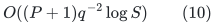

successful priced steps, with the same charged notification factors.
Each completed success or final failure adds <code class="math">O(P)</code> exact point
reads and <code class="math">\widetilde O(P)</code> rounding/verification work. There are
<code class="math">O(\log S)</code> thresholds. Under the quantitative master caps of
the matching construction, the existing conservative local bound

<!-- math-display: d290111100b4228323707163
T_{\rm local}\le(P+B)B^{250}
 \tag{11}
-->
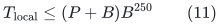

therefore remains sufficient. It now depends only on the priced-step
implementation and its raw-cycle backend. The separate deterministic
static-flow factor with logarithmic exponent <code class="math">17/18</code> is absent.

This does not make the numerical LOW assertion an independently
checked certificate at each intermediate threshold. Instead the
algorithm checks the final exact primal/dual pair. Its fast-time
proof still requires the priced-step contract; its returned exact
projection is checked directly.

## 7. A global exact maximum-flow algorithm from the same client

The same construction applies to an explicit directed network with
<code class="math">M</code> arcs and nonnegative integral capacities of polynomial master
magnitude within the FIXED declared magnitude and argument envelope
of the priced client. The threshold weights, source-capacity sum,
pad arguments and all root prices must satisfy that same envelope;
the matching capacities do. Arbitrarily encoded capacities instead
use the digit reduction in Section 8. First delete ordinary arcs entering the source, ordinary
arcs leaving the sink, and self-loops; their output flows will be zero.
This preserves the maximum value, since a maximum flow has a
cycle-free decomposition into simple source-to-sink paths, none of
which uses these arcs. It also preserves the capacity of every
source-side cut. Remove or separately ignore isolated nonterminal vertices.
Put <code class="math">\beta=\sum_{e\text{ leaving }s}\mathrm{cap}_e</code>.
If <code class="math">\beta=0</code>, the zero flow is maximum. Otherwise make every
vertex and arc represented from the start, use true capacities
throughout, and use no locks or boundary operations. Set

<!-- math-display: 7dfb90fe394c2477156149fb
W=20000(M+1),\qquad T=16b.
 \tag{12}
-->
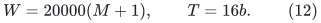

Initialize every ordinary flow and the return flow to zero and add
the same positive pads. After the preceding preprocessing, source
conservation gives <code class="math">-\alpha\le z\le16\beta+\alpha</code>.
Without that preprocessing the lower bound would be false: ordinary
flow from the sink back to the source could be balanced by a negative
return coordinate with no capacity violation. The ordinary objective
has exactly <code class="math">2M</code> logarithms. The threshold correctness proof and
the near-optimal LOW proof are consequently stronger than the local
constants above.

Binary search, success rounding and the final <code class="math">v+1</code> rounding now
return a maximum flow in the entire explicit network. The final
residual reachability is directly its minimum cut. The edge cases
<code class="math">v=0</code> and <code class="math">v=\beta</code> are handled as in Section 5.

With <code class="math">\mathcal E</code> denoting the common charged per-operation,
notification, occurrence and raw-quality factor of the priced
implementation, this gives

<!-- math-display: be915851c59c7e76d8b99ef0
\widetilde O\bigl((M+1)q^{-2}\mathcal E^{O(1)}\bigr)
 \tag{13}
-->
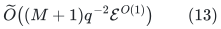

work, with logarithms of the integral capacity bound included.
For the existing matching caps <code class="math">q=B^{-100}</code> and
<code class="math">\mathcal E\le B^{O(1)}</code>, a safe bound is
<code class="math">(M+B)B^{250}</code>. All numerical histories have their old finite
guards and exact dyadic arithmetic. The final feasible-flow/cut
check is linear and is separate from the running-time proof. The
[main realization theorem](../../problems/general-matching/proof.md#116-deterministic-cycle-search-realization)
supplies the complete raw-cycle, occurrence and retirement interfaces
used by the current matching application.

More abstractly, an arbitrary-update raw-cycle backend whose
initialization, updates, paths, occurrences and inverse quality are
bounded by a computable subpolynomial <code class="math">E</code> gives, through the
already proved priced client, <code class="math">M E^{O(1)}</code> exact maximum flow.
One may choose a dyadic cap <code class="math">B\ge4E</code>,
<code class="math">q=B^{-100}</code>, and <code class="math">D_*=B^{10}</code>, provided the existing master
bit, horizon and finite-guard hypotheses hold. A static ratio oracle
without the raw-length and lifetime/motion interfaces is not enough
for this conclusion.

### The level-one matching reset

At level one, start from the integral allocation that places <code class="math">L</code>
on each current assigned incidence. Its full exchange graph has
<code class="math">O(N)</code> records, and its total deficit is at most
<code class="math">c\,w(\mathcal D)\le CN</code>. It can therefore use this global
algorithm directly; the weight and capacity magnitudes fit the
existing master precision bound. Its output is the exact flow and
full residual peel required by the reset.

A phase has <code class="math">O(aS/b_1+1)</code> level-one resets, where
<code class="math">b_1=B^{a-1}</code> and <code class="math">B^a\ge S</code>. Their total global-flow
cost is at most

<!-- math-display: df5f758c089daae44f9245ab
O(aB+1)\,(S+B)B^{250}\le S B^{252}
 \tag{14}
-->
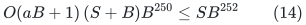

at the eventual quantitative guard sizes. The same outer reset
accounting already sums all higher local instances. Hence the
conservative phase allowance <code class="math">SB^{300}</code> still has ample room.
This alternative removes the static-flow exponent floor at EVERY
matching reset, not just at higher local levels.

## 8. Capacity digits, if large encoded capacities are desired

The previous theorem is sufficient for the matching application.
There is also an elementary reduction for an explicit general network
whose capacities have <code class="math">b</code> bits.

Process capacity bits from most significant to least significant.
If the old capacity vector is <code class="math">c</code>, its exact maximum flow is
<code class="math">f</code>, and the next vector is <code class="math">c'=2c+\xi</code> with
<code class="math">\xi_e\in\{0,1\}</code>, then <code class="math">2f</code> is feasible for <code class="math">c'</code>.
An old minimum cut proves that the additional optimum is at most
<code class="math">M</code>. In the residual graph of <code class="math">2f</code>, truncate every forward
and reverse residual capacity at <code class="math">M</code>. This preserves the optimum
augmentation: remove cycles from a maximum residual flow and every
arc carries no more than its total value, at most <code class="math">M</code>.

Solve this <code class="math">O(M)</code>-arc, capacity-<code class="math">M</code> residual instance using
Section 7 and add its signed correction to <code class="math">2f</code>. This yields
an exact maximum flow for <code class="math">c'</code>. Run ordinary residual reachability
in the NEW ORIGINAL network with capacities <code class="math">c'</code> and this updated
flow to obtain the minimum cut used in the next digit. A cut in the
truncated auxiliary residual graph is not silently reused as a cut
in the original network. This extra search costs <code class="math">O(M)</code> per digit.
There are <code class="math">b</code> rounds. The
large integers occur only in the explicitly charged digit arithmetic;
the priced instances themselves have polynomial capacities in their
actual explicit size. This avoids a dependence of the raw numerical
backend's length aspect on a huge original capacity magnitude.

## 9. Relation to the published IPM interface

Theorem 4.6 of
[van den Brand et al., arXiv:2309.16629v1](https://arxiv.org/abs/2309.16629)
is another possible route. It
uses a <code class="math">\kappa</code>-approximate cycle interface with point-flow
queries and an absolute-motion detection operation; its numerical
work is <code class="math">\widetilde O(M\kappa^{-2})</code>. A raw-cycle approximation
of factor <code class="math">E</code> is strong enough for its QUALITY inequality:
literal traversal length dominates the net weighted flow norm, so
<code class="math">\kappa=E^{-1}</code> is admissible for a hidden stable witness.

However, this quality observation alone is not a literal substitution
for Definition 4.5. That definition reports thresholds for the sum
of absolute NET increments per edge. The occurrence-forest client
naturally accumulates absolute raw traversals, which can be larger
when pieces cancel in one update. A direct invocation of Theorem 4.6
would need either exact net-motion detection or a proof that its
client tolerates the corresponding conservative early reports and
that their number is charged by raw length. It also needs the
theorem's own fixed-point and step-scaling interface.

The algorithm in Sections 1--8 avoids assuming this extra IPM
interface lemma. Its complete notification and exact-step analysis
is the already stated priced-logarithmic client, and the present
rounding and final-cut arguments close its exact-flow recovery.
No conclusion here depends on treating a net cycle certificate as
a raw one, or on treating final matching verification as evidence
for the new running time.
