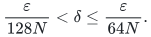
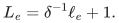
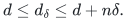
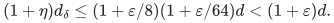
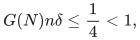
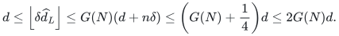
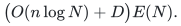

# Zero-length edges in integer distance and spanner interfaces

**Local deterministic reductions; ready for review.** These adapters
extend the stated positive-length interfaces to nonnegative integer
lengths. They preserve each interface's remaining hypotheses and do not
construct a numerical hierarchy or a raw-cycle backend.

Let <code class="math">N\geq\max\{n,2\}</code> be a fixed master cap and let original edge
lengths lie in <code class="math">[0,N^c]</code> for a fixed constant <code class="math">c</code>. Edge identities and
endpoints do not change during an edge's lifetime. A weight replacement
is an explicitly charged deletion and insertion where that update model
supports it. The parameters below are fixed for the complete history.

| Positive-length interface | Adapter | Result and scope |
|---|---|---|
| <code class="math">(1+\varepsilon)</code> source-distance and represented-path interface | Fixed dyadic perturbation, with a constant accuracy reserve | Same accuracy for original integer distances and paths; preserves exact zero distances |
| Distance-only oracle with <code class="math">\gamma(N)=N^{o(1)}</code> stretch | Fixed inverse-polynomial perturbation and exact flooring | At most <code class="math">2\gamma</code> stretch and exact zero distances; no new path-reporting claim |
| Unweighted spanner, with a positive weighted dyadic wrapper | One additional unweighted class containing the zero-length edges | Same asymptotic stretch, size, work and recourse; no zero-component maintenance primitive |

## 1. Approximate source paths and flat forests

Assume a positive-integer algorithm returns a represented source-to-vertex
walk of cost at most <code class="math">(1+\eta)</code> times the true distance, for every
reachable target. The representation can be an explicit path or a path
in a flat forest whose real edges map to individual original edges.
Typed nulls have no physical edge and keep length zero. Take
<code class="math">0&lt;\varepsilon\leq1/2</code>, set <code class="math">\eta=\varepsilon/8</code>, and choose a
dyadic number

<!-- math-display: 89c7e5754fd15faa40aa702e
\frac{\varepsilon}{128N}<\delta
\leq\frac{\varepsilon}{64N}.
-->

Run the algorithm on the positive integer lengths

<!-- math-display: 948576a1d420bc74081c663a
L_e=\delta^{-1}\ell_e+1.
-->

This formula is integral because <code class="math">\delta^{-1}</code> is a power of two.
The unchanged graph has the same reachable pairs. Whenever a target
has finite original distance <code class="math">d</code>, a simple shortest path has fewer
than <code class="math">n</code> edges. Its perturbed distance <code class="math">d_\delta</code>, before multiplication
by <code class="math">\delta^{-1}</code>, satisfies

<!-- math-display: b2ddf76cefb4c3f32b612f60
d\leq d_\delta\leq d+n\delta.
-->

If <code class="math">d\geq1</code>, integrality gives

<!-- math-display: 7e6e2666a2082034b7b1017f
(1+\eta)d_\delta
 \leq (1+\varepsilon/8)(1+\varepsilon/64)d
 <(1+\varepsilon)d.
-->

If <code class="math">d=0</code>, the represented walk's perturbed cost is at most
<code class="math">(1+\varepsilon/8)n\delta&lt;1</code>. Dropping the perturbation leaves a
walk of nonnegative **integer** cost less than one, hence exactly zero.
The argument allows repeated physical edge occurrences in a forest
projection: each occurrence has nonnegative original cost, and dropping
its added <code class="math">\delta</code> only decreases the projected cost.

Thus every returned represented walk has the required original
<code class="math">(1+\varepsilon)</code> guarantee, including exact zero distances.
For a distance-only estimate, rescale by <code class="math">\delta</code> and take its floor.
Since the true finite distance is an integer, this floor remains an
upper estimate and is zero exactly when the true distance is zero.

For a maintained flat forest, retain its original topology and edge
maps and publish the original length on each real edge copy. Maintain
the perturbed length as the algorithm's internal field. Two length
fields take constant additional work per forest record. Topological
acyclicity, maps, occurrence counts, edge recourse and update histories
are unchanged. The published forest is still a flat representation of
the original graph, now allowing zero-length real edge copies.

If <code class="math">1/\varepsilon\leq N^{O(1)}</code>, the positive lengths <code class="math">L_e</code> remain
polynomially bounded in <code class="math">N</code>. Polynomial precision and logarithmic
length factors are therefore unchanged up to fixed constants. Any
lower accuracy threshold in the positive theorem must reserve the
constant factor eight; an unspecified sufficiently small exponent can
be reduced once to ensure this. For constant or inverse-polylogarithmic
accuracy the reserve is immediate.

The [incremental SSSP theorem](../../problems/incremental-sssp/proof.md)
already gives the corresponding direct perturbation proof and a
simple-path reporting construction. The
[strong decremental forest](../../problems/decremental-strong-forest/proof.md)
uses this argument to reweight its flat output. It gains no new
simple-path query bound from this adapter alone.

## 2. Subpolynomial-stretch numerical distance oracles

Suppose a deterministic positive-integer distance oracle returns upper
estimates with stretch at most <code class="math">G(N)\geq1</code>, where **G is an explicit
uniform upper bound for the complete composed oracle**. It includes
degree-adapter losses and applies to every permitted query and settled
state in the announced lifetime, on the declared transformed length
range. An unspecified constant inside an
<code class="math">O(\cdot)</code> expression is not an executable value of <code class="math">G</code>.

Let <code class="math">R</code> be the least power of two at least <code class="math">4NG(N)</code>, take
<code class="math">\delta=R^{-1}</code>, and replace each original length by
<code class="math">L_e=R\ell_e+1</code>. If <code class="math">G(N)=N^{O(1)}</code>, this still has a polynomial
integer range. Define the new estimate to be the floor of the old
estimate multiplied by <code class="math">\delta</code>. For <code class="math">d=0</code>, its unfloored value is
at most

<!-- math-display: f7c7e1f67e082e0a7aa8cf4e
G(N)n\delta\leq\frac14<1,
-->

so its floor is exactly zero. For a positive finite distance <code class="math">d\geq1</code>,

<!-- math-display: 1f42f02fed66aec97ed506e3
d\leq\left\lfloor\delta\widehat d_L\right\rfloor
 \leq G(N)(d+n\delta)
 \leq\left(G(N)+\frac14\right)d\leq2G(N)d.
-->

Disconnected pairs still return infinity. The length-bit cost is
<code class="math">O(\log N+\log G(N))</code>; choosing the power of two and flooring
are exact dyadic operations. When <code class="math">G(N)=N^{O(1)}</code>, this cost is
polynomial logarithmic and changes neither the dynamic history nor
the asymptotic update or query factor. The value <code class="math">R</code> is chosen once,
not adjusted after observing individual answers.

For the subpolynomial-stretch application, use the provider's explicit
bound <code class="math">G(N)=N^{o(1)}</code>. Alternatively, wherever that bound has already
been proved to satisfy <code class="math">G(N)\leq N</code>, the fixed choice
<code class="math">\delta=R_0^{-3}</code>, with <code class="math">R_0</code> the least power of two at least <code class="math">N</code>,
also works because <code class="math">G(N)n\delta\leq1/N&lt;1</code>. Any finite exceptional
sizes in this latter version must be handled exactly. The first
construction using the supplied uniform <code class="math">G</code> avoids that exception.

To avoid any circular dependence of <code class="math">G</code> on the transformed aspect
ratio, the APSP application uses the fixed <code class="math">R_0^{-3}</code> choice. First
declare the enlarged positive input range
<code class="math">[1,8N^{c+3}+1]</code>. Then obtain the provider's explicit bound <code class="math">G</code> for
that range. Use the perturbed oracle when <code class="math">G(N)\leq N</code> and exact
computation otherwise. Subpolynomial <code class="math">G</code> makes the latter branch
finite. No bound proved only for the original, smaller length range
is reused without checking its range.

This proves the nonnegative-integer extension for every explicit row
of the [APSP tradeoff table](../../problems/apsp-frontier/proof.md).
For the general family there, it applies under the additional condition
<code class="math">t^4h=o(U)</code>, which makes its stated stretch subpolynomial.
The weaker condition <code class="math">t^2h=o(U)</code> alone does not establish this
extension with a fixed polynomial length range. There is no claim of
simple-path reporting: the adapter inherits exactly the numerical
output interface that was supplied.

## 3. Dynamic spanners: a separate zero-length class

For each positive dyadic length class, run the usual unweighted
spanner wrapper. Add one more independent unweighted instance on
exactly the original edges of length zero. Treat its edges as unit
length **inside** that instance, and publish their original zero
lengths in the output. Every instance uses the same fixed original
vertex names and original physical edge IDs.

If an original zero-length edge is living, the zero-class spanner
contains a path between its endpoints. Every edge on this path has
original length zero. If an original positive edge has length in
<code class="math">[2^j,2^{j+1})</code>, its class spanner replaces it by a path of original
length at most <code class="math">2\Gamma</code> times its own length, where <code class="math">\Gamma</code>
is the unweighted stretch. Replacing the edges of any original
shortest path therefore proves the same <code class="math">2\Gamma</code> bound for the
union, including a zero-cost path whenever the original distance is
zero.

These statements hold after every complete external update. In
particular, deletion of a zero-length edge is forwarded to the zero
class before the union is published. Its new unweighted spanner
preserves exactly the current zero-edge connected components, and
every published route in that class consists of currently living
original zero-length edges. The conclusion is therefore an explicit
zero-cost subgraph witness, not just a zero numerical estimate.

There are <code class="math">O(\log N)</code> positive classes and one zero class. The sum
of their actual insertions and deletions is the original record count.
Initializing their fixed vertex inventories adds only the already
allowed polynomial logarithmic factor. In particular, a per-class
deletion-sensitive recourse bound <code class="math">(n+D_j)E(N)</code> sums to

<!-- math-display: fb57c8f387cd717d5905ab15
\bigl(O(n\log N)+D\bigr)E(N).
-->

The corresponding ordinary-recourse and work bounds sum in the same
way. Hence both [dynamic spanner regimes](../../problems/dynamic-spanners/proof.md)
retain their stated asymptotic envelopes. Updates and queries may
depend on earlier published outputs whenever the underlying
deterministic instances support that history model. No randomized
sampling, quotient by zero-distance components, or hidden dynamic
connectivity subroutine is introduced.

## 4. Limits of the reductions

The perturbation arguments use the unit gap between zero and a positive
integer distance. They do not justify the same statements for arbitrary
real lengths. The spanner wrapper requires a finite logarithmic number
of positive length classes. Negative lengths are outside all three
adapters. Each source theorem's initialization charges, update-history
scope, numerical range and path-output obligations remain part of its
application. The current graph theorems use their linked realized
algorithms; this reduction does not add a new cycle-search hypothesis.
