# Nonuniform parameter budgets for the current hierarchy

**Internal optimization analysis, 25 October 2026.** This note explains
what can and cannot be gained by choosing different parameters at
different levels of the current distance hierarchy. It proves lower
bounds on a specified positive accounting envelope, not lower bounds on
algorithms, matching, distance oracles, or Gomory--Hu trees. A new
construction that removes one of these charged terms is outside the
model. The result therefore identifies a concrete research bottleneck
rather than ruling out further algorithmic progress.

Let `U` be the logarithm of the nominal initial size and let
`h = log(U+4)`. Multiplicative absolute constants are suppressed.
The discussion is asymptotic; finite small instances use the exact base
case. A budget denotes the logarithm of a multiplicative overhead.

**Checkpoint E update.** Section 5 records the earlier strong-forest
<code class="math">7/8</code> budget, whose copy charge has now been changed by the
uncontracted compressed-core construction. Section 7 proves the
corresponding <code class="math">6/7</code> boundary for the new budget. The matching
<code class="math">4/5</code> statement in Section 4 is unchanged. None is an algorithmic
lower bound.

## 1. The model and the part of the hierarchy that matters

Consider the initial part of a worst-case nominal size ledger whose
local logarithmic sizes `u_i` remain between `U/2` and `U`. A size
reduction parameter `x_i` decreases this ledger by at most `O(x_i)`.
Consequently, traversing this part of the hierarchy requires

<!-- math-display: e0a4fa3cfa4c680db6dd5e65
\sum_i x_i \ge cU.                     \tag{1}
-->
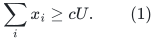

This is a statement about the full worst-case size allowance that the
analysis promises to handle. Some particular graphs can have much
smaller children or terminate immediately; (1) is not asserted for
such an input's actual recursion tree.

At each of these levels use a routing parameter `p_i`, repair depth
`K_i`, and size-reduction parameter `x_i`. The following positive terms
are present in the current certified envelopes:

<!-- math-display: b190eca4027bbb1ce9a49337
\begin{array}{ll}
\text{local work:} & x_i,\quad u_i/p_i,\quad K_i p_i h,\\
\text{cumulative recourse/copies:} &
          c_{\rm in}\ \ge c_0\sum_i u_i/K_i,\\
\text{cumulative metric log-stretch:} &
          a\ \ge c_0 h\sum_i K_i p_i.
\end{array}                                                \tag{2}
-->
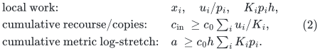

The symbols in (2) denote the *charged positive envelopes*, not
necessary losses incurred by every execution. These ledgers are defined as fixed positive sums of the displayed
terms. An asymptotic upper bound such as `g = O(p h)` alone does not
imply a matching lower bound on a true quality loss or running time.
Other existing terms, such as the decomposition parameter and its
construction work, have been dropped. Dropping positive terms can only weaken an obstruction
for this envelope.

If the hierarchy work budget is `B`, the model requires

<!-- math-display: f166052450ee15fdb217ed7a
x_i\le C B,\quad u_i/p_i\le C B,\quad
 K_i p_i h\le C B,\quad
 \sum_i u_i/K_i\le C B.                                    \tag{3}
-->
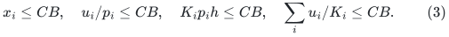

The first two conditions and (1) imply, for the number `d` of levels in
this interval,

<!-- math-display: 55b517de5547220c2d1900f4
d=\Omega(U/B),\qquad p_i=\Omega(U/B).
                                                               \tag{4}
-->
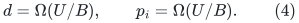

If an implementation switches directly to an exact base inside this
interval, its nominal dense exact-base cost is `exp Omega(u_i)` and
must be charged to `B`. Thus this shortcut does not avoid the argument
for the sublinear budgets `B = o(U)` considered here.

All logarithms of the local sizes in this interval are within fixed
constant factors of `h`. Using local rather than master logarithms
therefore does not change the inequalities below.

## 2. A metric-versus-work inequality

By Cauchy--Schwarz,

<!-- math-display: 0b1909595fa4129eec828693
\left(\sum_i\sqrt{u_i}\right)^2
 \le \left(\sum_i u_i/K_i\right)\left(\sum_i K_i\right).
-->
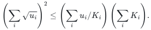

Since `u_i >= U/2`, equations (3)--(4) give

<!-- math-display: 1e9629890a61463963511124
\sum_i K_i=\Omega(d^2 U/B).
-->
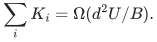

The metric envelope in (2) consequently satisfies

<!-- math-display: d1400fdc4bfc86742b41d6e7
a\ge\Omega\left((Uh/B)\sum_i K_i\right)
    =\Omega(d^2U^2h/B^2)
    =\boxed{\Omega(U^4h/B^4)}.                              \tag{5}
-->
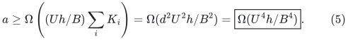

Thus, for a prescribed metric log-stretch allowance `Q`, the current
model needs

<!-- math-display: 418eaff1f77d3cfe70836bc8
B=\Omega((U^4h/Q)^{1/4}).               \tag{6}
-->
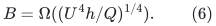

This remains true when the routing, repair, and reduction parameters
vary arbitrarily from one level to another, subject to (1)--(3).

At `Q = Theta(U^(6/7) h)`, equation (6) becomes
`B = Omega(U^(11/14))`. The uniform choice in
[apsp frontier proof](../../problems/apsp-frontier/proof.md) attains this envelope up to absolute
constant factors. The `11/14` point is therefore optimal within the
specified positive-budget model, not only among uniform parameter
choices.

## 3. Why the work-only boundary is three quarters

The local repair-work term in (3), together with `p_i = Omega(U/B)`,
gives

<!-- math-display: 0da26fb589664258a9147def
K_i=O(B^2/(Uh)).
-->
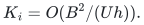

Hence

<!-- math-display: 221557c1c94c530a81c4847f
\sum_i u_i/K_i
       =\Omega(d U^2h/B^2)
       =\Omega(U^3h/B^3).
-->
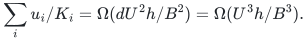

Its required upper bound `O(B)` yields

<!-- math-display: 56d2a883c8490ee826e932d8
B^4=\Omega(U^3h).                  \tag{7}
-->
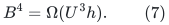

If the metric stretch is required to be subpolynomial, its certified
logarithm must be `a = o(U)`. Equation (5) then strengthens (7) to

<!-- math-display: 535fc45401708e85bf4bec1b
B/(U^{3/4}h^{1/4})\longrightarrow\infty.     \tag{8}
-->
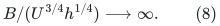

The slowly growing retreat

<!-- math-display: 60c9c616de7b248268c93753
B=O(U^{3/4}h^{1/4}\omega(U)),\qquad
 a=O(U/\omega(U)^4),\qquad \omega(U)\longrightarrow\infty
-->
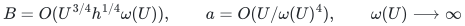

in the companion note approaches exactly this boundary. Choosing
`omega(U) = h^(1/4)` gives the cleaner explicit time
`exp O(U^(3/4) h^(1/2))` and stretch `exp O(U/h)`.
A claim of the boundary time `exp O(U^(3/4) h^(1/4))` together with
subpolynomial stretch is not supplied by these envelopes.

## 4. The matching quality charge returns four fifths

The raw-cycle and exact matching clients must also include the full
metric/cycle-quality envelope in their overhead budget. In this model
that adds `a = O(B)`. Substitution into (5) gives

<!-- math-display: c429852bb1c67464dc5be84b
B^5=\Omega(U^4h),\qquad
                        B=\Omega(U^{4/5}h^{1/5}).          \tag{9}
-->
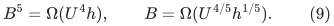

The current matching parameter choice attains (9). Merely choosing
nonuniform levels therefore cannot turn the APSP `3/4` time point into
a matching result. One must improve a charged interface, such as the
full accumulated correction-and-lift quality, rather than omit it.
This is not a matching lower bound.

## 5. The strong-forest outer composition returns seven eighths

For this section the hierarchy work has budget `B`, while its charged
copy/congestion envelope is `c_in`. The outer strong-forest budget is
`Z`. Its current covering and flattening formula includes

<!-- math-display: d6cbe0fc856df8f633251200
B\le CZ,\qquad U/\Lambda\le CZ,\qquad
 \Lambda U/K_{\rm cov}\le CZ,\qquad
 \Lambda c_{\rm in}\le CZ,                                \tag{10}
-->
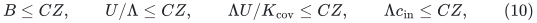

and its scale condition requires

<!-- math-display: 9341842bbcb0f0ddbd8b0d26
K_{\rm cov}\Lambda a\le CU.       \tag{11}
-->
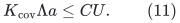

First obtain a relation that does not replace `c_in` by `B`.
Weighted Cauchy--Schwarz gives

<!-- math-display: 73278bab2e16b86129f5ff61
\left(h\sum_i K_i p_i\right)
       \left(\sum_i u_i/K_i\right)
 \ge h\left(\sum_i\sqrt{u_i p_i}\right)^2.
-->
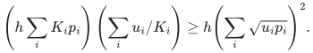

The local work condition `p_i >= c u_i/B`, together with (1) and
`x_i <= CB`, now gives

<!-- math-display: 89f3859d6734914fea236fab
a c_{\rm in}
                    =\Omega(U^4h/B^3)
                    \ge\Omega(U^4h/Z^3).                 \tag{12}
-->
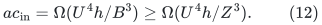

On the other hand, (10)--(11) imply

<!-- math-display: c5098c208a53b34ddeaa2b32
a\le O(Z/\Lambda^2),\qquad
 c_{\rm in}\le O(Z/\Lambda),\qquad
 \Lambda\ge\Omega(U/Z).
-->
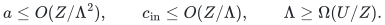

Consequently,

<!-- math-display: 6f13d278e411bbf507bfec17
a c_{\rm in}\le O(Z^5/U^3).            \tag{13}
-->
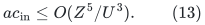

Combining (12) and (13),

<!-- math-display: 734786a41a2f64f26d2ff782
Z^8=\Omega(U^7h),\qquad
                       Z=\Omega(U^{7/8}h^{1/8}).          \tag{14}
-->
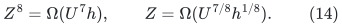

The currently assembled strong forest attains this budget. Thus its
`7/8` balance also survives arbitrary per-level parameter choices in
the stated model. Improving the Gomory--Hu result through this route
requires changing the inner stretch/copy tradeoff, the covering scale
condition, the flattening copy charge, or replacing this strong-forest
client altogether.

## 6. What would count as further progress

The equations identify concrete ways a new idea could escape the
accounting model. They do not prove that any such idea exists:

* A repair construction with smaller selected-child recourse than the
  present `exp O(u_i/K_i)` term would change (2).
* A router or local repair whose complete work no longer contains the
  charged `K_i p_i h` term would change (3).
* A cycle comparison with less accumulated raw-quality loss would
  remove the identification `a = O(B)` in the matching client.
* A path-forest construction that avoids the present outer scale or
  copy amplification would change (10)--(11).

These are interface questions. The proofs above justify spending
further research effort on those questions rather than repeatedly
retuning the same positive terms.

## 7. The new pool construction reaches the six-sevenths budget

The no-recursive-reset construction in
[decremental strong forest proof](../../problems/decremental-strong-forest/proof.md) removes
<code class="math">\sum_i u_i/K_i</code> from the simultaneous forest-copy envelope.
That positive sum remains in the work budget <code class="math">B</code>. Therefore
Sections 1--2 still give
<!-- math-display: 47c1286bdcebf159045ba21e
a\ge\Omega(U^4h/B^4).             \tag{15}
-->
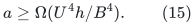
There is no remaining justification for substituting the old
<code class="math">c_{\rm in}\ge\Omega(\sum_i u_i/K_i)</code> in Section 5.
The new occurrence analysis is a genuine change of the charged
interface, and hence lies outside that old <code class="math">7/8</code> obstruction.

Let <code class="math">Z</code> bound the new outer logarithmic work. The unchanged
positive outer terms and scale constraint imply
<!-- math-display: 3b422ad642e43d737ebbb73c
B\le O(Z),\qquad U/\Lambda\le O(Z),\qquad
 \Lambda U/K_{\rm cov}\le O(Z),\qquad
 K_{\rm cov}\Lambda a\le O(U).
-->
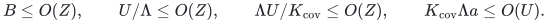
The middle conditions give
<!-- math-display: 175b7d6deb299f752bc5901c
\Lambda\ge\Omega(U/Z),\qquad
 K_{\rm cov}\ge\Omega(\Lambda U/Z).
-->
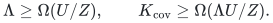
Combining with the scale constraint,
<!-- math-display: 7f08cd47ac5eda4f55351566
a\le O(Z/\Lambda^2)\le O(Z^3/U^2).
                                                               \tag{16}
-->
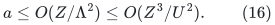
Equations (15)--(16), with <code class="math">B\le O(Z)</code>, yield
<!-- math-display: e5434723c9d9f9870962607a
Z^7=\Omega(U^6h),\qquad
                     Z=\Omega(U^{6/7}h^{1/7}).             \tag{17}
-->
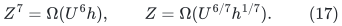

This derivation permits arbitrary per-level routing, repair, and
shrink parameters under the nominal-size and positive-charge
assumptions of Sections 1--2. It does not rely on any positive
lower charge for the new simultaneous occurrence <code class="math">c</code>.
Consequently simply improving <code class="math">c</code> further would not improve
this specified balance.

The new uniform construction attains (17): with <code class="math">U=t^7h</code>,
<code class="math">p=r=d=\Lambda=t</code>, <code class="math">K=K_{\rm cov}=t^2</code>, and
<code class="math">x=\Theta(U/t)</code>, it has <code class="math">B=O(t^6h)</code>, <code class="math">a=O(t^4h)</code>,
and <code class="math">c=O(t^2h)</code>. The remaining outer work fits <code class="math">O(t^6h)</code>.

Further progress through this framework therefore needs a better
inner metric/work tradeoff, a different outer scale relation, or
a different client. Equation (17) constrains the stated accounting
model; it does not rule out any of those changes or prove a lower
bound for strong SSSP, Gomory--Hu, or matching algorithms.
