# A payable batch criterion for matching-potential repairs

**Research lemma, 25 October 2026. Root mathematical review completed.**

See [non-tight-receiver-and-batch-repairs-root-audit.md](non-tight-receiver-and-batch-repairs-root-audit.md). The accepted
claims are the explicit batch criterion, its conditional history budget,
and the slow exact residual-ball primitive. Efficient discovery of
payable batches remains unproved.

This note supplies a concrete sufficient criterion for inexpensive
potential repairs in the bidirectional forest interface. It pays both the
explicit label edits and every affected forest direction flag. It does not
find the sets satisfying the criterion or prove that such sets always exist.

The ledger graph is fixed, every row has degree at most three, and its
conservative costs, source offers, and feasible labels have the meanings in
bidirected_potential_compatible_forest_matching_interface.md.

## 1. Normalize row labels without changing bin labels

For every row r replace its feasible label by
<!-- math-display: 33a94f93aefa554baa3de187
D(r):=\max_{d\sim r}D(d).             \tag{1}
-->
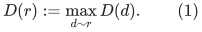
This only lowers D(r). All receiving inequalities hold by the maximum,
and all donor inequalities become weaker. Source constraints and the
semantic screen E are unchanged.

A previously selected tight receiver r-to-d has D(r)=D(d), and all other
neighboring bin labels were at most that value. Its row label therefore
does not change under (1); no old tight receiving direction is lost.
Additional tight directions may appear. Initialization and the associated
forest-flag updates take O(m polylog S) work once.

Thereafter retain (1). Bounded nonnegative initial bin labels and the
source constraints give strictly positive bounded
<!-- math-display: 21c70bfd6f24a7065045f494
\pi_d=(A-D(d))/H
-->
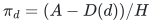
at bins. The row pi is the minimum neighboring bin pi.

## 2. Exact feasibility condition for a supplied bin batch

Supply a set S of bins and a positive integer shift delta. Raise
<!-- math-display: 7231f99ed256404da052311d
D'(d)=D(d)+\delta\quad(d\in S)
-->
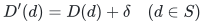
and leave other bin labels unchanged. Set every affected row to the
maximum of its new neighboring bin labels.

This operation is feasible if and only if both of the following
conditions hold:
<!-- math-display: 90781f0050f9a100fad4ef26
\delta\le A-\sigma_u-D(u)\qquad(u\in S),                     \tag{2}
-->
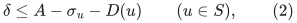
and
<!-- math-display: b489bf6c726708703e1b6c6e
\delta\le D(v)+\bar c_{rv}-D(u)
 \quad\text{whenever }u\in S,\ v\notin S,\ u,v\sim r.         \tag{3}
-->
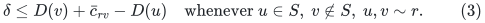
All right-hand sides are nonnegative by old feasibility.

For sufficiency, receiving constraints hold by normalization.
A donor whose bin v is shifted remains feasible because its row
rises by at most delta. If v is unshifted, an unshifted neighboring
bin cannot raise its row; a shifted neighboring u satisfies its
donor bound exactly by (3). These are all possibilities.
Equation (2) is precisely the source constraint.

Necessity follows because the new row label is at least D(u)+delta
for every shifted neighbor u. Its donor inequality from any unshifted
v requires (3). Source feasibility requires (2).

Equivalently, after eliminating a normalized row, every ordered pair
v,u of its bins has the constraint D(u)<=D(v)+bar c_rv.
Condition (3) checks just those directed constraints entering S.

## 3. Verification and implementation cost

Let
<!-- math-display: b97392289071606d5c0f3f82
\mathrm{vol}(S)=
                  \sum_{d\in S}(1+\deg(d)).
-->
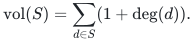
Enumerate the supplied bins and their incident rows. Mark each touched
row once and read its at most three neighbors. This checks (2)--(3),
computes its new maximum, and changes all necessary receiver flags
in O(vol(S) polylog S) deterministic work.

The set membership and row deduplication are implemented by explicit
IDs and marked dictionaries; no scan of all unselected bins is needed.
A failed test returns the violating source or ordered row-neighbor pair.

On a successful batch:

* update the supplied bin labels and the affected row labels;
* update the E terms only for bins in S;
* recompute receiving availability on each incident physical forest edge
  of a touched row and notify the scored top tree.

Only O(vol(S)) such edge flags can change, because row degree is at
most three. A direction that ceases to be tight is disabled; a new
tight direction is enabled. The underlying physical forest need not
be cut just because one of its directions is disabled.

Donor prices, endpoint-price leaves, allocations, guards, coordinate
ownership, and hysteretic registers do not change. The lazy watcher
therefore needs no primal path update or reset. The scored DP has its
usual point-update cost for each changed availability flag.

Execute this repair only between settled numerical path transactions.
Its labels are feasible throughout the next interval, and every
receiving path subsequently used is tested against the new labels.
The batch is an explicit paid potential repair, not a free change
to the fixed-D contract.

## 4. A history-wide budget for sufficiently large relative shifts

Suppose, in addition, that for a fixed 0<zeta<1 every supplied successful
batch obeys
<!-- math-display: 2276fba7a9e9b8c644bbff24
\delta\ge\zeta(A-D(d))
                     \qquad\text{for all }d\in S.            \tag{4}
-->
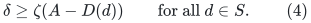
Then each affected bin satisfies
<!-- math-display: 5cc81e92e0878a04c6e2825a
\pi'_d\le(1-\zeta)\pi_d.
-->
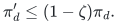
Its pi remains at least the guarded positive source lower bound.
All bin labels only increase; numerical allocation steps between
repairs do not change them. Hence each bin belongs to at most
O(zeta^{-1} log S) such batches.

On a fixed ledger graph, the total actual update volume is therefore
<!-- math-display: bcac2c7c7bae994683a6daa3
\sum_{\text{batches}}\mathrm{vol}(S)
                       =O((m+\nu)\zeta^{-1}\log S).          \tag{5}
-->
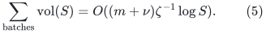
This pays explicit bin/row label work, semantic-screen updates, and
all physical forest direction-flag updates. It is independent of the
number of intervening accepted numerical steps.

The potential used for this accounting is the bounded sum of
degree-weighted log pi values, not E. The latter can increase during
numerical slack transfers and is not being silently telescoped.

Graph edits, new coordinate lifetimes, and arbitrary small relative
label changes are outside (5). So is the cost of discovering the
sets S. The statement does not charge an unreported global shortest
path computation to the few labels it eventually changes.

It also does not automatically pay for restarting the separate
tight-DAG reachability provider. A label batch can create tight
arcs, after which reachability may change far beyond the explicitly
changed labels. Equation (5) pays the bidirectional forest's
local availability flags, not an unproved dynamic reachability
update across multiple potential intervals.

## 5. The non-tight-receiver example has a constant-size paid repair

In non_tight_receiver_matching_obstruction.md, after exhaustion take
S={b,c} in one component and
<!-- math-display: 3144537040584e3b57bfb1c7
\delta=D(r)-D(b)
                         =\bar c_{rb}^{\rm initial}.         \tag{6}
-->
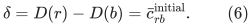
Both bins have slack Theta(L), while their old pi is Theta(1/C).
Their source constraints have ample room for this shift.

Row q has both its bins in S. The only crossing row is r, with a
outside and b inside. Its incoming constraint is
<!-- math-display: 6437af498f0ae0149dcc1fff
\delta\le D(a)+\bar c_{ra}-D(b)
                    =\delta+\bar c_{ra},
-->
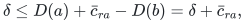
which holds. Thus the batch is feasible.

At completion D'(b)=D(r)=D(a). Receiving direction r-to-b becomes
tight, so the surviving strong path a-to-r-to-b is immediately
available to the same physical bidirectional forest. No new graph
edge and no primal coordinate change are needed.

The register bounds in that construction give
delta/H>.09/C and pi_b,pi_c<.38/C. Thus (4) holds, conservatively,
with zeta=1/5. The repair has constant volume and is fully covered
by (5).

This explicitly separates the counterexample from a refresh-time
lower bound: it needs a potential change, but this particular
change is cheap and has a valid global accounting credit.

## 6. The unproved discovery/completeness interface

The remaining sufficient theorem would return, whenever the current
compatible forest is empty but the matching comparison still exists,
either a useful path, a safely terminating semantic certificate, or
a batch meeting (2)--(4), with its discovery work charged to a
controlled transcript.

No such trichotomy is proved here. Tight incoming constraints can
prevent an individual bin from moving; closing a candidate set
under those constraints can force inclusion of source-tight bins.
Rounding approximate local Bellman conditions alone does not
produce a source-rooted path witness with constant accumulated error.

Thus (2)--(5) are a genuine payable repair criterion and implementation,
but are not a complete dynamic directed shortest-path algorithm or
a new general-matching time exponent.

## 7. An exact residual-ball primitive and its unpaid boundary

There is an exact, but currently too expensive, way to produce a
potential update or a tight passing path.

Use the complete threshold graph including its artificial source s.
For each arc u-to-v define its nonnegative integer reduced cost
<!-- math-display: ab87a927706d99a23b7a1af6
r_{uv}=\mathrm{length}(uv)+D(u)-D(v).
-->
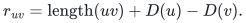
Fix a bin w with s_w pi_w>6, as some bin has when E>5N and there
are at most N bins. Choose the integer radius
<!-- math-display: 2f034b2bd7abdfe5b038c59b
R=\lfloor(A-D(w))/2\rfloor.
-->
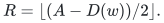
The rounding scale ensures that pi_w-R/H remains greater than
tau_w/H.
It also gives R>=1 under the stated excess premise: H/s_w is
already bounded below by the large rounding constant and
H pi_w>6H/s_w. Thus a zero chosen radius is not a hidden
nonprogress branch of this invocation.

Run reverse Dijkstra from w in these reduced costs, stopping at radius
R or upon extracting the artificial source. Let d(v) be the reduced
distance from v to w.

If the source is not reached before radius R, set
<!-- math-display: 19575e7c0ae4eae2f2beeb5d
\Delta_v=(R-d(v))_+,\qquad D'_v=D(v)+\Delta_v.
                                                               \tag{7}
-->
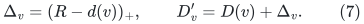
Here unreachable or unexamined vertices have Delta=0. The source
has Delta=0. Every ordinary or source arc obeys
<!-- math-display: e9b898af11d0190b85632e2a
\Delta_v-\Delta_u\le r_{uv},
-->
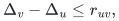
because d(u)<=r_uv+d(v) and positive clipping preserves the
inequality. Thus D' is feasible. In particular, w's pi decreases
by approximately one half.

If the source is extracted first at distance R_0<R, use the same
formula with radius R_0. It again keeps the source label fixed.
Every arc of a shortest source-to-w path becomes tight: its
reduced cost equals the corresponding difference of Delta values.
That path's actual threshold score at w is
<!-- math-display: 11f8db372c718967c5725b46
A-D(w)-R_0-\tau_w>0.
-->
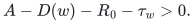
It is therefore a passing path whose receiving directions are
tight under the newly repaired labels. This is stronger than merely
returning an old-potential-incompatible witness.
The case R_0=0 is valid: the shift is identically zero and the
already tight source path itself passes. A tie R_0=R may be
handled by the radius branch; its source shift is still zero.

Rows may be renormalized by (1) afterward. A row on the new tight
source path already has a tight receiving edge and is unchanged
by this normalization, so that witness survives.

With explicit reverse Dijkstra this is a correct static operation.
No full SPT restart is needed merely to validate or apply the
computed shift. Update the explicitly affected labels, E terms
and physical-forest receiver flags by their actual incident
records; allocations, registers and the lazy watcher are
unchanged. That actual affected volume is charged, not assumed
small.

If the returned ordinary path is absent from the selected
physical forest, it can be installed with O(|P|) supplied
edge edits. Temporarily mark all its physical edge IDs.
For each missing path edge, either link its distinct components
or delete an unmarked edge on the resulting fundamental cycle
before linking. Such an unmarked edge exists because P itself
is acyclic. A dynamic-tree path aggregate finds it without
enumerating the cycle. Materialize each cut coordinate as in
the forest interface and reuse its register. After all path
edges are present, remove the temporary marks. All receiving
directions of this path are tight under the repaired labels.
This pays O(|P| polylog S) work for a supplied explicit path;
it does not pay the preceding reverse-ball exploration.

It does not satisfy the history bound (5): many visited boundary
vertices can receive arbitrarily small relative Delta, and a
high-pi vertex can receive a shift small relative to its own pi.
Nor does an extracted passing path alone pay for all its explored
reverse ball.

The missing improvement is therefore precise. One needs a method
to find and update these residual regions whose exploration and
direction-flag work is charged either to substantial relative
potential decrease, to useful numerical progress, or to another
proved shared budget. No such boundary-volume or amortization
theorem is supplied here.

