# Normalized projected routes in the distance repair layers

This note proves the projected-degree and congestion implication used in
[length-free-ambient-static-sparsifier.md](length-free-ambient-static-sparsifier.md),
Section 7. It concerns the explicit touched-set construction, not a
gradient-preserving change of an input edge.

The underlying repair is Algorithm 7 and Definition 7.13 of
[Chen et al., arXiv:2311.18295v1](https://arxiv.org/abs/2311.18295),
equivalently the edge-embedding projection of CKL22 Section 5.1.
We replace only the static geometric sparsifier and its returned route table.

## 1. The route inventory at one repair

Let <code class="math">G</code> be the current native input graph, with maximum current degree
<code class="math">\Delta</code>. A current input edge ID <code class="math">e=uv</code> has an older lower-layer route
<code class="math">R(e)</code>. Its edges and its endpoint annotations retain their original
lifetimes. Between rebuilds the route may become broken by deletions or
native vertex splits.

Let <code class="math">L\geq1</code> bound the recorded route length and let <code class="math">C</code> bound its
vertex-occurrence congestion, including endpoint annotations. Only live input
edge domains are counted. A dead input edge's owner and inverse-index records
are removed.

Native vertex splits partition incidences; they do not merge two old
vertices. One old route occurrence may expose pieces at both new endpoints,
but at either particular descendant it contributes at most a constant number
of old occurrence or endpoint records. Thus a current touched descendant is
charged to the old occurrence inventory with a fixed constant. Empty routes
must keep endpoint annotations for this statement: an old core loop that
becomes nonloop has two touched current endpoints even though its old edge
list was empty.

Let <code class="math">S</code> be the vertices touched since the relevant lower-layer rebuild.
For every affected input edge, choose the first touched vertex from each
endpoint of its old route, in the route graph after the intervening edits.
Write these anchors as <code class="math">\widehat u,\widehat v</code>. The exterior prefixes
<!-- math-display: 73971936117863090f5cbf1e
P_e^u:u\longrightarrow\widehat u,\qquad
 P_e^v:v\longrightarrow\widehat v
-->
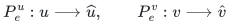
are still valid current lower-layer paths. If no touched occurrence exists,
the old route is still valid and requires no repair.

## 2. Degree and ambient congestion of the projected instance

The projected graph <code class="math">J</code> has one edge ID
<code class="math">\widehat e=\widehat u\widehat v</code> for every affected input edge.
Each projected endpoint is an occurrence or endpoint annotation of that
same input edge's lower route. With a harmless constant for split descendants,
<!-- math-display: c5266e41a0532d76d093a2cb
\Delta(J)\leq c_1(C+\Delta).
 \tag{1}
-->
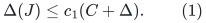
For an unchanged vertex identity the <code class="math">+\Delta</code> term can be omitted.
Keeping it covers current newborn identity routes and original endpoint
annotations without using a historical master-degree bound. Parallel
projected IDs are counted separately.

The preliminary ambient image of <code class="math">\widehat e</code> is
<!-- math-display: 405b2c18b49844ac4aaa9b2e
W_{\widehat e}
  =\overleftarrow{P_e^u}\ \oplus e\ \oplus P_e^v
-->
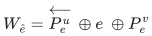
in <code class="math">H_{&lt;j}\cup E_{\rm affected}</code>. This gives
<!-- math-display: fc51388916f5b6291d3be860
L(W)\leq 2L+1,\qquad C(W)\leq c_2(C+\Delta).
 \tag{2}
-->
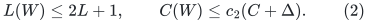
Indeed, each exterior prefix comes from one input route; using both prefixes
costs at most two copies of the occurrence inventory. Central original edges
contribute at most the current input degree <code class="math">\Delta</code>. No multiplication by
the length <code class="math">L</code> occurs in either argument.

Erase closed subwalks independently in each <code class="math">W_{\widehat e}</code>, retaining its
two anchors. Loop erasure compares CURRENT NATIVE AMBIENT vertex IDs,
not eventual physical images or ancestral labels. Two native aliases
of the same parent vertex can have distinct endpoints and different
frozen potentials; an open path between them cannot be erased as a
cycle merely because its physical image is empty.
Let <code class="math">W'</code> be the resulting normalized route table. Its length
and occurrence congestion do not increase. A projected loop can use an empty
route with its anchor annotation. This is a geometric route normalization,
not an assertion that the gradient of the original edge is unchanged.

## 3. Apply the length-free static statement and restore prefixes

Assume the static algorithm returns a subgraph <code class="math">\widetilde J\subseteq J</code>,
a route <code class="math">A(\widehat e)</code> in <code class="math">\widetilde J</code> for every projected demand,
and the normalized table <code class="math">W'</code>, with
<!-- math-display: d080615f01c01fa02725a387
L(W'\circ A)\leq\Gamma L(W'),\qquad
 C(W'\circ A)\leq\Gamma\bigl(C(W')+\Delta(J)\bigr).
 \tag{3}
-->
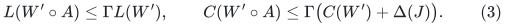
Its subgraph support has <code class="math">O(\Gamma&#124;S&#124;\mathrm{poly}(U))</code> edge IDs.

For each selected projected ID <code class="math">\widehat f</code>, insert only its associated
central original ID <code class="math">f</code> into layer <code class="math">j</code>. The rest of <code class="math">W'_{\widehat f}</code>
is a subwalk of old lower-layer prefixes and is already present in
<code class="math">H_{&lt;j}</code>. If normalization erased the central edge, inserting it is
unnecessary but harmless. It remains one selected membership. The algorithm
does not insert all edges of the expanded route as new memberships.

Define the repaired route for an affected original edge by
<!-- math-display: efabe175cd837b1ef817bf00
R_{\rm new}(e)
   =P_e^u\oplus (W'\circ A)(\widehat e)
                \oplus\overleftarrow{P_e^v}.
 \tag{4}
-->
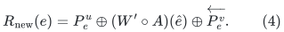
This is a valid walk with the original edge's current endpoints, using only
the retained lower layers and selected central IDs. Optional loop erasure
can make it simple.

The unaffected routes contribute at most <code class="math">C</code>, and the restored prefixes
contribute at most <code class="math">2C</code>. Equations (1)--(3) consequently imply
<!-- math-display: b8e08f17005ec4ac9d837a8a
\boxed{
  L_{\rm new}\leq c_3\Gamma L,\qquad
  C_{\rm new}\leq c_4\Gamma(C+\Delta).
 }
 \tag{5}
-->
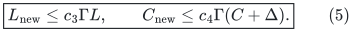
The constants are absolute. This is the explicit projected-instance
justification for the new recurrence; it does not replace <code class="math">\Delta(J)</code> by
an unrelated selected-degree bound.

## 4. Several repair levels and current degree

In the degree-three parent application, a stable core component contains
<code class="math">O(k)</code> parent vertices. Hence the current native degree is
<code class="math">\Delta\leq k\mathrm{poly}(U)</code>, even if a historical master vertex
has received many later descendants. The static initial base satisfies
<!-- math-display: a97e1e54d071e3d005e54919
L_{-1}\leq\Gamma,\qquad
 C_{-1}\leq k\mathrm{poly}(U)\Gamma.
 \tag{6}
-->
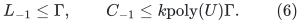
Live postinitial edge births use their identity routes. Their simultaneous
contribution is bounded by current degree, not the cumulative birth count.

Apply (5) at each rebuild, with the same additive current-degree allowance
between rebuilds. For <code class="math">K+1</code> repair levels,
<!-- math-display: 036ce67a2d2ed97600011599
L_K\leq\Gamma^{O(K+1)},\qquad
 C_K\leq k\mathrm{poly}(U)\Gamma^{O(K+1)}.
 \tag{7}
-->
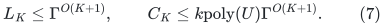
If all retained layer-owned route versions are indexed, rather than only the
highest current owner, summing their bounds adds at most a geometric factor
or <code class="math">K+1</code>. It is absorbed by the displayed polynomial. It does not restore
an input-length multiplier.

The optional fresh-base freeze after initial feedback is also compatible:
its starting length and congestion already have exponent <code class="math">O(K)</code>.
Applying another <code class="math">K+1</code> levels adds another <code class="math">O(K)</code> in the exponent.
It does not produce <code class="math">K^2</code>.

## 5. Route lifetimes, corrections, and work

All current normalized route records store complete edge-ID lists and
inverse occurrence lists, including endpoint annotations for empty routes.
A touched vertex or deleted used edge enumerates the affected current
records through those lists. If a closed subwalk was erased, later changes
on that unused subwalk need not invalidate the current normalized route.
The original input edge itself remains separately indexed by its own
lifetime and endpoints.

When a record changes, retire its old correction and inverse memberships
using old metadata before publishing the replacement. The distance-cycle
candidate is then formed from the actual new circulation
<!-- math-display: 25f388b3f90f82a5ae159a10
e-R_{\rm new}(e).
 \tag{8}
-->
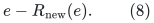
The selected core edge's frozen physical provenance and gradient are
unchanged. The sum of gradients on the new geometric route need not equal
the old route's sum. Equation (8), rather than such an equality, is the
required correction. This is compatible with the existing raw-cycle
normalization and retained-edge gauge construction.

At a rebuild, the number of affected live demand IDs is
<code class="math">O(&#124;S&#124;(C+\Delta))</code>, by the same endpoint/occurrence charging as (1), after
deduplicating IDs from different touched lists. Every actual preliminary
and output path is read and indexed at its full length. Thus local work
retains the <code class="math">L</code> factor for list processing, while (5) removes it from
congestion. The static work bound
<!-- math-display: 10ba511f230b4aebdd4d5975
|E(J)|F^{O(1)}\Gamma^{O(1)}(L+1)\mathrm{poly}(U)
-->
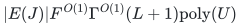
and (7) yield local factors <code class="math">\Gamma^{O(K)}</code>, with a fixed polynomial
in <code class="math">F</code>. Selected membership recourse remains controlled by
<code class="math">&#124;S&#124;\Gamma\mathrm{poly}(U)</code>, independently of <code class="math">L</code>, <code class="math">C</code>, and <code class="math">F</code>.

Native split publication, feedback settlement, dormant physical counters,
and numerical query transactions retain their separate lifetime rules.
The argument above changes the explicit geometric route records; it does
not authorize deleting an exposed physical occurrence without flushing it.
