# Normalized routes, cycle comparison, and exact raw lifting

This note supplies the cycle-correctness bridge for
[the length-free ambient static sparsifier](length-free-ambient-static-sparsifier.md)
and
[its projected-route implementation](normalized-projected-route-composition.md).
It proves that changing a geometric demand route by loop erasure does
not lose the min-ratio alternative, provided corrections use the
actual new route and identities are those of the immediate graph.

The comparison is the constructive form of the edge-sparsification
dichotomy in
[DO26, arXiv:2609.23852v1, Theorem 3.21](https://arxiv.org/abs/2609.23852).
Its dynamic record implementation uses
[Chen et al., arXiv:2311.18295v1, Definition 7.13 and Algorithm 7](https://arxiv.org/abs/2311.18295)
and the separately proved
[demand-route notifications](demand-route-notifications-and-local-work.md).
The raw lifting and frozen gauges are those in
[distance-oracle-raw-lift.md](distance-oracle-raw-lift.md).
The argument does not assume that a normalized open route preserves
the gradient of its previous version.

## 1. A route map at a settled state

Let <code class="math">G=(V,E)</code> be the current immediate graph, with an orientation
for every edge ID, lengths <code class="math">\ell_e&gt;0</code>, and gradients <code class="math">g_e</code>.
Let <code class="math">H\subseteq G</code> retain the original labels and provenance of
its selected edges. For every input edge <code class="math">e=(u,v)</code>, let <code class="math">R(e)</code>
be an explicitly oriented walk in <code class="math">H</code> from the CURRENT native
vertex <code class="math">u</code> to the CURRENT native vertex <code class="math">v</code>. Assume
<!-- math-display: d0cc4ae656e46ba78aa7e5b1
\ell_{\rm raw}(R(e))\leq\delta\ell_e,
                   \qquad \delta\geq1.
 \tag{1}
-->
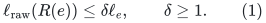
Lengths count every occurrence in a walk. If the routine uses
length buckets, their fixed within-bucket ratio is included in
<code class="math">\delta</code>.

Write <code class="math">B</code> for the incidence matrix. Extending <code class="math">R</code> linearly
to edge vectors gives
<!-- math-display: f68a82807926729e116ab34c
B R(e)=B e.
 \tag{2}
-->
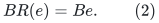
Consequently <code class="math">R(c)</code> is a circulation whenever <code class="math">Bc=0</code>.
Define the local correction
<!-- math-display: 46feab1037e7ac1abb8309b4
d_e=e-R(e).
 \tag{3}
-->
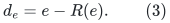
It is a circulation in <code class="math">G</code>, even when <code class="math">R(e)</code> repeats edges,
contains <code class="math">e</code>, or has been changed by geometric normalization.

One may keep (3) for every input edge, including selected edges.
Alternatively, for comparison set <code class="math">R(e)=e</code> on selected edges
and keep corrections only for nonselected edges. Identity routes
have stretch one. Either convention is valid; it is unnecessary
to reinterpret a selected edge's physical identity as its
possibly nonidentity demand route.

## 2. Exact decomposition and weighted denominator charge

For every circulation <code class="math">c\in\mathbb R^E</code>,
<!-- math-display: 26657b5313efc6c24527ad26
c=\sum_{e\in E}c_e\bigl(e-R(e)\bigr)+R(c).
 \tag{4}
-->
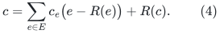
This is an algebraic identity for the CURRENT route table.
It does not compare gradients of old and new tables. Taking
the gradient gives the exact equality
<!-- math-display: 50d3a2811042f4ce81654cb6
g^\top c
               =\sum_e c_e g^\top d_e+g^\top R(c).
 \tag{5}
-->
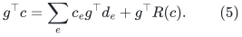

Orient each term <code class="math">c_ed_e</code> according to the sign of <code class="math">c_e</code>.
Its net weighted norm is at most
<!-- math-display: 6cfc7ffdf3588e74ca650c6b
|c_e|\bigl(\ell_e+\ell_{\rm raw}(R(e))\bigr).
 \tag{6}
-->
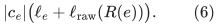
The net weighted norm of <code class="math">R(c)</code> is at most
<code class="math">\sum_e&#124;c_e&#124;\ell_{\rm raw}(R(e))</code>. Hence the sum of positive
denominator charges in (4) is at most
<!-- math-display: acf3d07021281aeeeb359b3b
\begin{aligned}
 &\sum_e|c_e|\bigl(\ell_e+\ell_{\rm raw}(R(e))\bigr)
                  +\sum_e|c_e|\ell_{\rm raw}(R(e))\\
 &\hspace{35mm}\leq(1+2\delta)\sum_e\ell_e|c_e|.
 \end{aligned}
 \tag{7}
-->
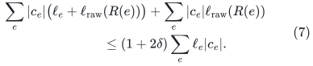
If <code class="math">-g^\top c/\&#124;Lc\&#124;_1=\beta&gt;0</code>, weighted averaging implies
that either some oriented correction <code class="math">d_e</code> or the circulation
<code class="math">R(c)</code> in <code class="math">H</code> has negative gradient divided by weighted
norm at least
<!-- math-display: 8ebf7a653eda60287d47c515
\frac{\beta}{1+2\delta}.
 \tag{8}
-->
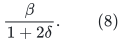
Thus <code class="math">3\delta</code> is a safe loss.

The proof works for arbitrary comparator circulations and
arbitrary signed coefficients. It does not assume that the
image of a comparator cycle is simple. Nor does it assume
that the comparator or its decomposition is known to the
algorithm; it proves the quality of the maintained alternatives.

Each explicit correction is evaluated by coalescing coefficients
by IMMEDIATE edge ID and decomposing the resulting directed
circulation into simple directed cycles. At least one component
has ratio at least that of the whole net correction, which in
turn is no worse than its raw denominator charge in (6).
Only this short local explicit circulation is decomposed.
There is no global cancellation of eventual physical images.

Zero-length alias links, where present before their exact
contraction, are treated with their gauge labels. A circulation
supported entirely on those links has zero physical image and
zero total gradient. It supplies no nonzero direction and may
be ignored. The ordinary positive-edge comparison above is
unchanged.

## 3. Why erasing a central edge loses no gradient

Suppose a projected edge has a preliminary walk consisting of
two old lower-layer prefixes and its own central original edge.
Loop erasure may remove that central edge. The normalized walk
still has the same immediate endpoints and uses only retained
prefix edges together with, at most, the selected central ID.
Adding that central ID to the selected support is harmless even
if the new route no longer uses it.

The selected edge itself retains its own input gradient and
length. Its gradient is not replaced by the sum along the
normalized walk. Equation (3) therefore retains exactly the
gradient discrepancy. More explicitly, if an old table <code class="math">R_0</code>
is replaced by <code class="math">R_1</code>, then
<!-- math-display: ba5e8affb23ddf901197d85d
e-R_1(e)=(e-R_0(e))+(R_0(e)-R_1(e)).
 \tag{9}
-->
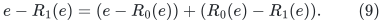
The circulation erased by normalization is included in the new
correction. It need not be retained as an additional independent
candidate.

For example, let <code class="math">e=uv</code> have an old route <code class="math">u,a,v</code>, and suppose
both projected anchors are <code class="math">a</code>. The preliminary projected loop
is <code class="math">a,u,e,v,a</code>, which may normalize to the empty route at <code class="math">a</code>.
Restoring the exterior prefixes gives <code class="math">R_{\rm new}(e)=(u,a,v)</code>.
The local correction is still the complete triangle
<code class="math">e-(u,a,v)</code>, with its exact possibly nonzero gradient.

## 4. The immediate-identity requirement

Loop erasure compares actual vertex lifetime IDs in the ambient
graph where the walk is defined. It does not compare their
eventual images under a higher-level or physical projection.
Likewise local coefficient cancellation uses actual immediate
edge IDs, preserving distinct parallel IDs.

This is essential for frozen-gauge aliases. Consider distinct
native vertices <code class="math">a_i</code>, <code class="math">\mathrm{star}(a)</code>, and <code class="math">a_j</code>
which all map to the same physical root <code class="math">a</code>. The open path
<!-- math-display: c9fb95764b8ef1947daed820
a_i\longrightarrow\mathrm{star}(a)
                              \longrightarrow a_j
 \tag{10}
-->
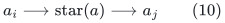
has no physical traversal, but its native boundary is
<code class="math">a_j-a_i</code>, not zero. With frozen potentials <code class="math">p_i,p_j</code>,
its stored gradient can be <code class="math">p_i(a)-p_j(a)\ne0</code>.
Erasing it merely because its physical images coincide would
break (2) and the gradient identities.

By contrast, erasing a closed walk at one actual immediate
vertex preserves (2). Its gradient may be nonzero, but that
change is paid by the new correction through (9).
If aliases are deliberately contracted, their gradients must
first undergo the already specified potential correction;
that is a separate graph transformation, not loop erasure.

## 5. Compatibility with the forest, ASZ, and raw-lift stages

The vertex-sparsification stage precedes this edge-sparsification
comparison. Its local-ball/ASZ/forest argument decomposes a
parent comparator into local differences, fundamental forest
cycles, and a circulation in the native core sum. The
normalized demand routes do not change the parent graph,
ASZ paths, stable core forests, or their fixed stretch labels.
Apply (4)--(8) to the resulting current core circulation.
The established vertex-stage loss is followed by the edge-stage
loss <code class="math">3\delta</code>, exactly as in the existing hierarchy proof.

For a parent edge <code class="math">e=(u,v)</code> and a stable forest <code class="math">F_i</code>, the
frozen potential satisfies
<!-- math-display: 91f18562854aa75ea8b370c0
g(f)+p_i(\mathrm{tail}f)
                         -p_i(\mathrm{head}f)=0
                 \quad(f\in F_i).
 \tag{11}
-->
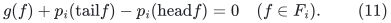
The native core label is
<code class="math">g_i(e)=g(e)+p_i(u)-p_i(v)</code>. If its current roots are
<code class="math">a=r_i(u)</code>, <code class="math">b=r_i(v)</code>, the selected child record has
<!-- math-display: 3979ac10be76fd827a78cf1a
\widehat g_i(e)
                =g_i(e)-p_i(a)+p_i(b).
 \tag{12}
-->
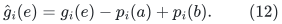
This is exactly the gradient of
<!-- math-display: ad3e631202666dfd6fd0e90f
F_i[a,u]\oplus e\oplus F_i[v,b].
 \tag{13}
-->
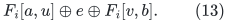
For a same-root edge, cancel its common forest leg inside that
one tree and use the simple fundamental cycle. Its stored core
length dominates the raw length of this representation.

Equations (11)--(13) depend on the selected edge's original
parent edge lifetime, forest index, and root IDs. They do not
depend on a demand route <code class="math">R(f)</code>. Normalization therefore
does not modify a child edge label, physical provenance, or
root-pool map. The zero-alias potential adjustment makes the
star gradients zero before contraction while preserving
gradients of all complete circulations.

A simple local core cycle obtained in Section 2 consequently
has an exact physical circulation gradient under the established
raw lift. Its physical raw traversal length is at most its
stored positive length charge. The lift counts every physical
occurrence and does not cancel distinct copies by physical ID.
Known port scales divide the numerator and length certificate
together at their level. Thus raw lifting cannot worsen the
ratio in (8).

This argument explains why normalization is compatible with
circulation-gradient preservation while failing to preserve
the gradient of an individual open edge image. It invokes the
already proved lifetime-fixed forest lift, not a new forest
whose edges are the normalized demand routes.

## 6. Exhaustive local invalidations

The explicit highest-owner route record supplies the current
edge-ID list, endpoint annotations, and correction key for each
live demand. Every settled change is handled in one of these ways:

* A route birth, replacement, or owner clear invalidates the old
  key before publishing the new table and key.
* A label or lifetime change of the demand edge invalidates its
  own key even if that edge does not occur in its geometric route.
* A used native edge or native vertex change reaches the route
  through its inverse occurrence lists. Empty routes keep their
  two current endpoint annotations; loop awakening is not hidden.
* A parent forest or physical price change is handled by the
  existing core-label/selected-provenance notifications and,
  conservatively, the local physical-expansion inverse index in
  the demand-notification lemma.

A subwalk erased from the CURRENT native route no longer belongs
to that route's inverse lists. A later change only on that unused
native subwalk need not invalidate the route. This does not
permit ignoring a physical edge which still appears in a forest
leg of some retained native edge: that dependency is covered by
the last item.

All route-owner changes, coefficient decomposition, rescoring,
and index maintenance occur inside the source's no-query
transaction. Old physical metadata remains available through
retirement. Before exposing a new cycle answer, every highest
owner is valid and every correction key uses the settled labels.
An answer and its consumption or discard form the separately
specified atomic numerical transaction.

The local arrays carry no primal motion counters. Reindexing
them does not retire or reset an exposed numerical forest edge.
Dormant copies and all signed/absolute counter transfers retain
the existing numerical lifetime discipline.

The normalized projected recurrence bounds current route
length and congestion by <code class="math">\Gamma^{O(K)}</code> and
<code class="math">k\mathrm{poly}(U)\Gamma^{O(K)}</code>, respectively.
The inverse-list scans, explicit local correction decomposition,
and optional physical expansion therefore fit the same local
<code class="math">k^{O(1)}F^{O(1)}\Gamma^{O(K)}\mathrm{poly}(U)</code>
work envelope. They do not create a demand-specific exported
forest or a new recursive selected edge. The smaller selected
transcript still depends only on original selected core IDs and
their own provenance.

## 7. Resulting proof boundary

At every settled state, valid current native endpoints, the
stretch bound (1), and complete local invalidations imply the
exact comparison (4)--(8). The established frozen-gauge and raw
forest-lift interfaces then export the chosen circulation with
the required physical numerator and raw denominator.

No counterexample arises merely because normalization erases a
nonzero-gradient loop or the selected central edge. Those changes
are explicitly retained in the new correction. The genuine
prohibited operations are erasure by eventual physical labels,
discarding an old discrepancy without recomputing the correction,
or failing to report a used edge/provenance change. The stated
interfaces exclude all three. The correctness and cost of the
underlying source primitives remain named dependencies.
