# Separating expander-path quality from construction time

**Mathematical derivation, 24 October 2026.** This note isolates the
parameter dependence needed by a proposed sharper static sparsifier.
It reconstructs the relevant source algorithms with separate quality
and work envelopes; it does not read such a separation into a theorem
that packages both quantities into one symbol.

The primary sources are
[Chuzhoy--Saranurak, arXiv:2009.08479v1](https://arxiv.org/pdf/2009.08479),
Sections 3.1--3.2 and Appendix B.4;
[Chuzhoy et al., arXiv:1910.08025v2](https://arxiv.org/pdf/1910.08025),
Theorems 1.6 and 5.1; and
[van den Brand et al., arXiv:2309.16629v1](https://arxiv.org/pdf/2309.16629),
Algorithm 4 and Theorem 8.1. The complete static construction is
developed in
[the separated sparsifier note](separated-static-sparsifier-parameters.md).

Let <code class="math">U\geq2</code> bound the logarithm of every actual graph size used in
one primitive invocation. Let <code class="math">q\geq2</code> and <code class="math">r\geq1</code> be integers.
The useful ranges have <code class="math">qr\log(U+2)=o(U)</code>; the construction below
also specifies actual-size fallbacks instead of padding small graphs.

## 1. The cut-player interface retains a free parameter

Theorem 1.6 of Chuzhoy et al. takes a graph on <code class="math">t</code> vertices with
maximum degree <code class="math">O(\log t)</code>. Its parameter must satisfy
<code class="math">t^{1/r}\geq N_0</code>, for a fixed source constant <code class="math">N_0</code>.
It either produces the required balanced sparse cut or identifies
a large induced subgraph with sparsity
<code class="math">(\log t)^{-O(r)}</code>. Its time is
<!-- math-display: 43965b6ad3d9673947a4a741
t\exp\!\left(O\!\left(\frac{\log t}{r}
                         +r^2\log\log(t+2)\right)\right).
 \tag{1}
-->
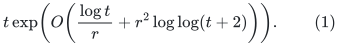
The proof's constants are uniform in the integer parameter <code class="math">r</code>:
its Theorem 4.1 has a fixed constant multiplying the quadratic
parameter exponent. This is not a fixed-<code class="math">r</code> asymptotic statement.

The cut-matching game in Chuzhoy--Saranurak Appendix B.4.1 has
<code class="math">O(\log t)</code> rounds. Keeping <code class="math">r</code> free therefore yields a witness
of conductance <code class="math">(\log t)^{-O(r)}</code>, degree <code class="math">O(\log t)</code>, and
construction cost (1), up to fixed polynomial logarithms.
The matching player in Appendix B.4.2 uses an input expander of
conductance <code class="math">\phi</code>, and produces paths of length
<!-- math-display: 36a5a15b3c3808287a010761
\ell=O(\phi^{-1}\log m).
 \tag{2}
-->
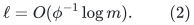
One round has congestion <code class="math">O(\phi^{-2}\log^2m)</code>.
Taking the union over the cut-matching rounds gives the conservative
bound
<!-- math-display: 1b674c0d0dbcd81d0387f821
\eta=O(\phi^{-2}\log^3m).
 \tag{3}
-->
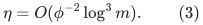
The extra logarithm is present in the Appendix B.4.3 proof even
though the display of Theorem 3.8 states only <code class="math">\log^2m</code>.
We use (3).

Choose one common dyadic conductance parameter
<!-- math-display: e7c371627c919ebc5fa45935
\phi=2^{-\lceil c_\phi r\log_2(U+2)\rceil}
 \tag{4}
-->
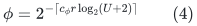
with a sufficiently large fixed coefficient. All witness graphs
then meet this same initial expansion guarantee. Expansion does not
multiply through the hierarchy: each new witness is certified by a
fresh cut-matching game.

## 2. The hierarchy multiplies quality, not the cut-player running time

Use the <code class="math">q</code>-level hierarchy from Chuzhoy--Saranurak Section 3.2,
with level sizes comparable to <code class="math">m^{i/q}</code>.
Every embedding between successive levels has length (2) and
congestion (3). The query recurrence is
<!-- math-display: a4a4cfd272b008ce13c039b5
L_i\leq O(\phi^{-1}\log m)(L_{i-1}+1),
-->
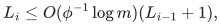
so both the reported path length and its reporting time are bounded by
<!-- math-display: 157d29bde6b59bc2e21a4692
\Lambda=\exp(O(qr\log(U+2))).
 \tag{5}
-->
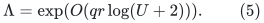
Repeated vertices in the reported walk are removed by ordinary
linear-time cycle erasure.

The stage-count argument in Lemma 3.10 uses only the embedding
congestion and the pruning volume bound. In one level-<code class="math">i</code> stage,
the number of level-<code class="math">(i-1)</code> stages is at most
<!-- math-display: 2920e0bee8784e3bbcd5009b
m^{1/q}\mathrm{poly}(U)\phi^{-O(1)}.
 \tag{6}
-->
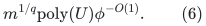
Consequently there are at most
<!-- math-display: e58f45fc05bb4e24d9256840
m^{(q-i)/q}
           \bigl(\mathrm{poly}(U)\phi^{-O(1)}\bigr)^{q-i}
-->
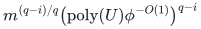
level-<code class="math">i</code> stages. The nonrecursive work of one such stage is at most
<!-- math-display: 091e8d81ee8bf0263bd71431
m^{(i+1)/q}
 \exp\!\left(O\!\left(U/r+r^2\log(U+2)+r\log(U+2)\right)\right).
 \tag{7}
-->
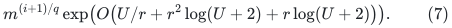
Multiplying the number of stages by (7) and summing over the levels
gives total work
<!-- math-display: 3555b87eb2b5a16bac8ee562
m\exp\!\left(
 O\!\left(U/q+U/r+r^2\log(U+2)+qr\log(U+2)\right)\right).
 \tag{8}
-->
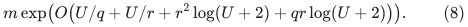
In particular the <code class="math">r^2\log U</code> cost of constructing a witness is
incurred as a local factor in (7). It is not raised to the hierarchy
depth <code class="math">q</code>. The propagation factors in (6) depend on <code class="math">\eta,\phi</code>,
not on the time used to construct their embeddings.

### Current terminals and deletion ordering

The ES-tree at level <code class="math">i</code> must have a supersource adjacent to the
**current surviving** vertices of the lower graph. When a lower
terminal is pruned, delete its supersource edge. Otherwise a query
could reach a terminal that no longer belongs to the recursive graph.
Process the parent deletion, all propagated lower deletions and
prunings, and all resulting root-edge removals before answering any
query. Each root edge dies at most once in its stage. Its deletion
is covered by the usual <code class="math">O(m\cdot\text{depth})</code> ES-tree bound.
When the lower graph is rebuilt, rebuild the corresponding ES-tree.

Apply pruning at the bottom level as well. The abbreviated source
case for <code class="math">i=1</code> only recomputes its tree, which by itself would not
remove a newly isolated lower terminal. After each incoming deletion,
prune, propagate all removed base terminals to the parent's root
set, and recompute the base BFS tree on the surviving expander.
Use the same deletion-quota restart rule there. At most the initial
number of base edges can be deleted within a base stage, so these
BFS recomputations cost
<code class="math">m^{2/q}\mathrm{poly}(U,\phi^{-1})</code>, within (7) for <code class="math">i=1</code>.

The path oracle is retired once its top-level deletion quota is
reached. Reporting every remaining vertex as pruned at that point
preserves <code class="math">\mathrm{vol}(S)=O(t/\phi)</code>, with a larger absolute
constant. This supplies the all-deletion interface used by the
static sparsifier; it does not ask the source oracle to exceed its
promised quota.

## 3. Actual-size and graph-model wrappers

The smallest cut-player call cannot be ignored when checking
<code class="math">t^{1/r}\geq N_0</code>. If
<!-- math-display: 3b2ad9297f0cf71b83ab35a4
\log m<Cqr\log(U+2),
 \tag{9}
-->
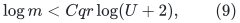
answer queries by direct BFS on the surviving expander, together
with the ordinary pruning procedure. Its actual size is already
at most the right envelope in (5). Its initialization and update
work fit (8). No array of that envelope size is allocated.
Otherwise the smallest terminal set, of size comparable to
<code class="math">m^{1/q}</code>, satisfies the source lower-size condition for a large
enough fixed <code class="math">C</code>. It also dominates the logarithmic maximum degree,
so enough surviving vertices remain to choose the next terminal set
after pruning. Integer level sizes can be computed by integer roots
of <code class="math">m^i</code>; the intermediate bit length is polynomial in <code class="math">U</code>.

The general static sparsifier uses multigraphs, whereas the opening
convention of Chuzhoy--Saranurak is simple graphs. The following
explicit wrapper handles this distinction.

* Input loops are served separately with their empty embedding and
  do not enter the path-oracle graph. Subdivide every remaining
  edge ID once. Parallel IDs now have distinct subdivision vertices,
  so the graph is simple. Conductance changes by only a constant.
  One original deletion becomes two deletions, and paths are projected
  back to their original edge IDs.
  This concerns one static routing call: logical loop IDs and their
  endpoint annotations remain present in the enclosing native splitter.
* The internal cut-matching witness may contain parallel edges.
  Chuzhoy et al. explicitly permit these. Finish that game first,
  then retain one copy, with one chosen embedding path, from each
  parallel class. There are at most <code class="math">O(\log t)</code> copies in a class,
  so this loses only that factor in conductance and never increases
  embedding congestion or degree. The slack in (4) covers it.
  Thus the recursive expander input graphs are simple as well.

Report only original vertices in the projected top-level pruned set.
Their original volume is at most the subdivision volume removed.
For any cut of surviving original vertices, put every surviving
subdivision vertex on a side of one of its surviving endpoints.
This produces a subdivision cut with no more crossing edges than
the original cut, while the reference volume of either side includes
the original degrees on that side. Strong expansion therefore
projects back. Missing subdivision vertices merely delete additional
routing options; any reported projected path is still a valid path
of the original graph.
This adapter also applies when invoking pruning alone in Section 4.
Use a fixed smaller original-edge deletion quota and fixed enlarged
volume/conductance constants to account for the two subdivision-edge
deletions and the constant conductance loss. The literal source
constants <code class="math">8,10,6</code> are not copied unchanged through this adapter.

## 4. Degree bands without artificial loops

The degree-band decomposition required by the static sparsifier can
be reconstructed using only loopless multigraph inputs.
First remove isolates, put <code class="math">n=&#124;V&#124;</code>, <code class="math">m=&#124;E&#124;</code>, and start at
<!-- math-display: f778b56df92addd89deaace5
h=\max\{0,\lceil\log_2(m/n)\rceil\}.
 \tag{10}
-->
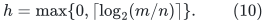
Then <code class="math">m\leq2^hn</code>, and <code class="math">\sum_{i=0}^h2^in=O(m)</code>.
Starting at the maximum degree instead would not give this work
bound on an arbitrary graph.

At band <code class="math">i&gt;0</code>, assume its current graph <code class="math">J_i</code> has at most
<code class="math">2^in</code> edges. Compute an ordinary <code class="math">\phi</code>-expander decomposition
with at most <code class="math">&#124;E(J_i)&#124;/4</code> crossing edges. This follows directly
by recursively applying Chuzhoy et al. Theorem 5.1 with cut budget
<code class="math">1/(C_0\log(m+2))</code>: recursion depth is <code class="math">O(\log m)</code>, because
every recursive child loses a constant fraction of the current
volume. The output expansion is <code class="math">\exp(-O(r\log(U+2)))</code>, and
the work is
<!-- math-display: 367cb43e61063bf65c1e40a8
|E(J_i)|\exp(O(U/r+r^2\log(U+2))).
 \tag{11}
-->
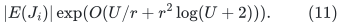
An actual connected component too small for the source's parameter
condition can be returned directly: a connected <code class="math">e</code>-edge graph
has conductance at least <code class="math">1/e</code>, which is more than the chosen
global <code class="math">\phi</code> at this cutoff.

Initialize pruning on each nontrivial expander component, using
Section 3's simple-graph adapter for a multigraph.
Repeatedly choose a current vertex of degree less than
<!-- math-display: 8ce0940ab489da893696ba82
\delta_i=\phi\,2^i/C_1
 \tag{12}
-->
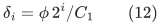
and explicitly delete its current incident edges. Forward these
edge deletions to its pruning instance. Move all newly pruned
original edges to the next band. If a component's permitted
deletion quota is first crossed, discard that entire component
to the next band. Such a discard costs
<code class="math">O(t_C/\phi)</code> original edges, where <code class="math">t_C</code> counts its explicit
deletions, so it obeys the same charge as ordinary pruning.

Each vertex is chosen at most once in this band. Hence the total
number of explicit current-edge deletions is less than
<code class="math">\delta_i n</code>, and all pruning/discard movements are bounded by
<!-- math-display: 9871d7077953769dfb770321
O(\delta_i n/\phi)=O(2^in/C_1).
 \tag{13}
-->
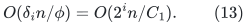
This counts original component edges, including boundaries removed
by earlier pruning; it does not confuse current degree with original
volume. A chosen vertex that remains only as an isolated record
may be omitted separately, since it has no remaining edge to move.
For sufficiently large fixed <code class="math">C_1</code>, (13) plus the decomposition
crossings is at most <code class="math">2^{i-1}n</code>. This proves the next-band invariant.

Every surviving nontrivial component has conductance at least
<code class="math">\phi/c_{\rm pr}</code>, for one fixed constant <code class="math">c_{\rm pr}</code>, and
minimum degree at least <code class="math">\delta_i</code>. Both guarantees
hold with one common parameter <code class="math">\phi'=c\phi</code>, for a fixed small
constant <code class="math">c&gt;0</code>. Band zero has at most <code class="math">n</code> edges and is retained
directly. The pruning time sums to
<!-- math-display: 87d22d68c8ed777843a176ea
\sum_i O(2^in\,\mathrm{poly}(U)/\phi)
             =O(m\,\mathrm{poly}(U)/\phi),
 \tag{14}
-->
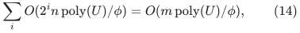
which fits (11). Degrees and candidate queues can be updated by
scanning each moved edge once per band. No artificial self-loop
extension of Theorem 5.1 is used in this construction.

## 5. A loopless witness for the actual balanced weights

There is one further graph-model detail in the static construction.
An arbitrary prescribed weighted degree vector need not admit a
loopless graph: one coordinate might exceed the sum of all others.
The actual degree-band weights avoid this obstruction. In a
nontrivial loopless component <code class="math">J_i[X]</code>, put
<!-- math-display: b1f079169fed280d6efc185f
w_v=\deg_{J_i[X]}(v)/(\phi'2^i).
-->
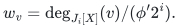
The degree-band guarantee gives <code class="math">w_v\geq1</code>, and absence of loops
gives <code class="math">w_v\leq\sum_{u\ne v}w_u</code>. Set <code class="math">p_v=\lceil w_v\rceil</code>.
These integers remain balanced, because
<!-- math-display: 0d6775e2c70ce03077a316cb
\lceil w_v\rceil
 \leq\left\lceil\sum_{u\ne v}w_u\right\rceil
 \leq\sum_{u\ne v}\lceil w_u\rceil.
 \tag{15}
-->
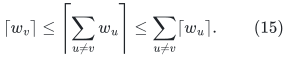

Construct a constant-conductance expander on
<code class="math">N=\sum_vp_v\geq2</code> ports, with maximum degree <code class="math">D_0=O(1)</code>
and minimum degree at least one, using the deterministic
constant-degree expander primitive. Group <code class="math">p_v</code> ports at each
vertex <code class="math">v</code>, contract each group, discard its internal edges,
and replicate every remaining edge by one fixed integer
<code class="math">c\geq1/\phi_0</code>, where <code class="math">\phi_0</code> is the port expander's
conductance.

Every fiber has at most <code class="math">N/2</code> ports. Its port boundary therefore
has at least <code class="math">\phi_0p_v</code> edges, and the resulting loopless
multigraph <code class="math">W</code> satisfies
<!-- math-display: fffe09c3a144197c87366edf
w_v\leq p_v\leq\deg_W(v)
                   \leq cD_0p_v\leq2cD_0w_v.
 \tag{16}
-->
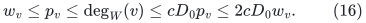
For a cut <code class="math">A,B</code> of the grouped vertices, let <code class="math">p_A,p_B</code> be
their port counts. Its boundary is at least
<code class="math">c\phi_0\min(p_A,p_B)</code>, while the smaller output volume is
at most <code class="math">cD_0\min(p_A,p_B)</code>. Hence
<code class="math">\Phi(W)\geq\phi_0/D_0</code>.
The construction takes <code class="math">O(N)=O(\sum_vw_v)</code> time and records,
and only loopless multigraphs are passed to the path oracle.
Ceilings of the dyadic-rational weights use the declared integer
word bounds.

This proves exactly the weighted-witness interface used here.
It does not assert a loopless construction for an arbitrary
unbalanced vector. Together with Section 4, it removes the need
for a self-loop extension of the balanced-cut or path-oracle sources.

## 6. Consequence for the static sparsifier interface

In van den Brand et al. Algorithm 4, the congestion thresholds depend
on the maximum reported path length, the pruning-volume constant and
<code class="math">\phi^{-1}</code>. They do not depend on the running time of the path
oracle. The decomposition and path-oracle replacements above
therefore support separate envelopes
<!-- math-display: da89086062d4b764433d73fa
\log\Gamma=O(qr\log(U+2)),\qquad
 \log F=O(U/q+U/r+r^2\log(U+2)+qr\log(U+2)).
 \tag{17}
-->
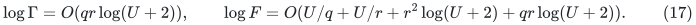
Here <code class="math">\Gamma</code> bounds output sparsity, path length and congestion
factors; <code class="math">F</code> bounds construction work per actual input-path record.
Fixed powers and polynomial logarithms can be included in these
envelopes.

The literal ambient-embedding length factor remains:
<!-- math-display: d21e7e86f82f31738690ed84
C(\Pi\circ\widehat\Pi)
 \leq \Gamma\,L(\Pi)\bigl(C(\Pi)+\Delta(J)\bigr).
 \tag{18}
-->
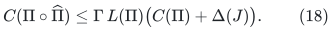
It must still be multiplied through the touched-set hierarchy.
Separating (17) does not provide a length-free congestion theorem.
The subsequent static-to-dynamic reduction, degree feedback,
root-pool lifetime accounting and matching composition require
their own proofs; the derivation here addresses the source
parameter, graph-model and stage-count interfaces.

Thus the separated static primitive is derived from the cited
constructive balanced-cut, pruning, constant-expander and dynamic-tree
algorithms, using the explicit replacements above and the full
Algorithm 4 reconstruction in the companion note. No additional
unproved self-loop extension is part of this derived interface.
Its source algorithms remain named mathematical dependencies;
an optimality verifier does not establish their running-time bounds.
