# Polynomial-bit low stretch inside stable core forests

**Interface composition lemma, 24 October 2026.** This note proves the
arithmetic and quantitative integration of an original-edge low-stretch
tree primitive into the stable-forest distance backend. It treats the
geometric tree guarantee in
[the AN finite-bit adapter](an-weighted-finite-bit-adapter.md) as its
explicit premise. It does not replace or independently reprove that
adapter's petal geometry.

The conclusion is that fixed-polynomial dependence on the input
length BIT COUNT changes only the already charged polynomial factors
in the master parameter. In particular, it does not create a
recursive bit-length self-reference, a product of unrelated rational
denominators, or an uncharged factor on each recursive child update.

## 1. Required tree interface

For a connected undirected multigraph with <code class="math">n</code> vertices, <code class="math">m</code>
positive-length edge IDs, and integral lengths
<!-- math-display: b5630d91bc8c7d43f98efce8
1\leq \ell_e<2^b,
-->
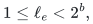
write
<!-- math-display: d942be5ede3f65025d46a094
B=b+\lceil\log_2(n+m+4)\rceil+4.
-->
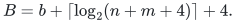
The required primitive returns a genuine spanning tree consisting
of ORIGINAL input edge IDs, with
<!-- math-display: c4d970ca640ed47d7a804e59
\sum_{e=uv}\frac{d_T(u,v)}{\ell_e}
                          \leq m\,c_{\rm str} B^{q_{\rm str}},
 \tag{1}
-->
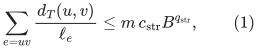
in
<!-- math-display: fd5a2da72a2e6e8bede43cf4
(n+m)c_{\rm time}B^{q_{\rm time}}
 \tag{2}
-->
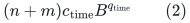
bit operations. All four constants are fixed once the primitive's
program is fixed. They are independent of the master parameter,
recursive depth, repair depth, and routing parameters.

The tree can be rooted at any prescribed original vertex after it
has been constructed. Positive parallel edges retain their distinct
IDs; an actual tree cannot choose two parallel edges as a two-cycle.
Its degree is at most the original input degree. Temporary portals
therefore create no additional degree in the exported tree.
Isolated vertices are handled separately.

The primitive may use finer temporary coordinates and larger
temporary integers internally, as long as their COMPLETE bit work
is included in (2). It must not export its portal subdivision,
dyadic coordinates, reciprocal capacities, or modified working
lengths as the next numerical graph. The AN adapter has precisely
this output type: its temporary geometry is unpacked to an
original-edge tree.

The distinction is essential. A statement merely returning a tree
in an auxiliary metric would not establish the label recurrence
proved below.

## 2. Weighted calls need no unrelated denominators

Consider one component <code class="math">C</code> with <code class="math">e_C&gt;0</code> genuine edges. The
future-path construction uses the integer importance weights
<!-- math-display: 4fae0dd0271be59beb165126
w_e=N_e\ell_e,\qquad
         N_e=\text{number of occurrences of }e
                \text{ in the current path inventory}.
 \tag{3}
-->
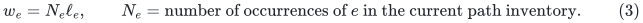
An inventory walk may repeat an edge. Its occurrences are counted
with multiplicity; mere membership does not give the identity
needed for weighted path halving.

Put <code class="math">W=\sum_e w_e</code>. If <code class="math">W&gt;0</code>, use positive integer weights
<!-- math-display: 41761da77bc63320c82836dc
v_e=e_Cw_e+W,\qquad
              V=\sum_e v_e=2e_CW.
 \tag{4}
-->
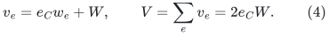
This is a common rescaling of the usual smoothing
<code class="math">w_e+W/e_C</code>. Form the replica counts
<!-- math-display: d7ff45375d530538ea6ea93a
r_e=\left\lceil\frac{e_Cv_e}{V}\right\rceil.
 \tag{5}
-->
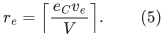
Every edge has a positive count and
<!-- math-display: a3f88cc563ea44985715d7e2
\sum_e r_e\leq 2e_C.
 \tag{6}
-->
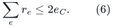
If <code class="math">W=0</code>, take unit importance weights instead.

Only the count of a replicated edge changes. Each replica keeps
the original integer length <code class="math">\ell_e</code>. The tree primitive is
therefore called on at most <code class="math">2e_C</code> edges with the SAME length
bit bound <code class="math">b</code>. No importance weight is used as a new geometric
length, and no magnitude-proportional replication is performed.

For clarity, let <code class="math">T_{\rm occ}</code> be an upper bound on the total
number of explicitly represented path-edge occurrences. Then
<!-- math-display: 66e64e769fdec8b68cb4c88e
\begin{split}
  N_e&\leq T_{\rm occ},\\
  W&\leq T_{\rm occ}2^b,\\
  \mathrm{bits}(w_e),\mathrm{bits}(v_e),
  \mathrm{bits}(e_Cv_e),\mathrm{bits}(V)
       &\leq b+O(\log(T_{\rm occ}+2)+\log(e_C+2)).
 \end{split}
 \tag{7}
-->
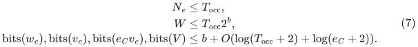
The ceiling in (5) is integer division at this bit size.

For any nonnegative fixed-label quantity <code class="math">s_e</code>, replication gives
<!-- math-display: 135a77dfa6f00664b83b8efe
\sum_e v_es_e
             \leq \frac{V}{e_C}\sum_e r_es_e.
 \tag{8}
-->
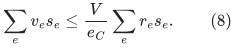
Consequently an unweighted fixed-label bound on the replica graph
implies the corresponding weighted bound. The replica ceiling and
(4) lose only fixed constants. The exponent of <code class="math">B</code> does not
depend on the number of weighted calls.

The present backend uses the inventory bound
<code class="math">T_{\rm occ}\leq m k^{O(1)}\mathrm{poly}(U)</code>.
Hence, under the existing polynomial-master size and lifetime
guards, (7) is <code class="math">b+O(U)</code> bits. None of these operations creates a
least common multiple.

## 3. Reciprocal ordering uses one dyadic grid

The CKL ancestor construction has a separate reciprocal calculation:
the congestion used to order a tree edge <code class="math">f</code> is
<!-- math-display: 09a8bddd54a764135dd3ec4d
c_f=\sum_{e:\,f\in T[e]} r_e/\ell_e.
-->
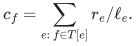
Computing this expression exactly as an arbitrary rational would
indeed be an unsupported arithmetic shortcut. Use instead
<!-- math-display: 2f6279840a401c843d8d126a
a_e=2^{-\lceil\log_2\ell_e\rceil},\qquad
       \widehat c_f=\sum_{e:\,f\in T[e]}r_ea_e.
 \tag{9}
-->
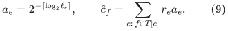
Since
<!-- math-display: 0e6f3666b8bb274b07514046
c_f/2\leq\widehat c_f\leq c_f,
 \tag{10}
-->
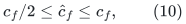
sorting by <code class="math">\widehat c_f</code>, with fixed edge-ID ties, suffices for
the factor-three variant of CKL Lemma B.6 proved in
[the component wrapper](disconnected-component-backend-wrapper.md).

All exponents in (9) are at most <code class="math">b</code>. Multiplication by <code class="math">2^b</code>
turns every summand into an integer, and their sum has
<code class="math">O(b+\log(e_C+2))</code> bits by (6). One tree postorder of LCA
difference sums computes these loads. The ordering remains fixed
during the forest lifetime.

This dyadic grid is PRIVATE ordering arithmetic. It does not
round the input metric or any exported core length. In particular,
there is no multiplication of the denominators <code class="math">\ell_e</code> across
different edges, and no accumulation of the AN adapter's temporary
portal denominators.

CKL Lemma B.9's domination property holds for any fixed total
order. The proxy changes the weighted average-stretch constant,
not the structural ancestor height or the subsequent fixed-label
domination argument.

## 4. The exported label bound does not involve low stretch

This is the point that prevents a recursive bit-length
self-reference.

For one returned original-edge tree, CKL Appendix B.3 constructs
an ancestor hierarchy of height
<!-- math-display: c57d44a11020bfce088d1001
h=O(\log^2(n+2)).
-->
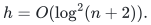
This height is a structural property of the tree hierarchy. It
does not depend on the low-stretch factor in (1).

Its fixed stretch label has the exact integral realization
<!-- math-display: 61d2c57a976a60f6950594d4
\ell_e\widetilde{\mathrm{str}}(e)
           =2\sum_{j=0}^{h}(\ell_e+P_j(e)),
 \tag{11}
-->
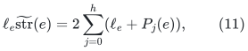
where <code class="math">P_j(e)</code> is the length of one simple tree path or two
simple root legs in a subforest of that original-edge tree.
If <code class="math">L</code> bounds all parent length labels admitted during the instance,
including its initial labels, every summand satisfies
<!-- math-display: 82862939e6386c062aa7c99e
P_j(e)\leq 2nL.
-->
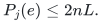
Therefore
<!-- math-display: bcecc7efcbd7dbc4e928a53b
1\leq
       \ell_e\widetilde{\mathrm{str}}(e)
              \leq c_{\rm lab}(n+1)\log^2(n+2)L.
 \tag{12}
-->
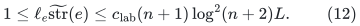
Here <code class="math">c_{\rm lab}</code> is an absolute fixed hierarchy constant.
Inserted edges have fixed stretch label one and satisfy the same
bound. Endpoint promotions and later forest cuts preserve the
old labels.

Equations (11)--(12) are valid for ANY original-edge spanning
tree returned by the primitive. Its average stretch could even
be poor without invalidating this magnitude bound. Low stretch
is needed for comparison quality and the initial root count,
not for the bit recurrence.

There are two different forest counts:

* <code class="math">h</code> in (11) is the ancestor hierarchy height for ONE tree;
* <code class="math">\lambda</code> is the number of weighted path-halving calls.

An edge in one core graph has one label (11). It is not assigned
the sum or product of its labels across the <code class="math">\lambda</code> different
core copies. The direct sum of those copies changes the record
count, not the magnitude of one edge label.

Frozen potential corrections also have a direct bound. A potential
is the signed sum of at most <code class="math">n-1</code> birth-time gradients on a tree
path. Let <code class="math">G</code> bound all parent gradient magnitudes admitted during
the instance, including those old frozen values and the current
central-edge gradient. A corrected retained gradient then has
magnitude at most <code class="math">(2n+1)G</code>. A later decrease in a current gradient
does not retroactively decrease a frozen potential; the uniform
lifetime bound is the one used in (13). This calculation does not
use the stretch factor in (1).

## 5. An acyclic master bit induction

Use the degree-reset backend's declared depth limit <code class="math">d_*</code>, its
polynomial-master graph-size guard, and its port scale
<!-- math-display: f96e0d47821ca6c39eeca967
H_{\rm port}
     =2^{\lceil\log_2(4(\log_2 C+1))\rceil}.
-->
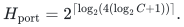
For a fixed parameter tuple, <code class="math">\log_2 H_{\rm port}=O(\log U)</code>.
Real edge lengths and gradients are multiplied by this integer;
fiber connectors have length one and gradient zero.

Suppose every current local graph has at most <code class="math">2^{c_{\rm size}U}</code>
actual records, as required by the existing executable size guard.
Equations (12) and the potential bound imply
<!-- math-display: 4146f95380970fabe7bf0bae
\begin{split}
   b_{\ell,i+1}
       &\leq b_{\ell,i}+c_{\rm size}U+O(\log U),\\
   b_{g,i+1}
       &\leq b_{g,i}+c_{\rm size}U+O(\log U).
 \end{split}
 \tag{13}
-->
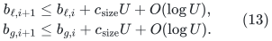
The constants in these inequalities are independent of the
polynomial degree in (1)--(2). Root labels have at most <code class="math">c_0U</code>
bits. A sufficiently large fixed coefficient in
<!-- math-display: 0f3186bb48a2e6ce9188c8ba
b_*=(c_0+100)U(d_*+1)
 \tag{14}
-->
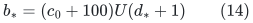
therefore bounds all stored labels under the stated size convention.
The current backend uses a size exponent small enough for the
displayed coefficient 100; changing that size convention requires
changing this explicit fixed coefficient too.

The logical order is as follows.

1. Declare the size, depth, and stored-label guards before the run.
2. Conditional only on the size guard, prove (13), hence (14).
   This step does not invoke the AN stretch/work estimate.
3. Now the input parameter for every AN call obeys
   <code class="math">B\leq b_*+O(U)=\mathrm{poly}(U)</code>.
   Its fixed powers in (1)--(2) are consequently fixed powers of <code class="math">U</code>.
4. Substitute these powers into the stable-forest and recursive-size
   recurrences. For a favorable fixed cap tuple their shrink factor
   is less than one, proving that the size guard itself does not
   fail.

This is a simultaneous first-failure argument, not an equation of
the form <code class="math">b_{i+1}=\mathrm{poly}(b_i)</code>. No power of a bit
count is exported as a new bit count. Temporary integers inside
the AN call may have polynomially larger bit size, but they are
discarded after producing its original-edge tree and are charged
only to (2).

For the 4/5 parameters,
<!-- math-display: 223ad4b474ec4cc92673babd
t^5h_U\leq U,\qquad
 d_*=O(t),\qquad
 b_*=O(Ut),\qquad
 x=\lceil U/t\rceil,
-->
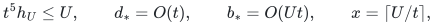
so
<!-- math-display: 15496a4925fae54b662282c5
b_*/x^2=O(t^3/U)=o(1).
 \tag{15}
-->
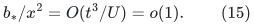
The existing smallest-nonbase-instance aspect guard is unchanged.

## 6. Stable-forest count, roots, and recourse

The weighted fixed-label stretch supplied by the wrapper is
<!-- math-display: 1a994797c1c4743aa16f2ffd
\alpha_U=\mathrm{poly}(B,\log n)
                                  =\mathrm{poly}(U),
 \tag{16}
-->
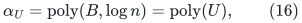
with a fixed polynomial degree. Replica ceilings, positive
smoothing, the factor-three congestion ordering, and the
ancestor hierarchy contribute only the fixed factors already
identified above.

In the path-halving construction, discard every path whose
fixed-label weighted stretch is at most <code class="math">2\alpha_U</code>.
The surviving TOTAL LENGTH is at most half the preceding total
length. The initial sum is at most <code class="math">T_{\rm occ}L</code>, and every
nonempty inventory walk has integer length at least one. Hence
<!-- math-display: 22bd573bd940d9989e35c221
\lambda\leq 1+\lceil\log_2(T_{\rm occ}L+1)\rceil
                    =O(b+\log(T_{\rm occ}+2))
                    =\mathrm{poly}(U).
 \tag{17}
-->
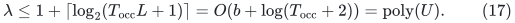
This count is not proportional to <code class="math">\alpha_U</code>, and it is not
the result of applying a polynomial operation recursively to
the weights. Each new importance weight is recomputed from
(3) on the surviving inventory.

The halving test itself needs no rational path-stretch value.
Choose an integral polynomial upper bound for <code class="math">\alpha_U</code> and
compare the integer sum of the labels (11), with occurrences,
against <code class="math">2\alpha_U</code> times the integer path length. Empty paths
are already preserved and can be omitted from this inventory.
Thus the claimed arithmetic also covers the path-selection test,
not only construction of its input weights.

Raise the high-stretch threshold by the same factor <code class="math">\alpha_U</code>
when initializing the stable forest. Markov's root bound is
unchanged because its numerator and threshold have the same
factor. The component wrapper's small-component replica
normalization gives the corresponding individual-label bound,
so it introduces no exceptional small-component roots.

The number of ancestor-closure cuts per endpoint promotion stays
<code class="math">O(\log^2 n)</code>: it is controlled by the hierarchy height,
not by the low-stretch factor. The family of <code class="math">\lambda</code> forests,
length buckets, pool copies, and ordinary indexing therefore
acquires only FIXED polynomial factors of <code class="math">U</code>. The component
volume split bound is combinatorial and is unchanged.

All actual original-edge label/provenance and occurrence-lifetime
rules remain in force. In particular, a child forest log still
creates or removes one connecting occurrence, and complete
retirement still flushes the old occurrence pools. A polynomial
bit operation is local work; it is not an additional factor <code class="math">k</code>
multiplying every propagated child log.

## 7. Effect on the 4/5 quantitative composition

Let <code class="math">\Gamma</code> and <code class="math">F</code> be the static ambient sparsifier's output
and work factors in the current composition:
<!-- math-display: 0d5212e76932f239fcdb6cd6
\log\Gamma=O((p+r)h_U),\qquad
       \log F=O(U/p+U/r+r^2h_U+(p+r)h_U).
-->
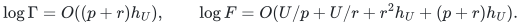
The low-stretch replacement changes the stable-core polynomial
factor <code class="math">A(U)</code>. It does not insert the AN runtime into the
static sparsifier's selected support size, and it does not turn
that runtime into selected-edge recourse.

After collecting all fixed polynomial factors, the same forms
remain valid:
<!-- math-display: 248cdd0be10cbf7a4cf6a320
\begin{split}
 \log P&=O(U/K+\log\Gamma+\log U),\\
 W&=k^{O(1)}\rho_{\rm sched}^{O(1)}
        F^{O(1)}\Gamma^{O(K)}\mathrm{poly}(U).
 \end{split}
 \tag{18}
-->
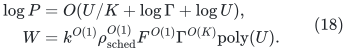
The stable-forest comparison quality has one additional
<code class="math">\mathrm{poly}(U)</code> factor per distance level. Its
full-depth contribution is already the <code class="math">O(d_*\log U)</code> term
in the raw inverse-quality bound. If a presentation absorbs
a polynomial factor into <code class="math">\Gamma</code> before its repair-depth
power, the resulting <code class="math">O(d_*K\log U)</code> term is also smaller
than the displayed <code class="math">O(d_*K(p+r)h_U)</code> term. Neither choice
changes the 4/5 balance.

With <code class="math">p=r=t</code>, <code class="math">K=t^2</code>, <code class="math">d_*=O(t)</code>, and <code class="math">x=\lceil U/t\rceil</code>,
<!-- math-display: ea1050754f2c311a00096d66
d_*\log U=O(th_U),\qquad
    d_*K\log U=O(t^3h_U)\leq O(x).
 \tag{19}
-->
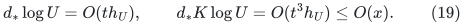
The source polynomial degrees are FIXED. They do not become
functions of <code class="math">p,r,K</code>, or <code class="math">d_*</code>. Explicit products across
repair and recursive levels are exactly the products already
counted in (18)--(19), rather than a new implicit degree in
<code class="math">\mathrm{poly}(B)</code>.

The existing coupled work recurrence, including late initial
child-update credit,
<!-- math-display: 2a330680c28e1e2ae45d8e56
\begin{split}
 J_d&\leq W+P(G_{d-1}+1)
                +(P/k)(J_{d-1}+T_{d-1}),\\
 T_d&\leq O(kW+kP(G_{d-1}+1))
                +O(P)(J_{d-1}+T_{d-1}),
 \end{split}
-->
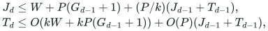
therefore retains the same solution via <code class="math">J_d+T_d/k</code>.
No initial credit is reclassified as free work by this substitution.

## 8. Exact boundary of the conclusion

The integration requires the AN adapter's ORIGINAL-EDGE spanning
tree output, fixed-polynomial bit-cost guarantee, and low-stretch
inequality. Its temporary geometric work is not a replacement for
those requirements. Subject to that interface, the arithmetic,
weighted normalization, stable labels, recurrence, and finite
guards above are sufficient.

The argument does not establish a different numerical exponent
or strengthen the matching theorem independently of its other
modules. It shows that the finite-bit tree implementation has
the precise quantitative type required by the current backend.

### Named source interfaces

* CKL+22, [arXiv:2203.00671](https://arxiv.org/pdf/2203.00671),
  Definition 6.4, Lemma 6.5, and Appendix B.3: the ancestor hierarchy,
  fixed labels, and equation (56). The polynomial-bit replacement
  uses only this deterministic construction, not the later random
  sampling of core forests.
* KMPG, [arXiv:2311.06402v1](https://arxiv.org/pdf/2311.06402v1),
  Lemma 3.5, Claim 3.11, and Lemma 3.12: deterministic future-path
  inventories and weighted halving. The total-length stopping
  bound is stated explicitly in (17), rather than assuming
  polynomial magnitude in the local graph size.
* [The component wrapper](disconnected-component-backend-wrapper.md),
  Sections 2--2.1: component-local replicas, integer smoothing,
  dyadic congestion ordering, common roots, and small components.
