# A polynomial-work energy cut player

This note gives a deterministic replacement for the exhaustive local search
in Appendix B.1 of [Chang--Huang--Su, arXiv:2405.03908v1](https://arxiv.org/abs/2405.03908).
The replacement proves the energy separation needed by the shuffler with
an <code class="math">O(\log t)</code> loss, where <code class="math">t</code> is the number of clusters. Its arithmetic
work is polynomial in <code class="math">t</code> and in the input bit size. The extra logarithm
in the number of shuffler rounds is harmless for the source's
<code class="math">\log^{O(1/\epsilon)}n</code> routing envelope.

The proof is independent of the projection-dependent expectation
calculation in the printed proof of Lemma B.2. It does not assert the
printed constant <code class="math">1/720</code>. It also does not supply the matching-embedding
or hierarchical-decomposition algorithms used elsewhere in that source.

## 1. The vector separation problem

Let <code class="math">t\geq16</code>, and let <code class="math">R_1,\ldots,R_t</code> be rational vectors in
<code class="math">\mathbb Q^t</code>. Put
<!-- math-display: f44d5472dbe6b47e6094d323
\overline R=\frac1t\sum_iR_i,\qquad
 v_i=R_i-\overline R,\qquad
 \Phi=\sum_i\|v_i\|_2^2.
-->
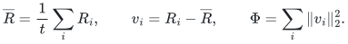
Assume <code class="math">\Phi&gt;0</code>. Define the integer
<!-- math-display: b85028f6372e1762322b3cd7
h=\left\lceil\log_4(8t^3)\right\rceil.
 \tag{1}
-->
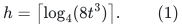
There is a deterministic polynomial-work algorithm returning disjoint
sets <code class="math">S,S'\subseteq[t]</code> such that
<!-- math-display: 1cfd1dab68104b785b7aa5a6
|S|\leq t/8,\qquad |S'|\geq t/2,
 \tag{2}
-->
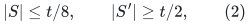
and, for every map <code class="math">\sigma:S\longrightarrow S'</code>, including
noninjective maps,
<!-- math-display: 49ed5ad31a6ccfe2945fb93c
\sum_{i\in S}\|R_i-R_{\sigma(i)}\|_2^2
       \geq \frac{\Phi}{512h}.
 \tag{3}
-->
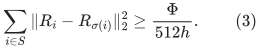
The same sets work for every map; the map is not fixed before the sets
are chosen.

### 1.1 A sign projection with simultaneous control of every pair

For a sign vector <code class="math">r\in\{-1,1\}^t</code>, write
<!-- math-display: b48c9cbe6b22471604b8dc08
E(r)=\sum_i\langle v_i,r\rangle^2.
-->
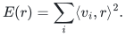
For each unordered pair <code class="math">i&lt;j</code> with <code class="math">d_{ij}=v_i-v_j\ne0</code>, put
<!-- math-display: bc7d4be494adbf61d0e8f47e
H_{ij}(r)=
   \left(\frac{\langle d_{ij},r\rangle^2}
                    {8h\|d_{ij}\|_2^2}\right)^h.
-->
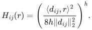
Use the potential
<!-- math-display: 5e5fb8e42ba27be0f09040eb
\Psi(r)=E(r)-t\Phi\sum_{i<j:\,d_{ij}\ne0}H_{ij}(r).
 \tag{4}
-->
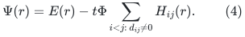
If the signs are independent and uniform, then
<code class="math">\mathbb E E=\Phi</code>. Expanding the even moment, or comparing its
nonnegative even-monomial expansion with the Gaussian moment, gives
<!-- math-display: 6f484e0ac8f42eab16b0600e
\mathbb E\langle d,r\rangle^{2h}
 \leq (2h-1)!!\,\|d\|_2^{2h}
 \leq (2h)^h\|d\|_2^{2h}.
 \tag{5}
-->
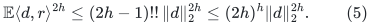
Consequently <code class="math">\mathbb E H_{ij}\leq4^{-h}</code>. There are fewer than
<code class="math">t^2</code> pairs, so (1) implies
<!-- math-display: 1320a735f34c8c20a922e130
\mathbb E\Psi\geq
 \Phi-t^3\Phi\,4^{-h}\geq\frac78\Phi.
 \tag{6}
-->
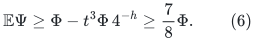

Fix the coordinates of <code class="math">r</code> in order. At each step compute the exact
conditional expectation of (4) for each of the two choices, and retain
the larger one, breaking ties by a fixed rule. Section 4 proves that
these computations take polynomial work and polynomially many bits.
The resulting vector satisfies <code class="math">\Psi(r)\geq7\Phi/8</code>. Therefore
<!-- math-display: 01aea44c2e917943f3c5d90e
E(r)\geq7\Phi/8.
 \tag{7}
-->
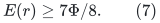
Moreover Cauchy--Schwarz gives <code class="math">E(r)\leq t\Phi</code>. If any pair had
<code class="math">H_{ij}(r)\geq1</code>, (4) would give <code class="math">\Psi(r)\leq0</code>, contradicting
(6). Thus, simultaneously for every pair,
<!-- math-display: 637527fca3afb5dc779c50be
|\langle R_i-R_j,r\rangle|^2
       \leq 8h\,\|R_i-R_j\|_2^2.
 \tag{8}
-->
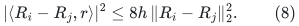
The inequality is also true when <code class="math">R_i=R_j</code>.

### 1.2 A median and two extreme tails

Set <code class="math">\mu_i=\langle R_i,r\rangle</code>, and sort these values with index
tie-breaking. Let <code class="math">m</code> be the value in position <code class="math">\lceil t/2\rceil</code>,
and put <code class="math">a=\lfloor t/8\rfloor</code>. Take the bottom <code class="math">a</code> and top <code class="math">a</code>
positions. Their union contains the <code class="math">a</code> largest values of
<code class="math">&#124;\mu_i-m&#124;</code>. Hence the sum of squared distances to <code class="math">m</code> on that
union is at least
<!-- math-display: 19882525233f3cfff57a3d5a
\frac at\sum_i(\mu_i-m)^2.
 \tag{9}
-->
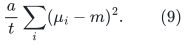
Choose as <code class="math">S</code> whichever of the two tails has the larger sum in (9).
Because <code class="math">t\geq16</code>, <code class="math">a\geq t/16</code>, and therefore
<!-- math-display: fc8044381c0436fa8653df4f
\sum_{i\in S}(\mu_i-m)^2
       \geq\frac1{32}\sum_i(\mu_i-m)^2
       \geq\frac1{32}\sum_i(\mu_i-\overline\mu)^2
       =\frac{E(r)}{32}.
 \tag{10}
-->
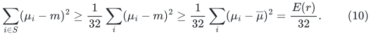
If <code class="math">S</code> is the top tail, let <code class="math">S'</code> be the bottom
<code class="math">\lceil t/2\rceil</code> positions. If <code class="math">S</code> is the bottom tail, take the
top <code class="math">\lceil t/2\rceil</code> positions. These sets are disjoint, including
when values tie, and satisfy (2). Their scalar values lie on opposite
sides of <code class="math">m</code>. Thus for every map <code class="math">\sigma:S\to S'</code>,
<!-- math-display: be319a738457a7fcce3fcbfc
|\mu_i-\mu_{\sigma(i)}|\geq|\mu_i-m|.
 \tag{11}
-->
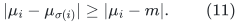
Combining (7), (8), (10), and (11) proves
<!-- math-display: 49a647dabd3cb7004e3b1364
\sum_{i\in S}\|R_i-R_{\sigma(i)}\|_2^2
 \geq \frac{7\Phi}{2048h}
 \geq \frac{\Phi}{512h}.
 \tag{12}
-->
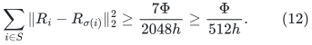
No search over the <code class="math">3^t</code> possible pairs of disjoint sets occurs.

## 2. Physical cluster sizes and a saturated fractional matching

For the CHS application, <code class="math">R</code> is the current doubly stochastic
walk matrix, and its row mean is <code class="math">\mathbf1/t</code>. Let cluster <code class="math">i</code>
have <code class="math">c_i</code> physical vertices. Property 3.1 supplies
<!-- math-display: a6212f11be8269e5f2f5bdf2
\frac23(\tau-1)\leq c_i\leq2(\tau+1)
 \tag{13}
-->
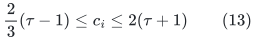
for a common <code class="math">\tau</code>, as well as
<!-- math-display: be72210eace42bfc518cafdf
\frac{|X|}{3k}\leq c_i\leq\frac{6|X|}{k}.
 \tag{14}
-->
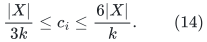
Assume <code class="math">\tau&gt;7</code>. For the sets just constructed,
<!-- math-display: 4f0a0a1b7cb89307092f3152
|S_X|\leq\frac{(\tau+1)t}{4}
       <\frac{(\tau-1)t}{3}
       \leq |S'_X|.
 \tag{15}
-->
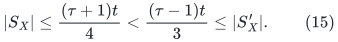
Thus the source's matching-embedding primitive can be called with
sources <code class="math">S_X</code> and sinks <code class="math">S'_X</code>. In a host whose sparsity is
strictly greater than the primitive's cut threshold, its cut alternative
is impossible, and its matching saturates all of <code class="math">S_X</code>.

Let <code class="math">c_{ij}</code> count the matched pairs between clusters <code class="math">i</code> and <code class="math">j</code>,
and retain the source's literal normalization
<!-- math-display: 397ff9409c10882f0645bf31
n'=\frac{6|X|}{k},\qquad m_{ij}=\frac{c_{ij}}{n'}.
 \tag{16}
-->
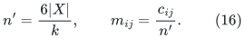
This is not a change to normalization by the largest cluster.
Equation (14) implies that <code class="math">M=(m_{ij})</code> is a symmetric fractional
matching: every fractional degree is at most one. For every
<code class="math">i\in S</code>, saturation and (14) imply
<!-- math-display: 9c2ec6751021b468b4d361c6
\sum_{j\in S'}m_{ij}=\frac{c_i}{n'}\geq\frac1{18}.
 \tag{17}
-->
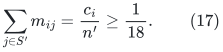

To apply (3) to these fractional weights, for each <code class="math">i\in S</code> choose
a <code class="math">j_i\in S'</code> minimizing <code class="math">\&#124;R_i-R_j\&#124;^2</code>. Then
<!-- math-display: 69eaefed63c20479af55603d
\sum_{i\in S,j\in S'}m_{ij}\|R_i-R_j\|^2
 \geq\frac1{18}\sum_{i\in S}\|R_i-R_{j_i}\|^2
 \geq\frac{\Phi}{9216h}.
 \tag{18}
-->
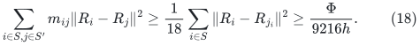
This argument uses no rounding of <code class="math">n'/18</code> and no asserted integer
number of cluster matchings.

## 3. Exact potential decrease and the revised shuffler length

Complete <code class="math">M</code> to a symmetric stochastic matrix <code class="math">M^*</code> with diagonal
entries <code class="math">1-\sum_{j\ne i}m_{ij}</code>, and let
<!-- math-display: 8947253fd2f736343012642b
Q=\frac12(I+M^*),\qquad R_{\rm new}=QR.
 \tag{19}
-->
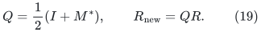
This is the CHS lazy fractional-matching update. Both matrices are
doubly stochastic, so the row mean remains <code class="math">\mathbf1/t</code>. Applied
to the centered row vectors, Jensen's inequality gives
<!-- math-display: 14a25193f74384acf22739bc
\Phi-\Phi_{\rm new}
 \geq\frac14\sum_{i,j}m^*_{ij}\|v_i-v_j\|^2
 =\frac12\sum_{i\in S,j\in S'}m_{ij}\|R_i-R_j\|^2.
 \tag{20}
-->
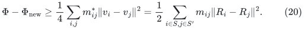
For completeness, write <code class="math">w_i=\sum_jm^*_{ij}v_j</code>.
The identity
<!-- math-display: dca372a44ca7b1fd3bfcd468
\|v_i\|^2-\left\|\frac{v_i+w_i}{2}\right\|^2
 =\frac14(\|v_i\|^2-\|w_i\|^2)
          +\frac12\langle v_i,v_i-w_i\rangle
-->
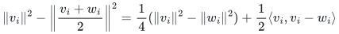
and Jensen's inequality show that the sum of the first terms is
nonnegative. Symmetry of <code class="math">M^*</code> converts the sum of the second
terms into the Dirichlet form in (20).
Equivalently <code class="math">I-Q^2=(I-M^*)(3I+M^*)/4\succeq(I-M^*)/2</code>,
since the eigenvalues of the symmetric stochastic <code class="math">M^*</code> lie in
<code class="math">[-1,1]</code>. The quadratic-form identity
<code class="math">\langle v,(I-M^*)v\rangle =\tfrac12\sum_{ij}m^*_{ij}\&#124;v_i-v_j\&#124;^2</code>
then gives (20).

Combining (18) and (20),
<!-- math-display: 5f40bda60b4bbab3efc3a193
\Phi_{\rm new}\leq
 \left(1-\frac1{18432h}\right)\Phi.
 \tag{21}
-->
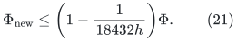
Starting from <code class="math">R=I</code>, the initial potential is <code class="math">t-1</code>. For
<code class="math">t\leq n</code>, a sufficiently large absolute constant in
<!-- math-display: 19309f709ff864a693a16e2d
\lambda=O\!\left(h\log(n+2)\right)
          =O\!\left(\log(t+2)\log(n+2)\right)
 \tag{22}
-->
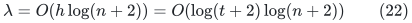
ensures <code class="math">\Phi\leq1/(9n^3)</code>, the unchanged stopping condition.
The stopping test can also be made by exact rational arithmetic.

### 3.1 The source's later integer-token error bounds

The following is a compatibility calculation for the source's original
integer-token architecture. The PRIMARY sequential provider instead
uses the actual-size leaf threshold and integer guards in
[sequential-expander-routing-tradeoff.md](sequential-expander-routing-tradeoff.md),
Section 3, together with the direct query induction in
[conditional-full-router-from-shufflers.md](conditional-full-router-from-shufflers.md).
That provider does not require the additional clipping or condition
(23) below. This distinction prevents a historical sufficient condition
from being mistaken for a restriction on its growing parameter p.

The only change here is that the shuffler has <code class="math">\lambda</code> as in
(22), rather than <code class="math">O(\log n)</code>. The source's Section 6.1 accumulates
at most <code class="math">\lambda t</code> error for each token class, and Section 6.5
uses <code class="math">q^2/k</code> in its load bound after <code class="math">q\leq\lambda</code> shuffler
steps. Its leaf trimming ensures <code class="math">&#124;X&#124;\geq k^4</code> for an internal
node and <code class="math">t\leq k</code>. Thus the same inequalities hold after
requiring
<!-- math-display: c74c1ce17915cd5169de41ed
k\geq c_1\lambda
 \tag{23}
-->
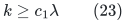
for a sufficiently large absolute constant: in particular
<code class="math">&#124;X&#124;/(10t^2)\geq k^2/10\geq t\lambda</code>, and
the maximum load is <code class="math">O(L\lambda)</code> for <code class="math">L\geq1</code>.

The actual-size clipping used in
[degree-split-token-routing-interface.md](degree-split-token-routing-interface.md)
has
<!-- math-display: f7cd162307f4191fa9aa749b
p_{\rm loc}\leq c\sqrt{\log(n+2)/\log\log(n+4)},\qquad
 k=n^{1/p_{\rm loc}}.
-->
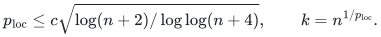
It makes <code class="math">k</code> exceed every fixed power of <code class="math">\log n</code> eventually.
Therefore (23) holds without altering the proposed output envelope.
An executable implementation checks the elementary size inequalities;
the finitely many remaining actual host sizes are handled directly.
The larger <code class="math">\lambda</code> contributes fixed logarithmic factors to
recursive costs and hence remains within
<code class="math">\log^{O(p_{\rm loc})}n</code>. It does not insert a polynomial factor
in <code class="math">k</code> into output path length or congestion.

The assumptions <code class="math">t\geq16</code> and <code class="math">\tau&gt;7</code> can likewise be enforced
by a fixed increase of the leaf/small-host thresholds. A node with
<code class="math">\tau\leq7</code> has <code class="math">&#124;X&#124;=O(k)</code>, so it is a permissible
polynomial-<code class="math">k</code> leaf. Once the global host has <code class="math">k\geq24</code>,
Property 3.1's <code class="math">t\geq2k/3</code> gives <code class="math">t\geq16</code>.

## 4. An exact finite-word implementation

Assume first that all <code class="math">v_i</code> have a common positive denominator <code class="math">D</code>,
and that the integer coordinates <code class="math">D v_i</code> have at most <code class="math">b</code> bits.
One may multiply the entire potential by <code class="math">D^2</code>, so only these
integer coordinates and rational pair-normalization factors are
needed. Different explicitly represented denominators can instead
be cleared by their product; its bit size is polynomial in the
stated input encoding.

After some signs have been fixed, a pair projection has the form
<!-- math-display: ad7e3b9590007d82c83781d2
a+\sum_{\ell\in I}d_\ell r_\ell .
 \tag{24}
-->
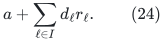
Its moments through order <code class="math">2h</code> are computed by a short dynamic
program. Start with <code class="math">M_j=a^j</code>. When incorporating one remaining
coefficient <code class="math">d</code>, replace the list by
<!-- math-display: 14d2cef202de2a75e094cddd
M'_j=\sum_{\substack{0\leq z\leq j\\z\ {\rm even}}}
                 {j\choose z}d^z M_{j-z}.
 \tag{25}
-->
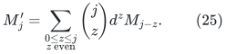
The absence of odd terms is exactly the average over the two signs.
All entries are integers. At the end <code class="math">M_{2h}</code> is the conditional
moment appearing in (4). The conditional expectation of <code class="math">E(r)</code>
is even simpler: for each row it is the square of the fixed partial
sum plus the sum of the remaining coefficient squares.

A pair moment has <code class="math">O(h(b+\log(t+2)))</code> bits. Its denominator in
(4) is
<!-- math-display: b338d6e65686881dca3ae112
(8h)^h\left(\sum_\ell d_\ell^2\right)^h,
 \tag{26}
-->
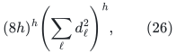
with <code class="math">O(h(b+\log(t+2)+\log(h+2)))</code> bits. Summing the fewer than
<code class="math">t^2</code> rational pair terms using the product of their denominators
therefore requires only polynomially many bits. Computing both
candidate expectations from scratch at each of the <code class="math">t</code> sign
choices uses, for example,
<!-- math-display: b02be97ba55b44723cf6e772
O(t^4h^2)
 \tag{27}
-->
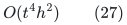
integer arithmetic operations on polynomial-bit integers. This
deliberately loose bound suffices: no operation hides an
exponential search in <code class="math">t</code>.

In the CHS application <code class="math">k</code> is rounded to an integer. The
entries of each update (19) have a common denominator dividing
<code class="math">12&#124;X&#124;</code>. After <code class="math">i</code> shuffler steps, a common denominator for
the centered rows divides
<!-- math-display: 4a29ec7370081f23b670bd35
t(12|X|)^i.
 \tag{28}
-->
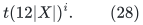
Because <code class="math">i=O(\log t\log n)</code>, these input coordinate bit lengths
are <code class="math">O((\log(n+2))^3)</code>. The larger integers used privately in
the exact conditional-expectation comparison occupy polynomially
many <code class="math">k</code>-words and are charged to preprocessing work. They are
not assumed to fit in one CONGEST message or one machine word.
Only the resulting cluster sets, matching counts, and existing
routing labels need the source's short-message representation.

For <code class="math">t\leq k</code>, the full cut-player preprocessing at a node is
therefore polynomial in <code class="math">k</code> and <code class="math">\log n</code>, with fixed degree.
Summing over at most <code class="math">n</code> hierarchy nodes gives the safe work
bound
<!-- math-display: 6825fc161064b6ad9a04d903
n\,\mathrm{poly}(k,\log n).
 \tag{29}
-->
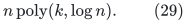
This is compatible with the intended
<code class="math">n\exp O((\log n)/p+p\log\log(n+2)+\log\psi^{-1})</code>
sequential preprocessing envelope. The hierarchy and
matching-embedding work remain separately accounted obligations.

## 5. Precise interface supplied

The routine supplies explicit sets satisfying physical source/sink
size feasibility and the all-mappings energy inequality (3). It
supplies an exact finite rational algorithm and proves the revised
potential contraction (21), including fractional matching weights.
Together with the source's matching-embedding primitive it constructs
a valid shuffler in the number of rounds (22).

The note does not deduce sequential complexity merely from CONGEST
rounds. The other necessary pieces are the constructive leaf routing
procedure and explicit hierarchy/matching-primitive work accounting,
as separated in
[sequential-leaf-routing-and-chs-work.md](sequential-leaf-routing-and-chs-work.md).
It establishes no new matching running-time theorem by itself.
