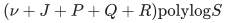
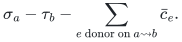
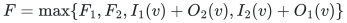
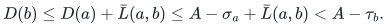
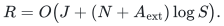

# Root audit: compatible local forest repairs for matching

**25 October 2026. Completed internal mathematical review.**

## Verdict and scope

The interface in
[potential-compatible-dynamic-forest-matching-interface.md](potential-compatible-dynamic-forest-matching-interface.md) is valid for
a supplied directed forest with unique physical allocation-coordinate
IDs and a fixed feasible potential. It supports supplied compatible
cuts and links, maximum-score directed path search, implicit numerical
path steps, guard checks, and register notifications in

<!-- math-display: 7788d5e6b63bc14eeb9f5077
(\nu+J+P+Q+R)\mathrm{polylog} S
-->

local work. Here P counts the supplied edge edits; it is not silently
bounded by the number of accepted numerical steps J. The register bound
is the existing history-wide bound, independent of how often a caller
cuts or links the same coordinate.

This is a constructive local lemma, not a new global matching runtime.
Finding useful replacement arcs, paying for unsuccessful searches,
altering the feasible potential, and bounding the total number of
repairs remain separate problems. The original arbitrary general-graph
maximum-matching exponent remains four fifths.

The independent review is in
[potential-compatible-dynamic-forest-independent-audit.md](potential-compatible-dynamic-forest-independent-audit.md). This audit
rechecks the mathematics and the relevant primary dynamic-tree
interface; neither review is formal verification or a benchmark.

## 1. Primary dynamic-tree interface

The root directly read Alstrup, Holm, de Lichtenberg, and Thorup,
*Maintaining Information in Fully-Dynamic Trees with Top Trees*,
arXiv:cs/0310065v2:

<https://arxiv.org/html/cs/0310065v2>.

Theorem 1 and Section 2.1 supply logarithmically many local cluster
changes per forest update, with a linear-size representation. Theorems
2--3 supply exposed-path aggregates and lazy path addition. Theorem 7
identifies why mutable vertex data cannot indiscriminately be included
at every cluster boundary. The present interface uses these public
operations; its directed score state, endpoint gadget, and allocation
watcher are additional application-specific arguments below.

No all-graph shortest-path update guarantee is imported from this
source. The forest is the entire domain of the maintained path search.

## 2. Physical-coordinate and direction checks

The underlying undirected structure is acyclic. Each selected edge is
one direction of one physical row/bin incidence, and each live
allocation ID occurs at most once. Therefore a directed simple bin-to-bin
path changes each allocation at most once. At every internal row, one
incoming donor loses eta and one outgoing receiver gains eta. At every
internal bin, these changes cancel in its load equation. Only the two
endpoint slacks change.

An implementation's internal rooting does not define these physical
directions. Rerooting a dynamic tree cannot turn a donor update into a
receiver update. An edge reversal is a genuine cut and link, with the
usual compatibility check for its new receiving direction.

Without coordinate-ID uniqueness, conservation could fail even when
the displayed logical graph were a forest. The main statement now
requires the physical identity condition explicitly.

## 3. Endpoint leaves and the directed score state

The source leaf into a bin carries sigma; the target leaf out of a bin
carries minus tau. A terminal is degree one and has an immutable role.
It can be an endpoint but cannot be internal to a simple scored path.
Thus a terminal-to-terminal score is exactly

<!-- math-display: 471ff540c96736fe4190643d
\sigma_a-\tau_b-\sum_{e\text{ donor on }a\leadsto b}\bar c_e.
-->

Changing a bin's slack changes two individual edge prices. It does not
require editing every cluster at which that bin appears as a boundary.
This addresses the high-degree vertex-update issue directly, without
assuming bounded allocation-graph degree.

For a cluster, the boundary-to-boundary table W, source-to-boundary
table I, boundary-to-target table O, and internal optimum F have constant
size. Two edge-disjoint child clusters intersect in one vertex v. A
simple path either lies in one child or crosses v once. Consequently

<!-- math-display: c548ba053a2d7b9d97bd368e
F=\max\{F_1,F_2,I_1(v)+O_2(v),I_2(v)+O_1(v)\}
-->

and the stated I, O, and W join formulas exhaust all possibilities.
Every finite cross term is a valid directed simple path: the two
constituent subpaths have no common vertex except v. Negative scores
cause no problem in an underlying forest.

The corrected base cases include a zero-edge source-to-itself I entry
and target-to-itself O entry when the corresponding terminal is a
boundary. No vertex has both terminal roles, so this does not create a
spurious positive zero-edge F candidate. All maxima propagate witness
metadata even when their numerical value is unchanged.

The global maximum dictionary contains settled component roots only.
For an update transaction, remove the affected old component records,
perform all local structural changes, then insert the resulting
component records. The temporary clusters produced by splits are not
published as additional graph components. Only constantly many
settled components are affected by one supplied link, cut, expose, or
edge-price change.

## 4. Implicit allocation arithmetic is kept separate from the score DP

The watcher contains only ordinary incidence edges. A donor stores
x-ell and x-chi; a receiver stores 2ell-x and U-x. On an accepted
directed path, all these selected-role buffers decrease by eta.
An exposed-path lazy addition therefore applies the full allocation
change without enumerating its physical edges.

Lazy tags are sent only to the path children of a split cluster.
Consequently an off-path branch, an endpoint-price leaf, or a different
allocation coordinate receives no unintended update. The watcher also
maintains the donor-price path sum used to choose the numerical step.

A guard failure is located before committing the step. After a
successful step, a nonpositive register buffer identifies a concrete
coordinate for resetting ell to 3x/4. A donor reset changes one selected
score edge; a receiving reset changes the opposite donor price in the
ambient allocation record, not a selected score edge. Hence a long
lazy allocation update does not conceal a long score-DP update.

This last distinction is essential. A top tree cannot generally
recompute an arbitrary global path optimum after an arbitrary change
to all its edge weights in constant time. Here the selected score
weights are piecewise constant between the explicitly counted
register events.

## 5. Ownership under cuts, links, and role changes

Before cutting an edge, point-query its watcher to recover the current
exact allocation and write it into the native coordinate record. Only
the logarithmically many required lazy tags are pushed. The remaining
selected allocations stay implicit.

An unselected coordinate has an explicit native value. Linking it
initializes the appropriate watcher buffers from that value and its
existing ell. A role change reuses the same register; it does not
create a new lifetime or clear previously accumulated variation.

The selected/unselected ownership table makes one representation
authoritative at a time. This is enough to prevent a stale explicit
record from being mistaken for an independently updateable copy.

## 6. Preservation of the fixed feasible labels

Every selected receiving edge is D-tight. If its allocation increases,
its reverse donor cost may decrease, but the old potential difference
across that incidence is zero. Thus feasibility survives even an
arbitrary sequence of receiving register decreases. Donor allocations
decrease on their selected arcs; their conservative costs can only
increase.

For an accepted a-to-b path, ordinary feasibility and its positive
score imply

<!-- math-display: 570dffb92873b8df2e0e1a82
D(b)\le D(a)+\bar L(a,b)
       \le A-\sigma_a+\bar L(a,b)<A-\tau_b.
-->

This supplies the same terminal source-arc margin as in the accepted
fixed-tree lemma. The prescribed small step, including its rounding
allowance, preserves that source constraint. The starting source arc
only becomes more permissive. The proof does not require that a be
the old shortest-path root, nor that the selected path be tight.

The numerical ratio and potential-gain bounds likewise use only the
two endpoint slacks and donor-price sum. All other path-topology
details disappear from those inequalities. The fixed semantic E
screen therefore stays valid, and only its two endpoint terms change
per numerical step.

FOREST-EMPTY means that this supplied forest has no accepted path.
After the potential has become stale, it is not a semantic LOW
certificate. The main statement preserves this distinction.

## 7. Finite arithmetic and the history-wide cost bound

The revised statement explicitly bounds D and A to O(log S) bits.
Fresh exact nonnegative shortest-path labels in the polynomially
bounded integer threshold graph satisfy this condition. Merely saying
that arbitrary labels are feasible would not imply it: arbitrarily
large negative translations would be feasible too.

Each finite DP score is a sum over at most O(nu) edges with polynomially
bounded integer prices. Its bit length is therefore O(log S), under
the same polynomial input-scale convention as the fixed-tree lemma.
The allocation watcher uses the already specified common dyadic grid;
the data structure introduces no new denominator growth.

After a reset at allocation x0, a new reset requires the coordinate to
reach at most 3x0/4 or at least 3x0/2. It therefore pays a constant
absolute logarithmic variation. One accepted step has O(1) total
negative allocation-log variation. The sum-log allocation potential
and the existing coordinate birth/death/external-assignment ledger
bound total positive variation by the negative variation plus
O((N+A_ext) log S). Cuts, links, and internal reroots contribute no
numerical variation and erase none. This gives

<!-- math-display: c2c9a2b6ddf2fa83fce3d0ca
R=O\bigl(J+(N+A_{\rm ext})\log S\bigr).
-->

The initialization, supplied-edit, query, numerical-step, and reset
costs consequently give the claimed local total. None of these terms
pays for finding useful ambient edges or for changing D. Those costs
must be supplied by a later global theorem.

## 8. Review outcome

The directed dynamic-forest interface is accepted as a local component.
It removes the need to rebuild a static heavy-light decomposition
merely because the caller supplies a legal local edge replacement.
It also handles arbitrary directed paths in an underlying forest,
rather than only ancestor paths of a fixed out-tree.

The next question is a global completeness and amortization question:
when the current forest is empty but the safe LOW screen does not
apply, how can one discover and pay for a useful compatible repair or
a potential change? The current lemma leaves that question open.
