# Joint retuning of the public deterministic APSP construction

**Primary-source derivation and audit, 25 October 2026.**

The derivation tracks work and quality separately, including the conservative local cutoff, domain adapters and work-budget substitution.

This note separates the construction time of the public static metric
sparsifier from its output quality, and then jointly retunes that provider,
the public repair hierarchy, and the recursive APSP hierarchy. The resulting
public composite has the following quantitative point:

<!-- math-display: 02d34f6d1eca525559ecdd38
\boxed{\begin{aligned}
 \text{amortized update factor}
    &\le \exp O(U^{6/7}h^{1/7}),\\
 \text{distance stretch}
    &\le \exp O(U^{5/7}h^{2/7}),\\
 \text{distance query time}&\le\mathrm{polylog}N,
 \qquad U=\log_2(N+4),\quad h=\lceil\log_2(U+4)\rceil.
\end{aligned}}                                                    \tag{P1}
-->
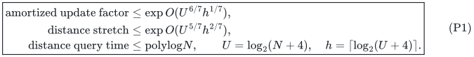

Initialization plus an update sequence costs its initial inventory plus
its number of elementary edits, multiplied by the factor in (P1). The
input is an arbitrary-degree undirected graph with positive integer
lengths at most a fixed polynomial in the history bound <code class="math">N</code>.

**Classification.** This is a derived public baseline, obtained by reading
and composing the actual algorithms and recurrences in the sources below.
It is not a theorem printed with these parameters in any of those papers.
In particular, it does not invoke the printed KMG Theorem 3.1 beyond its
declared parameter range: Section 4 rederives the needed local envelope
from the public repair algorithm. It also does not use the new sequential
router or the new length-free ambient normalization in the research
checkpoint.

At the permitted stretch scale <code class="math">\exp O(U^{6/7}h)</code>, (P1) strengthens
the previously recorded derived public <code class="math">59/63</code> update comparison. It
still has a larger update exponent than the new <code class="math">11/14</code> point. The
present result does not establish that <code class="math">6/7</code> is optimal over every
public APSP framework.

## 1. Source inventory and what is imported

All algorithmic inputs to this derivation are primary sources.

1. **CGLNPS20**, *A Deterministic Algorithm for Balanced Cut with
   Applications to Dynamic Connectivity, Flows, and Beyond*,
   [arXiv:1910.08025v2](https://arxiv.org/html/1910.08025v2).
   Theorem 1.6 is the parameterized deterministic cut player. Theorem 5.1
   is the slower balanced-cut/pruning routine with output conductance
   loss <code class="math">(\log m)^{O(r)}</code>, as opposed to the bundled quadratic
   exponent in some later corollaries. Theorem 2.4 supplies fixed-degree
   auxiliary expanders, and Theorem 2.5 bounds the cut-matching rounds.

2. **CS21**, *Deterministic Algorithms for Decremental Shortest Paths
   via Layered Core Decomposition*,
   [arXiv:2009.08479v1](https://arxiv.org/html/2009.08479v1).
   Theorem B.9 is deterministic terminal matching in an expander with
   short paths and bounded congestion. Section 3.2, especially Lemmas
   3.10 and 3.11, gives the separate stage-count and path-length
   recurrences of the decremental expander path oracle. Theorem 3.7
   is the expander-pruning interface used in those recurrences.

3. **vdB et al.23**, *A Deterministic Almost-Linear Time Algorithm for
   Minimum-Cost Flow*,
   [arXiv:2309.16629v1](https://arxiv.org/html/2309.16629v1).
   Theorem 8.1 and Algorithm 4 give the deterministic static sparsifier
   with an ambient embedding. Theorem 8.2 explicitly imports the public
   CKL repair reduction. Theorems 8.4--8.6 and Appendix B describe the
   weighted witnesses, degree bands, and expander path dependency. Some
   subsequent citations use an earlier section number 7 for this material.

4. **CKL et al.22**, *Maximum Flow and Minimum-Cost Flow in Almost-Linear
   Time*,
   [arXiv:2203.00671v1](https://arxiv.org/pdf/2203.00671v1).
   Section 5.1, Algorithm 1, Claims 5.7--5.8, and Lemma 5.9 supply the
   touched-set repair hierarchy and its recourse/work analysis. Its own
   static sparsifier is randomized; this derivation uses the deterministic
   replacement from item 3, exactly as that replacement paper prescribes.

5. **KMG23**, *A Dynamic Shortest Paths Toolbox*,
   [arXiv:2311.06402v1](https://arxiv.org/pdf/2311.06402v1).
   The local pivot/ball/core construction is Section 3.2. Theorem 3.7 and
   the preceding paragraphs specify weighted bucketing, insertions,
   forwarded vertex splits, and the standard deamortization of the public
   spanner. Claims 3.17--3.18 and the proof of Theorem 3.1 separate
   selected-edge recourse from the cost of maintaining the embedding.
   Algorithm 6 and Claim 4.4 give the numerical query algorithm and its
   exact-base-table implementation.

The binary-tree degree reduction used at recursive boundaries is the
standard dynamic degree reduction, also explicitly described in Section
2.6 of the public ESA 2025 paper *A Simple and Faster Algorithm for
Fully Dynamic Approximate Shortest Paths*. Its full version is
[arXiv:2408.11375v1](https://arxiv.org/html/2408.11375v1).
Section 6 below states the complete version needed here, including
positive lengths and current inventory, so no path-output strengthening
is hidden in that citation.

## 2. The public static provider has two independent parameters

Let <code class="math">r\ge1</code> be the CGLNPS cut-player parameter and <code class="math">q\ge2</code> the
number of CS21 expander-path levels. Take

<!-- math-display: a5e3abd6c9cd995fb36ea094
\phi^{-1}=2^{O(rh)},\qquad
 F_r=2^{O(U/r+r^2h)}.                                      \tag{P2}
-->
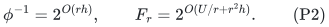

The hidden constants are uniform constants of the named constructive
algorithms. They do not depend on the input or on the selected growing
parameters. We only need <code class="math">r,q\le U</code> and <code class="math">q^2rh=o(U)</code> for the
conservative small-instance implementation used below.

### 2.1 The cut player and decomposition

CGLNPS Theorem 1.6 constructs an expanding large terminal subset with
sparsity <code class="math">(\log n)^{-O(r)}</code> in time
<code class="math">n^{1+O(1/r)}(\log n)^{O(r^2)}</code>. Its cutoff is
<code class="math">n^{1/r}\ge N_0</code> for a fixed constant <code class="math">N_0</code>. Theorem 5.1 gives
a balanced cut or a constant-volume expander side with conductance
<code class="math">\theta/(\log m)^{O(r)}</code>, in time

<!-- math-display: 18987f70f076184f1cf62ec9
m^{1+O(1/r)}(\log m)^{O(r^2)}/\theta^2.                  \tag{P3}
-->
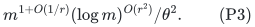

The ordinary balanced-cluster recursion, with
<code class="math">\theta=\epsilon/(C\log(m+2))</code>, gives an expander decomposition
with crossing-edge budget <code class="math">\epsilon m</code>, conductance
<code class="math">\epsilon 2^{-O(rh)}</code>, and total construction work
<code class="math">mF_r\mathrm{poly}(U)/\epsilon^2</code>. The recursion has
logarithmically many edge-disjoint levels. The quadratic <code class="math">r^2h</code>
term pays for constructing the cut certificate; it need not be inserted
into the output conductance.

For a too-small call, replace <code class="math">r</code> by
<code class="math">\min\{r,\lfloor\log(m+2)/C_0\rfloor\}</code>, with a constant-size
base case. This improves output conductance and keeps the work within
the master bound (P3). No small graph is padded to size <code class="math">N</code>.

### 2.2 The terminal expander and the actual CS21 stage count

CS21 Theorem B.9 routes one terminal matching in a <code class="math">\phi</code>-expander
using paths of length <code class="math">O(U/\phi)</code>, edge congestion
<code class="math">O(U^2/\phi^2)</code>, and work <code class="math">m\mathrm{poly}(U)/\phi^3</code>.
Using CGLNPS Theorem 1.6 as the cut player in the public cut-matching
construction yields an embedded terminal expander with

<!-- math-display: cf8bb305ca81e3367a9f9260
\text{conductance}\ge2^{-O(rh)},\quad
 \ell=\mathrm{poly}(U)/\phi,
 \quad\eta=\mathrm{poly}(U)/\phi^2,                 \tag{P4}
-->
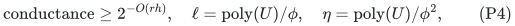

and work <code class="math">mF_r\mathrm{poly}(U,\phi^{-1})</code>. In (P4), the
congestion includes all <code class="math">O(U)</code> matching rounds; using a safe
<code class="math">O(U^3/\phi^2)</code> bound also agrees with the proof in CS21 B.4.3.
The factor <code class="math">F_r</code> controls construction, not output length or
congestion.

Use the CS21 hierarchy with nominal sizes <code class="math">m^{i/q}</code>. Inspection of
Lemma 3.10, rather than substituting into its bundled <code class="math">\gamma</code>, gives:

* work for one level-<code class="math">i</code> stage, excluding recursive lower stages:
  <code class="math">m^{(i+1)/q}F_r\,2^{O(rh)}</code>;
* number of level-<code class="math">i</code> stages contained in a level-<code class="math">(i+1)</code> stage:
  <code class="math">m^{1/q}2^{O(rh)}</code>.

The second assertion follows by charging child restarts to deletions,
amplified by the embedding congestion and pruning loss in (P4). It does
not contain the work used to construct the terminal expander. Multiplying
stage work by the number of stages, and summing, therefore gives

<!-- math-display: 64162d8a4074fea7dbeff768
mF_{\rm path},\qquad
 \log F_{\rm path}
      =O(U/q+U/r+r^2h+qrh).                               \tag{P5}
-->
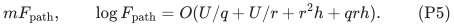

In Lemma 3.11 the path-length recurrence is instead

<!-- math-display: 9ed852a5ac2e2346433a8947
L_i\le O(U/\phi)(1+L_{i-1}).                            \tag{P6}
-->
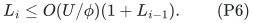

Consequently returned simple paths have length and explicit-query work
<code class="math">2^{O(qrh)}</code>. The final simplification of a walk takes its explicit
length and only removes occurrences.

For a fully explicit size cutoff, only run the hierarchy when
<code class="math">\log(m+2)\ge Cq^2rh</code>, for a sufficiently large absolute constant
<code class="math">C</code>. Then every nominal consecutive-size ratio obeys

<!-- math-display: c6b338a5bf9507c5564540f1
m^{1/q}\ge2^{Cqrh}\ge\Gamma^{C_1},                     \tag{P5a}
-->
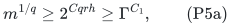

after choosing constants in the prescribed order. This stronger-than-needed
gap dominates immediate embedding lengths and congestion, all
polylogarithmic maximum degrees, pruning losses, and the cut-player cutoff
on the smallest terminal set. In particular the smallest nonbase stage
has a positive allowed deletion budget. A surviving intermediate expander
has a constant fraction of its initial edge volume and maximum degree
<code class="math">O(U)</code>, so it has enough surviving vertices to choose the next terminal
set. At the top level, the source's subdivision-edge terminals give the
same conclusion even for an initially high-degree graph. Ceilings in sizes
and integer budgets change fixed factors only.

For smaller actual instances, use expander pruning and a direct BFS for
each query. The BFS path length is still <code class="math">O(U/\phi)</code>, since the
surviving graph is a strong <code class="math">\phi/O(1)</code>-expander. Its query work,
however, can be as large as <code class="math">2^{O(q^2rh)}</code>. This extra term is a
construction/work allowance, not an output-quality allowance. The
static sparsifier below makes only <code class="math">m\Gamma^{O(1)}\mathrm{poly}(U)</code>
path calls, so it pays this fallback with one extra factor
<code class="math">2^{O(q^2rh)}</code>. No small component is replaced by a master-sized graph.

The public pruning guarantee is used only within each generation's
allowed deletion quota. On the first request exceeding that quota,
retire all remaining vertices of that generation and stop answering
queries there. If the quota is a fixed multiple of <code class="math">\phi m</code>, then
at that first excess request <code class="math">m=O(t/\phi)</code>, so the entire remaining
original volume fits the same <code class="math">O(t/\phi)</code> pruning charge. This also
handles a quota below one. It gives the all-deletion convention needed
by the static congestion rounds, including the direct-BFS fallback;
it does not assert expansion after arbitrary uncharged deletions.

The settled implementation uses the current surviving child terminals as
the roots of each ES tree. A pruned child terminal deletes its super-source
edge, and bottom-level deletions perform pruning before recomputing the
base tree. Retired-generation callbacks are ignored. These bookkeeping
completions are required to read the source's abbreviated procedures as
a valid query interface. They add at most the already charged root and
edge deletions in a stage, and do not alter (P5)--(P6).

### 2.3 A loopless implementation of the public degree-band reduction

The statement of vdB et al.23 Theorem 8.5 is the required degree-band
interface. Its Appendix B Algorithm 5, read literally, adds <code class="math">2^i</code>
self-loops at every vertex and starts at a maximum-degree scale.
CGLNPS Section 2 explicitly permits parallel edges but excludes
self-loops. Moreover, explicitly allocating all those artificial loops
could cost <code class="math">n\Delta</code> rather than <code class="math">m</code>. The following elementary
implementation supplies the needed interface using only the public
loopless decomposition and pruning primitives. It is stated explicitly
rather than silently applying Algorithm 5 outside a source domain.

Let <code class="math">n</code> count the nonisolated vertices of the loopless demand graph.
Start with

<!-- math-display: 872179cf636ae5572c0fbb43
\ell=\max\{0,\lceil\log_2(2m/n)\rceil\},\qquad G_\ell=J.
-->
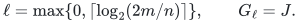

Maintain <code class="math">&#124;E(G_i)&#124;\le2^in</code>. For <code class="math">i&gt;0</code>, decompose <code class="math">G_i</code>
using Section 2.1 with crossing-edge budget <code class="math">&#124;E(G_i)&#124;/4</code>. Initialize
public expander pruning in each nontrivial component. While a surviving
vertex has positive current degree below
<code class="math">\delta_i=\phi2^i/C_b</code>, explicitly delete all its current incident
edges and settle the pruning output. A chosen vertex becomes isolated
and is chosen at most once in this band. Thus the number <code class="math">t_i</code> of
explicit deletion requests is less than <code class="math">\delta_i n</code>.

Put every explicitly deleted edge and every initial component edge
incident to a pruned vertex into the next residual graph. Public pruning
bounds that removed initial volume by <code class="math">c_{\rm pr}t_i/\phi</code>, for
a fixed constant <code class="math">c_{\rm pr}</code>. If the next request would exceed a
component's allowed deletion quota, count that first excess request and
move the entire component to the residual graph. Its edge count is then
at most a fixed multiple of <code class="math">t_C/\phi</code>, so the same charge applies.
This convention also handles a component whose positive quota is below
one. Each original edge is moved only once within this band.

Consequently, for an absolute constant <code class="math">c_b</code>,

<!-- math-display: 071bd0f2caea85feec7b9e2d
|E(G_{i-1})|
   \le |E(G_i)|/4+c_bt_i/\phi
   \le2^in(1/4+c_b/C_b)
   \le2^{i-1}n,                                          \tag{P5b}
-->
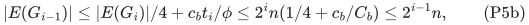

on choosing <code class="math">C_b\ge4c_b</code>. The retained graph <code class="math">J_i</code> has
nontrivial components of conductance <code class="math">\Omega(\phi)</code>, and every
nonisolated vertex in those components has degree at least
<code class="math">\phi2^i/C_b</code>. The residual <code class="math">J_0=G_0</code> has at most <code class="math">n</code>
edges and is retained directly. Replacing <code class="math">\phi</code> by a smaller fixed
multiple makes the degree and conductance lower bounds use the same
parameter, as in the published interface.

The total size charged to bands is at most
<code class="math">\sum_i2^in=O(m)</code>. Their decomposition, adjacency scanning, and
pruning therefore cost <code class="math">mF_r\mathrm{poly}(U,\phi^{-1})</code>.
In particular there is no maximum-degree padding factor. Pruning and
path queries on a loopless multigraph may use the source's one-subdivision
representation: it is simple, has constant-factor size and conductance
loss, and retains original edge IDs when paths are projected back.

The weighted witness needed for a retained component can likewise be
constructed within the public domains. Its weights are
<code class="math">w_v=\deg_{J_i}(v)/(\phi2^i)\ge1</code>. Because the component is
loopless, <code class="math">w_v\le\sum_{u\ne v}w_u</code>. Put
<code class="math">p_v=\lceil w_v\rceil</code>, create <code class="math">p_v</code> ports for <code class="math">v</code>, and
apply CGLNPS Theorem 2.4 to all ports. Contract each vertex's port fiber,
discard internal edges, and replicate the remaining edges a sufficiently
large fixed number of times. Every fiber contains at most half the
ports, so its boundary gives a degree lower bound <code class="math">w_v</code>, while the
fixed port degree gives an upper bound <code class="math">O(w_v)</code>. The same argument
for a union of fibers gives constant conductance. Construction work is
<code class="math">O(\sum_vw_v)=O(&#124;E(J_i)&#124;/(\phi2^i))</code>.

This derives the weighted-witness contract of Theorem 8.4 without
self-loop assumptions or a higher-degree allocation. It introduces no
independent <code class="math">U/q</code> output-quality term.

### 2.4 Feeding the oracle into the public static sparsifier

Algorithm 4 has two routing passes: witness edges into the demand graph,
and demand edges into the witness. In each pass it uses fresh expander
path structures for logarithmically many congestion-threshold rounds.
Each round's initialization and adaptive deletions cost its actual graph
size times (P5). The source's constant-progress charging uses output
path length and pruning loss, not construction time. Thus both static
passes preserve the separation in (P5).

Writing

<!-- math-display: 947927546ec12775e03015b4
\Gamma=2^{g},\quad
 g=O(qrh),\quad
 F=2^f,\quad
 f=O(U/q+U/r+r^2h+q^2rh),                                \tag{P7}
-->
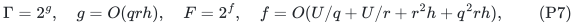

the reparameterized form of the public Theorem 8.1 is as follows.
Given an actual demand graph <code class="math">J</code> and an explicit ambient embedding
<code class="math">\Pi:J\to H'</code> with maximum path cardinality <code class="math">L_0\ge1</code> and
vertex congestion <code class="math">C_0</code>, it returns <code class="math">\widetilde J\subseteq J</code> and
an explicit routing <code class="math">\widehat\Pi:J\to\widetilde J</code> with

<!-- math-display: 8339daa23629ed543ce40725
\begin{aligned}
 |E(\widetilde J)|&\le |V(J)|\Gamma\mathrm{poly}(U),\\
 \mathrm{length}(\widehat\Pi)&\le\Gamma,\\
 \mathrm{length}(\Pi\circ\widehat\Pi)&\le\Gamma L_0,\\
 \mathrm{vcong}(\Pi\circ\widehat\Pi)
    &\le\Gamma L_0\bigl(C_0+\Delta(J)\bigr).
\end{aligned}                                                   \tag{P8}
-->
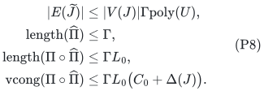

Its safe work bound is

<!-- math-display: b57c6959a1a1e6bcd9a7bedf
|E(J)|\,F\,\Gamma^{O(1)}(L_0+1)\mathrm{poly}(U).  \tag{P9}
-->
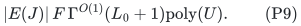

For example, the published two-pass composition has congestion factor
<code class="math">O(\gamma_{\rm ExpPath}^2\gamma_{\rm del}^2 U^2/\phi^2)</code>, which
fits <code class="math">\Gamma</code>. The static proof's explicit path enumeration contributes
only fixed powers of that output factor. The conservative BFS fallback
contributes the separately charged <code class="math">q^2rh</code> term in (P7). It does not
raise <code class="math">F</code> to the number of routing rounds.

**The ambient factor <code class="math">L_0</code> in (P8) is retained.** Removing it is one of
the changes made by the new checkpoint provider. No such removal is used
to obtain (P1).

Parallel demand IDs and loop demands are retained as identities. A loop
has an empty route in its own demand graph and needs no metric edge in
the selected graph. For expander path calls, the standard one-subdivision
representation handles a loopless multigraph using a simple graph with
constant-factor conductance loss. Weighted witness quotas can be rounded
to ports and Theorem 2.4 applied to the ports; contracting their fibers
retains the needed constant-factor degree and conductance inequalities.
These are representation conventions, not a faster routing primitive.

## 3. Why the speculative public 5/6 calculation is not justified

The tempting substitution

<!-- math-display: a95b96697a43b7572b47265d
g=O(rh),\qquad f=O(U/r+r^2h)
-->
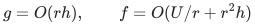

is valid for a cut certificate. It is not the output interface of the
public metric provider just audited. The public path oracle has a second
depth parameter <code class="math">q</code>. Its recurrence (P6) contributes <code class="math">q</code> to the
quality exponent, while (P5) contributes <code class="math">U/q</code> to construction work.
Taking <code class="math">q</code> constant to remove its growing quality cost leaves a
polynomial construction overhead.

Accordingly, the claimed public 5/6 balance obtained by putting a cut
quality directly into a metric sparsifier has not been established. The
source-supported interface for this composition is (P7), and the joint
balance below gives 6/7. This audit does not rule out other public routers
or a stronger future reconstruction; it identifies the exact missing
interface in that particular 5/6 argument.

## 4. Retuning the public repair depth without a hidden work multiplier

Let <code class="math">K</code> be the number of touched-set repair levels in CKL Section 5.1.
Use the deterministic primitive (P8)--(P9) in place of its randomized
static primitive. This is the replacement explicitly prescribed before
vdB et al.23 Theorem 8.2.

Let <code class="math">\mathcal L_j</code> and <code class="math">\mathcal C_j</code> bound the maximum explicit
path length and vertex congestion after repairing through level <code class="math">j</code>.
The construction and Claim 5.8 give

<!-- math-display: b6d70d243e54546d2dbd454a
\mathcal L_j\le O(\Gamma)(\mathcal L_{j-1}+1),
       \qquad \mathcal L_j\le\Gamma^{O(j+1)}.             \tag{P10}
-->
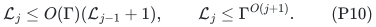

For congestion, follow Claim 5.7 but keep the public deterministic
ambient-path factor. The new middle route has input length at most
<code class="math">\mathcal L_{j-1}+1</code>; the two surviving legs only add the previous
congestion. The degree of the projected demand graph is bounded by the
previous embedding congestion. Hence

<!-- math-display: f29bed44a30c9083e8caa38d
\mathcal C_j
   \le O(\Gamma)(\mathcal L_{j-1}+1)
                 (\mathcal C_{j-1}+\Delta),
 \qquad
 \mathcal C_j\le\Delta\,\Gamma^{O((j+1)^2)}.             \tag{P11}
-->
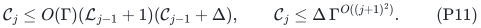

This is the precise source of the old <code class="math">K^2g</code> loss. It has not been
replaced by the new checkpoint's <code class="math">Kg</code> maintenance loss.

At a level-<code class="math">j</code> rebuilding event, the projected demand graph has vertex
set equal to the touched set <code class="math">S_{j-1}</code>, and at most
<code class="math">O(&#124;S_{j-1}&#124;\mathcal C_{j-1})</code> demand edges. Equations (P9)--(P11)
bound the entire job by

<!-- math-display: d713867c747aea0f60e5e81d
|S_{j-1}|\,\Delta F\Gamma^{O(K^2)}\mathrm{poly}(U).
                                                               \tag{P12}
-->
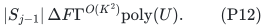

The number of selected edges created by the job is only
<code class="math">&#124;S_{j-1}&#124;\Gamma\mathrm{poly}(U)</code>. The public clock charges
one such touched-set job to its interval of updates. Thus, with
<code class="math">\rho=2^{O(U/K)}</code>, the selected-edge recourse is

<!-- math-display: 9dcabf74c61b950509c478fb
\rho\Gamma\mathrm{poly}(U),              \tag{P13}
-->
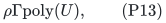

while the update work has the additional multiplier
<code class="math">F\Gamma^{O(K^2)}</code>, and powers of input degree. **The static
construction factor <code class="math">F</code> occurs once in (P12).** It does not occur in
the number of touched vertices, the output edge count, or the path and
congestion recurrences.

### What happens to the printed restriction on K

The deterministic spanner theorem prints
<code class="math">K=o((\log m)^{1/6}/\log\log m)</code> with its fixed
<code class="math">g_0=O((\log m)^{2/3}\log\log m)</code>. Its use guarantees that
the quantities <code class="math">\Gamma^{O(K^2)}</code> are subpolynomial in that input
size. The algorithms and proofs just cited impose no additional
correctness inequality involving the number <code class="math">1/6</code>.

For the reparameterized primitive, (P10)--(P13) prove the replacement
envelope directly. It is sufficient here that <code class="math">K^2g=o(U)</code>, where
<code class="math">U</code> is the global logarithmic inventory bound. At the smallest
nonbase local calls one need not claim that every overhead is
subpolynomial in that call's smaller size. It is bounded by the stated
global envelope and is explicitly paid. All actual record counts remain
polynomial in <code class="math">N</code>.

An integer implementation uses a geometric clock with ratio
<code class="math">b=\max\{2,\lceil n^{1/K}\rceil\}</code>, and only as many powers of
<code class="math">b</code> as the actual phase needs. The effective depth is at most <code class="math">K</code>
up to an absolute endpoint convention, and the adjacent clock ratio is
<code class="math">O(1+n^{1/K})</code>. If the nominal depth exceeds the actual logarithmic
size, this simply gives a binary clock with fewer levels. It does not
pad a small clock to <code class="math">N</code> updates. The changes preserve (P12)--(P13)
up to fixed factors and polynomial logarithms.

### Deamortization, lengths, and insertions

The paragraphs preceding KMG Theorem 3.7 explicitly apply the standard
batching deamortization, forward native vertex splits, add newly inserted
edges directly to the selected graph, and use length buckets. Those
operations depend on the job's output bound (P13), its repair deadline,
and its work budget (P12), separately. Multiplying the budget for a static
job by <code class="math">F</code> changes its allotted computation per update, not its
number of selected edges. Consequently the public selected-edge
recourse guarantee remains (P13). No deamortization of the entire APSP
composition is claimed here.

More explicitly, treat each static call in the public batching scheduler
as a job on its fixed input snapshot. Its output is buffered until the
job completes; the active routing structure never uses a partially
computed candidate. Replace its declared construction budget
<code class="math">T_{\rm out}</code> by <code class="math">FT_{\rm out}</code>, and multiply the computational
budget assigned to every logical update by the same master factor <code class="math">F</code>.
Every job then completes by the same logical-update deadline. The same
argument applies to processing a candidate's backlog: its component
operations have slowed by at most <code class="math">F</code>, and its allotted work has
increased by <code class="math">F</code>. Induction over job completions gives exactly the
same bound on the number of pending logical edits as in the public
schedule. The number of retained old/candidate structures, the lifetime
of old support measured in input edits, and the number of selected edges
published at a handoff are consequently unchanged.

Equivalently, simulate each unit of the original job budget by <code class="math">F</code>
units of actual computation. A static call whose result is ready early
may keep that result buffered until the scheduled release, so no earlier
completion forces an extra handoff or an earlier new job. Only input and
completed output cross a static-call boundary in CKL Algorithm 1. This
permits the simulation even when the substituted static routine has a
different internal implementation and private intermediate graph sizes.

This is a work-budget substitution, not an assertion that the old
deadline survives after slowing only the implementation. All static
intermediate records stay private to their job. Neither they nor its
construction work are forwarded as recursive graph edits. The source
import used for the scheduler is precisely KMG's public strengthening
preceding Theorem 3.7; the <code class="math">F</code>-budget substitution above explains why
its output-recourse analysis is unaffected by separating the two
parameters. Overall work is still charged amortized in (P18).

Weighted bucketing uses only a polynomial logarithmic number of buckets
for the length range in Section 7. Zero-length core identifications are
handled in their separate zero bucket and quotient, as in KMG; all
external and inter-level port graphs below have strictly positive
integer lengths. Insertions retained directly in a spanner are cleared
at its next full phase rebuild; their output inventory is charged to
the number of input insertions in that phase.

## 5. KMG's selected-degree repair does not multiply F into recourse

KMG's local vertex sparsifier maintains exact nearest pivots, small
strict balls, their exact distances, and the public low-stretch core
forests. Those operations cost <code class="math">k^{O(1)}</code> per local edit and do not
use the static metric provider. The provider only sparsifies the direct
sum of core graphs.

Claims 3.17--3.18 analyze selected-degree repair using two quantities:
the number of selected edges introduced by a spanner update, and the
degree of the original graph. The potential decrease and pile-splitting
argument use (P13), not the time needed to produce those edges. The
subsequent simulation of a vertex split by edge edits introduces another
fixed power of that selected-degree bound. With input degree fixed by
the public adapter in the next section, the complete local transcript
therefore has

<!-- math-display: b98d5eee18d6038fd6598714
\log P=O(U/K+g+h),                                       \tag{P14}
-->
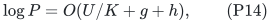

where <code class="math">P</code> bounds both the child inventory multiplier and the number
of child edits per native edit. A safe local work allowance is

<!-- math-display: 4469ee0b3fbdbc15ba5ffd62
k^{O(1)} F\Gamma^{O(K^2)}P^{O(1)}\mathrm{poly}(U).
                                                               \tag{P15}
-->
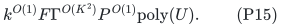

During initialization, the cleanup potential can cause further
spanner updates. Paying all of them with the larger bound (P15) remains
valid; there is no need to reuse the particularly economical printed
initialization expression after changing its static provider.

The local pivot-to-child metric stretch is
<code class="math">\Gamma^{O(K)}</code>. A selected child edge retains its actual parent
core-edge identity and a parent path no longer than its label. This is
the public KMG metric interface. No lifted arbitrary forest or stronger
path-output contract is needed for the numerical APSP theorem.

## 6. Public degree reduction at every recursive boundary

For every native vertex lifetime <code class="math">v</code>, retain a permanent query handle
<code class="math">q_v</code>. The current incidences at <code class="math">v</code> form the leaves of a balanced
binary tree attached to this handle. Leaves retain their incidence
identity through rotations. All connectors have length one; a native
edge of length <code class="math">\ell</code> becomes one leaf-to-leaf edge of length
<code class="math">H\ell</code>, for a fixed power of two <code class="math">H\ge C\log N</code>.

The resulting graph has maximum degree three. A native edit causes
<code class="math">O(\log N)</code> connector/edge edits, using only the current incidences.
Rotations allocate no new vertices; incidence insertions allocate a
constant number. Total vertex births are proportional to actual native
vertex and incidence births, and total connector lifetimes are larger
by only <code class="math">O(\log N)</code>. Delete old connectors before inserting their
replacement so every intermediate step satisfies the degree bound.

For distinct connected vertices,

<!-- math-display: 665cdbd5eb5dfbb7ee831eab
d_G(u,v)\le H^{-1}d_{G'}(q_u,q_v)\le2d_G(u,v).           \tag{P16}
-->
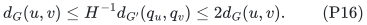

The first inequality drops connector edges and divides real lengths
by <code class="math">H</code>. A simple native shortest path with <code class="math">b\ge1</code> edges uses
<code class="math">O(b\log N)</code> connectors in its lift. Since native lengths are
positive integers, its native length is at least <code class="math">b</code>, proving the
second inequality. Disconnected pairs stay disconnected, and equal
endpoints are returned as zero directly.

Use this adapter at every child boundary, not just the external graph.
Thus local selected-degree bounds do not compound as a physical input
degree through all recursive levels. Its extra logarithmic edits are
absorbed by <code class="math">h</code> in (P14). The native handles are fixed for their
lifetimes; when an entire recursive instance is rebuilt its private
handles are replaced atomically along with the current pivot maps.
Queries never retain a reference to a retired instance generation.

## 7. Recursive work, query cost, and arithmetic

Set <code class="math">x=\log_2 k</code> with <code class="math">x</code> larger than a sufficiently large
constant times <code class="math">\log P</code>. Stop in an exact base case once the actual
inventory is <code class="math">k^{O(1)}</code>. Rebuild a local instance after a constant
multiple of its current initial inventory divided by <code class="math">k</code> native
edits. Over that interval, its selected child has size at most
<code class="math">P</code> times the parent inventory divided by <code class="math">k</code>. The size shrinks
by a factor <code class="math">k/P</code>, so the recursive depth is

<!-- math-display: b843b12b76830bce4e5d7614
d=O(U/x).                       \tag{P17}
-->
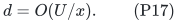

The total work to initialize a child is paid when that child is created.
On a full local replacement, creating and retiring its entire selected
inventory introduces <code class="math">O(P)</code> child records per native update after
amortization over the local interval. This includes initial child
records; it does not merely count later child edits.

Consequently the update recurrence has local term (P15) and multiplies
recursive work by <code class="math">P^{O(1)}</code>, yielding

<!-- math-display: 143ba20f2aa16d6c45a3c742
\boxed{\begin{aligned}
 B_{\rm pub}
   &=O\bigl(x+f+K^2g+d(U/K+g+h)+h\bigr),\\
 a_{\rm pub}:=\log\gamma
   &=O(dKg+dh).
\end{aligned}}                                                   \tag{P18}
-->
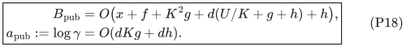

This is an amortized public composite. It deliberately avoids the
larger <code class="math">d^2</code> degree multiplication in the unmodified printed KMG
hierarchy by applying the standard degree adapter at every boundary.
It does not replace any static routing primitive by a new one.

### Numerical queries

The query is the public Algorithm 6. At each recursive level it stores
one current pair of endpoints. It either reads the stored exact strict-ball
distance and finishes, or reads the two stored exact nearest-pivot legs
and passes the current pivot pair to the child. Divide the child's
answer by its stored reset scale <code class="math">H</code> before adding native legs.
The endpoint maps are those of the currently settled instance.

The exact base graph recomputes its distance table after each settled
update; its <code class="math">k^{O(1)}</code> cost belongs to (P15). A query reads one
entry of that table. It never performs a size-<code class="math">k</code> shortest-path
computation. Deterministic dictionaries and polynomial logarithmic
arithmetic therefore give <code class="math">O(d\mathrm{poly}(U))</code> query time.
The source's pivot-detour proof multiplies approximation by
<code class="math">\Gamma^{O(K)}</code> per level; (P16) adds a constant per reset,
giving the second line of (P18).

### Finite arithmetic and history

Each core projection multiplies the permitted largest label by at most
the local vertex bound, and each degree reset multiplies labels by
the fixed polynomial scale <code class="math">H</code>. Thus all structural length labels
have <code class="math">O(Ud)</code> bits. At every nonbase invocation this is a fixed
polynomial in its logarithmic size; exact arithmetic and the number of
weighted buckets contribute only polynomial logarithms in <code class="math">N</code>.
The static provider uses a dyadic <code class="math">\phi</code>, integer quotas, and explicit
path occurrence lists, with the same polynomial logarithmic bit cost.

For the parameters below, all recourse, work, path, and degree factors
are <code class="math">N^{o(1)}</code>. The internal elementary history can therefore use
a fixed polynomially larger cap such as <code class="math">N^C</code>; its logarithm remains
<code class="math">\Theta(U)</code>. Graphs are always allocated at their actual current
sizes. Long sequences may be handled by the usual doubling/restarting
of the master bound, charging each replacement to the elapsed history.

## 8. The joint 6/7 balance

Let

<!-- math-display: c72780811ea28a8a17f239b4
t=\Theta((U/h)^{1/7}),\qquad
 q=r=\Theta(t),\qquad K=\Theta(t^2),
 \qquad x=\Theta(U/t),\quad d=O(t).                      \tag{P19}
-->
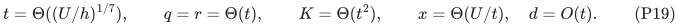

Round parameters to integers and choose the fixed constant in <code class="math">x</code>
large enough for shrink. For the finitely many small values of <code class="math">N</code>,
use the exact base algorithm. Since <code class="math">U=t^7h</code> up to fixed factors,

<!-- math-display: cff4503b941d6dcc044c2a6d
\begin{array}{c|c}
\text{quantity}&\text{logarithmic bound}\\ \hline
g& O(t^2h)\\
f& O(U/t+t^3h)\\
K^2g& O(t^6h)=O(U/t)\\
dU/K& O(U/t)\\
dg& O(t^3h)\\
dKg& O(t^5h).
\end{array}                                                    \tag{P20}
-->
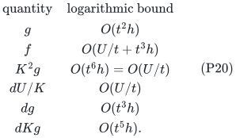

It follows that

<!-- math-display: af9eb4f1ad26393e9c69fa07
B_{\rm pub}=O(U/t)=O(U^{6/7}h^{1/7}),\qquad
 a_{\rm pub}=O(t^5h)=O(U^{5/7}h^{2/7}),                  \tag{P21}
-->
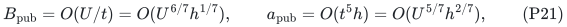

as claimed. Moreover
<code class="math">x/(U/K)=\Theta(t)\to\infty</code>,
<code class="math">x/g=\Theta(t^4)\to\infty</code>,
<code class="math">q^2rh=o(U)</code>, and <code class="math">K^2g=o(U)</code>, verifying the conditions used
above. The proposed <code class="math">K</code> exceeds the fixed-<code class="math">g_0</code> theorem's printed
range, which is why Section 4's source-level rederivation is essential.

For orientation, within the fixed-power envelope (P18), ignoring
polylogarithmic factors, a budget <code class="math">B=U^\sigma</code> forces
<code class="math">q,r,d\ge U^{1-\sigma}</code>, and <code class="math">dU/K\le B</code> forces
<code class="math">K\ge U^{2(1-\sigma)}</code>. Therefore <code class="math">K^2qr\le B</code> forces
<code class="math">6(1-\sigma)\le\sigma</code>, or <code class="math">\sigma\ge6/7</code>.
This only explains the balance inside this particular charged envelope;
it is not a lower bound for deterministic APSP.

## 9. Consequences for the current comparisons

The previous derived public comparison used KMG's fixed static output
factor <code class="math">g_0=O(U^{2/3}h)</code>, then retuned only the outer parameters and
degree adapter. That yielded <code class="math">59/63</code> update exponent at the displayed
<code class="math">6/7</code> stretch scale. The present source-level joint retuning is stronger
and should replace that value in a comparison claiming to include the
currently checked joint public composition.

The new research APSP point remains
<code class="math">\exp O(U^{11/14})</code> amortized update work at stretch
<code class="math">\exp O(U^{6/7}h)</code>. Compared at this allowed stretch scale, the
checked public composite is now (P1), not merely the printed
<code class="math">\exp O(U^{20/21}h)</code> theorem or the earlier <code class="math">59/63</code> composite.
The difference comes from two substantive changes in the research engine:
its new static router has <code class="math">g=O((p+r)h)</code>, and its normalized ambient
repair changes the local quadratic depth loss into a linear one.

An equal-stretch comparison is also available. The public point (P1)
has stretch exponent <code class="math">U^{5/7}h^{2/7}</code>. Set
<code class="math">t_{\rm new}=\Theta((U/h)^{5/28})</code> in the new curve
<code class="math">B_{\rm new}=O(U/t_{\rm new}+t_{\rm new}^3h)</code>,
<code class="math">a_{\rm new}=O(t_{\rm new}^4h)</code>. This gives

<!-- math-display: 3cc73d7effe80274f31bb312
B_{\rm new}=O(U^{23/28}h^{5/28}),\qquad
 a_{\rm new}=O(U^{5/7}h^{2/7}),                           \tag{P22}
-->
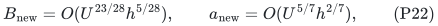

so the new construction also improves the checked public update envelope
at that finer allowed stretch. More generally, the public balanced family
has <code class="math">B_{\rm pub}=O(U/t+t^6h)</code>, <code class="math">a_{\rm pub}=O(t^5h)</code>, while
the research family has <code class="math">B_{\rm new}=O(U/t+t^3h)</code>,
<code class="math">a_{\rm new}=O(t^4h)</code>. These are separate time/stretch curves; their
parameters should not be equated when claiming equal approximation.

This audit makes no automatic change to the strong-forest or Gomory--Hu
comparison. Those interfaces require additional forest lifting, stable
canonical maps, cover/hopset recourse, and an outer scale constraint.
They need their own joint rederivation. It also makes no ordinary
output-sensitive simple-path claim and no new exact-matching exponent.

No already delivered immutable checkpoint archive is modified by this
baseline correction.
