# Reoptimizing the public dual tree-cut framework

**Baseline audit and quantitative derivation, 25 October 2026.** The literal deterministic bound in van den Brand et al., arXiv:2407.10830v1, is

<!-- math-display: 191d5d812607080330400d89
m\exp O((\log m)^{5/6}\log\log m).
-->
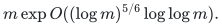

However, the construction contains independent parameters that its displayed final specialization sets separately. Keeping construction work distinct from output quality gives a plausible, and substantially stronger, **four-fifths reparameterization of that same public framework**. Consequently, a new raw-cycle route to static minimum-cost flow at four fifths must not be advertised as outperforming every result derivable from the public methods until this reparameterization has been resolved.

The positive parameter calculation and its exact source interface are recorded below. It does not use the new sequential expander router, moving-box numerical client, or general-graph matching reduction.

## 1. Public source interfaces

Use these primary sources:

1. Chuzhoy, Gao, Li, Nanongkai, Peng, and Saranurak, *A Deterministic Algorithm for Balanced Cut with Applications to Dynamic Connectivity, Flows, and Beyond*, arXiv:1910.08025v2, particularly Lemma 5.3, Theorem 5.1, Corollary 5.2, and Theorem 5.5. <https://arxiv.org/html/1910.08025v2>
2. van den Brand, Chen, Kyng, Liu, Meierhans, Probst Gutenberg, and Sachdeva, *Almost-Linear Time Algorithms for Decremental Graphs: Min-Cost Flow and More via Duality*, arXiv:2407.10830v1, Sections 4.1--4.4, Theorem 4.15, Claim 4.22, and Sections 5--6. <https://arxiv.org/html/2407.10830v1>
3. Sulser and Probst Gutenberg, *Near-Optimal Algorithm for Directed Expander Decompositions*, arXiv:2403.04542v2, Definition 2.2, Theorem 4.1, and Appendices A.5--A.6. <https://arxiv.org/pdf/2403.04542>

Set

<!-- math-display: 7ec4c6ff3fed33ac7a629174
U=\log(m+4),\qquad h=\log(U+4).
-->
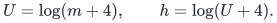

The CGLNPS source has a uniform integer parameter `p`. Its output quality is governed by

<!-- math-display: 2dd40a0264e8d87e5435fe6d
a=O(ph),                                                   \tag{1}
-->
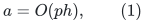

whereas its construction work has logarithm

<!-- math-display: 912280759fb65a451a47337e
f=O(U/p+p^2h).                                             \tag{2}
-->
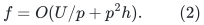

In particular, Theorem 5.1 / Corollary 5.2 gives an `exp(O(ph))` approximation with time

<!-- math-display: 110f24ccff6f2b31332c0a7b
m\exp O(U/p+p^2h)/\theta^2.
-->
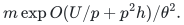

The distinction is explicit: the source's faster low-conductance theorem in its introduction has a different, quadratic quality parameter, but Section 5's slower algorithm has linear-in-`p` logarithmic quality. The latter is exactly the regime used in the 2024 dual-flow paper's Section 4.4. That section refers to "Theorem 5.3" of the second arXiv version; the relevant witness result in the retrieved version is **Lemma 5.3**.

Lemma 5.3 returns either a sparse cut or a spanning witness of expansion `1/log^{O(p)} n`, with a controlled fake-edge set and congestion `O(Delta log n/theta)`. Its time is

<!-- math-display: 7b8c1b62d427b43e85dd1e9d
\widetilde O(n^{1+O(1/p)}\log^{O(p^2)}n+n\Delta^2/\theta).
-->
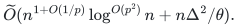

Thus this is an actual general-graph cut/witness interface, rather than a routing algorithm that assumes its host is already an expander.

### Uniform dynamic-decomposition interface and its import boundary

The parameter-sensitive form of the derandomization in Section 4.4 is the following:

<!-- math-display: 9d62c743dec61fbb8b400c0b
\log c_0,\log c_1=O(ph),\qquad
 T_{\rm dec}\leq m\exp O(U/p+p^2h+ph)/\theta^{C},             \tag{3}
-->
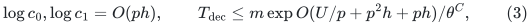

for an absolute constant `C`, preserving the refining partition, monotone cut-set, vertex-split, and self-loop interfaces of Theorem 4.7. The printed specialization has `p` of order `U^(1/3)` and `C=4` after its capacitated reduction.

The Sulser--Probst Gutenberg construction has fixed polynomial dependence on its witness-quality inverse. Its Theorem 4.1 transforms a `(phi,psi)` witness into one with parameters `(phi psi^6/32000, psi^4/800)` and charges work `O(h_pr |D|/(psi^2 phi))`, under `200 |Pi^-1(D)|/psi^2 < m`. Here `h_pr` is the pruning height, not our logarithm `h`. Appendices A.5--A.6 use fresh witness calls for new pieces; they do not repeatedly raise one witness's quality to a power along the entire recursion. Replacing `psi^-1` by `exp O(ph)` therefore preserves fixed-power losses.

**Precisely retained source import.** Use the full-lifetime refining, split, and self-loop wrapper of FO24 Theorem 4.8 and its Section 4.4 replacement argument. The PS24/25 printed main theorem alone is insufficient: its refinement guarantee applies only within an epoch before rebuilding. Equation (3) imports the FO24 wrapper with the same general witness parameter, rather than claiming the PS main theorem directly supplies the required interface. The two independent audits found fixed powers of `psi^-1` in the exposed pruning and fresh-piece accounting. A formal source-composition theorem should state this parameterized wrapper explicitly. Sections 2--5 then require no further new algorithmic hypothesis.

The separate [public-dual-uniform-wrapper-audit.md](public-dual-uniform-wrapper-audit.md) records the independent arbitrary-parameter check, including fake-edge singleton congestion, the absence of an inverse-conductance balance loss, and deterministic constant-factor flow extraction. It found no additional exponent obstruction. Equation (3) remains explicitly stated as a source-composition interface, rather than being attributed to a literal published four-fifths theorem.

## 2. Decremental tree-cut sparsifiers: quality is not work

Let

<!-- math-display: 918188fbe006c0c4e550e896
\theta=\exp(-s),\qquad s\geq 2\log(2c_1)+O(h).             \tag{4}
-->
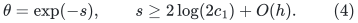

At each hierarchy level, total cut capacity shrinks by `2 c1 theta`. Thus, for polynomially bounded original capacities, the number of expander-hierarchy levels is

<!-- math-display: 2eaeae8678ef3910e0dc9563
k=O\!\left(\frac{U}{s-\log(2c_1)}+1\right)
   =O(U/s+1).                                              \tag{5}
-->
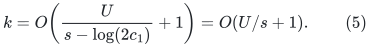

To avoid a normalization ambiguity, use expansion `theta/c0` and boundary factor

<!-- math-display: 4e93353096729514de0f18fe
\beta=2c_0c_1.
-->
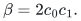

Then `beta (theta/c0)=2 c1 theta`, and the required boundary self-loop multiplier is `1/(4c1 theta)` when the boundary-link parameter is two. This is a safe explicit normalization of the parameters underlying Section 4.2. Absorbing `c0` into `beta` changes its logarithm by only `O(ph)`.

Theorem 4.15 bounds the tree-cut quality by

<!-- math-display: f79692e339b59a6451952291
Q_{\rm dec}\leq O((2\beta)^{O(k)}c_0/\theta).
-->
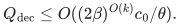

Therefore

<!-- math-display: 443f8761874c112496981480
\log Q_{\rm dec}
   =O\!\left(s+ph+\frac{Uph}{s}\right).                    \tag{6}
-->
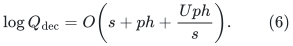

The construction and total maintenance work are instead

<!-- math-display: 00d8cf6a8bfc592188bcb494
T_{\rm dec-tree}
 \leq m\exp O(U/p+p^2h+ph+s),                              \tag{7}
-->
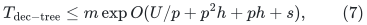

after absorbing the polynomial number of hierarchy levels and the fixed power of `theta^-1` into the exponent.

The **exported tree-edit count does not equal (7)**. By the source construction, the refining hierarchy has only `m poly(U)` cluster-node births, and its monotone tree capacities are rounded to powers of two. Every existing edge can therefore change capacity only `poly(U)` times. The exported tree has `m poly(U)` records and edits. This bound depends on the hierarchy depth and capacity bit range, not on the time spent finding a decomposition. It is the reason construction work need not be raised to the later batching depth.

The source's proof of Theorem 4.11 explicitly gives a tree of `~O(m)` vertices and `~O(m)` edge un-contractions and weight decreases. Keeping `k=poly(U)` preserves that combinatorial count. This is an essential interface, not a claim that all internal decomposition operations are cheap.

## 3. Fully dynamic batching multiplies quality, but adds the work exponent

Use an independent integer `L` for the fully dynamic batching depth of Section 4.3. A level rebuilds after `m_i` updates and has a core of `O(m_{i-1})` edges, where

<!-- math-display: d2ba313c1e861aa6499b4bef
m_{i-1}/m_i=\exp O(U/L).
-->
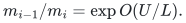

The source's Claim 4.22 charges one decremental initialization and lifetime to each such core period. Substituting (7), the total work is bounded by

<!-- math-display: 5c068412de03d05f6ced2bfd
m\exp O\!\left(U/L+U/p+p^2h+ph+s\right).                 \tag{8}
-->
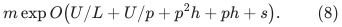

There is **no `L(U/p+p^2h)` term** in this charge. It would incorrectly propagate computation time as an exported edit count. The source's displayed computation is

<!-- math-display: dde8bc0fda48d8d8e0afbee0
m_{i-1} F_{\rm dec}\frac m{m_i}
   =m\,F_{\rm dec}\,\exp O(U/L)
-->
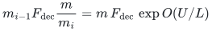

per level, followed by summing the polynomially many levels. The published paragraph contains a typo in one final value assigned to `L_max`; the literal preceding product is the expression relevant here.

The tree-cut quality does multiply over levels:

<!-- math-display: 81a6888c3b6deeb35840fae0
Q_{\rm full}\leq(C Q_{\rm dec})^{O(L)},\qquad
 \log Q_{\rm full}
  =O\!\left(Ls+Lph+\frac{LUph}{s}\right).                 \tag{9}
-->
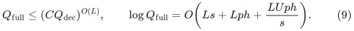

The directed layer graph for change detection has depth `L+1`, local branching `poly(U)`, and at most the same update volume as (8), times fixed polynomial factors. Its tree-cover enumeration therefore adds `exp O(Lh)`, already bounded by the `Lph` term for `p>=1`. The unchanged Section 5 data structure and Section 6 numerical reduction incur only fixed polynomial losses in the work, quality, and detection factors.

## 4. The four-fifths parameter choice

Choose, with harmless integer rounding and sufficiently large fixed constants,

<!-- math-display: bcc173e3e806691b20aaf299
t=(U/h)^{1/5},\qquad p=\Theta(t),\qquad L=\Theta(t),
 \qquad s=\Theta(t^3h).                                   \tag{10}
-->
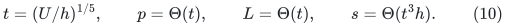

Then `U=Theta(t^5 h)` and the principal terms are

<!-- math-display: f058fbea83aa5fa11117a3d9
\begin{array}{c|c}
 \text{term}&\text{order}\\ \hline
 U/p& t^4h\\
 U/L& t^4h\\
 p^2h& t^2h\\
 s& t^3h\\
 Ls& t^4h\\
 LUph/s& t^4h\\
 Lph& t^2h.
 \end{array}
-->
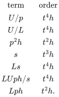

Condition (4) holds with ample slack because `s/(ph)=Theta(t^2)`. The decremental expander hierarchy has `k=O(t^2)` levels, so it is still polylogarithmic. Both (8) and (9), and the detection factor, fit

<!-- math-display: c73637a0fdab8c96abb1286b
\exp O(t^4h)
  =\exp O(U^{4/5}h^{1/5}).                               \tag{11}
-->
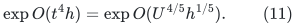

Notice that the decremental provider now deliberately spends more time than its own quality factor: its work exponent is `t^4h`, while its quality exponent is only `t^3h`. Optimizing the decremental provider in isolation would set these two exponents equal and recover the weaker final `5/6` specialization. The later fully dynamic client benefits from the unequal pair.

Small core graphs must use their actual size. Clip the local CGLNPS recursion parameter to its admissible range, with a constant-size base case, while retaining global upper envelopes in (1)--(3). When the local logarithmic size is below `O(p)`, the local `u/p_local` term is constant and the local quadratic term is at most `p^2h`. No master-sized graph needs to be allocated. Capacity replication in the capacitated reduction contributes the already paid `theta^-C` factor, and the returned partition/tree remains on actual graph vertices.

## 5. Why this is the optimum of these charged expressions

This is only an algebraic statement about the displayed model. If a logarithmic budget `A` pays (8)--(9), then

<!-- math-display: 23f666f9cbe52e7513ff3c85
p\gtrsim U/A,\qquad L\gtrsim U/A.
-->
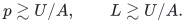

For every positive `s`,

<!-- math-display: 361907064c380a96744ef630
s+Uph/s\geq 2\sqrt{Uph}.
-->
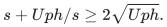

Consequently

<!-- math-display: 586c9faaf4258effff9c6222
A\gtrsim L\sqrt{Uph}
   \gtrsim \frac U A\sqrt{\frac{U^2h}{A}}
   =\frac{U^2\sqrt h}{A^{3/2}}.
-->
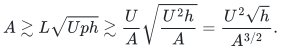

Thus

<!-- math-display: 6e66eaf9b0a98f15678d91e7
A^5\gtrsim U^4h,
-->
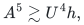

matching (11). Improving only the `p^2h` work term to `ph` does not improve this balance. Improving the static output-quality tradeoff, the fully dynamic quality composition, or its rebuild accounting would be a different mechanism.

## 6. Consequences and attribution

Conditional on the uniform source interface (3), the public dual framework supports deterministic

<!-- math-display: 7bef3876370595377a540474
(m+Q)\exp O((\log m)^{4/5}(\log\log m)^{1/5})
-->
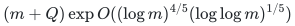

fully dynamic tree-cut maintenance and the same logarithmic overhead for its min-ratio-cut and decremental threshold-flow consequences, under their original numeric and update-model assumptions. Static exact minimum-cost flow is included. The literal published statements remain `5/6`; the `4/5` expression here is a reoptimized consequence, not a quotation of a published theorem.

For baseline comparison, there are therefore three distinct claims:

* the explicit published deterministic static-flow theorem: `5/6`;
* the public-method reoptimization identified in this audit: candidate `4/5` pending the uniform decomposition check;
* the new raw-cycle/moving-box client: a different `4/5` proof route, with additional applicability to incremental threshold maintenance on its proved backend branch.

The new flow client remains a substantive technical transfer even if the second item closes. Its static exponent alone would then not be a separation from everything already obtainable by reparameterizing public constructions. A checkpoint should say this plainly and use the incremental application, another genuinely sharper exponent, or an improved structural interface as its main second-problem progress.
