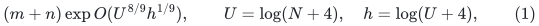
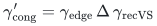
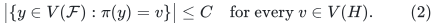
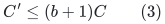
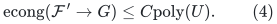
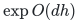
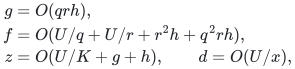
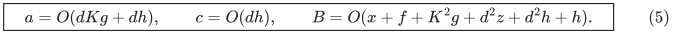
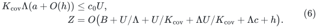
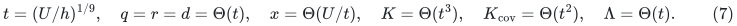

# Direct vertex inventory in the public core-forest lift

**Independent source reconstruction, 25 October 2026.**

This note sharpens the accounting of the existing public construction
in KMG, without using compressed Steiner cores, a colored path pool,
degree reset, or a new static provider. It proves that the original
Algorithm 5 can propagate an explicit **vertex occurrence capacity**
with only a polynomial logarithmic multiplier. Its selected graph can
still have large degree, and its update work retains the previously
audited degree factors.

The resulting derived public strong-forest bound is

<!-- math-display: a99a7c6e434327f17628b06d
(m+n)\exp O(U^{8/9}h^{1/9}),\qquad
 U=\log(N+4),\quad h=\log(U+4),                            \tag{1}
-->

under the public-provider and outer-wrapper interfaces already audited
in this checkpoint. This is a new analysis of public constructions,
not a claim that (1) is a theorem printed in the source or an optimum
over all public algorithms.

## 1. Primary source and the unnecessary degree conversion

The primary source is [KMG, arXiv:2311.06402v1](https://arxiv.org/pdf/2311.06402v1), Lemma 3.21, Definition 3.22,
Algorithm 5, and the accompanying proof on pages 30--32.

Let <code class="math">G</code> be the current native graph and <code class="math">H</code> its public selected
core graph. Let <code class="math">F_1,\ldots,F_b</code> be the stable native forests,
where <code class="math">b=\mathrm{poly}(U)</code>. The source uses an incoming
flat forest <code class="math">\mathcal F</code> embedded in <code class="math">H</code>. It allocates

<!-- math-display: 55b839e29058139db2f4f858
\gamma'_{\rm cong}
   =\gamma_{\rm edge}\,\Delta\,\gamma_{\rm recVS}
-->

copies of each rooted direct-sum tree. The paragraph before Algorithm
5 explicitly explains this choice: edge congestion multiplied by
maximum degree bounds the number of incoming forest nodes at one
vertex of <code class="math">H</code>. No later structural step needs that particular
product. It only needs enough distinct slots for those incoming
nodes.

Instead assume and maintain the direct invariant

<!-- math-display: 470005b8d83e0133af5dd908
\bigl|\{y\in V(\mathcal F):\pi(y)=v\}\bigr|\le C
 \quad\text{for every }v\in V(H).                         \tag{2}
-->

Every living input node counts in (2), including isolated designated
nodes and unused nodes in a previously lifted forest. Consequently
there is no inference of a node bound from edge congestion and no
exception for isolated nodes. An arbitrary external forest must
supply this bound; the recursively constructed native forests start
with one node per native vertex, so the hierarchy does supply it.

## 2. The existing construction with C slots

For a physical root <code class="math">v</code>, let <code class="math">T_v</code> be the direct sum of all
components of the <code class="math">F_i</code> rooted at <code class="math">v</code>, identifying their root
aliases as in Definition 3.22. For a retained isolated child root
with no nontrivial component, use a singleton. Allocate exactly
<code class="math">C</code> copies <code class="math">T_{v,j}</code>, <code class="math">1\le j\le C</code>.

Assign each input node at <code class="math">v</code> a distinct slot <code class="math">j</code>. A surviving
designated input node keeps its slot and its root-node identifier.
Each input edge is processed exactly as in Algorithm 5: retain its
selected core provenance, take the literal native edge corresponding
to that core edge, and connect the corresponding endpoint in the
first assigned root-tree copy to the endpoint in the second copy.

The collection of root-tree copies is initially disjoint. Replacing
each node of the forest <code class="math">\mathcal F</code> by its assigned tree, and
each input edge by its projected physical edge, gives a forest.
Unused copies remain additional disjoint forest components. Between
two assigned root nodes, the root-leg/native-edge/root-leg route has
length at most the stored core-edge length. The source metric proof
therefore applies unchanged.

### Parallel edges and selected ownership

Native parallel edges have distinct physical edge identities. For a
fixed identity <code class="math">e</code> and fixed core <code class="math">i</code>, the core graph contains
at most one corresponding edge identity. The public selected graph
is a subgraph of that core union; its fully dynamic repair layers
select an identity rather than manufacture additional native edges.
Repeated internal ownership can be represented by a reference count.
Equivalently, retaining a polynomial number of explicitly indexed
bucket or core aliases only changes the polynomial below.

Thus one physical edge has at most <code class="math">b_0=\mathrm{poly}(U)</code>
living selected aliases. This statement does not bound the number of
*different* native edges incident to a high-degree root by a constant.
It does not require such a bound.

For any fixed nonloop child edge identity <code class="math">uv</code>, all incoming
occurrences have endpoints among at most <code class="math">C</code> nodes mapped to
<code class="math">u</code> and <code class="math">C</code> nodes mapped to <code class="math">v</code>. They form a subgraph of
the forest <code class="math">\mathcal F</code>, so there are at most <code class="math">2C-1</code> such
occurrences. This remains true with parallel physical edges: two
parallel occurrences joining the same pair of input nodes would
already be a cycle in the input multigraph forest. Core loops are
discarded as in the positive-length selected interface.

The projected physical edges consequently have edge congestion at
most <code class="math">(2C-1)b_0</code>. No independent incoming edge-congestion
parameter is needed once (2) is available.

## 3. All simultaneous vertices and edges are counted

Fix a physical vertex <code class="math">x\in V(G)</code>. In any one native forest
<code class="math">F_i</code>, it belongs to exactly one component and hence to exactly
one rooted tree contributing to the collection <code class="math">\{T_v\}_v</code>.
It has one copy in each of the <code class="math">C</code> slots of that component.
Summing over all cores gives at most <code class="math">bC</code> occurrences. Identifying
root aliases can only reduce this number. Any explicit singleton
root convention adds at most <code class="math">C</code> occurrences for the physical
vertex, rather than an amount depending on its degree.

Projected edges introduce no new nodes. Thus the output forest has

<!-- math-display: 934194174d9689b42b343f2f
C'\le (b+1)C                                              \tag{3}
-->

nodes at each physical vertex, including all unused copies and all
isolated nodes. The forest-copy edges have at most <code class="math">bC</code> copies
of each native edge. Together with the projected-edge calculation,

<!-- math-display: 57d76633fa8eb5d84674c7af
\mathrm{econg}(\mathcal F'\to G)
       \le C\mathrm{poly}(U).                       \tag{4}
-->

There is no selected-degree factor in (3) or (4). A large degree
increases the number of incidences of a copied root, not the number
of copies of that root.

## 4. Stable roots, cuts, and full rebuilds

Use one fixed slot capacity for an entire private period. The
identifier and transaction rules are the public ones completed in
[public-strong-forest-marks-anchor-focused-audit.md](public-strong-forest-marks-anchor-focused-audit.md), Sections 2--5.
For clarity, the essential cut argument is repeated here.

Suppose a native core-tree cut detaches a piece from root <code class="math">v</code>
and gives it a new root <code class="math">u</code>. First remove the projected input
incidences whose selected core endpoint changes. These changes are
in the actual child edit transcript, because each incidence retains
its core provenance. The detached copy in slot <code class="math">j</code> now has no
remaining attachment to an input node assigned to the old root and
no designated mark of that old node. Its root can be identified with
the slot-<code class="math">j</code> root of <code class="math">T_u</code>, retaining the existing designated
root identifier when present. Then insert the new input incidences.

No full tree is newly copied at this cut: the copies of the detached
piece already exist. The operation merely cuts physical forest
edges, joins equal-image root aliases, and updates the reported
projected incidences. The detached piece has no surviving projected
attachment when it is joined, so the join cannot create a cycle or
merge two distinct designated input nodes. The settled state is
again precisely Algorithm 5 with <code class="math">C</code> slots.

Root-alias joins can require <code class="math">C\mathrm{poly}(\Delta,U)</code>
work and actual incident-edge edits. This is a work charge, not an
increase in the simultaneous occurrence bound (3). Core provenance
and cuts-before-reinsertions are required; ignoring the input edit
transcript would not justify a stable-map claim.

Private retained ghosts keep their native identity within their
period. A rebuild retires its private copies and publishes new copies
using the old identifiers for surviving designated root terminals.
The full old and new inventories are paid. The final original
canonical identifiers persist throughout. This is the existing
copy-and-identify construction, with no typed-null edge or permanent
port gadget.

## 5. Recursion: small occurrence, unchanged conservative work

Each native nearest-pivot forest and each exact base shortest-path
forest has one node at every native vertex, including its isolated
vertices. Lift each family and perform the source's prescribed root
joins. Those joins identify nodes and cannot increase node inventory.
The union of at most <code class="math">d+1</code> lifted native families therefore has

<!-- math-display: 0e717eaceaae2b591945ba3b
\exp O(dh)
-->

vertex and edge occurrences per root native vertex. Equivalently,
an induction of the form <code class="math">C_{j+1}\le Q(C_j+1)</code> with
<code class="math">Q=\mathrm{poly}(U)</code> yields the same bound. This is
valid for the **unreset** public hierarchy: a child native vertex
is a single physical root identifier in its parent graph. It is not
a claim that an arbitrary high-degree port expansion has this
property. That different interface is addressed by the new
uncontract-and-compress construction elsewhere.

The selected graph degree can still grow as <code class="math">P^{O(j)}</code> at
level <code class="math">j</code>, and converting splits into explicit child edits still
costs its degree. Keep all those already audited charges. With

<!-- math-display: 946c4ae9ce4b8f88a829c632
\begin{aligned}
 g&=O(qrh),\\
 f&=O(U/q+U/r+r^2h+q^2rh),\\
 z&=O(U/K+g+h),\qquad d=O(U/x),
 \end{aligned}
-->

the safe public envelopes become

<!-- math-display: c13241c0a9bae3f09564b8b0
\boxed{\quad
 a=O(dKg+dh),\qquad c=O(dh),\qquad
 B=O(x+f+K^2g+d^2z+d^2h+h).
 \quad}                                                    \tag{5}
-->

The added <code class="math">d^2h</code> permits even a conservative product of all
copy factors while forwarding work. Since <code class="math">z\ge h</code>, it may
also be absorbed in <code class="math">d^2z</code>. The improvement is to <code class="math">c</code>;
this note does not silently replace the public <code class="math">d^2z</code> work
by <code class="math">dz</code>.

## 6. Public strong-forest 8/9 parameter point

The public outer copy accounting, independently checked in
[strong-forest-mechanism-comparison.md](strong-forest-mechanism-comparison.md), uses

<!-- math-display: 287108fbd3c74ee4b7974013
\begin{aligned}
 K_{\rm cov}\Lambda(a+O(h))&\le c_0U,\\
 Z&=O\bigl(B+U/\Lambda+U/K_{\rm cov}
              +\Lambda U/K_{\rm cov}+\Lambda c+h\bigr).
\end{aligned}
\tag{6}
-->

The local forest's explicit recourse is included in <code class="math">B</code> once;
the outer copy inventory uses <code class="math">c</code>, not that whole work bound.
Take

<!-- math-display: fb4e7f465d131378b789c96c
t=(U/h)^{1/9},\quad q=r=d=\Theta(t),\quad
 x=\Theta(U/t),\quad K=\Theta(t^3),\quad
 K_{\rm cov}=\Theta(t^2),\quad\Lambda=\Theta(t).             \tag{7}
-->

Writing <code class="math">U=t^9h</code> gives the following charged quantities.

| Quantity | Logarithmic order |
|---|---:|
| <code class="math">g</code> | <code class="math">t^2h</code> |
| <code class="math">f</code> | <code class="math">t^8h</code> |
| <code class="math">z</code> | <code class="math">t^6h</code> |
| <code class="math">K^2g</code> | <code class="math">t^8h</code> |
| <code class="math">d^2z</code> | <code class="math">t^8h</code> |
| <code class="math">a</code> | <code class="math">t^6h</code> |
| <code class="math">c</code> | <code class="math">th</code> |
| <code class="math">B</code> | <code class="math">t^8h</code> |
| <code class="math">K_{\rm cov}\Lambda(a+O(h))</code> | <code class="math">t^9h</code> |
| <code class="math">U/\Lambda</code>, <code class="math">\Lambda U/K_{\rm cov}</code> | <code class="math">t^8h</code> |
| <code class="math">\Lambda c</code> | <code class="math">t^2h</code> |

Choose fixed constants in the cover parameters so the first line of
(6) holds. Their effect on all work bounds is only a fixed factor in
the exponent. The public provider's small-instance cutoff
<code class="math">q^2rh=O(t^3h)</code> is below the nonbase size scale
<code class="math">x=\Theta(t^8h)</code>. Initialization credit, fixed maps, and the
forced-anchor metric completion are the same previously audited
interfaces. Equations (5)--(7) prove (1).

## 7. What this comparison changes

The earlier public <code class="math">10/11</code> reconstruction is valid but weaker.
Its factor <code class="math">c=d^2z</code> arose from using the printed edge-to-vertex
congestion conversion at every level. The source itself states why
that conversion is used; maintaining the direct node inventory
removes it without changing the copy construction.

The new colored-pool proposal must therefore be compared with this
<code class="math">8/9</code> public baseline, not just the printed <code class="math">83/84</code>, the
common-factor <code class="math">26/27</code>, or the intermediate <code class="math">10/11</code> bound.
Its substantive additional interface is a compressed, low-overlap
child graph that also controls recursive native degrees and port
aliases. The direct public node count does not by itself establish
that new interface or its candidate <code class="math">6/7</code> application.
