# Joint public retuning for the strong forest: a conservative source audit

**Research audit, 25 October 2026. Status: source-interface completion
in Sections 3--5 passed the focused independent audit and root review.**

This note continues [public-apsp-joint-retuning-audit.md](public-apsp-joint-retuning-audit.md). It asks what
the same public static provider gives when used in the original KMG
low-diameter forest hierarchy and its original common-factor outer
analysis. The calculation gives the derived point

<!-- math-display: e323738be2069b4db3afd542
\boxed{(m+n)\exp O(U^{26/27}h^{1/27})},
 \qquad U=\log_2(N+4),\quad h=\lceil\log_2(U+4)\rceil.       \tag{S1}
-->
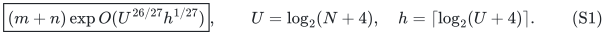

The resulting research reconstruction is a deterministic strong decremental
<code class="math">(1+\varepsilon)</code>-SSSP forest, with explicit flat forest, stable
canonical vertex images, bounded original-edge congestion, and total
maintenance work (S1), for positive polynomially bounded integer
lengths and constant or inverse-polylogarithmic requested accuracy.
The existing Gomory--Hu application inherits this factor through its
separately proved adapter; this note does not reopen its separate
fixed-guide-tree correctness and size accounting.

The point is a **derived public-framework baseline**, not a printed
theorem. It uses neither the new sequential routing primitive nor the
new length-free ambient repair recurrence. It retains the old
quadratic-in-repair-depth work loss and the old quadratic-in-hierarchy-
depth forest accounting. Sections 3--5 explicitly address two places
where substituting symbols into the printed KMG headline statements is
insufficient.

The focused proof is [public-strong-forest-marks-anchor-focused-audit.md](public-strong-forest-marks-anchor-focused-audit.md).
It verifies fixed terminal identifiers through splits, joins and full
rebuilds, and the anchor proof on the active connected canonical set.
The exact private base is a spanning forest, and no unproved leaf-image
property is imported. This improves the earlier outer-only <code class="math">62/63</code>
comparison. The still stronger separated public comparison appears in
[strong-forest-mechanism-comparison.md](strong-forest-mechanism-comparison.md). No immutable checkpoint
archive is changed by these notes.

## 1. Primary sources and exact locations

The local parameterized static provider is the one proved in
[public-apsp-joint-retuning-audit.md](public-apsp-joint-retuning-audit.md), Sections 1--4, using these primary
sources:

* CGLNPS20, [arXiv:1910.08025v2](https://arxiv.org/html/1910.08025v2),
  Theorems 1.6, 2.4, 5.1 and 5.5.
* CS21, [arXiv:2009.08479v1](https://arxiv.org/html/2009.08479v1),
  Section 3.2, Lemmas 3.10--3.11, and Theorem B.9.
* vdB et al.23,
  [arXiv:2309.16629v1](https://arxiv.org/html/2309.16629v1),
  Theorems 8.1--8.6, Algorithm 4, and Appendix B.
* CKL et al.22,
  [arXiv:2203.00671v1](https://arxiv.org/pdf/2203.00671v1),
  Section 5.1, Claims 5.7--5.8, Lemma 5.9, and Lemma 6.5 with its
  Appendix B.3 proof.

The strong hierarchy and outer construction are KMG23,
[arXiv:2311.06402v1](https://arxiv.org/pdf/2311.06402v1).
The relevant printed pages are:

| Printed page | Source location | Use here |
|---|---|---|
| 15 | Theorem 3.1 | The stated local contract; its parameter range is not silently extended |
| 17--18 | Lemma 3.5 and core construction | Monotone stable forests and fixed physical root identities |
| 19--21 | Theorem 3.7, Algorithms 2--4 | Public repair, selected-degree feedback, and split emulation |
| 26--29 | Claims 3.17--3.18 and proof of Theorem 3.1 | Separate maximum-degree and elementary-edit bounds |
| 30--32 | Lemma 3.21 and Algorithm 5 | Flat forest lifting; stable maps and per-level copies |
| 33--36 | Algorithm 6 and Claim 4.6 | Query and hierarchy/rebuild inventory |
| 39--41 | Theorem 4.9, Claim 4.10 | Common-factor low-diameter forest construction |
| 42 onward | Theorem 4.12 and Section 5 | Forced terminals, sparse covers, hopsets, and flattening |

The table above identifies the primary theorem, algorithm and page locations used by the reconstruction.

The degree/edit distinction and conservative local copy charging are separate requirements of the strong-forest composition.

## 2. Public local parameters, kept separate

Let <code class="math">r</code> be the cut-player parameter, <code class="math">q\ge2</code> the CS21 path-hierarchy
parameter, and <code class="math">K</code> the public dynamic repair depth. The provider audit
establishes the conservative envelopes

<!-- math-display: 98cddb0c6e4a5f9b23bb03ff
g:=\log\Gamma=O(qrh),\qquad
 f:=\log F=O(U/q+U/r+r^2h+q^2rh).                         \tag{S2}
-->
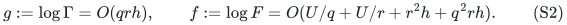

The <code class="math">q^2rh</code> term pays the direct implementation on local components
too small for the growing-<code class="math">q</code> hierarchy; it is construction work and
does not enlarge <code class="math">\Gamma</code>. The provider includes loopless degree
bands, weighted port witnesses, explicit generation retirement at the
pruning quota, actual-size small-instance treatment, and work-budget
rescaling in the deamortization. Those details and their independent
audit are imported in full.

The old public ambient interface retains its ambient-length factor.
Its repair recurrence therefore has length inflation
<code class="math">\Gamma^{O(K)}</code>, but ambient congestion and maintenance work can
contain <code class="math">\Gamma^{O(K^2)}</code>. Define a sufficiently large common
selected-record factor

<!-- math-display: dab0db399e375b629120bc28
P=\exp O(U/K+g+h).                                      \tag{S3}
-->
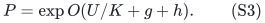

The factor <code class="math">F</code> is paid once as a construction/maintenance factor; it
does not enter selected-record recourse or the degree threshold. The
public APSP source audit proves this distinction before any numerical
parameter substitution.

## 3. The degree discrepancy does not require a stronger theorem

There is a literal mismatch worth recording. The printed Theorem 3.1
chooses <code class="math">\gamma_{\rm recVS}=\widetilde O(m^{4/K}\gamma_\ell^4)</code>
independently of <code class="math">\Delta</code>, and puts a factor <code class="math">\Delta</code> outside it.
The proof on printed page 29 instead multiplies the number of
forwarded vertex splits by the maximum selected degree and writes a
choice <code class="math">\widetilde O(\Delta^2m^{4/K}\gamma_\ell^4)</code>.

The present derivation does not resolve that mismatch by assuming the
stronger displayed recourse bound. It keeps the two actual estimates
from Claim 3.18 and the explicit split simulation separate:

<!-- math-display: 4b73d013b841fd02467c7f8e
\begin{array}{rcl}
 \text{maximum selected degree}&\le&\Delta P,\\
 \text{changes to stable cores and split-inclusive selected graph}
       &\le&\Delta P,\\
 \text{elementary child edits after split emulation}
       &\le&\Delta^2P^2.
 \end{array}                                               \tag{S4}
-->
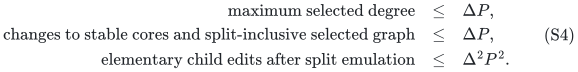

Polylogarithmic factors are included in <code class="math">P</code>. Multiplication by
<code class="math">\Delta P</code> is used only to encode the split into edge and isolated
vertex edits. It does not change the already established actual
maximum degree of the settled selected graph. Identifying the
<code class="math">O(\log N)</code> core aliases of one physical vertex increases maximum
degree by that polylogarithmic factor, also included in <code class="math">P</code>.

For the input to the repair structure, a core component may have
<code class="math">k\Delta</code>, rather than <code class="math">k</code>, incident edges. We conservatively pay
the resulting fixed polynomial in <code class="math">\Delta</code> in local work. No
<code class="math">\Delta</code>-independent degree assertion is needed for that internal
graph.

Likewise, no high-degree bound of <code class="math">O(k)</code> is assumed for the total
number of vertices in a nearest-pivot tree. A pivot can have
<code class="math">\Delta</code> incident branches, each controlled by a strict inverse
cluster; the safe component bound contains <code class="math">\Delta</code>. An individual
pivot leg still contains <code class="math">O(k\mathrm{poly}U)</code> vertices because
all its vertices except its pivot lie in the source's strict ball.
The native nearest-pivot forest has edge congestion one regardless of
its component size. All local scans are allowed a fixed polynomial in
<code class="math">k,\Delta,U</code>, already covered by the envelope used here.

Let <code class="math">d</code> be the number of vertex-reduction hierarchy levels, and let
the root input have degree at most a fixed constant. Then (S4) gives

<!-- math-display: 10f27e89e6c22d323b47e746
\Delta_i\le3P^i,\qquad
 \prod_{j<i}\Delta_j^2P^2=P^{O(i^2)}.                      \tag{S5}
-->
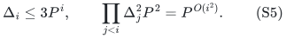

Thus the conservative split-emulation cost still gives a quadratic
depth loss in the logarithm. It does not produce a recurrence such as
<code class="math">\Delta_{i+1}=\Delta_i^2P^2</code>: that would incorrectly substitute an
edit-count bound for the distinct maximum-degree bound.

Initialization outputs <code class="math">O(m\Gamma/k)</code> selected records, with isolated
marked terminals retained separately. Even replacing this by
<code class="math">m\Delta^2P^2/k</code> is sufficient for the hierarchy inventory. The
parent-clock rebuild calculation in KMG Claim 4.6 then has both
current size and edit transcript bounded by its usual size reduction
times <code class="math">P^{O(i^2)}</code>. All initialization transcripts are counted; the
bound is not restricted to edits after initialization.

Only an amortized total-work result is needed. Rebuilds and the full
flat forest can be replaced at the scheduled rebuild boundary. The
static repair may use the work-budget rescaling of the preceding
provider audit, while this global forest hierarchy need not obtain a
new worst-case output guarantee.

## 4. Conservative flat lifting and fixed maps

KMG Lemma 3.21 is a local combinatorial construction. For each native
physical root it takes copies of the direct sum of the stable core
trees rooted there. Each vertex of the input flat forest is assigned
its own copy, and each forest edge is replaced by its physical
preimage edge between the corresponding copies. The length of the
replacement path between marked vertices is bounded by the length of
the input forest path. This argument uses the fixed core stretch
labels, not a bound on the static construction time <code class="math">F</code>.

For a safe reanalysis, let <code class="math">C</code> bound the input forest's edge and
node occurrence multiplicities. Let <code class="math">R</code> be its explicit edit count
per parent edit. All factors in one lift can be upper-bounded by

<!-- math-display: 8e83e75ed700c37a5ad4a8f8
C'\le C(\Delta P)^{c_0},\qquad
 R'\le (R+C+1)(\Delta P)^{c_0},                           \tag{S6}
-->
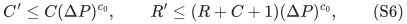

for an absolute constant <code class="math">c_0</code>. This intentionally overpays the
published sharper formulas. There are at most <code class="math">\Delta P</code> stable
forest or split-inclusive selected-record changes by (S4); the
available copies per physical vertex are linear in <code class="math">C+1</code> and a
fixed polynomial in <code class="math">\Delta P</code>; and merging equal root aliases costs a further fixed
polynomial in the parent degree. Input forest edits are processed once
in their assigned copies.

In particular, initialization pays for all those copies. We do not
reuse the abbreviated printed initialization bound
<code class="math">\widetilde O(m\gamma_{\rm congRep})</code> while omitting its displayed
copy-capacity factor. A safe bound is the actual parent inventory
times <code class="math">(C+1)(\Delta P)^{O(1)}</code>. All subsequent recurrences remain
linear in <code class="math">C+1</code>, which is essential: raising the previous level's
entire copy count to a fixed power at each new level would not give
the stated quadratic-depth logarithmic bound.

One can keep node occurrence explicit without assuming that edge
congestion bounds arbitrary isolated copies. Remove unmarked isolated
nodes from the exposed forest; keep the one marked canonical node for
each element of the input terminal set. In this unreset public
hierarchy, <code class="math">V(G_{i+1})\subseteq V(G_i)</code>: terminal identities are
actual parent vertices, not multiple port terminals with the same
physical image. Each fixed physical vertex consequently contributes
at most one marked isolated node to a single lifted input forest.
Every other exposed node has incident forest edges and is charged to
edge congestion times parent degree. Retiring and recreating an
unmarked node preserves its physical image throughout its own
lifetime and causes only constant additional edits per affected edge.

Assignments of marked input forest nodes to core-tree copies remain
fixed while those nodes live, exactly as in Algorithm 5. A disappearing
core edge only cuts copies; it never changes the physical image of a
node. The local output therefore retains the fixed-map contract.

The source lemma formulates its terminal set as monotonically growing.
To respect that interface inside a period, an internally retired
isolated terminal is kept as a private isolated mark until that period
is rebuilt. Its name is not reused. These marks are counted among the
initial records plus the actual vertex births in the period, already
present in (S5); they are not free historical padding. At a rebuild the
old private lifted families are retired together. The eventual strong
SSSP client has a fixed original vertex set, so its permanent root
canonical marks are retained through these private replacements.

For a core split, process deleted or re-endpointed input-forest edges
before joining the copies rooted at its newly exposed physical root;
then process the final input-forest insertions. Every projected edge
incident to a detached core piece changes its child endpoint and is
included in that batch. Thus the final structure is precisely
Algorithm 5 applied to the current child forest, while each surviving
marked child node retains its assigned copy root. Joining two aliases
of a physical root retains its pre-existing marked copy root if one
exists. No two distinct marked child nodes may occupy the same copy
slot for the same physical root.

Iterating (S6) down the hierarchy, with <code class="math">\Delta_i\le3P^i</code>, gives
<code class="math">\exp O(d^2\log P)</code> congestion and lift-edit multiplication.
Nearest-pivot forest changes and the exact base shortest-path trees
contribute a fixed polynomial in <code class="math">k</code> in the work envelope. There are
only <code class="math">d+1</code> such lifted forests, so their union adds a polynomial in
<code class="math">U</code>, not an additional exponential depth factor.

At the root the original graph has bounded degree. When the nested
lifted nearest-pivot forests are joined at corresponding pivot marks,
retain the root graph's marked canonical node whenever an equal-image
component contains it. Its physical image is unique. A split retains
that mark in its own component. The equal-image occurrence inventory
and bounded root degree give a fixed polynomial in the above common
factor for each join change. This is the bounded-degree merging
accounting already used in the proof of KMG Claim 4.10, with the
canonical survivor stated explicitly. Initially unreachable original
vertices retain their isolated canonical nodes.

## 5. Anchored diameter proof, avoiding an all-Steiner stretch claim

The upper metric guarantee of KMG Theorem 3.1 applies to its logical
pivots <code class="math">A</code>, not to all extra core roots in <code class="math">V(H)</code>. We therefore do
not use the sentence in Claim 4.10 that implicitly treats all vertices
of every recursive graph as uniformly distance-preserving relative
to the root graph.

Instead, choose one current root-graph vertex <code class="math">a</code>, and force it into
every logical pivot set. This operation is supplied by the public
construction: augment the initial `Center` output by <code class="math">a</code>, and add
<code class="math">a</code> to the initial root set <code class="math">S</code> of Lemma 3.5. The source's
remarks explicitly provide that initial rooting interface. All
endpoints of a later update are likewise promoted to pivots and
stable-forest roots. The tiny-edge trick in KMG Theorem 4.12 is an
alternative source mechanism, but the present construction uses the
direct initial-center/root-set interface. Promotion must actually
reach those routines; a front-end loop filter is not used as a
substitute. One extra initial pivot per hierarchy level and
<code class="math">O(d)</code> promotions when the current anchor is replaced are absorbed
in the existing initialization and edit bounds.

No artificial connection to another graph vertex is retained. Thus
promotion changes neither the metric nor the current connectivity.
Whenever a level rebuilds, the same live anchor is promoted before
the rebuilt level is published. If an isolated anchor is removed,
choose another current root vertex; that choice and its <code class="math">O(d)</code>
promotions are charged to the vertex-deletion operation.

Write <code class="math">\rho=\Gamma^{O(K)}\mathrm{poly}U</code>. Suppose the current
root graph is connected and has diameter <code class="math">D</code>. For a root vertex
<code class="math">v</code>, let <code class="math">v_0=v</code> and <code class="math">v_{i+1}=p_{i+1}(v_i)</code>. Because the anchor
is in the pivot set at level <code class="math">i</code>,

<!-- math-display: 80ae5976bbbdabd5c330ea63
d_i(v_i,v_{i+1})\le d_i(v_i,a),\qquad
 d_{i+1}(v_{i+1},a)
   \le\rho\,d_i(v_{i+1},a)
   \le2\rho\,d_i(v_i,a).                                 \tag{S7}
-->
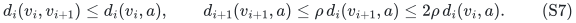

The middle inequality applies only to the two pivots
<code class="math">v_{i+1},a</code>, as permitted by the source contract. Induction gives
<code class="math">d_i(v_i,a)\le(2\rho)^iD</code>. Maintain an exact shortest-path
**spanning forest** at the base: root the component containing
<code class="math">a</code> at <code class="math">a</code>, and use an arbitrary root in each other component.
Private isolated ghosts can make this base disconnected even when
the relevant original graph is connected. All chains starting at
the original vertices under the finite-diameter obligation reach
the anchor component by (S7). The path from the root canonical image of <code class="math">v</code> to the
anchor in the assembled hierarchy is the concatenation of these
nearest-pivot legs and the final base path, so its length is at most

<!-- math-display: 2b85bbd79570747f54c65cb4
D\sum_{i=0}^{d}(2\rho)^i
       \le D\exp O(dKg+dh).                              \tag{S8}
-->
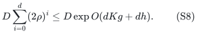

Flat lifting does not increase this length. Two root canonical
vertices have a path through the anchor of at most twice (S8).
Uncontrolled extra Steiner vertices do not enter that proof.

If the root graph is disconnected, its all-vertex diameter is
infinite and the low-diameter guarantee imposes no finite
all-component upper bound. Canonical nodes are still maintained.
Small components lacking a sampled pivot are handled directly in the
usual actual-size base case. Whenever a graph supplied to the sparse
cover has a finite diameter requirement, all vertices in that
requirement belong to its connected instance and the preceding
anchor argument applies.

This is an explicit completion of the public proof, not an automatic
all-pairs guarantee for the extra roots.

We do not use Claim 4.10's additional sentence saying that every
canonical image is a leaf. A level-zero canonical node can have
several incident nearest-pivot forest edges. The sparse-cover and
hopset flattening interfaces need its fixed identity, flat embedding,
and distance guarantee; they do not require this node to have degree
one. The strong forest contract used here therefore makes no such
leaf assertion.

## 6. The common-factor low-diameter envelope

Let <code class="math">k=2^x</code> and <code class="math">d=O(U/x)</code>, using the ordinary rebuild schedule
and exact actual-size base case. Sections 2--5 give the conservative
common logarithmic envelope

<!-- math-display: 7b11e32b464c0e86dabcc14d
B_0=O\left(x+f+K^2g+d^2(U/K+g+h)+h\right).               \tag{S9}
-->
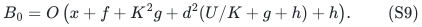

This bounds initialization/maintenance work, flat forest congestion,
explicit recourse and diameter inflation. The more precise metric
exponent in (S8) is <code class="math">O(dKg+dh)</code>, but we deliberately absorb it into
the common factor whenever the parameters below are used. The
numerical APSP and marked-diameter operations required by the cover
have no larger common envelope: stored exact ball/base distances
give polylogarithmic distance queries, and the marked-diameter
query can be recomputed after each edit at the charged
<code class="math">k\mathrm{poly}U</code> cost as in KMG Claim 4.8.

Choose rounded parameters

<!-- math-display: 333fe772becddd293634bc5c
t=(U/h)^{1/9},\quad q=r=\Theta(t),\quad K=\Theta(t^3),
 \quad x=\Theta(U/t),\quad d=O(t).                        \tag{S10}
-->
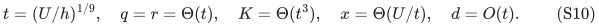

Then <code class="math">g=O(t^2h)</code>, <code class="math">f=O(U/t+t^3h)</code>, and

<!-- math-display: 79306539157001ff74841df6
K^2g=O(t^8h),\qquad d^2U/K=O(t^8h),\qquad U/t=t^8h.
-->
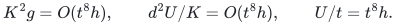

Also <code class="math">d^2g=O(t^4h)</code>, and the metric exponent
<code class="math">dKg=O(t^6h)</code> is smaller. Hence

<!-- math-display: ee1ef3646a46853df0e73b9c
B_0=O(U^{8/9}h^{1/9}).                    \tag{S11}
-->
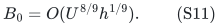

The small-instance cutoff <code class="math">q^2rh=O(t^3h)=o(U)</code> from the provider
audit is satisfied. The repair depth is not justified by the printed
old <code class="math">K=o(U^{1/6}/h)</code> domain; instead the source repair recurrence is
rederived as in the provider audit. All correctness conditions are
uniform and the actual resulting work factor <code class="math">K^2g</code> is sublinear
in <code class="math">U</code>.

For orientation, within (S9) the balancing exponent <code class="math">8/9</code> is forced
by its displayed terms. If all logarithmic costs are at most <code class="math">A</code>,
then <code class="math">q,r,d\gtrsim U/A</code>, so <code class="math">g\gtrsim U^2h/A^2</code>.
The terms <code class="math">K^2g</code> and <code class="math">d^2U/K</code> imply
<code class="math">K\lesssim A^{3/2}/(U\sqrt h)</code> and
<code class="math">K\gtrsim U^3/A^3</code>, respectively. Thus <code class="math">A^9\gtrsim U^8h</code>.
This is an algebraic limitation of this conservative envelope, not a
lower bound for dynamic forests or shortest paths.

## 7. Original common-factor outer construction

This section is exactly the outer retuning already proved in
[public-strong-forest-retuning-baseline.md](public-strong-forest-retuning-baseline.md), now with the candidate
common factor (S11). Put <code class="math">A=C B_0</code>. The public cover parameter
<code class="math">K_{\rm cov}</code> and hopset depth <code class="math">\Lambda</code> need

<!-- math-display: 59400495a79d9a797d93cabd
K_{\rm cov}\Lambda(A+O(h))\le cU.
-->
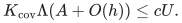

The cover overlap has log <code class="math">O(U/K_{\rm cov}+h)</code>, and KMG Claim
5.15 multiplies copies over <code class="math">O(\Lambda)</code> levels. The total common
logarithmic cost is

<!-- math-display: 4d35a74b6b55403bc13ec627
O\left(A+U/\Lambda+U/K_{\rm cov}
          +\Lambda(U/K_{\rm cov}+A+h)+h\right).            \tag{S12}
-->
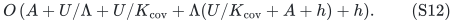

Take <code class="math">\Lambda=\Theta((U/A)^{1/3})</code> and
<code class="math">K_{\rm cov}=\Theta((U/A)^{2/3})</code>, with small enough absolute
constants. Equation (S12) becomes

<!-- math-display: ab036fe1edcc683c2d094aab
U^{2/3}A^{1/3}=O(U^{26/27}h^{1/27}),
-->
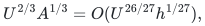

giving (S1) with the explicit local completions above. Requested
inverse-polylogarithmic accuracy is
divided by <code class="math">O(\Lambda)</code>, which only adds <code class="math">O(h)</code> to logarithmic
costs. Original lengths and all recursive labels retain polynomial
in <code class="math">U</code> bit length; public weighted bucketing contributes a fixed
polynomial in that length and does not change the leading exponents.

## 8. Classification

The common-factor comparison proved here is:

| Strong forest comparison | Leading logarithmic power |
|---|---:|
| Printed KMG strong forest | <code class="math">83/84</code> |
| Public outer retuning with unchanged printed base | <code class="math">62/63</code> |
| Public joint retuning with the common-factor outer proof, this note | <code class="math">26/27</code> |
| Research construction with new routing, repair, and separated metric/forest analysis | <code class="math">7/8</code> |

The research <code class="math">7/8</code> point remains strictly faster. The public
improvement is not a use of the research router. It does not establish
optimality among all public constructions; in particular the separated
reanalysis in [strong-forest-mechanism-comparison.md](strong-forest-mechanism-comparison.md) improves this
common-factor reconstruction further.

The completed independent checks cover:

1. Preserve the distinction in (S4) between degree and edit count when
   reusing Claim 3.18 and the hierarchy inventory.
2. Check that the conservative forest lift (S6), including marked
   isolated vertices and root joins, retains the source stable-map
   contract with only fixed powers of <code class="math">\Delta P</code>.
3. Check that forced-anchor promotion and the canonical root path
   argument (S7)--(S8) apply to every finite-diameter instance used by
   the public cover.

These checks concern source interfaces as well as the parameter
arithmetic. Their proofs are in the two focused audit files named in
Sections 1 and 4--5, together with the root source review.
