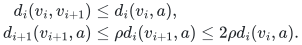
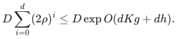
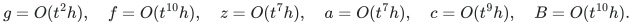

# Focused audit: public forest marks, rebuilds, and the forced anchor

**25 October 2026.** This audits Sections 4--5 of
[public-strong-forest-joint-retuning-audit.md](public-strong-forest-joint-retuning-audit.md). The degree and edit
budgets were checked separately and are not substituted for a proof of
the vertex-map semantics here.

## 1. Verdict and the exact scope of the completion

The public KMG construction admits the required stable canonical marks
and anchored metric proof with the implementation conventions below.
These conventions use the source's copies of core trees and its
identification of equal-image vertices. They do not introduce typed
null edges, permanent port gadgets, a new metric embedding primitive,
or the checkpoint's length-free ambient repair.

Two details should be explicit in the main derivation:

1. Private retained ghost vertices may make a base graph disconnected.
   Use a shortest-path **forest**, with the selected anchor as root of
   its component. The metric proof concerns current active canonical
   vertices in that component, not all ghost or Steiner vertices.
2. The source's extra sentence that canonical images are leaves is
   unnecessary here and is not justified by the displayed assembly.
   This audit imports stable images and flat forests, not a leaf-image
   strengthening.

The result of this focused audit is affirmative for those interfaces.
It does not independently certify all later sparse-cover and strong
SSSP parameter substitutions.

Primary source throughout is
[KMG23, arXiv:2311.06402v1](https://arxiv.org/pdf/2311.06402v1):
Theorems 3.2--3.3, Lemma 3.5 and its following remark, Lemma 3.21 and
Algorithm 5, the assembly before Claim 4.10, and Theorem 4.12 with
Claim 4.13.

## 2. What a fixed map requires

The exposed maps have different domains and must not be conflated.

* Every living output forest node has a fixed physical image in its
  current native graph. Deleting an unmarked node and later creating a
  fresh node at the same physical vertex is permitted.
* A living designated terminal has a fixed **output node identifier**.
  Its incident forest edges may change. Merely keeping its physical
  image while changing its output node would not satisfy this contract.
* In the final strong SSSP interface, each original vertex has its own
  permanent canonical identifier. Private marks belonging to a retired
  recursive instance may end their lifetimes with that instance.

The public unreset hierarchy has actual native-vertex terminals:
<code class="math">V(G_{i+1})\subseteq V(G_i)</code> within a settled private period.
For a lifted forest whose terminal set is <code class="math">V(G_i)</code>, each physical
vertex therefore has at most one designated terminal. Unmarked nodes
with the same physical image can still be numerous, and are controlled
by the forest's occurrence inventory.

An unmarked isolated input node can be omitted from the active lifted
forest until it becomes incident to an edge again. Reintroduction uses
a fresh private lifetime and is charged to that edge edit. A marked
isolated node is retained. This normalization does not alter distances
between designated terminals, and avoids inferring an arbitrary
isolated-node count from edge congestion.

## 3. Copy slots in one application of Algorithm 5

Use a fixed, sufficiently large copy-slot range for the duration of a
local period. The range is the source's copy-capacity allowance,
enlarged by the conservative polynomial factors already charged in the
main note. Use the same slot indices for every current physical root.

For each root <code class="math">v</code>, the source defines <code class="math">T_v</code> as the direct sum of
the stable core trees rooted at <code class="math">v</code>, identifying their root aliases.
An input forest node <code class="math">x</code> with physical image <code class="math">v</code> is assigned an
unused slot <code class="math">j</code> at that root. Its designated output location is the
root of the copy <code class="math">T_{v,j}</code>. Assignments for living designated nodes
are fixed. Distinct input forest nodes at the same physical root use
distinct slots, just as Algorithm 5 requires.

Each projected forest edge retains the identity of the core graph from
which its selected native edge came. Its physical endpoint is attached
to the corresponding vertex in that particular stable-core copy.
This provenance matters in the split argument below: the direct sum's
copies of the same physical vertex in different cores are distinct
except at their common root.

### Core cuts and newly exposed roots

The source's stable core forests only lose edges; their roots are
monotone within a period. Suppose a core tree formerly rooted at <code class="math">v</code>
is cut and a detached piece acquires root <code class="math">u\ne v</code>.

Before joining this piece into copies rooted at <code class="math">u</code>, remove or
re-endpoint all affected input-forest incidences. Every projected
incidence in the detached piece belongs to the core that was cut, and
its child-core endpoint changes from <code class="math">v</code> to the appropriate newly
exposed root. It is therefore present in the actual child edit batch.
This is not a guessed notification based only on physical image.

After those incidence deletions, a detached piece has no surviving
projected attachment to the old input node assigned to root <code class="math">v</code>.
It also has no surviving designated mark: that input node's mark was
the old root <code class="math">v</code>, which lies in the retained piece. Marks for other
physical roots belong to their own root copies, not to internal
unmarked vertices of <code class="math">T_v</code>.

For each slot <code class="math">j</code>, the existing detached copy can now be joined at
its physical root <code class="math">u</code> to <code class="math">T_{u,j}</code>. If the latter already has a
marked root, retain that root's identifier. Otherwise use an existing
unmarked root identifier or a fresh one. All merged nodes have the
same physical image <code class="math">u</code>. The detached piece was disconnected and
had no remaining projected attachments, so this operation cannot
create a cycle or merge two distinct designated input nodes.

Finally process the child forest's insertion batch in the resulting
copies. This yields exactly Algorithm 5 applied to the settled current
input forest. A surviving designated node keeps the same root
identifier throughout the operation. Multiple cuts are handled in
this order one after another, or by the equivalent atomic batch.

This implementation also explains why a full tree need not be copied
from scratch at every new root. Its copies already exist as the
detached pieces of the old copies. Only root alias joins and actual
projected incidences change.

### Counting the alias operation

When a newly detached root alias is absorbed into a marked survivor,
its projected incidences have already been removed. Only the native
core-tree incidences need to be transferred. Their number is bounded
by the native degree and the number of cores. The number of slots is
linear in the incoming occurrence allowance. Thus this operation is
compatible with the main note's recurrence linear in <code class="math">C+1</code>; it does
not silently square the previous level's entire occurrence count.

## 4. Joining the lifted families at the root graph

KMG's Section 4.2 takes the disjoint union of the lifted nearest-pivot
forests and joins corresponding pivot marks at consecutive levels.
These are vertex identifications, already present in the public
construction. They are not additional zero-length edges in the exposed
flat forest.

Each component of a native nearest-pivot forest has exactly one pivot
root in the next logical pivot set. After lifting, the corresponding
component is joined to the next family at this one designated root.
The unused copies may form extra components. The components carrying
the designated input nodes follow the same forest incidence structure
as before lifting. Induction over levels therefore gives a forest;
physical coincidence of unmarked Steiner copies alone is never an
instruction to merge them.

Assign each equivalence class created by the prescribed joins a
representative identifier as follows. If it contains the root graph's
canonical node for physical vertex <code class="math">v</code>, retain that identifier.
Otherwise retain an existing compatible representative when possible,
or allocate a fresh one. A class cannot contain canonical nodes for
two distinct original vertices: every prescribed join has a single
physical image, and the root has one canonical node per physical
vertex.

If a join is removed, retain the canonical identifier in the unique
resulting piece that contains it and create fresh identifiers for other
pieces as necessary. If a new join merges classes, its unique canonical
survivor, when present, is retained. Moving incident edges between
equal-image representatives keeps their physical edge embeddings
valid. Their cost is covered by the occurrence inventory and the
bounded degree at the root, exactly the type of merging charge used
in Claim 4.10.

## 5. Full rebuilds do not require a permanent port gadget

At a rebuild, construct the new private families using fresh private
node identifiers. Keep every still-live original canonical node.
Before publishing the new families, rename their prescribed canonical
representatives to those existing identifiers. This is an injective
renaming because distinct original vertices have distinct canonical
nodes. Delete the old affected forest edges and private nodes, retain
the canonical nodes, and insert the replacement physical edge copies.

Every retained node keeps its physical image. Every canonical terminal
keeps its exact node identifier. There is no connector edge between
an old marker and a new representation: the new representation uses
the same vertex identifier. Full replacement work is the actual old
and new forest inventory, already charged to the local rebuild budget.
The update is exposed only after the replacement is settled.

For a private period, an internally retired isolated native terminal
can be retained as a ghost until that period ends. This respects the
monotone terminal-set condition of Lemma 3.21. Its name is not reused,
and its storage is charged to actual vertex births. When the private
period ends, its private maps and marks end with it. Only the final
original canonical marks must survive all such private rebuilds, as
ensured by the preceding renaming.

This is an explicit identifier policy for the source's quotient
assembly. It does not supply the checkpoint's stronger typed-null or
port-based lifting interface.

## 6. The forced anchor is a public operation

The local metric upper bound applies only to the logical pivot set
<code class="math">A</code>, so an argument that bounds every extra Steiner root's distance
by the root graph's diameter is not justified by Theorem 3.1 alone.
The forced anchor avoids that inference.

At initialization, augment `Center(G,k)` by one specified native
vertex <code class="math">a</code>. Balls and inverse clusters can only shrink when a
center is added. Include <code class="math">a</code> in the initial root set supplied to
each stable core routine. The remark after Lemma 3.5 explicitly
provides initial prescribed roots using an initial set <code class="math">S</code>. The
extra center/root changes the inventory by a constant, paid directly
or by the actual-size base case.

For a newly chosen anchor within a period, the same public root-forcing
mechanism can be effected by an actual self-loop insertion/deletion
processed by the local pivot and stable-root routines, before the
static metric routines discard loop demands. Such an update promotes
its endpoint under Theorem 3.1 and Lemma 3.5. No artificial edge is
retained after the atomic promotion; distances and connectivity of the
settled native graph are unchanged. The temporary degree increase is
constant. One must not filter the loop before those routines see its
endpoint. Alternatively, a fresh private initialization can include
the anchor directly when a new period begins.

KMG Theorem 4.12 / Claim 4.13 already use a temporary-edge terminal
forcing construction through the hierarchy. The completion here uses
the same available endpoint/root promotion principle and does not
require an additional zero-length or permanent-edge interface.

Promote the same physical anchor at every level, and do so again before
publishing a rebuilt level. In a fixed connected root instance one
anchor suffices for its entire lifetime. If the active canonical set
shrinks and its anchor retires, choose a remaining active vertex and
charge the <code class="math">O(d)</code> promotions to that vertex-retirement operation.

## 7. Metric proof only for the necessary anchored chains

Let <code class="math">C</code> be the current active canonical set, contained in the
anchor's connected component, and let
<code class="math">D\ge\max_{v\in C}d_0(v,a)</code>. For a connected root instance one
may take its diameter; for a decremental cover one may take the
diameter of its current connected active subgraph. Isolated ghosts
outside that active set impose no finite metric requirement.

Set <code class="math">v_0=v</code> and <code class="math">v_{i+1}=p_{i+1}(v_i)</code>. Since <code class="math">a</code> is a
logical pivot at every level, with local pivot stretch
<code class="math">\rho=\Gamma^{O(K)}\mathrm{poly}(U)</code>,

<!-- math-display: ba22758dc853c5490b1a843a
\begin{aligned}
 d_i(v_i,v_{i+1})&\le d_i(v_i,a),\\
 d_{i+1}(v_{i+1},a)
    &\le\rho d_i(v_{i+1},a)
     \le2\rho d_i(v_i,a).
 \end{aligned}
-->

The upper-stretch inequality is used only for the two pivots
<code class="math">v_{i+1}</code> and <code class="math">a</code>, exactly within Theorem 3.1's contract.
Consequently <code class="math">d_i(v_i,a)\le(2\rho)^iD</code>, and these vertices remain
in the anchor's component at every level.

Use an exact base spanning forest, rooting the anchor's component at
<code class="math">a</code>. Other components, including ghosts, have arbitrary roots.
The nearest-pivot legs followed by the base path yield a canonical
<code class="math">v</code>-to-anchor route of length at most

<!-- math-display: fef591608bef66889bd5ad17
D\sum_{i=0}^{d}(2\rho)^i
              \le D\exp O(dKg+dh).
-->

Algorithm 5 does not increase the length between designated terminal
marks. The prescribed root joins connect these legs at exactly those
marks. The final forest path is no longer than the resulting walk.
Two active original canonical vertices consequently have a route of
at most twice that bound through the anchor. No all-Steiner stretch
claim and no leaf-image claim is used.

## 8. Classification

The forced-terminal operation is explicitly available in the public
framework; the stable-survivor policy is identifier bookkeeping for
its already prescribed equal-image joins. Together with the careful
split order, actual copy initialization, and full-rebuild charge, they
complete the public source interface needed here. They are additional
proof detail, not a license to quote the old headline theorem outside
its printed parameter range. The construction and parameter envelope
must still be stated as a derived public-framework baseline.

## 9. Subsequent fully public 10/11 parameter check

The parameter substitution in Section 4 of
[strong-forest-mechanism-comparison.md](strong-forest-mechanism-comparison.md) passes independently. With
<code class="math">U=t^{11}h</code>, <code class="math">q=r=d=\Lambda=\Theta(t)</code>,
<code class="math">K=\Theta(t^4)</code>, <code class="math">K_{\rm cov}=\Theta(t^2)</code>, and
<code class="math">x=\Theta(U/t)</code>, the public envelopes give

<!-- math-display: 12774e7faf91d9789dbc31e5
g=O(t^2h),\quad f=O(t^{10}h),\quad z=O(t^7h),
 \quad a=O(t^7h),\quad c=O(t^9h),\quad B=O(t^{10}h).
-->

Each of <code class="math">U/\Lambda</code>, <code class="math">\Lambda U/K_{\rm cov}</code>, and
<code class="math">\Lambda c</code> is <code class="math">O(t^{10}h)</code>; the omitted standalone
<code class="math">U/K_{\rm cov}=t^9h</code> is smaller. The cover feasibility product
<code class="math">K_{\rm cov}\Lambda(a+O(h))</code> is <code class="math">O(t^{10}h)=o(U)</code>.
Thus the separated outer work envelope is
<code class="math">O(U^{10/11}h^{1/11})</code>.

This check keeps the native low-diameter maintenance/recourse factor
<code class="math">e^B</code> separate from the outer copy capacity controlled by <code class="math">e^c</code>.
It does not require the stronger assertion that local recourse itself
is bounded by <code class="math">e^c</code>. The explicit change-forwarding paragraphs
before KMG Claim 5.15 support paying the former once and multiplying
by the preallocated copy inventory. No new local pool construction is
used in this public parameter point.

