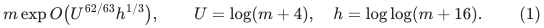
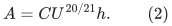
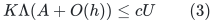
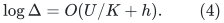
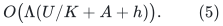
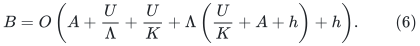
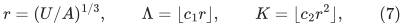
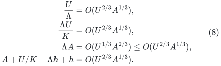
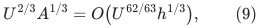

# A stronger public baseline for the strong forest and Gomory--Hu application

## 1. Conclusion and limits of the comparison

The printed <code class="math">83/84</code> logarithmic exponent of the KMG strong
decremental forest is not the strongest consequence of its public
parameterized outer construction. Keeping its published APSP and
low-diameter forest theorems completely unchanged, one can retune only
the covering and hopset parameters to obtain

<!-- math-display: fdd6d512150a90dec8f0c6ca
m\exp O\bigl(U^{62/63}h^{1/3}\bigr),
       \qquad U=\log(m+4),\quad h=\log\log(m+16).
       \tag{1}
-->

This is a **derived public-framework baseline**, not a printed headline
bound. It uses no new static provider, normalized repair, degree reset,
anchored-diameter proof, or separated metric/congestion analysis from
the present checkpoint. It improves the comparison beyond the printed
<code class="math">83/84</code> bound, while remaining asymptotically above the proposed
<code class="math">7/8</code> construction.

This note does **not** prove that <code class="math">62/63</code> is optimal over all
possible reanalyses or combinations of public constructions. In
particular, a complete optimization of every internal KMG parameter
has not been established here. A correct comparison says "printed
<code class="math">83/84</code>; directly derived public <code class="math">62/63</code>; proposed <code class="math">7/8</code>,"
not "the best conceivable public exponent is <code class="math">83/84</code>."

## 2. Exact public inputs

The source is Kyng, Meierhans, and Probst Gutenberg,
*A Dynamic Shortest Paths Toolbox: Low-Congestion Vertex Sparsifiers
and their Applications*,
[arXiv:2311.06402v1](https://arxiv.org/pdf/2311.06402).
The arXiv version history checked on 25 October 2026 lists only v1.

The public locations used are:

| Location | Quantity used in this derivation |
|---|---|
| Theorem 4.1 | APSP work <code class="math">\exp O(U^{20/21}h)</code>, approximation <code class="math">\exp O(U^{6/7}h)</code> |
| Theorem 4.9 | Low-diameter flat forest with work, congestion, and diameter factor <code class="math">\exp O(U^{20/21}h)</code> |
| Theorem 5.3 | Cover overlap <code class="math">\Delta=\widetilde O(Kn^{2/K})</code>, work proportional to <code class="math">n^{1+2/K}</code> times the APSP work |
| Theorems 5.12 and 5.14 | Hopset/ball work <code class="math">\widetilde O(m\Delta n^{O(1/\Lambda)})</code>, subject to the displayed scale inequality |
| Claim 5.15 | Each flattening level multiplies occurrence capacity by <code class="math">1+\Delta^2+\Delta\gamma_{\rm lowDiam}</code> |
| Claim 5.16 | Accuracy accumulates over <code class="math">O(\Lambda)</code> flattening levels |
| Claim 5.17 | Explicit maintenance cost multiplies primitive transcripts by the flattening copy inventory |

We import the published constructions at those interfaces. The
following algebra concerns their outer free parameters only.

## 3. A common public base envelope

Choose a sufficiently large absolute constant <code class="math">C</code>, and let

<!-- math-display: 531b934f0b99c98fa507c8b5
A=C U^{20/21}h.
                      \tag{2}
-->

The published base primitive work, low-diameter stretch, and
low-diameter congestion are all at most <code class="math">e^A</code>. The covering
stretch can be chosen at most <code class="math">e^A</code>, after changing <code class="math">C</code>,
because it only needs to dominate the square of the APSP approximation
and the low-diameter factor.

Use internal accuracy <code class="math">\varepsilon_{\rm int}</code> equal to the
requested accuracy divided by a sufficiently large multiple of
<code class="math">\Lambda</code>. For constant or inverse-polylogarithmic requested
accuracy, <code class="math">\log(1/\varepsilon_{\rm int})=O(h)</code>. Thus the public
scale condition is satisfied when

<!-- math-display: e5fe3bbec66c9e176e1e5ab9
K\Lambda(A+O(h))\leq cU
                     \tag{3}
-->

for a sufficiently small absolute <code class="math">c&gt;0</code>.

The cover overlap satisfies

<!-- math-display: ba6429dcad03e4bca7073bc9
\log\Delta=O(U/K+h).
                    \tag{4}
-->

By Claim 5.15, over <code class="math">O(\Lambda)</code> flattening levels the logarithm
of the total occurrence factor is at most

<!-- math-display: 795f00438be99ec0555b522c
O\bigl(\Lambda(U/K+A+h)\bigr).
        \tag{5}
-->

Primitive work contributes <code class="math">A+O(U/K+h)</code>; hopset and approximate
ball work additionally contributes <code class="math">O(U/\Lambda)</code>. Forwarding
these transcripts into the preallocated copies contributes (5).
Consequently a safe logarithmic envelope for total work, congestion,
and explicit forest recourse is

<!-- math-display: 615c5366c609924af353c56e
B=O\left(A+{U\over\Lambda}+{U\over K}
               +\Lambda\left({U\over K}+A+h\right)+h\right).
 \tag{6}
-->

This expression is obtained before substituting KMG's printed choices
of <code class="math">K</code> and <code class="math">\Lambda</code>. It uses exactly the common-factor
public analysis; no separation of metric distortion from congestion
inside the low-diameter primitive is being asserted.

## 4. Retuning the two public outer parameters

Put

<!-- math-display: 9881d2fdbb6f2a819294fa05
r=(U/A)^{1/3},\qquad
             \Lambda=\lfloor c_1r\rfloor,\qquad
             K=\lfloor c_2r^2\rfloor,
             \tag{7}
-->

where <code class="math">c_1,c_2</code> are sufficiently small fixed positive constants.
For all sufficiently large <code class="math">U</code>, both parameters are at least one.
The finitely many smaller sizes use the printed public algorithm or
an elementary exact implementation.

Then <code class="math">K\Lambda A=O(c_1c_2U)</code>, so (3) holds. The dominant
terms in (6) satisfy

<!-- math-display: 49b9de48dfb8fca3b769e9c5
\begin{split}
 {U\over\Lambda}&=O(U^{2/3}A^{1/3}),\\
 {\Lambda U\over K}&=O(U^{2/3}A^{1/3}),\\
 \Lambda A&=O(U^{1/3}A^{2/3})
               \leq O(U^{2/3}A^{1/3}),\\
 A+U/K+\Lambda h+h&=O(U^{2/3}A^{1/3}).
\end{split}
\tag{8}
-->

Here <code class="math">A=o(U)</code>, which also implies <code class="math">r\to\infty</code>. Substituting
(2) yields

<!-- math-display: 12c39c71e80125f90a99af29
U^{2/3}A^{1/3}
       =O\bigl(U^{62/63}h^{1/3}\bigr),
       \tag{9}
-->

and proves (1) at the published interfaces.

For clarity, the powers of <code class="math">U</code> in the two parameters are
<code class="math">\Lambda=\Theta(U^{1/63}h^{-1/3})</code> and
<code class="math">K=\Theta(U^{2/63}h^{-2/3})</code>. The accuracy rescaling remains
within the inverse-polylogarithmic regime required by the public
approximate-ball theorem.

## 5. Consequence for the public Gomory--Hu framework

Abboud et al.,
[arXiv:2507.20354v1](https://arxiv.org/html/2507.20354v1),
use the KMG strong interface in Theorem 4.7. Replacing its printed
specialization by (1) changes neither the flat embedding nor the
explicit recourse contract. Its packing/MST/Euler-tour construction
uses fixed powers of this overhead.

The other quantitative dependencies are smaller: the updated Li
skeleton has leading power <code class="math">5/6</code>, the terminal expander
decomposition has leading power <code class="math">4/5</code>, and deterministic exact
maxflow is available with at most the public printed <code class="math">5/6</code>
factor, or the separately audited public <code class="math">4/5</code> retuning. The
fixed guide-tree respect parameter and final recursion do not raise
these overheads to a growing power. The exact source inventory for
those claims is recorded in
[gomory-hu-seven-eighths-dependency-audit.md](gomory-hu-seven-eighths-dependency-audit.md).

Thus the same public-framework calculation gives the derived
<code class="math">62/63</code> comparison for deterministic exact Gomory--Hu trees with
polynomial integer capacities. This statement is a quantitative
composition of the named public interfaces, not a claim that the
original paper printed that bound.

## 6. Later-looking reductions that are not valid runtime baselines

Two apparently stronger follow-up reductions must not be used as
current proved runtime baselines:

* [arXiv:2509.02520](https://arxiv.org/abs/2509.02520), *A Simple and
  Fast Reduction from Gomory-Hu Trees to Polylog Maxflows*, was
  withdrawn in v2 on 24 April 2026. Its official abstract page states
  that the runtime proof has a gap. The SODA publication also carries
  a [retraction notice](https://doi.org/10.1137/1.9781611978971.246).
* [arXiv:2510.27330](https://arxiv.org/abs/2510.27330), *A Simple
  Deterministic Reduction From Gomory-Hu Tree to Maxflow and Expander
  Decomposition*, was withdrawn the same day. Its official notice
  says its runtime analysis depends on the preceding invalid runtime
  analysis.

The algorithmic-correctness versus runtime distinction in the first
notice is preserved here: these notices invalidate using the claimed
time bound; they are not being interpreted as a claim that every
algorithmic idea in the papers is incorrect. The earlier
arXiv:2507.20354 Gomory--Hu result remains the public framework used
above.

## 7. What remains unclaimed

The current audit has not established a public construction with a
<code class="math">7/8</code> or smaller strong-forest exponent merely by parameter
substitution. Nor has it proved that such a public construction is
impossible. The present <code class="math">7/8</code> proof uses additional structural
work: normalized repair, degree-controlled recursion, an anchored
diameter argument, and separate metric, congestion, and construction
factors. Those contributions should be stated positively, alongside
the stronger public <code class="math">62/63</code> benchmark, without an unsupported
optimality assertion about prior work.
