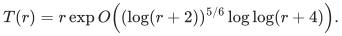
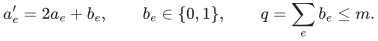
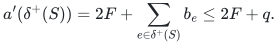
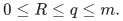
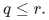
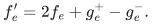
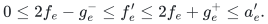
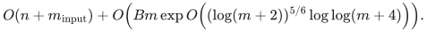
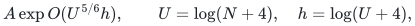
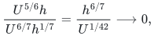

# Using the published flow bound on small recursive graphs

This note removes an unnecessary dependency from the Gomory–Hu
application. Its forest overhead has leading logarithmic power `6/7`.
The published deterministic exact-flow bound with power `5/6` already
fits below it. The application's flow calls therefore need no
four-fifths parameter retuning of the public dual-flow construction.

A local-size issue must still be resolved: a small recursive graph can
have capacities polynomial in the original input size but much larger
than any fixed polynomial in its own edge count. The elementary
capacity-bit reduction below handles that issue without allocating
dummy vertices or padding the graph to the original input size.

## 1. The precise published input

Jan van den Brand, Li Chen, Rasmus Kyng, Yang P. Liu, Simon Meierhans,
Maximilian Probst Gutenberg and Sushant Sachdeva,
[*Almost-Linear Time Algorithms for Decremental Graphs: Min-Cost Flow
and More via Duality*](https://arxiv.org/html/2407.10830v1),
**Theorem 6.17**, gives a deterministic exact minimum-cost-flow
algorithm for polynomially bounded integer capacities and costs in time

<!-- math-display: 027948a592df601afbff9ac0
T(r)=r\exp O\!\left((\log(r+2))^{5/6}\log\log(r+4)\right).
-->


Section 6.2 constructs a flow and the proof of Theorem 6.17 includes
exact final rounding. We use an integral optimum on integral input,
including the flow itself. An objective-value oracle alone would not
suffice for the reduction below. This is a named published algorithm,
not an implementation supplied by this repository.

We use the theorem only on graphs whose positive capacities are at
most their actual edge count, with costs zero or minus one and zero
demands. Thus no growing accuracy parameter or unproved uniform
retuning is imported. A single-arc or empty instance can be solved
directly, avoiding conventions about logarithms of very small sizes.

## 2. Capacity bits and a bound on the missing flow

Let a directed input graph have distinct source and sink <code class="math">s,t</code>,
nonnegative integral capacities, and <code class="math">m</code> nonloop
positive-capacity arc records. Let <code class="math">W</code> be the largest capacity of
these retained records, or zero if there are none. Parallel and oppositely directed records
remain distinct. Loops and zero-capacity records are ignored for the
solve and receive zero flow in the returned native record list.
If there are no remaining arcs, return the zero flow and a separating
zero-capacity cut immediately.

Set <code class="math">B=\lceil\log_2(W+1)\rceil</code> when <code class="math">W&gt;0</code>. Begin with zero
capacities and the zero maximum flow. Reveal the capacity bits from
most significant to least significant. A stage replaces the previous
capacity vector <code class="math">a</code> by

<!-- math-display: a4ba39626b259fc591f7a0e2
a'_e=2a_e+b_e,\qquad b_e\in\{0,1\},\qquad
q=\sum_e b_e\leq m.
-->


Assume <code class="math">f</code> is a maximum integral flow for <code class="math">a</code>, of value <code class="math">F</code>.
Then <code class="math">2f</code> is feasible for <code class="math">a'</code>. Let <code class="math">R</code> be the maximum
additional source-to-sink flow in its residual graph. An old minimum
cut <code class="math">S</code> has <code class="math">a(\delta^+(S))=F</code>, and hence

<!-- math-display: 6cc09c53c572100851da5f4e
a'(\delta^+(S))
 =2F+\sum_{e\in\delta^+(S)}b_e
 \leq 2F+q.
-->


The residual capacity of this cut equals
<code class="math">a'(\delta^+(S))-2F</code>, because reverse residual records subtract
the net current flow across the cut. Consequently

<!-- math-display: 2bc56ca2f1379143ac225ad8
0\leq R\leq q\leq m.
-->


The residual maximum-flow value is exactly the new optimum minus
<code class="math">2F</code>. One direction follows by adding any residual flow to <code class="math">2f</code>.
For the other, compare <code class="math">2f</code> with a maximum flow for <code class="math">a'</code>: the
positive and negative coordinate differences are feasible on the
corresponding forward and reverse residual records. Their divergence
is the difference in the two source-to-sink values. Equivalently,
minimizing the displayed residual-cut identity gives this equality
directly by the elementary max-flow/min-cut theorem.

If <code class="math">q=0</code>, the old cut already shows that <code class="math">2f</code> is maximum, so
the stage makes no oracle call.

## 3. Truncate to capacities polynomial in the actual call size

For <code class="math">q&gt;0</code>, form the positive residual records of <code class="math">2f</code> under
<code class="math">a'</code>. For each original arc <code class="math">e=(u,v)</code>, these records are:

- a forward record <code class="math">u\to v</code> of capacity <code class="math">a'_e-2f_e</code>, if positive;
- a reverse record <code class="math">v\to u</code> of capacity <code class="math">2f_e</code>, if positive.

Keep their original record and direction tags even if other arcs have
the same endpoints. Let <code class="math">r\leq2m</code> be their total number. Whenever
<code class="math">b_e=1</code>, the forward residual capacity is positive, since
<code class="math">a'_e-2f_e=2(a_e-f_e)+1\geq1</code>. Therefore

<!-- math-display: 2e5b8b56b60b1b9b0e2978fb
q\leq r.
-->


Replace every residual capacity <code class="math">c_e</code> by
<code class="math">\widehat c_e=\min\{c_e,q\}</code>.

**Truncation lemma.** The capped residual graph still has maximum-flow
value <code class="math">R</code>.

**Proof.** Every old cut has capacity at least <code class="math">R</code>. If none of its
arcs is changed by capping, its capacity is unchanged. Otherwise it
contains a capped arc of capacity <code class="math">q\geq R</code>, so its new total
capacity is still at least <code class="math">R</code>. Thus every new cut has capacity at
least <code class="math">R</code>. A minimum cut of old capacity <code class="math">R</code> has no arc larger
than <code class="math">R\leq q</code>, so that cut is unchanged. The two minimum-cut
values, and hence the maximum-flow values, are equal. ∎

For completeness, the integer max-flow/min-cut fact used here has a
short constructive proof. Start with zero flow and augment along any
residual source-to-sink path by its positive integral bottleneck.
The integral value increases at each step and is bounded by the sum
of capacities leaving the source, so this process terminates. At
termination the source's residual reachable set excludes the sink.
Every outgoing cut arc is saturated and every incoming cut arc has
zero flow, giving equality between flow value and cut capacity.
Weak cut bounds prove optimality. This establishes the fact needed
by the argument; the efficient oracle uses the published algorithm.

All capped positive capacities are at most <code class="math">q\leq r</code>. Compact only
vertices incident to these records, together with <code class="math">s,t</code>; there
are at most <code class="math">2r+2</code> such vertices. No global-size graph is allocated.
If either terminal has no relevant path, the resulting zero value is
handled in the same way as any other solve.

To invoke the published minimum-cost-flow algorithm, give each capped
residual arc cost zero and add one additional record <code class="math">t\to s</code>
with capacity <code class="math">q</code> and cost minus one. All demands are zero. The
zero circulation is feasible. Removing the added record from any
feasible circulation gives a source-to-sink flow of value equal to
that record's flow, and the circulation's cost is minus that value.
Conversely any residual flow of value at most <code class="math">q</code> becomes such a
circulation by placing its value on the added record. Since
<code class="math">R\leq q</code>, an integral minimum-cost circulation yields an integral
maximum residual flow. The new graph has <code class="math">r+1</code> edges, capacities
at most <code class="math">r</code>, and costs in <code class="math">\{-1,0\}</code>, meeting the literal
polynomial-range input condition of Theorem 6.17.

An existing original or reverse arc <code class="math">t\to s</code> is not merged with
the added negative-cost record. Keeping their identities is necessary
for the cost and the returned-flow projection.

## 4. Lift the answer and recover an explicit cut

Let <code class="math">g_e^+</code> and <code class="math">g_e^-</code> be the integral flows on the forward
and reverse residual records of original arc <code class="math">e</code>, with zero for
an absent record. Set

<!-- math-display: c56d4d23cac18d2970eeef1b
f'_e=2f_e+g_e^+-g_e^-.
-->


Even if both directions carry flow, the individual residual bounds give

<!-- math-display: 0de8d8512fb3bf47dedc4046
0\leq2f_e-g_e^-\leq f'_e
 \leq2f_e+g_e^+\leq a'_e.
-->


The residual divergence adds <code class="math">R</code> units to the source-to-sink value
and zero at every other vertex. Thus <code class="math">f'</code> is a feasible integral
flow of value <code class="math">2F+R</code>, exactly the new optimum. Induction over the
bits proves that the final native flow is maximum for the original
capacities.

After the last stage, scan the ordinary uncapped residual graph and
take the vertices reachable from <code class="math">s</code>. The sink is not reachable,
and the corresponding original cut has capacity equal to the final
flow value. This supplies an explicit minimum cut as well as a flow.
Restoring a full cut-membership vector costs <code class="math">O(n)</code>; writing the
native flow vector costs <code class="math">O(m_{\rm input})</code>, including zeros on
ignored loops and zero-capacity records. Isolated vertices are not
repeatedly allocated inside the oracle calls.

For an undirected cut instance, replace each nonloop edge by two
oppositely directed arcs of the same capacity. A directed source-side
cut counts each crossing undirected edge exactly once. Contracting
specified source and sink vertex sets also preserves the relevant
cut problem; loops created by contraction can be discarded. These
adapters use linear actual inventory and preserve native cut witnesses.

## 5. Time, numeric representation and recursive calls

The zero-capacity case <code class="math">W=0</code> needs no scaling stage. Otherwise there
are exactly <code class="math">B=\lceil\log_2(W+1)\rceil</code> stages and at most that
many oracle calls. Each has at most <code class="math">2m+1</code> actual records. The
preprocessing, residual construction, reconstruction and final output
cost <code class="math">O(n+m_{\rm input}+Bm)</code> outside the oracle. The total is

<!-- math-display: c9ccd6d349169ea25b3fb2e9
O(n+m_{\rm input})+
O\!\left(Bm\exp O\!\left((\log(m+2))^{5/6}
                             \log\log(m+4)\right)\right).
-->


The numerical conditions are explicit. If every recursive capacity is
bounded by <code class="math">N^C</code> for one fixed constant <code class="math">C</code>, then
<code class="math">B=O(\log N)</code>. Scaling, doubling and returned-flow arithmetic use
<code class="math">O(\log N)</code> bits per number. The source oracle sees only
<code class="math">O(\log(m+2))</code>-bit capacities and costs. Its internal finite
arithmetic is that of the published theorem. For larger user-supplied
integers, actual multiword arithmetic and encoding costs must be added;
the word-operation statement does not make such integers free.

Now consider a sequence of recursive calls, each of actual size
<code class="math">n_j+m_j</code>, total inventory <code class="math">A=\sum_j(n_j+m_j)</code>, maximum size
polynomial in <code class="math">N</code>, and capacities at most <code class="math">N^C</code>. Summing the
per-call bound gives

<!-- math-display: 090b12cdbc80398399c369ac
A\exp O(U^{5/6}h),\qquad
U=\log(N+4),\quad h=\log(U+4),
-->


where the additional bit stages and fixed polynomial logarithms are
absorbed. Empty calls and explicit isolated-vertex output are charged
to their actual inventories. In particular, small calls are never
padded to <code class="math">N</code> to satisfy a numeric-range condition.

## 6. Consequence for the Gomory–Hu dependency chain

The strong-forest application has overhead
<code class="math">E_{6/7}(N)=\exp O(U^{6/7}h^{1/7})</code>. Since

<!-- math-display: f665293bd6b3b60d30a11f91
\frac{U^{5/6}h}{U^{6/7}h^{1/7}}
 =\frac{h^{6/7}}{U^{1/42}}\longrightarrow0,
-->


the literal published flow factor is absorbed by that overhead, even
after any fixed polynomial logarithmic multiplier. Finitely many
small sizes are absorbed by increasing one fixed constant. The same
conclusion holds for the older seven-eighths application bound.

The application already proves its aggregate exact-flow input inventory
and bounds the integer capacities of its contracted and auxiliary
instances. Applying the preceding sum establishes the required flow
cost directly. Its forest, skeleton and guide-tree requirements remain
unchanged; only the unnecessary four-fifths flow-retuning dependency
is removed. The published flow algorithm remains an external theorem,
identified precisely as Theorem 6.17 above.

## 7. Executable finite evidence

Run the [capacity-scaling checker](../../problems/min-cost-flow/verify/check_capacity_scaling.py)
from the repository root:

```bash
python3 -B problems/min-cost-flow/verify/check_capacity_scaling.py
```

It enumerates all directed capacity assignments
from zero through three on two and three vertices, all binary assignments
on four vertices, 300 seeded native-record instances and four explicit
edge cases. It compares each stage with independently enumerated cuts,
including both residual directions, truncation and lifted feasibility.
Loops, parallel records, opposite arcs, isolated vertices, all-zero
inputs, zero-bit stages and capacities longer than a machine word occur
in this finite suite.

It also enumerates 419,904 flow assignments for 729 small
negative-return-edge instances, checking conservation and the exact
minimum circulation cost. A simple integral augmenting-path
algorithm instantiates the oracle for testing; the checker does not
implement or verify the published fast flow algorithm. It refuses
optimized Python execution that disables assertions.
