# An explicit deterministic exact-flow bound for the growing-parameter construction

This note supplies the quantitative static-flow dependency in the proposed
matching construction. It uses the fixed deterministic algorithm of
van den Brand, Chen, Kyng, Liu, Peng, Probst Gutenberg, Sachdeva and Sidford,
[A Deterministic Almost-Linear Time Algorithm for Minimum-Cost Flow,
arXiv:2309.16629v1](https://arxiv.org/abs/2309.16629v1).
The conclusion is obtained from the displayed parameters in its proof,
rather than from the notation <code class="math">m^{1+o(1)}</code> alone.

## 1. Quantitative imported interface

The source provides the following ingredients. Its Lemma 5.17 has
<code class="math">\log\gamma_\ell,\log\gamma_r=O((\log m)^{8/9}\log\log m)</code>.
Lemma 6.3 specifies depth <code class="math">d=\Theta((\log m)^{1/18})</code> and the
corresponding cycle accuracy. The proof of Theorem 5.1, equation (12)
and its concluding bound, charges
<!-- math-display: b775103d5338439950915a67
(m+Q)m^{3/d}\widetilde O(\gamma_\ell\gamma_r)^{O(d)}.       \tag{1}
-->
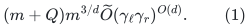
Theorem 4.6 bounds the number of numerical calls, changed edges and
reported coordinates by <code class="math">\widetilde O(m\kappa^{-2})</code>.
Lemma 4.1 gives deterministic, cost-nonincreasing integral rounding
in <code class="math">O(m\log m)</code>. Section 2's computational model uses fixed-point
fields with a polylogarithmic bit bound in the encoded input size.

Cost/capacity scaling is the deterministic reduction in
[Chen et al., arXiv:2203.00671v2, Appendix C](https://arxiv.org/abs/2203.00671v2),
especially Lemmas C.1, C.3 and C.10. Its polynomial-capacity calls can
use fixed bounds <code class="math">m^{10}</code> on costs and <code class="math">m^{40}</code> on capacities;
the remaining number of calls is polylogarithmic in <code class="math">m,C,U</code>.
These are the named constructive imports of this note.

## 2. Recovering an explicit exponent

Put <code class="math">x=\log(m+2)</code> and
<!-- math-display: 75800f75467a370455b08273
E(x)=x^{17/18}\log(x+2).
-->
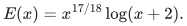
Choose an integer depth comparable to <code class="math">x^{1/18}</code>, with the small
constant-size cases handled directly. Rounding the depth or the
branching factor by constant factors changes the following logarithms
by at most <code class="math">O(d\log x)</code>.

The logarithm of the multiplicative factor in (1) is at most
<!-- math-display: f1f48671771a07f1d42ceaa1
\frac{3x}{d}
   +O\!\left(d\,x^{8/9}\log(x+2)+d\log(x+2)\right)
 =O(E(x)).                                                   \tag{2}
-->
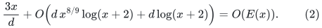
Indeed, <code class="math">x/d=\Theta(x^{17/18})</code>, while
<code class="math">d x^{8/9}=\Theta(x^{1/18+16/18})=\Theta(x^{17/18})</code>.

The accuracy denominator in the same construction is a constant
multiple of <code class="math">(d+1)\widetilde O(m^{1/d}) \widetilde O(\gamma_\ell)^d</code>. Consequently
<!-- math-display: 02ca08206f63244c56b42d87
\kappa^{-1}\le \exp(O(E(x))).       \tag{3}
-->
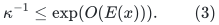
Combining (2) with the number of calls and updates in Section 1 gives
<!-- math-display: 2ca5a578809aa7ddaebd0622
\widetilde O(m\kappa^{-2})\,\exp(O(E(x)))
                  =m\exp(O(E(x))).                         \tag{4}
-->
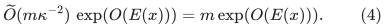
The final integral rounding and the extraction of the explicit flow
are covered by (4). No randomized isolation step is needed: if the
fractional cost is within <code class="math">1/2</code> of the optimum, cost-nonincreasing
rounding produces an integer cost strictly below the next larger
integer. Integrality therefore makes that cost optimal.

Thus the proof-level bound for polynomially bounded integral data is
<!-- math-display: d2d3cc57d937d10e3dbb583a
\boxed{\quad
 T_{\rm flow}(m)
   \le m\exp\!\left(O\!\left((\log(m+2))^{17/18}
                           \log\log(m+3)\right)\right).
 \quad}                                                     \tag{5}
-->
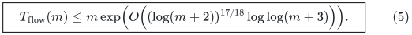
The constants here belong to one fixed public algorithm. They do not
depend on the matching parameter <code class="math">a</code>.

## 3. Capacity scaling and ordinary machine arithmetic

For arbitrary integral magnitudes, a safe version of (5) is
<!-- math-display: a16999eb285f691e1037aa1e
\begin{split}
 T_{\rm flow}(m,C,U)
 \le {}&m\exp(O(E(\log(m+2))))\,
      \mathrm{poly}(\log(m+2))\\
 &\cdot\log(2+C)\log(2+mU),
\end{split}
\tag{6}
-->
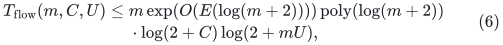
before the polynomial bit-arithmetic overhead is absorbed. The
polynomial logarithm allows the extra <code class="math">\log m</code> in the capacity
scaling proof, so the conclusion does not rely on suppressing it as
a constant. Demands and lower bounds can be included through the
usual linear-size reduction to circulation; the scaling proof
explicitly permits its polynomial change of magnitudes.

Each polynomially bounded inner instance uses the same fixed
arithmetic regime. Its field width is a fixed power of the logarithm
of its encoding length. Simulating such a field by digits on a
machine with physical words of <code class="math">\Theta(\log S)</code> bits costs only
a polynomial in <code class="math">\log S</code>, provided the original magnitudes have
<code class="math">\mathrm{poly}(\log S)</code> bits and the graph has size
<code class="math">S^{O(1)}</code>. Ordinary integer arithmetic, including schoolbook
multiplication and division, is already sufficient for this statement.
No unit-cost operation on an unbounded-precision real is used.

Scaling does not introduce a matching-parameter-dependent family of
flow solvers. It repeatedly invokes the same deterministic inner
algorithm on polynomially bounded data. The construction is
computable from the instance size and its integer data; an asymptotic
cutoff depending on <code class="math">a</code> is not an input.

For maximum flow alone, one may add a return edge from sink to source
with cost <code class="math">-1</code>, give the original edges cost zero, and optimize the
resulting bounded circulation. Zero circulation is feasible. This
avoids requiring a promised feasible demand-routing instance. The
optimal return-edge flow is the maximum-flow value. A residual
reachability search extracts the corresponding exact cut if requested.

## 4. Absorption in the proposed matching bound

Let <code class="math">S=2^s</code>, and let <code class="math">Z</code> bound the local flow graph size. Assume
<!-- math-display: b6181df6688ec33a861ad23f
B\le Z\le S^{c_0},\qquad
 \log(2+C)+\log(2+U)\le \mathrm{poly}(s),               \tag{7}
-->
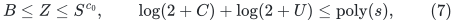
with fixed exponents. The outer accounting is responsible for the
sum of these nominal sizes <code class="math">Z</code>. An instance smaller than <code class="math">B</code>
may be charged with nominal size <code class="math">B</code>; the monotonicity of the
upper bound is enough, whether or not dummy graph records are
actually created.

Since <code class="math">\log(Z+2)=O(s)</code>, (6) and its bit simulation imply
<!-- math-display: 651572eadb74e67e80db250f
T_{\rm flow}(Z;S)
       \le Z\exp\!\left(O\!\left(s^{17/18}\log(s+2)\right)\right).
                                                                    \tag{8}
-->
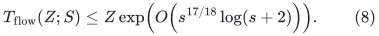
The source's own depth is chosen from <code class="math">Z</code>, not from the matching
parameter <code class="math">a</code>. In particular, the interpretation of its constants
does not change when the outer algorithm lets <code class="math">a</code> grow.

For the proposed outer choice
<!-- math-display: a3e716320fc0de7c55ac24f1
a=\Theta\!\left(\frac{s^{1/336}}{(\log(s+2))^3}\right),
 \qquad B=2^{\lceil s/a\rceil},
-->
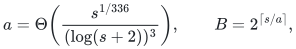
the intended multiplicative allowance is
<code class="math">\exp(O(s^{335/336}(\log(s+2))^3))</code>. The exponent gap is
<!-- math-display: 9ef6a496a21b17ac7afd1e81
\frac{335}{336}-\frac{17}{18}
                         =\frac{53}{1008}>0.
-->
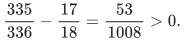
Hence
<!-- math-display: 327e37bc34a0d1181d9ca82a
\frac{s^{17/18}\log(s+2)}
      {s^{335/336}(\log(s+2))^3}
 =\frac{s^{-53/1008}}{(\log(s+2))^2}\longrightarrow0.          \tag{9}
-->
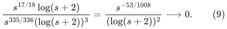
Every fixed polynomial in <code class="math">s</code> or <code class="math">a</code> is smaller still. Summing
any collection of local calls with total charged size <code class="math">\sum Z</code>
therefore gives
<!-- math-display: 792e77bd006173e896f0f30c
\sum T_{\rm flow}(Z;S)
 \le \left(\sum Z\right)
       \exp(O(s^{335/336}(\log(s+2))^3)).                    \tag{10}
-->
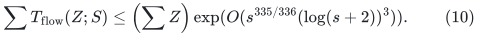

This closes the static exact-flow overhead needed for that proposed
quantitative envelope. It does not establish the growing-parameter
raw-cycle backend or the outer matching count; those remain separate
proof obligations. The imported flow theorem is used only for its
own internally generated stable numerical sequence, not as a fully
dynamic min-ratio oracle for the matching client's arbitrary sequence.
