# A conditional 14/15 quantitative bound for deterministic general matching

**Separate complete mathematical candidate, 24 October 2026.** This note
composes the degree-reset distance backend with exact recovery from
near-feasible circulations. It leaves all frozen 335/336, 209/210, and
167/168 constructions unchanged. Under the named constructive interfaces,
one uniform deterministic program finds an explicit maximum-cardinality
matching in every undirected general graph in time

<!-- math-display: 0b401dada6f68ec58838fb69
O(n+m)+(m_s+1)\exp\!\left(
 O\!\left((\log(m_s+2))^{14/15}
             (\log\log(m_s+4))^{1/5}\right)\right).
 \tag{1}
-->
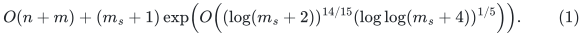

Here <code class="math">m</code> counts input edge records and <code class="math">m_s</code> counts distinct
nonloop edges. The bound has no perfect-matching promise, density
restriction, or approximation error. It is a research proof assembly
with explicit public primitive dependencies, not an implementation or
external certification. The independent final verifier proves accepted
output correctness; the improved time additionally requires the
fast-branch proof given here.

## 1. Complete dependency boundary

The matching state and reduction are specified in:

* [Exact general-graph gap reduction](general-graph-gap-reduction.md).
* [Algorithm and transaction outline](matching-algorithm-specification.md).
* [Factor-critical contraction witnesses](factor-critical-contractions.md).
* [Ledger algebra and physical phase budget](ledger-algebra-and-phase-budget.md).
* [Persistent actual integral carriers](persistent-integral-ledger-carrier.md).
* [Deterministic small tight-set discovery](deterministic-local-tight-discovery.md),
  [local balanced pair queries](balanced-forest-pair-oracle.md), and
  [descending-level exchanges](static-pair-exchange.md).

The complete numerical route used in THIS composition is:

* [Degree-three reset between distance levels](distance-degree-reset-candidate.md).
* [Distance raw lifting and retained-edge gauge correction](distance-oracle-raw-lift.md).
* [Disconnected-component routing](disconnected-component-backend-wrapper.md).
* [Numerical occurrence lifetime and query transactions](numerical-backend-lifetime-and-loops.md).
* [Priced logarithmic client](priced-logarithmic-steps-from-raw-cycles.md).
* [Near-feasible rounding and exact projection](near-feasible-rounding-and-exact-projection.md).

The region and lock construction is the one in
[local exact projection](local-exact-projection-from-priced-steps.md),
but ALL its static exact-flow checks and recovery calls are replaced
by the new rounding construction. Level-one global exchange uses the
all-expanded version of that construction. Consequently this composition
has no separate exact-flow factor with logarithmic exponent 17/18.

The source-specific numerical primitives remain the constructive local
KMPG and DO26 interfaces, including their selected-edge transcript,
weighted future-path forests, native split processing, and deterministic
spanner. Their primary references and exact scope are recorded in the
degree-reset note. The full DO26 growing-depth theorem is not being
substituted for the recurrences below. Its old squared maximum-degree
recurrence is avoided by a genuine degree-three input between levels.

## 2. Literal master parameters for a numerical branch

Let <code class="math">S_b=2^U</code>, with integer <code class="math">U</code>, be a backend master bound.
An actual root has at most <code class="math">S_b^2</code> records and root integer
lengths/gradients of at most <code class="math">c_0U</code> bits for one fixed absolute
<code class="math">c_0</code>, for example <code class="math">c_0=1200</code>. Use positive integer branch
constants <code class="math">c_C,c_E</code>. Define

<!-- math-display: 2ce215a6bd0a6a34fd97fc94
\begin{split}
 L_U&=\lceil\log_2(U+4)\rceil,\qquad r_U=\lceil L_U^{1/5}\rceil,\\
 K&=\max\left\{1,
       \left\lfloor\frac{\lfloor U^{2/15}\rfloor}{r_U^2}
       \right\rfloor\right\},\\
 h_k&=\lceil U^{14/15}\rceil r_U,\qquad k=2^{h_k},\\
 h_C&=c_C\left(\left\lceil\frac UK\right\rceil
       +\lceil U^{2/3}\rceil L_U+L_U\right),\qquad C_p=2^{h_C},\\
 \gamma_*&=2^{c_C\lceil U^{2/3}\rceil L_U},\qquad P_*=C_p^{16},\\
 H_p&=2^{\lceil\log_2(4(h_C+1))\rceil},\\
 d_*&=\left\lceil\frac{8U}{h_k}\right\rceil+10,\qquad
 b_*=(c_0+100)U(d_*+1).
 \end{split}
 \tag{2}
-->
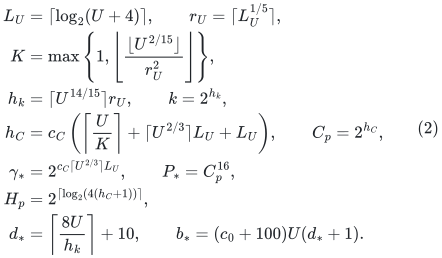

Rational powers are rounded by integer power comparisons. The
numerical port symbols <code class="math">C_p,H_p</code> are separate from the matching
floor <code class="math">C=a+1</code>. Use the computable common backend cap

<!-- math-display: dbe0eb1a4fe29bb3d86d6db9
E_*=k^{c_E}\gamma_*^{c_EK^2}
       C_p^{c_E(d_*+1)}(U+4)^{c_E(d_*+1)}.
 \tag{3}
-->
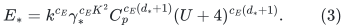

An adequate fixed <code class="math">c_C</code>, followed by an adequate fixed <code class="math">c_E</code>,
bounds the source and reset construction. The program checks selected
degrees, emitted-record prefixes, resident sizes, stored bit lengths,
and charged operations against these declared caps. A failure suspends
the branch. Resource checks are not finite-size quality certificates.

The bit cap <code class="math">b_*</code> is fixed for each source invocation's whole
life and for its length/radius buckets. It is not increased after an
observed edge becomes longer. An active instance of size at most
<code class="math">24k</code> uses the direct base solver. Before nonbase recursion,
let <code class="math">e_0</code> be its initial ACTIVE edge count and
<code class="math">v_0=\lfloor\log_2\max\{2,e_0\}\rfloor</code>, and check

<!-- math-display: cecebbb24770753ee0b8db97
K\ge2,\qquad K^7\le v_0,\qquad b_*\le v_0^2,
 \qquad P_*^2\le k/16.
 \tag{4}
-->
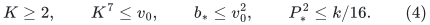

The active-isolate adapter of the degree-reset note is part of this
contract. Private physical isolates are initialized once and touched
only on their own events; they are not counted as fictitious edges
and are not rescanned on active-source restarts. Actual port trees,
including inactive resident ghost trees, remain counted child input.
A temporary source activation generation does not create a second
external port fiber for the same actual parent vertex lifetime. More
precisely, each source period starts on the maintained nonisolated
endpoint list, keeps newly isolated native slots until that period is
discarded, and reuses the SAME source generation and external fiber on
reactivation. No mid-period source-vertex deletion is needed. An actual
parent-lifetime deletion leaves only a counted inactive tombstone after
real-record retirement and export suppression; a new actual lifetime
gets a different identity. The period's elementary-edit allowance
<code class="math">Q\le m_{\rm act}/(12k)</code> bounds the additional resident slots and
the change in edge count, so its resident size remains within a constant
factor of its initial active size. Disposal scans only this bounded
period history and its descendant records, never the private historical
isolate inventory.

### The smaller selected-edge envelope

For a degree-three parent, the selected degree, fully encoded
birth/recourse, and STABLE CORE forest F_i change envelopes have logarithm

<!-- math-display: c2e4997ea630bbddad800f3a
O\!\left(U/K+U^{2/3}L_U\right).
 \tag{5}
-->
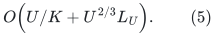

Adequate fixed <code class="math">c_C</code> makes <code class="math">C_p</code> cover them. The port trees,
per-occurrence pool indices and their explicit metadata add fixed
powers, covered by <code class="math">P_*=C_p^{16}</code> as in the reset lemma.

The source's <code class="math">\gamma^{O(K^2)}</code> demand-route re-embedding work is
LOCAL work. It does not replace unchanged retained child edges.
A retained child edge uses its own physical core-edge provenance and
corrected root-leg gradient. Genuine endpoint/price/provenance changes
are in the smaller selected-edge transcript. Forwarding every changed
demand route as a recursive edge edit would invalidate this separation
and the exponent proved below.
The separate nearest-pivot shortest-path forest can have
<code class="math">\widetilde O(k)</code> changes per input edit; its local candidate work
is included in <code class="math">W</code>, not in this smaller recursive envelope.

## 3. Recursion, aspect and the backend contract

Let <code class="math">G_r</code> be occurrence multiplicity, <code class="math">J_r</code> initialization
work per active nominal record, and <code class="math">T_r</code> amortized work per
external edit/query with <code class="math">r</code> remaining levels. The reset gives

<!-- math-display: f1db64e68e94e4e5e860b1c3
\begin{split}
 G_r&\le P(G_{r-1}+1),\\
 J_r&\le W+P(G_{r-1}+1)+(P/k)J_{r-1},\\
 T_r&\le P T_{r-1}
       +O\!\left(kW+kP(G_{r-1}+1)+P J_{r-1}\right),
 \end{split}
 \tag{6}
-->
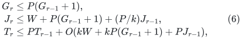

where <code class="math">P\le P_*</code> eventually and
<code class="math">W=k^{O(1)}C_p^{O(1)}\gamma_*^{O(K^2)}\mathrm{poly}(U)</code>.
The exponents denoted <code class="math">O(1)</code> are absolute implementation constants,
independent of depth and <code class="math">K</code>; an adequate <code class="math">c_E</code> covers them.

At active nonbase size <code class="math">m&gt;24k</code>, the period is
<code class="math">\lfloor m/(12k)\rfloor</code>. Degree three implies
<code class="math">m=n+e\le5n/2</code>, so this is within the literal <code class="math">n/k</code> source
horizon. Active edges and vertices are comparable up to constants
through the period; this is supplied by the isolate adapter. Current
level initialization AND complete retirement are included in (6).

The child-input size, including ghost slots and all born port trees,
is at most <code class="math">mP/k</code>. Equation (4) gives shrink by at least
<code class="math">\sqrt{k}</code> up to the absorbed constant. A root of size
<code class="math">m\le S_b^2</code> therefore has depth

<!-- math-display: 088d6c6d0822bfa007ed8dce
d=O(U/h_k)=O(U^{1/15}L_U^{-1/5})<d_*.
 \tag{7}
-->
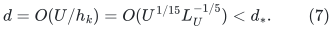

The flat lift assigns a distinct same-index parent-tree copy to EACH
child occurrence over ANY port of a logical root. Its factor is
<code class="math">\lambda C_p(G+1)</code>, within <code class="math">P(G+1)</code>. A child forest-edge
log changes one attachment and does not rebuild its long parent
tree. Common observed capacity doubling charges dormant pool copies
to initialization/restarts. No extra <code class="math">k</code> multiplies each recursive
edit. Private isolates likewise have no repeated active-restart scan.

Solving (6), including polynomial direct base queries, gives

<!-- math-display: 5f1cc04cee5e01b417e7f452
\log E=O(h_k+K^2\log\gamma_*+d\log C_p).
 \tag{8}
-->
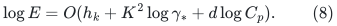

The large local <code class="math">\gamma_*^{O(K^2)}</code> factor occurs once in this
bound; it is not raised to depth. Raw quality and piece count obey the
same envelope. Their per-level <code class="math">\gamma_*^{O(K)}</code> factor fits a
fixed power of <code class="math">C_p</code>, since <code class="math">K^2U^{2/3}L_U=o(U)</code>.

The rounded parameters satisfy

<!-- math-display: 5be7f51b60c8d5a0a9882bcd
\begin{split}
 K&=\Theta(U^{2/15}L_U^{-2/5}),\qquad
 h_k=\Theta(U^{14/15}L_U^{1/5}),\\
 K^2\log\gamma_*&=O_{c_C}(U^{14/15}L_U^{1/5}),\\
 d\log C_p&=O_{c_C}(U^{14/15}L_U^{1/5}).
 \end{split}
 \tag{9}
-->
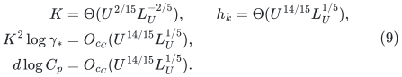

The dominant term in the last line is <code class="math">(U/h_k)(U/K)</code>.
Thus (3) covers the complete backend with

<!-- math-display: b98a3c40458d8fa6c9080135
E\le E_*=
 \exp\!\left(O_{c_C,c_E}(U^{14/15}L_U^{1/5})\right).
 \tag{10}
-->
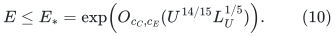

This includes actual-size initialization, amortized edits/queries and
logs, inverse raw quality, pieces, occurrences and full retirement.
No initialization allocates <code class="math">k</code> or <code class="math">S_b</code> records for a tiny
root. Charged local restarts support a polynomial master history,
such as <code class="math">S_b^{200}</code>, rather than requiring one tiny primitive
instance to endure that entire history.

### Internal length and gradient bits

The integer stable-core labels and the port scale give

<!-- math-display: a32b6a5ce8bd2471bf36e961
L_{i+1}\le O(n_i\log^2(n_i+2))H_p L_i.
 \tag{11}
-->
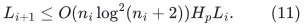

Each level adds <code class="math">O(U)</code> bits. Frozen gradient potentials and the
corrected retained-edge gradients have the same additive bound.
Consequently

<!-- math-display: 1a4bdcd0555c6edf9048711d
b_{\rm internal}=O(U(d_*+1))
       =O(U^{16/15}L_U^{-1/5}+U).
 \tag{12}
-->
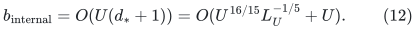

The declared <code class="math">b_*</code> covers this eventually. Every nonbase source
has <code class="math">b_*\le v_0^2</code>, a literal quasipolynomial aspect in its
OWN edge count. Its future-path forest count is
<code class="math">O(\log m+\log k+b_*)</code>, polynomial in <code class="math">U</code>; no
polynomial-length shorthand is used. Moreover

<!-- math-display: 464cce903ea88427ef460200
K^7/h_k=O(L_U^{-3})\longrightarrow0.
 \tag{13}
-->
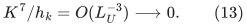

The active-size adapter gives <code class="math">v_0=\log_2m-O(1)</code>, so (4)
holds eventually at the smallest nonbase size. Since
<code class="math">K^7\le\log m</code> implies
<code class="math">K\log\log m/(\log m)^{1/6}\to0</code>, the source's spanner
parameter condition is checked at every local scale.

### Root certificates have O(log S) bits

An inherited abstract upper certificate need not have short encoding.
Instead evaluate the returned list on the exposed ROOT occurrence
forest. Each of its edges maps to one root input edge or true null.
Path aggregates give the exact root gradient and literal root length
<code class="math">V</code>. Pieces have unit signed coefficients; repeated traversals
are counted with their multiplicity, before any cancellation. There are at most <code class="math">E_*</code>
pieces and <code class="math">ME_*</code> root forest records, hence

<!-- math-display: f94411fb9371dbc8f323f00a
V\le M E_*^2\max_e\ell_e.
 \tag{14}
-->
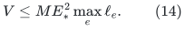

The root numerator <code class="math">\Gamma</code> satisfies the analogous
<code class="math">\lvert\Gamma\rvert\le ME_*^2\max_e\lvert g_e\rvert</code>.
The length is no larger than the inherited raw certificate, so quality only
improves. Under the outer caps below it has polynomial master magnitude
and <code class="math">O(s)</code> bits. Internal metric arithmetic still has the charged
multiword cost (12); no unbounded real or integer operation is unit cost.

## 4. The outer parameter and uniform absorptions

Let the subcubic physical graph have order at most <code class="math">S=2^s</code>, with
one fixed <code class="math">s</code> throughout the gap driver. Invoke the backend with
<code class="math">U=2s</code>. For a third positive integer branch constant <code class="math">c_B</code>, put

<!-- math-display: 1b05fbda33bb8e285b80ff3f
\begin{split}
 L_s&=\lceil\log_2(s+4)\rceil,\qquad r_s=\lceil L_s^{1/5}\rceil,\\
 a&=\left\lfloor\frac{\lfloor s^{1/15}\rfloor}{c_Br_s}\right\rfloor,\\
 v&=\lceil s/a\rceil,\qquad B=2^v,\qquad
 q=B^{-100},\qquad D_*=B^{10}.
 \end{split}
 \tag{15}
-->
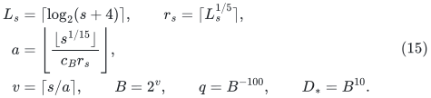

Suspend before dividing by <code class="math">a</code> if <code class="math">a&lt;1000</code>. For any fixed
<code class="math">c_B</code>, eventually

<!-- math-display: 2b90e450a899f40ea1d48dee
a=\Theta_{c_B}(s^{1/15}L_s^{-1/5}),\qquad
 v=\Theta(c_Bs^{14/15}L_s^{1/5}).
 \tag{16}
-->
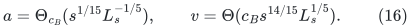

After fixing adequate <code class="math">c_C,c_E</code>, a sufficiently large FIXED
<code class="math">c_B</code> makes (10), including <code class="math">U=2s</code>, imply

<!-- math-display: f1bfede1a7dbd29f82e3456a
E_*\le B/4.
 \tag{17}
-->
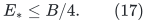

The branch checks this literal inequality using (3). It need not know
an analytical leading constant. It is stronger than the priced
client's slack requirement between raw pieces/occurrences/inverse
quality and <code class="math">D_*</code>.

All remaining outer overheads are strictly smaller:

<!-- math-display: 5f052ecde6030b03bddc33e5
a=o(v),\qquad a^2=o(v),\qquad
 \mathrm{poly}(a,s)=2^{o(v)},\qquad v=o(s).
 \tag{18}
-->
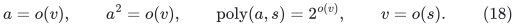

In particular <code class="math">B^a\in[S,2^aS)</code>. Rounding nominal numerical
sizes to the prescribed <code class="math">2^{2a^2}</code> grid costs only <code class="math">2^{o(v)}</code>.
For a higher reset, its parent-debt bound gives local lifetime
<code class="math">R+B\le O((a+3)2^aS/B)=o(S)</code> in the worst case. Top nominal
size <code class="math">SB</code>, all smaller actual local instances, and their rounded
capacities have <code class="math">M\le S^2</code> eventually. Thus master <code class="math">U=2s</code>
has ample size and history headroom without a master-sized allocation.

Numerical root prices have <code class="math">O(s)</code> bits under the existing explicit
<code class="math">S^{1122}</code> price bound. Equation (14), with <code class="math">M\le S^2</code> and
<code class="math">E_*\le B/4=S^{o(1)}</code>, gives polynomial root certificate
magnitude. Internal fields in (12) use only <code class="math">\mathrm{poly}(s)</code>
ordinary <code class="math">\Theta(s)</code>-bit words. Their fixed polynomial arithmetic
cost is absorbed by (18).

The dyadic grids, step sizes, pad sizes and positivity services are
unchanged. The executable guards <code class="math">q\ge S^{-1}</code>,
<code class="math">D_*\le S^2</code>, and the stronger initial size conditions hold
eventually since <code class="math">v=o(s)</code>. The master bound is used in these
caps; a tiny local instance is not assigned a separate local
<code class="math">M^{10/a}</code> occurrence cap.

## 5. Local and global exact recovery

The local threshold proof has absolute constants: ordinary capacities
are scaled by 16, <code class="math">W=20000(P+1)</code>, and fewer than <code class="math">1000(P+1)</code>
ordinary arcs are ever represented. Objective range and all
insertion/lock losses are <code class="math">O((P+1)s)</code>, so

<!-- math-display: df9f0ebb4156db8f5ea63c97
J_{\rm local}=O((P+1)B^{200}s).
 \tag{19}
-->
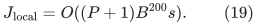

Genuine motion notifications are <code class="math">O(D_*J_{\rm local})</code>.
Their client responses and the separately counted external requests
do not recursively create new motion credit. The priced proof pays
full occurrence sweeps and their <code class="math">D_*^2</code> cost. Substitution of
(17) into its explicit counts bounds numerical work by

<!-- math-display: 08f118e994f7c597a82f0773
(P+B)2^{2a^2}B^{230}\mathrm{poly}(s).
-->
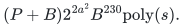

Near-feasible rounding adds <code class="math">O(P)</code> exact coordinate reads and
<code class="math">\widetilde O(P)</code> dynamic-tree work per completed recovery.
The <code class="math">O(s)</code> threshold count is absorbed by (18). A complete local
projection therefore has the safe bound

<!-- math-display: 0d3bc705f23333a62e4d6160
T_{\rm local}\le(P+B)B^{250}.
 \tag{20}
-->
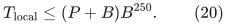

Exact recovery does not solve a fresh max-flow problem on the union.
A true success rounds to an integral flow of exactly its threshold
value. At the final optimistic LOW threshold <code class="math">v+1</code>, the return
coordinate is greater than <code class="math">16v-8</code>. Dropping locks and dividing
by 16 leaves total integral-bound violation below one. Penalty-based
rounding yields an exact optimistic maximum <code class="math">v</code> and a checked
minimum cut. The true flow and that cut certify the full maximum;
ordinary residual search on the deduplicated union gives the COMPLETE
full peel. Intermediate LOW answers are provisional. Wrong ones
cannot pass the final exact flow/cut checks. All residual graphs
omit the numerical return arc.

At level one, use the all-expanded version on the <code class="math">O(S)</code>-record
exchange graph with <code class="math">W=20000(M+1)</code>. It has the same
<code class="math">(M+B)B^{250}</code> bound. For a general directed invocation, first
remove ordinary arcs entering the source, leaving the sink, and loops;
this ensures the return lower bound and preserves maximum value.
The matching exchange network already has this terminal orientation.

All capacities and threshold arguments lie in the fixed master
envelope of the priced client. Arbitrarily encoded general capacities
can instead use the separate capacity-digit reduction. The matching
composition needs only its polynomial-master capacities.

There is no <code class="math">s^{17/18}</code> overhead to absorb into (16): every reset
uses this priced client, explicit integral rounding, and residual
reachability.

## 6. Phase counts, reset sum and complete matching time

The combinatorial/debt proof has explicit dependence on <code class="math">a</code>.
For <code class="math">C=a+1</code>, target <code class="math">1\le K\le N</code>,
<code class="math">L=\lceil10000CN/K\rceil</code>, and
<code class="math">g_*=\max\{1,\lfloor K/(100C)\rfloor\}</code>,

<!-- math-display: c639aa2b7aa842bb5aaf2aaf
Lg_*\le10001CN,\qquad \tau=O(aS),\qquad
 T_{\rm structural}=a^2S\mathrm{poly}(s).
 \tag{21}
-->
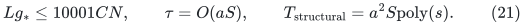

One frozen injection plus a sparse overlay is used throughout each
structural/reset transaction. A new canonical carrier assignment is
published only after settlement. Physical erased volume, contractions
and sparse supports are charged without a global explicit assignment
rewrite after every carrier pivot.

At the top, structural objective losses and bounded range give
<code class="math">J_{\rm top}=O(aSB^{200}s^2)</code>. Notifications, exact cached
residual access and complete sweeps bound all top numerical work by
<code class="math">SB^{240}</code> eventually.

Put <code class="math">b_j=B^{a-j}</code>. For a higher reset, including a gain that
jumps many finer periods, the unreset parent's debt is at most
<code class="math">(C+2)b_{j-1}</code>. Hence

<!-- math-display: 38207c8daeafaf83bdffd0f3
\sum_{j=2}^{a}\frac{\tau}{b_j}
       [(C+2)b_{j-1}+B]=O(a^3SB).
 \tag{22}
-->
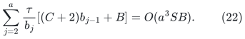

Multiply this sum once by <code class="math">B^{250}</code>. Costs are added over
levels, not compounded through the ledger hierarchy. Sparse support
application and persistent normalization fit
<code class="math">O(a^3SB^{251})</code>.

At level one, <code class="math">b_1=B^{a-1}\ge S/B</code>. There are at most
<code class="math">O(aB+1)</code> global resets. The NEW all-expanded flow cost gives

<!-- math-display: 287a731944b779b20c7457d4
O(aB+1)(S+B)B^{250}\le SB^{252}
 \tag{23}
-->
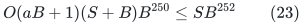

eventually. Initialization, last incomplete attempts and phase
materialization remain within these envelopes. From (18)--(23),

<!-- math-display: 910993f42409b451b097b7f4
T_{\rm phase}\le SB^{300}.
 \tag{24}
-->
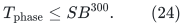

The bound holds on every input and every valid prefix, including LOW
exits. No perfect-matching hypothesis enters the cost accounting.

The direct gap driver maintains
<code class="math">\nu(J)-&#124;Q&#124;\le U_0\le\lfloor N/2\rfloor-&#124;Q&#124;</code>, chooses
<code class="math">K=\lceil U_0/2\rceil</code>, and updates this bound after gains or
the generalized LOW conclusion. There are <code class="math">O(a\log(N+2))</code>
phases, including the final <code class="math">O(a)</code> small-gap steps. Equation (18)
absorbs that count. A complete favorable branch has time

<!-- math-display: dff0f694e2bfc0105f941bd5
SB^{320}
 =S\exp\!\left(O_{c_C,c_E,c_B}(s^{14/15}L_s^{1/5})\right).
 \tag{25}
-->
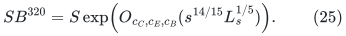

## 7. First-failure proof and one uniform program

Retain the explicit initial, magnitude and history guards of the
priced client and phase proof. A failed guard suspends the branch;
it never returns an optimum certificate. They include <code class="math">a\ge1000</code>,
<code class="math">100000(a+1)\le S^{1/20}</code>, <code class="math">B\le S^{1/20}</code>,
<code class="math">q\ge S^{-1}</code>, <code class="math">S^{20}</code> main-action/threshold caps, and
<code class="math">S^{100}</code> external-operation caps, together with (4), (17) and
the literal recursive degree/bit/size budgets.

Argue at the first attempted guard violation. The loose prefix guards
first bound positivity and pad changes, before using a sharp time
theorem. They give small total violation and valid region bounds.
These give (19), the notification count, rounding prerequisites and
(20). Structural/debt identities then give (21)--(23), and (24)
applies to the prefix INCLUDING its last attempted operation. All
these quantities are <code class="math">S^{1+o(1)}</code> or smaller and lie below their
loose polynomial guards eventually. Recursive source caps follow
independently from (6)--(13). An adequate fixed branch therefore
cannot have a first guard failure beyond one fixed input-size threshold.

Internal arithmetic, memory allocation, pool growth, dynamic trees,
coordinate reads and rounding are charged physical-word instructions.
Memory addresses have polynomial master magnitude on guarded histories.
Large integer operations use ordinary digit arithmetic. No branch
can monopolize execution through a nominally single unbounded-cost
operation.

Enumerate all positive integer triples <code class="math">(c_C,c_E,c_B)</code>, for
example by sum and then lexicographic order. Give one classical
deterministic exact general-matching algorithm a fixed positive
instruction share. Give branch number <code class="math">j</code> a share at least a
fixed multiple of <code class="math">2^{-j}</code>, using a computable binary-counter
interleaving. Instantiate a branch only when it first receives work.
Branches have private mutable state and share the compact immutable
input.

Decode every proposal, check it as a matching of that compact original
graph, and perform one deterministic exact augmenting-path search
before acceptance, using
[classical matching verification](classical-matching-optimality-verifier.md).
All verification work is charged WITHIN the proposing branch's share.
A rejected or malformed proposal suspends that branch. The classical
branch supplies termination on every finite input.

There exist an adequate fixed <code class="math">c_C</code>, then an adequate fixed
<code class="math">c_E</code>, then an adequate fixed <code class="math">c_B</code>, for which all displayed
source and client bounds hold eventually. Their triple has one finite
index <code class="math">j_*</code>, independent of input. Its share penalty
<code class="math">2^{j_*}</code> is a constant. Counter/interleaving overhead is
polynomial in logarithms and is absorbed by (25). Finitely many
exceptional compact sizes are covered by enlarging the final absolute
constant for the always-running classical branch. The program does
not need to know that threshold.

The verifier and classical branch prove sound output and termination
even for an inadequate numerical tuple. The improved time uses the
existence and correctness of a favorable branch; verification is not
a substitute for that proof.

## 8. Arbitrary graphs and the optional matching-size kernel

One linear input scan removes loops, coalesces parallel copies while
retaining original IDs, drops isolates and compacts the graph. The
odd-path reduction replaces each degree-d vertex by <code class="math">2d-1</code>
vertices, producing a subcubic graph with
<code class="math">N=4m_s-r=O(m_s)</code> and optimum offset <code class="math">A=2m_s-r</code>.
Every maximum auxiliary matching, including noncanonical gadget
matchings, decodes linearly to an original maximum matching. The
decoder is the arbitrary-matching proof in the gap-reduction note;
it does not assume one external port per gadget.

Choose <code class="math">S</code> as the next power of two above a fixed constant and
this <code class="math">N</code>. The empty-edge case returns immediately. Then
<code class="math">S=\Theta(m_s+1)</code>, so (25) gives (1). All portfolio branches
and verifiers operate on compact records. The original <code class="math">O(n+m)</code>
scan and winning original-ID translation are not repeated per branch.

Optionally apply the exact
[vertex-cover matching kernel](matching-size-kernel-corollary.md).
If <code class="math">\nu</code> is the original matching number, its computable greedy
cover keeps a graph with

<!-- math-display: 7471ce41040df1e2ba36d20a
m'\le\min\{m_s,O(\nu^2)\}.
-->
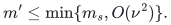

Apply the SAME algorithm and parameter choice to its actual compact
size. This gives

<!-- math-display: 9f1bd0082930dca414cec2a0
O(n+m)+(m'+1)\exp\!\left(
 O\!\left((\log(m'+2))^{14/15}
             (\log\log(m'+4))^{1/5}\right)\right).
 \tag{26}
-->
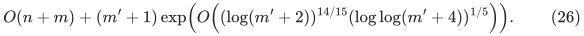

No knowledge of <code class="math">\nu</code> is needed to build the kernel. No special
graph family is introduced. Both conclusions remain conditional on
the complete constructive numerical and state interfaces in Section 1.
