# A 4/5 research composition from sequential expander routing

**Separate research theorem candidate, 24 October 2026.** This note gives
the complete quantitative composition using the sequential expander
router and static sparsifier constructed in the linked provider notes.
Their mathematical proofs, including the repaired half-matching entropy
lemma, have been assembled and independently reread within this research
session. That is not external certification. The parameter calculation
does not replace those component proofs. The existing 5/6 composition
and its threshold router are unchanged.

The target remains exact maximum-cardinality matching in arbitrary
undirected graphs, with no perfect-matching promise, approximation,
bipartiteness assumption, or density restriction. The proposed bound is
<!-- math-display: 1dd092d9f354409c57748515
O(n+m)+(m_s+1)\exp O\!\left(
    (\log(m_s+2))^{4/5}(\log\log(m_s+4))^{1/5}\right),
 \tag{1}
-->
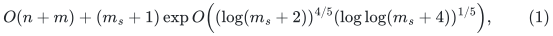
where <code class="math">m_s</code> is the number of edges after one-time simplification and
compaction. Section 9 gives the optional exact matching-size kernel.
This is a research proof assembly with named dependencies, not an
externally verified implementation. Exact output verification and the
proof of the faster running time are separate claims.

## 1. The additional primitive and its literal output type

Let <code class="math">U\geq2</code> be an integer master bound and set
<!-- math-display: dc8be3c7a90615793075900d
h=\lceil\log_2(U+4)\rceil.
 \tag{2}
-->
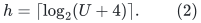
Local graphs, token inventories, explicit route lists, and their genuine
identifiers have at most <code class="math">2^{O(U)}</code> records. Every initialization is
proportional to its ACTUAL input inventory; this master bound does not
authorize padding by <code class="math">2^U</code>.

The new parameters are integers <code class="math">1\leq p,r\leq U</code>. The routing
parameter <code class="math">p</code>, decomposition parameter <code class="math">r</code>, dynamic-repair depth
<code class="math">K</code>, and recursive size-reduction factor <code class="math">k</code> below are distinct.
The required additional construction has structural and work factors
<!-- math-display: e1e5ccc125a058ac968f3d5b
\log_2\Gamma=O((p+r)h),\qquad
 \log_2F=O(U/p+U/r+r^2h+(p+r)h),
 \tag{3}
-->
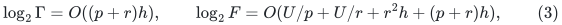
with absolute constants uniform in the growing parameters. We impose
the conservative literal range
<!-- math-display: 351a73242d013a534a1639bf
(p+r)h\leq U.
 \tag{4}
-->
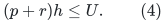

The routing part of (3) is the following sequential interface. On a
loopless expander of <code class="math">m'</code> edge IDs and conductance
<code class="math">\phi\geq2^{-O(rh)}</code>, preprocess once in
<!-- math-display: e46871e0dacfa53071977ba6
m'\exp O(U/p+ph+\log\phi^{-1})\mathrm{poly}(U)
 \tag{5}
-->
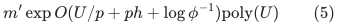
work. For token demands with at most <code class="math">D\deg(v)</code> starts and at most
<code class="math">D\deg(v)</code> destinations at every vertex, return explicit walks of
length at most <code class="math">2^{O((p+r)h)}</code> and edge congestion at most
<code class="math">D\,2^{O((p+r)h)}</code>. Query work is allowed to be
<!-- math-display: 52e87e8f81d2cf76773342a5
m'D\,2^{O((p+r)h)}\mathrm{poly}(U).
 \tag{6}
-->
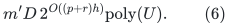
It is not claimed to be proportional only to the number of nonempty
demands. The two witness applications below pay this full volume.
The dedicated provider is
[sequential-expander-routing-tradeoff.md](sequential-expander-routing-tradeoff.md).

The separate sequential construction combines the following interfaces:

* [the virtual expander hierarchy](virtual-expander-hierarchy-reconstruction.md),
  with actual sparse cuts, identity child inclusions, and one physical
  root embedding;
* [the explicit coverage and balance wrapper](explicit-virtual-cut-balance-wrapper.md),
  whose weak leaves and internal successes both retain at least a
  1-beta fraction of their current host, for fixed beta=1/1000;
* [exact short-path packing](sequential-short-path-matching.md) and the
  [fresh-cut matching adapter](sequential-fresh-cut-matching-adapter.md);
* [half-matching entropy progress](half-matching-entropy-progress.md)
  at recursive balanced-cut threshold at most <code class="math">1/8</code>;
* [the polynomial energy cut player](polynomial-energy-cut-player.md);
* [constructive leaf routing](sequential-leaf-routing-and-chs-work.md);
* [the direct full-router recursion](conditional-full-router-from-shufflers.md),
  which does not invoke the source's Task-2/Sort mutual recursion.

The interface in (5)--(6), including its aggregate precomputed path
family and degree-split adaptation, must be obtained by their explicit
composition. It cannot be inferred just from a distributed round bound.
The fixed inverse-conductance power in (5)--(6) is essential.

### The static normalized-route interface

The input is a demand multigraph <code class="math">J</code> with distinct native edge IDs and
annotated ambient walks <code class="math">\Pi(e)</code> with the same immediate endpoints.
Let <code class="math">L_0\geq1</code> bound their lengths, let <code class="math">C_0</code> be their ambient
vertex-occurrence congestion including endpoints, and let
<code class="math">\Delta_0=\Delta(J)</code>. Erase closed subwalks of each individual image,
obtaining a table <code class="math">\Pi'</code> of simple paths. Thus
<!-- math-display: 7345b835f45bd68dc7fe7eed
L(\Pi')\leq L_0,\qquad C(\Pi')\leq C_0.
 \tag{7}
-->
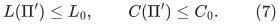
The additional static construction returns <code class="math">\Pi'</code>, a subgraph
<code class="math">\widetilde J\subseteq J</code>, and explicit routes
<code class="math">\widehat\Pi:J\to\widetilde J</code>, satisfying
<!-- math-display: debb3aa54db5c19652c1e5c3
\begin{aligned}
 |E(\widetilde J)|&\leq |V(J)|\Gamma\mathrm{poly}(U),\\
 L(\widehat\Pi)&\leq\Gamma,\\
 L(\Pi'\circ\widehat\Pi)&\leq\Gamma L_0,\\
 C(\Pi'\circ\widehat\Pi)&\leq\Gamma(C_0+\Delta_0).
 \end{aligned}
 \tag{8}
-->
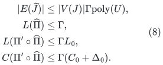
Its full work is
<!-- math-display: 24bdae34ce192ead00f09f28
|E(J)|F^{O(1)}\Gamma^{O(1)}(L_0+1)\mathrm{poly}(U)
 \tag{9}
-->
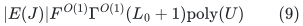
plus actual vertex bookkeeping. In particular, the construction-work
factor <code class="math">F</code> enters neither selected size nor ambient congestion.

The precise new static provider is
[linear-parameter-static-sparsifier.md](linear-parameter-static-sparsifier.md).
It uses the degree bands and weighted witnesses of
[the length-free static construction](length-free-ambient-static-sparsifier.md),
with (5)--(6) substituted for its threshold router, and
[deterministic weighted path selection](deterministic-weighted-path-selection.md).
For the demand-band host, the port inventory and query load give
<code class="math">m'D\leq &#124;E(J)&#124;\,2^{O((p+r)h)}</code>. For a witness of common weight
<code class="math">\rho</code>, its reverse-embedding demand has load at most
<code class="math">\max\{1,\lceil\rho\rceil\}</code>, and
<!-- math-display: 5f1d6bd0d500319fcfdc12af
m_W\max\{1,\lceil\rho\rceil\}
                   =O(m_W+|E(J)|)\,2^{O((p+r)h)}.
 \tag{10}
-->
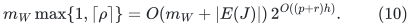
These are required application-level estimates: repeatedly preprocessing
once per load unit, or ignoring the <code class="math">m'D</code> query volume, would not prove
(9). The dedicated static refinement supplies their precise degree and
weight bookkeeping.

There are TWO distinct path normalizations. Besides (7), erase closed
subwalks from every returned token candidate in its immediate host
before ambient composition and weighted selection. The latter operation
produces the simple <code class="math">J</code>-paths needed by that selection proof. It
decreases every edge-occurrence load and costs the already charged
explicit list length.

All normalization uses IMMEDIATE ambient vertex lifetime IDs. Distinct
aliases with the same eventual physical image remain distinct vertices.
An edge whose eventual image is null is not deleted for that reason.
The conclusion is about the returned <code class="math">\Pi'</code>, not the old <code class="math">\Pi</code>.
The exact circulation identity, gradient correction, and raw-lift
compatibility are supplied by
[normalized-route-cycle-comparison.md](normalized-route-cycle-comparison.md).
The central original selected-edge ID remains separately recorded even
when normalization erases its geometric occurrence.

## 2. Actual-size hierarchy and finite local computation

For an expander host with actual <code class="math">n'</code> vertices, let
<!-- math-display: 418957e613307df30ef193b0
v=\lceil\log_2(n'+2)\rceil,\quad
 k_{\rm route}=2^{\max\{5,\lceil v/p\rceil\}},\quad
 \lambda_{\rm cap}=C_\lambda(v+1)^2.
 \tag{11}
-->
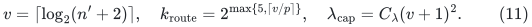
Here <code class="math">C_\lambda</code> is one fixed constant justified by the explicit energy
decrease. Use the actual-size leaf condition
<!-- math-display: f027a55f4748dc50ad7f0213
N\leq C_{\rm leaf}k_{\rm route}^5
                                         \lambda_{\rm cap}^2.
 \tag{12}
-->
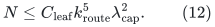
No graph of the right-hand size is allocated. Each genuine internal
part then has enough vertices for
<!-- math-display: f340032573e7f5e3c9202051
\min_i|Y_i|\geq8\lambda t_{\rm parts}^2,\qquad
                        n'_X\geq\lambda t_{\rm parts}^2,
 \tag{13}
-->
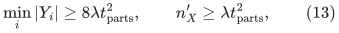
where <code class="math">t_{\rm parts}\leq k_{\rm route}</code>. The direct scatter proof uses
these inequalities, not a CHS distributed-<code class="math">\epsilon</code> range.
The hierarchy depth is <code class="math">O(p)</code>; the fixed minimum
<code class="math">k_{\rm route}=32</code> only improves that bound.

All leaves have <code class="math">\mathrm{poly}(k_{\rm route},v)</code> vertices. The
exact PSD and moment procedures may have
<code class="math">\mathrm{poly}(k_{\rm route},v,\log\phi^{-1})</code>-bit TEMPORARY
integers; leaf walk moments may additionally have a fixed polynomial
dependence on inverse expansion. Their complete bit operations are
charged in (5). They are not core lengths or gradient labels and need
not satisfy the backend label cap in Section 7. Only explicit graph
IDs and path lists leave these local preprocessing calls.

At every nonroot cut-player host the degree and cut threshold losses
are polylogarithmic. Root inverse conductance is paid once. Summing
local <code class="math">k_{\rm route}^{O(1)}</code> work over disjoint child mass, with only
polylogarithmic factors multiplying across <code class="math">O(p)</code> levels, yields
<!-- math-display: 115e67b4d2980be083e6d4f1
n'\exp O(v/p+p\log(v+2)+\log\phi^{-1}).
 \tag{14}
-->
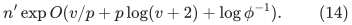
The nonroot balanced-cut player uses threshold at most <code class="math">1/8</code>.
The repaired entropy proof gives a literal
<code class="math">512\lceil\log_2(N+2)\rceil</code> round cap with half-matchings.
The source's incorrect per-round calculation at threshold <code class="math">1/2</code>
is not used. This changes an absolute constant, not (14).
The aggregate precomputed shuffler, fold, and leaf-circuit family has
quality <code class="math">\phi^{-O(1)}\log^{O(p)}(n'+2)</code>. Identity child inclusions let
one apply the physical root embedding only once. The full-router
recursion adds <code class="math">\lambda^{O(p)}</code> and no polynomial
<code class="math">k_{\rm route}</code> factor to output quality.

A decomposition call on a smaller actual graph clips its integer
parameter <code class="math">r</code> to the source's admissible range, with constant-size
base cases. Its work remains within <code class="math">F</code>, while expansion improves.
The static tiny case can use an actual spanning forest after
normalization, as in the 5/6 construction. Loop demands keep their
current endpoint annotations and permitted empty routes outside
nonloop expander hosts. Awakening such a lifetime under a native split
is not billed as a new batch of synthetic edge insertions.

## 3. Rounded master parameters and executable caps

Compute
<!-- math-display: 386d3063a8b93611f2dc4810
t=\max\{2,\lfloor(U/h)^{1/5}\rfloor\},\qquad
 p=r=t,\qquad K=t^2,\qquad x=\lceil U/t\rceil,\qquad k=2^x.
 \tag{15}
-->
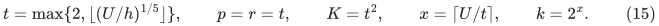
Integer-root comparisons suffice. Eventually
<!-- math-display: 841740678aa572d6b43bdc33
t^5h\leq U,\quad
 t=\Theta((U/h)^{1/5}),\quad
 x=\Theta(U^{4/5}h^{1/5}).
 \tag{16}
-->
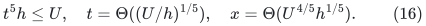
Thus (4), <code class="math">K\leq U</code>, and <code class="math">p,r\leq U</code> eventually hold.
Check them explicitly on finite exceptional inputs.

Use the private touched-set schedule
<!-- math-display: 6dc65dcf7fa4253f210e2278
\rho_{\rm sched}=2^{\lceil8U/K\rceil},\qquad
                 N_{\rm sched}=\rho_{\rm sched}^{\,K}.
 \tag{17}
-->
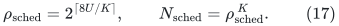
The latter is an <code class="math">O(U)</code>-bit counter, never an allocated universe.
No <code class="math">K^7\leq\log m</code> condition from an older worst-case spanner is
imposed on the elementary static-base schedule.

For a positive integer constant index <code class="math">c_C</code>, define
<!-- math-display: 930a4d879438bffad79f7eb0
c_\phi=\max\{1,\lfloor c_C^{1/4}\rfloor\},\quad
 c_\Lambda=\max\{1,\lfloor c_C^{1/2}\rfloor\},\quad
 c_\Gamma=\max\{1,\lfloor c_C^{3/4}\rfloor\}.
 \tag{18}
-->
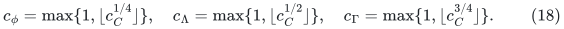
Declare dyadic caps
<!-- math-display: f91b6c694834c743276ef237
\phi_*=2^{-c_\phi rh},\qquad
 \Lambda_*=2^{c_\Lambda(p+r)h},\qquad
 \Gamma_*=2^{c_\Gamma(p+r)h}.
 \tag{19}
-->
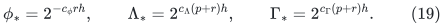
These are conservative numerical parameters and checked output
envelopes. A path exceeding its declared cap suspends the branch;
it is never truncated. The explicit internal hierarchy constants may
be fixed from their proofs. The geometric cap indices in (18) cover
unknown fixed source constants without inserting them as advice.

For sufficiently large FIXED <code class="math">c_C</code>, <code class="math">\phi_*</code> lies below all
required witness expansions. The router has logarithmic quality
<code class="math">O(ph+c_\phi rh)</code>, which fits <code class="math">\Lambda_*</code>. Weighted selection
and the static composition have logarithmic factors
<code class="math">O(c_\Lambda(p+r)h)</code>, which fit <code class="math">\Gamma_*</code>. Fixed polynomial
powers of those structural quantities fit the cap
<!-- math-display: 1db7f40ab13b564979646715
C=2^{c_C(\lceil U/K\rceil+(p+r)h+h)},\qquad P=C^{c_P},
 \tag{20}
-->
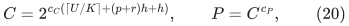
where <code class="math">c_P</code> is the fixed encoding/pool exponent of the chosen
implementation. This order of constants is acyclic because
<code class="math">c_\phi=o(c_\Lambda)</code>, <code class="math">c_\Lambda=o(c_\Gamma)</code>, and
<code class="math">c_\Gamma=o(c_C)</code>.
After <code class="math">c_C</code> is fixed, a separate constant <code class="math">c_E</code> bounds all work
and inverse quality. No index grows with the input in the favorable
branch.

## 4. Static-base repair and selected-edge recourse

Use
[the amortized static-base distance sparsifier](amortized-static-base-distance-sparsifier.md).
Each selected projected edge contributes only its central ORIGINAL
core-edge ID. Prefixes and suffixes lie in already retained lower
layers. Deduplicate selected IDs across owners before degree
feedback. The work factor <code class="math">F</code> remains local and does not multiply
selected size or recourse.

The selected-degree and encoded child-edit factor has
<!-- math-display: 950a181201981f77c0e962ad
\log R=O(U/K+\log\Gamma+\log U).
 \tag{21}
-->
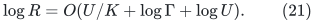
Its safe chronological prefix is <code class="math">O(mR/k+Rz)</code> through <code class="math">z</code>
parent edits. Additive initial credit may be spent late. It is not
equated with actual child initialization.

The normalized projected-route proof bounds both projected degree
and preliminary ambient congestion by a constant times old route
congestion plus the native degree:
[normalized-projected-route-composition.md](normalized-projected-route-composition.md).
For a degree-three parent, that native degree is
<code class="math">k\mathrm{poly}(U)</code>. The repaired length and congestion
therefore obey
<!-- math-display: 49fdaa6cf0fd88843ff6a705
L_{j+1}\leq O(\Gamma)L_j,\qquad
 C_{j+1}\leq O(\Gamma)
                    (C_j+k\mathrm{poly}(U)).
 \tag{22}
-->
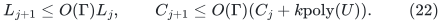
There is no <code class="math">L_j</code> factor in the second recurrence. After <code class="math">K</code>
layers, lengths are <code class="math">\Gamma^{O(K)}</code>, and congestion is
<code class="math">k\mathrm{poly}(U)\Gamma^{O(K)}</code>. An optional fresh-base
normalization changes only the absolute constant in <code class="math">O(K)</code>.

The local work envelope is
<!-- math-display: 1990b21cc4bb37a425fc49ab
W=k^{O(1)}\rho_{\rm sched}^{O(1)}F^{O(1)}
                       \Gamma^{O(K)}\mathrm{poly}(U).
 \tag{23}
-->
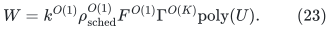
Route-owner replacement, inverse occurrence lists, current
correction scores, native endpoint annotations, and erased-path
retirement are charged here. Selected edges keep their genuine
labels and provenance. New normalized routes replace their own
correction circulation <code class="math">e-R(e)</code>, not a child edge's gradient.
All raw-lifetime and no-query transaction requirements remain in
force; normalization does not reset signed or absolute motion.

## 5. Recursive work, occurrence pools, and full quality

Apply the fixed port-fiber degree reset, with one fiber per actual
parent vertex lifetime. Retained inactive fibers are counted in
child size. A parent lifetime is suppressed from exported null
components only after genuine edge retirement has completed.
Stable core forests, frozen potentials, parallel-edge provenance,
common path pools, and dormant motion counters use the existing
raw-lift interface.

The port scale is
<!-- math-display: 269b90a5a3b034357a9180d9
H_{\rm port}=
        2^{\lceil\log_2(4(\log_2C+1))\rceil},
 \tag{24}
-->
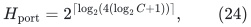
with real child lengths and gradients scaled together, and null
fiber links assigned length one and gradient zero.
<code class="math">\log H_{\rm port}=O(\log U)</code>.
Use the depth cap
<!-- math-display: 9b2905f8e37d7bdb97be62d6
d_*=\lceil8U/x\rceil+10=O(t).
 \tag{25}
-->
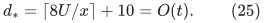
Since
<!-- math-display: 118b8b8eda9edbfd74b1b2cb
\frac{\log P}{x}
       =O\!\left(\frac1t+\frac{t^2h}{U}\right)=o(1),
 \tag{26}
-->
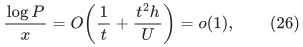
the child size factor <code class="math">P/k</code> is at most <code class="math">k^{-1/2}</code> eventually.
The depth cap has fixed slack.

Let <code class="math">G_d</code> bound occurrences and answer pieces, <code class="math">J_d</code> the work
allowance per actual initialized record, and <code class="math">T_d</code> amortized
update work. The safe coupled recurrence is
<!-- math-display: 862a5d66571a0206b73ac422
\begin{aligned}
 G_d&\leq P(G_{d-1}+1),\\
 J_d&\leq W+P(G_{d-1}+1)
                 +(P/k)(J_{d-1}+T_{d-1}),\\
 T_d&\leq O(kW+kP(G_{d-1}+1))
                 +O(P)(J_{d-1}+T_{d-1}).
 \end{aligned}
 \tag{27}
-->
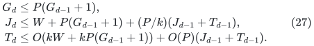
The <code class="math">T_{d-1}</code> term pays for late spending of initial child-update
credit. With <code class="math">\mathcal H_d=J_d+T_d/k</code>, the recurrence closes as
<!-- math-display: eb491c0a789f155953f5a03d
\mathcal H_d\leq O(W+P(G_{d-1}+1))+O(P)\mathcal H_{d-1}.
 \tag{28}
-->
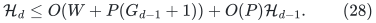
Thus initialization per ACTUAL record, amortized updates, and
occurrence/piece counts are at most
<!-- math-display: 5e1fb6d14ddf3b968b46feb0
k^{O(1)}W(cP)^{O(d_*)}.
 \tag{29}
-->
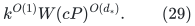
There is one polynomial <code class="math">k</code> factor overall, not a <code class="math">k</code> factor
on every recursive child update.

The one-level distance quality is <code class="math">\Gamma^{O(K)}</code>. The full
raw-cycle inverse quality includes its multiplication across
levels:
<!-- math-display: d26e1bb239e206f729c46c3b
k^{O(1)}
                 \exp O(d_*K\log\Gamma+d_*\log U).
 \tag{30}
-->
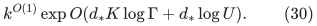
Local correction circulations and same-tree loops are extracted
before recursion with their actual expansion work charged in
<code class="math">W</code>. The exact native circulation identity and frozen-gauge
raw lift justify their comparison. Equation (30) is not replaced
by a one-level quality estimate.

## 6. The 4/5 balance

Substituting <code class="math">p=r=t</code> into (3) gives
<!-- math-display: acf4ded583fae31fafdb7d28
\log\Gamma=O(th),\qquad
            \log F=O(U/t+t^2h+th)=O(x).
 \tag{31}
-->
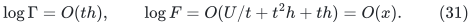
The local repair term and propagated occurrence/work term are
<!-- math-display: 6a95922f831d18843a7e7d30
K\log\Gamma=O(t^3h)=O(x),
 \tag{32}
-->
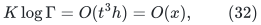
<!-- math-display: 2a02f2f78aff3afb6b37250e
d_*\log P
      =O\!\left(t(U/t^2+th+h)\right)
      =O(U/t+t^2h)=O(x).
 \tag{33}
-->
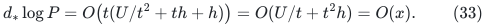
Most importantly, the full quality term is
<!-- math-display: ee0a1076050278683a0956c8
d_*K\log\Gamma=O(t^4h)\leq O(U/t)=O(x),
 \tag{34}
-->
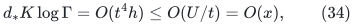
using <code class="math">t^5h\leq U</code>.
Consequently the common logarithmic envelope is
<!-- math-display: b576c4365add8d75f9a0659c
\begin{split}
 O\!\left(x+\log F+K\log\Gamma+
       \frac Ux\left(\frac UK+\log\Gamma+K\log\Gamma\right)\right)
  &=O(U^{4/5}(\log(U+4))^{1/5}).
 \end{split}
 \tag{35}
-->
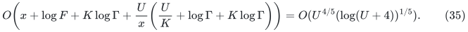
Construction work, structural recourse, and full-depth quality
have each been counted separately.

## 7. Stored labels, guards, and root certificates

Retain the conservative degree-reset length/gradient bound:
one level increases maximum stored magnitude by at most a
polynomial in its graph size, followed by (24). Frozen potential
sums obey the same conservative bound. For root labels of at
most <code class="math">c_0U</code> bits, declare
<!-- math-display: 64ed505c61ebc74e7acb31e3
b_*=(c_0+100)U(d_*+1)=O(Ut).
 \tag{36}
-->
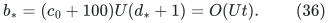
Actual stored-label operations are charged at that precision.
On a nonbase graph <code class="math">\log m\geq x-O(1)</code>, and
<!-- math-display: aa1ceb2c8c70ecdf6249ab34
b_*/x^2=O(t^3/U)=o(1).
 \tag{37}
-->
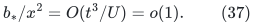
Thus the conservative source guard
<code class="math">b_*\leq(\log m)^2</code> eventually holds. Actual small instances
use a direct multiword base; they do not assume root prices
have <code class="math">O(\log m)</code> bits. Temporary matrix/moment integers
from Section 2 remain separately charged local work.

Set the executable master envelope
<!-- math-display: d4cde43e9557038f9ba39e27
E_*=2^{c_Ex}.
 \tag{38}
-->
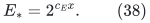
For one fixed sufficiently large <code class="math">c_C</code>, followed by one fixed
sufficiently large <code class="math">c_E</code>, it bounds initialization per actual
record, update work, notifications, answer pieces, flat
multiplicity, and inverse raw quality. Every degree, prefix,
size, lifetime, bit, depth, and work cap is checked before
using an answer. A violation suspends that branch.

The root client computes the actual raw physical denominator
and numerator from returned paths, with repetitions and unit
signed pieces counted:
<!-- math-display: e22b81fdd98993ad375d2e44
V\leq ME_*^2\max_e\ell_e,\qquad
 |N|\leq ME_*^2\max_e|g_e|.
 \tag{39}
-->
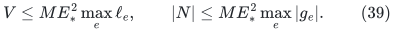
Root forest size is at most <code class="math">ME_*</code>, and there are at most
<code class="math">E_*</code> pieces. For a fixed favorable tuple,
<code class="math">\log E_*=o(U)</code>, so (39) has <code class="math">O(U)</code>-bit root values.
The raw denominator does not exceed an inherited upper
certificate, so using it improves the ratio. Internal
arithmetic still pays (36).

These executable guards do not establish the imported mathematical
contracts. Eventual nonfailure and fast completion require the
supplied primitive and lifetime proofs.

## 8. Decoupled exact matching client

Let <code class="math">S=2^s</code> bound the physical degree-three matching instance,
and use master <code class="math">U=2s</code>. The binary-ledger proof sets
<!-- math-display: 9d3390ba94c681c26a8320c8
a=s,\quad C_{\rm ledger}=s+1,\quad b_j=2^{s-j}.
 \tag{40}
-->
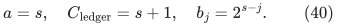
Choose
<!-- math-display: 8ce7b726c38db20b2dd9248b
D=2^{\lceil\log_2\max\{16,4E_*\}\rceil},\qquad
                     q_{\rm num}=1/(16D).
 \tag{41}
-->
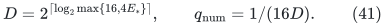
The grid <code class="math">\delta=S^{-1000}</code>, <code class="math">\epsilon=S^{-3000}</code>, and
the existing root price scale are unchanged. Eventually
<code class="math">D\leq S^2</code>, <code class="math">q_{\rm num}\geq S^{-1}</code>, and the strict
acceptance margin <code class="math">1/(4D)&gt;2q_{\rm num}</code> holds literally.

For actual nominal size <code class="math">R_{\rm nom}</code>, initialize with
<!-- math-display: 274659e62c613f25d5672949
M=2^{\lceil\log_2(16(R_{\rm nom}+2))\rceil}.
 \tag{42}
-->
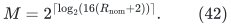
The top choice <code class="math">R_{\rm nom}=S(s+1)^{10}</code> and the local
choice <code class="math">8192(P_{\rm debt}+1)</code> are at most <code class="math">2^U=S^2</code>
eventually. No old <code class="math">2a^2</code> rounding condition is used.
The ledger base two need not dominate <code class="math">E_*</code>.

The structural reset sum is <code class="math">O(s^3S)</code>, the number of global
resets is <code class="math">O(s)</code>, and the number of gap phases is <code class="math">O(s^2)</code>.
The [decoupled client](decoupled-numerical-client.md) costs
<!-- math-display: 793d3cb283c2b5d6cfc4828d
O(MD+QD+D^2J)\mathrm{poly}(s),
 \tag{43}
-->
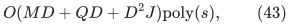
Here <code class="math">J</code> counts accepted steps and <code class="math">Q</code> counts external
requests from the owning client, including failed/LOW queries
and exact point requests. Internal numerical refreshes form
the separate <code class="math">O(DJ)</code> category already paid by <code class="math">D^2J</code>;
they are not added to this <code class="math">Q</code>.
Local and all-expanded exact recovery cost
<code class="math">(P_{\rm debt}+1)D^4\mathrm{poly}(s)</code>. They round
the conserved grid circulation and use ordinary residual
searches; no fresh static max-flow call is hidden there.

The complete favorable branch therefore costs
<!-- math-display: f25e41a385d83b28d67fe2a1
SE_*^4\mathrm{poly}(s)
       =S\exp O(s^{4/5}(\log(s+4))^{1/5}).
 \tag{44}
-->
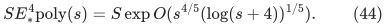
This uses the same persistent integral carrier, exact physical
matching representation, factor-critical contraction proof,
general-gap LOW implication, and reset/phase budget as the
existing construction.

For a first supposed failure on a favorable sufficiently large
input, all prior states satisfy those interfaces. Physical debt,
padded debt, and prefix estimates bound the attempted operation.
Equations (15)--(44) then place its work and state within the
declared caps, contradicting first failure. This argument is
conditional on the mathematical primitive, not on a verifier.

## 9. One finite program, all graphs, and an optional kernel

Simplify once: ignore self-loops for cardinality matching,
retain one representative per parallel pair, and compact
nonisolated vertices. In the ordinary integer-labeled input
model this costs <code class="math">O(n+m)</code>; let <code class="math">m_s</code> be the surviving
simple edge count.

The exact odd-path degree-three reduction in
[general-graph-gap-reduction.md](general-graph-gap-reduction.md)
has size <code class="math">O(m_s)</code>, a known optimum offset, and a decoder
for every auxiliary maximum matching. Gap phases use the
general improvement target and have no perfect-matching
promise. The numerical improvement does not restrict the
class of input graphs.

Enumerate positive integer pairs <code class="math">(c_C,c_E)</code>. Give every
guarded branch a fixed positive geometrically decreasing
share of word instructions, and give one deterministic
classical exact matching branch a fixed positive share.
Charge all allocation, callbacks, local multiword arithmetic,
path materialization, and verification to those budgets.
No long subroutine is an indivisible scheduled unit.

Validate each decoded proposal on the compact working graph,
then perform one exact deterministic general-graph
augmenting-path search. Accept only if no augmenting path
exists. This verification runs in the proposing branch's
budget. The classical branch ensures termination and exact
output even when another branch suspends or makes an
incorrect early LOW claim.

Under the additional primitive theorem, one fixed pair has
the eventual fast bound (44), and its budget share is a
fixed positive constant. The same finite program handles
all finite exceptional sizes through the classical branch,
without knowing their threshold. This proves the conditional
time bound (1).

Optionally compute an exact matching-size kernel before
starting workers. A maximal matching gives a vertex cover
<code class="math">C_0</code>. Keep all edges inside it; for each <code class="math">v\in C_0</code>,
keep <code class="math">&#124;C_0&#124;+1</code> arbitrary outside neighbors, or all if fewer.
Any omitted maximum-matching edge can be replaced by an
unused retained outside neighbor, since at most <code class="math">&#124;C_0&#124;</code>
outside vertices are occupied. Iterating preserves the
optimum and gives
<!-- math-display: 425e7631d3da59593ecf8e84
m_c\leq\min\{m_s,O(\nu^2)\}.
 \tag{45}
-->
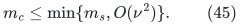
ALL workers, including the classical branch and every
augmenting-path verifier, then use this compact kernel.
Only the winning output is mapped once to original IDs.
Thus <code class="math">m_s</code> in the second term of (1) may be replaced by
<code class="math">m_c</code>, while keeping the one-time <code class="math">O(n+m)</code> term.

The exact-output statement uses the verifier and classical
fallback. The fast-time statement additionally uses (3)--(10)
and their full sequential construction, together with all
shared dynamic, raw-cycle, numerical, and matching proofs.
This distinction remains necessary after an independent
mathematical review.
