# A 5/6 quantitative composition for deterministic general matching

**Research theorem candidate, 24 October 2026.** This note composes
[deterministic threshold token routing](deterministic-token-routing-by-thresholds.md),
[sparse weighted path selection](deterministic-weighted-path-selection.md),
and the resulting
[static sparsifier with length-free ambient congestion](length-free-ambient-static-sparsifier.md)
with the existing dynamic, numerical, and matching constructions.
It gives the parameter balance and a single computable wrapper.
Its dependencies are the named primary-source algorithms and the
mathematical reconstructions cited below. It is not an externally
verified implementation or a claim that an optimality verifier proves
the fast running time.

The target is exact maximum-cardinality matching in arbitrary
undirected graphs. There is no perfect-matching promise, approximation,
bipartiteness assumption, or density restriction. This construction
does not use the Chang--Huang--Su distributed hierarchy. The separate
6/7 construction remains unchanged.

## 1. The static interface, including the normalized-route type

Let <code class="math">U\geq2</code> be an integer master bound, and put
<code class="math">h=\lceil\log_2(U+4)\rceil</code>. Every actual graph, explicit route
list, and token inventory in a local call has at most <code class="math">2^{O(U)}</code>
records. This is a bound, not permission to allocate a master-sized
graph. All initializations use actual input records.

The static parameters are integers <code class="math">q\geq2</code>, <code class="math">r\geq1</code>,
with <code class="math">q,r\leq U</code> and <code class="math">qrh\leq U</code>. The separated source
construction supplies
<!-- math-display: 2089f1ba64dcf077a5b99d87
\log_2\Gamma=O(qrh),\qquad
 \log_2F=O(U/q+U/r+r^2h+qrh).
 \tag{1}
-->
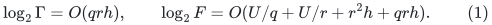
The first factor controls structural output; the second is
construction work. Constants are uniform in the growing parameters.

The input is a demand multigraph <code class="math">J</code> with distinct physical edge
IDs, and annotated ambient paths <code class="math">\Pi(e)</code> with the same endpoints.
Write <code class="math">L_0=\max\{1,\max_e&#124;\Pi(e)&#124;\}</code>, let <code class="math">C_0</code> be their
ambient vertex-occurrence congestion, and let
<code class="math">\Delta_0=\Delta(J)</code>. Endpoints and repeated occurrences are
included in <code class="math">C_0</code>.

First erase closed subwalks from each individual nonloop image.
This produces a normalized table <code class="math">\Pi'</code> of simple paths, with
<!-- math-display: 0103bf5cd8c23db9cb89e195
L(\Pi')\leq L_0,\qquad C(\Pi')\leq C_0.
 \tag{2}
-->
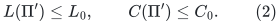
The static routine returns this table, a subgraph
<code class="math">\widetilde J\subseteq J</code>, and explicit routes
<code class="math">\widehat\Pi:J\to\widetilde J</code>, with
<!-- math-display: 577e1f4edad7b969f6fdfcac
\begin{aligned}
 |E(\widetilde J)|&\leq |V(J)|\Gamma\mathrm{poly}(U),\\
 L(\widehat\Pi)&\leq\Gamma,\\
 L(\Pi'\circ\widehat\Pi)&\leq\Gamma L_0,\\
 C(\Pi'\circ\widehat\Pi)&\leq\Gamma(C_0+\Delta_0).
 \end{aligned}
 \tag{3}
-->
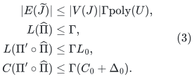
Its work, including the normalization and full explicit ambient
route lists, is
<!-- math-display: 8efe1e3d0a7fc1089c5ec634
|E(J)|F^{O(1)}\Gamma^{O(1)}(L_0+1)\mathrm{poly}(U),
 \tag{4}
-->
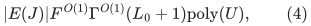
plus actual vertex bookkeeping. In particular <code class="math">F</code> enters none
of the structural bounds in (3).

The last line of (3) is about the returned normalized table
<code class="math">\Pi'</code>, not the unchanged original walks <code class="math">\Pi</code>. This distinction
is necessary: an input walk could repeat an ambient vertex
arbitrarily often. The distance application permits normalization
and explicitly uses the correction circulation
<code class="math">e-\text{current normalized route of }e</code>. No gradient-preserving
static theorem for the old image is asserted.
All erasure compares IMMEDIATE ambient vertex lifetime IDs.
Equal eventual parent or physical images do not identify native
endpoints. In particular a path between different aliases of one
root, or an edge with zero eventual physical image, cannot be
discarded on that basis.
The exact circulation decomposition, gradient calculation, and
raw-lift compatibility are proved in
[normalized-route-cycle-comparison.md](normalized-route-cycle-comparison.md).

The proof of this interface has two new steps. In a fixed expander,
edge-threshold deletions and the original-volume pruning bound route
all degree-proportional token demands in <code class="math">O(\log M)</code> fresh oracle
generations. Each token path has length
<code class="math">\Lambda=2^{O(qrh)}</code>, while aggregate edge congestion is
<code class="math">D\,2^{O(qrh)}</code>. There is one oracle per round, rather than <code class="math">D</code>
separately initialized copies. Next, the deterministic weighted
selection lemma chooses one path for each witness edge. Simplicity
of each individual <code class="math">\Pi'(e)</code> bounds a single choice's load at an
ambient vertex by <code class="math">O(\Lambda\Delta_0)</code>, independently of <code class="math">L_0</code>.
That is the step that removes <code class="math">L_0</code> from ambient congestion.
The separate static note proves the degree-band, weighted-witness,
and reverse-embedding composition, including fractional witness
weights and parallel IDs.

## 2. Source ranges and actual-size base cases

The source dependencies in (1) are the parameterized
Chuzhoy--Saranurak decremental expander paths and
Chuzhoy et al. cut-player/decomposition algorithms, as reconstructed
in
[separated-static-sparsifier-parameters.md](separated-static-sparsifier-parameters.md)
and
[parameterized-expander-path-and-degree-bands.md](parameterized-expander-path-and-degree-bands.md).
The threshold router uses their original-volume pruning guarantee,
including its whole-host extension at deletion-quota exhaustion.

In a decomposition call on <code class="math">m'</code> records, clip <code class="math">r</code> to
<!-- math-display: 760e258646490a7ee5277895
r'=\min\{r,\lfloor\log(m'+2)/c_0\rfloor\},
 \tag{5}
-->
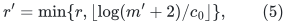
with a constant-size base. This improves conductance and keeps
construction work inside (1). In a path-oracle call with
<code class="math">\log(m'+2)&lt;c_1qrh</code>, use ordinary pruning and direct BFS;
the query factor is <code class="math">2^{O(qrh)}</code>, with no larger padded graph.
Otherwise the smallest terminal set has sufficient logarithmic
size to meet the cut-player cutoff and the pruning slack. These
are the literal small-instance adapters in the source
reconstruction.

An additional tiny static case can use a spanning forest of <code class="math">J</code>.
For <code class="math">v</code> nonisolated demand vertices with <code class="math">v^2\leq\Gamma</code>, route
each edge along its tree path. After input normalization, each
individual input image visits any ambient vertex at most once.
Thus the composed ambient congestion is at most
<!-- math-display: 9cff2033ba98be5800267415
|E(J)|v\leq v^2\Delta_0
                         \leq\Gamma(C_0+\Delta_0),
 \tag{6}
-->
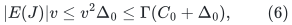
and its length is at most <code class="math">vL_0</code>. The actual construction work
is <code class="math">O(&#124;E(J)&#124;v(L_0+1))</code>, within (4).
This argument requires the simple normalized table; applying the
old nonsimple walks would reintroduce a length factor.

Loop demands retain their current endpoint annotations and
permitted empty geometric routes. They are kept outside nonloop
expander hosts. A later native split may awaken such a demand,
which is a change of its retained lifetime, not a new synthetic
edge insertion. Unrelated private native roots are never
published as a large zero-star child graph.

At a recursive cycle-backend level, inputs with at most <code class="math">24k</code>
active records use the direct small-graph ratio solver on their
actual records and declared word sizes. Resident child isolates
remain counted for size bounds; only private tombstone metadata
is excluded. Source periods start from current active records
and retain newly isolated native slots until that period ends,
as in the existing isolate adapter.

## 3. Rounded parameters

Define
<!-- math-display: 7771f3fcf3e072824849fc6f
t=\max\left\{2,\left\lfloor(U/h)^{1/6}\right\rfloor\right\},
 \qquad q=r=t,\qquad K=t^2,
 \tag{7}
-->
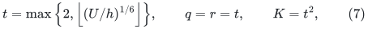
<!-- math-display: 07c6bff5df0eb8f9755501ba
x=\lceil U/t\rceil,\qquad k=2^x.
 \tag{8}
-->
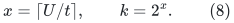
Integer-root comparisons compute <code class="math">t</code>; no real-valued
parameter advice is used. The static path-hierarchy depth <code class="math">q</code>,
cut-player parameter <code class="math">r</code>, touched-set repair depth <code class="math">K</code>,
and recursive size reduction <code class="math">k</code> have distinct roles.

For sufficiently large <code class="math">U</code>,
<!-- math-display: 58d9fb4b61f8ccce9a164aab
t^6h\leq U,\qquad
 t=\Theta((U/h)^{1/6}),\qquad
 x=\Theta(U^{5/6}h^{1/6}).
 \tag{9}
-->
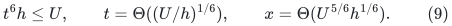
The literal source guards <code class="math">q,r\leq U</code>, <code class="math">K\leq U</code>, and
<code class="math">qrh=t^2h\leq U</code> follow. They are checked, rather than presumed,
on finite exceptional inputs.

For the private touched-set schedule use
<!-- math-display: 717470b29dbd7c9bfd58a0d5
\rho=2^{\lceil8U/K\rceil},
             \qquad N_{\rm sched}=\rho^K.
 \tag{10}
-->
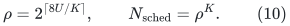
The latter is a counter of <code class="math">O(U)</code> bits. It is never an allocated
vertex universe. The old restriction <code class="math">K^7\leq\log m</code>, belonging
to a different worst-case spanner instantiation, is not imposed
on this elementary static-repair schedule.

### 3.1 Explicit internal caps from the same constant index

The threshold router needs a numerical path cap in its threshold,
not just asymptotic notation for <code class="math">\Lambda</code>. No extra noncomputable
constant is supplied to the program. From the same positive integer
<code class="math">c_C</code> enumerated in Section 9, compute
<!-- math-display: babc278d93b9a2c59f42990c
\begin{split}
 c_\phi&=\max\{1,\lfloor c_C^{1/4}\rfloor\},\\
 c_\Lambda&=\max\{1,\lfloor c_C^{1/2}\rfloor\},\\
 c_\Gamma&=\max\{1,\lfloor c_C^{3/4}\rfloor\}.
 \end{split}
 \tag{10a}
-->
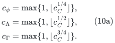
Integer comparisons compute all three roots. Declare the dyadic
conductance and path caps
<!-- math-display: 354489db2f5668bf7665bf58
\phi_*=2^{-c_\phi rh},\qquad
 \Lambda_*=2^{c_\Lambda qrh},\qquad
 \Gamma_*=2^{c_\Gamma qrh}.
 \tag{10b}
-->
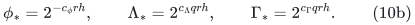
Use <code class="math">\phi_*</code> as the conservative host/witness conductance
parameter, and <code class="math">\Lambda_*</code> in the threshold router. For its
fixed explicit pruning constant <code class="math">c_{\rm prune}</code>, the threshold
is the integer ceiling of
<!-- math-display: ab8aff93709e1e2c97fe79ff
8c_{\rm prune}D\Lambda_*/\phi_*.
 \tag{10c}
-->
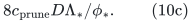
If a returned path exceeds <code class="math">\Lambda_*</code>, suspend that branch;
do not truncate the path. Likewise the static structural and
prefix counts are checked against their declared caps.

For a sufficiently large fixed <code class="math">c_C</code>, <code class="math">\phi_*</code> is no greater
than the decomposition and witness expansion guarantees.
The source path bound has logarithm <code class="math">O(c_\phi qrh)</code>, so
<code class="math">\Lambda_*</code> eventually dominates it. The threshold routing
and weighted selection output factors have logarithm
<code class="math">O((c_\Lambda+c_\phi)qrh)</code>, which is dominated by
<code class="math">\log\Gamma_*</code> for sufficiently large fixed <code class="math">c_C</code>.
Finally the fixed polynomial powers of <code class="math">\Gamma_*</code>, <code class="math">\rho</code>,
and <code class="math">U</code> required by selected-degree feedback fit the port
cap (14), because <code class="math">c_\Gamma=o(c_C)</code> as the constant index
grows. Explicit powers of <code class="math">\Gamma_*</code> may be used in the
native repair thresholds.

All coefficients in this paragraph are fixed after one favorable
<code class="math">c_C</code> is chosen. They do not grow with the input. Consequently
they alter only the fixed constants in (1) and (22)--(26).
The independent <code class="math">c_E</code> is then chosen large enough for all
work and quality bounds. On finite exceptional inputs the
parameter/bit guards may suspend the branch. This cap separation
makes the two-constant portfolio executable without knowing an
asymptotic path-bound constant in advance.

## 4. Dynamic repair and the improved local recurrence

Use
[the amortized static-base construction](amortized-static-base-distance-sparsifier.md).
Every selected projected edge contributes only its central original
core-edge ID. Its prefix and suffix already lie in lower repair
layers. Selected IDs are deduplicated across layer owners before
degree feedback. The static running time <code class="math">F</code> is local work;
it does not multiply selected size or recourse.

Let <code class="math">A=\mathrm{poly}(U)</code> cover native translation, stable
core forests, length buckets, and ordinary indexing. The
selected-degree and encoded child-edit factor is
<!-- math-display: b32990fec42574d9a07040db
R=(A\rho\Gamma)^{O(1)},\qquad
                 \log R=O(U/K+\log\Gamma+\log U).
 \tag{11}
-->
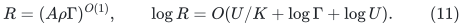
Through <code class="math">z</code> parent edits the child transcript has the safe prefix
bound <code class="math">O(mR/k+Rz)</code>. Its additive credit may be spent late and is
not confused with actual child initialization. The alternative
one-time fresh-base normalization proves a pure <code class="math">O(Rz)</code>
post-initialization prefix, but the recurrence below allows the
more conservative credit.

In a touched-set projection, a new endpoint is an occurrence on
an old route or a current native endpoint. Consequently the
projected input degree is bounded by a constant times old route
congestion plus the native degree envelope. This includes empty
loop endpoints. The literal normalized-route and endpoint-count
proof is in
[normalized-projected-route-composition.md](normalized-projected-route-composition.md).
In particular it bounds both projected degree and preliminary
ambient congestion without a factor <code class="math">L_j</code>.
The native envelope is
<code class="math">k\mathrm{poly}(U)</code> in the degree-three parent interface.
Together with (3), the repair recurrence is therefore
<!-- math-display: 60fc4d64df196f0380fe8433
L_{j+1}\leq O(\Gamma)L_j,\qquad
 C_{j+1}\leq O(\Gamma)
                  \bigl(C_j+k\mathrm{poly}(U)\bigr).
 \tag{12}
-->
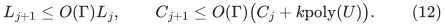
It gives length <code class="math">\Gamma^{O(K)}</code> and congestion
<code class="math">k\mathrm{poly}(U)\Gamma^{O(K)}</code>.
There is no multiplication by <code class="math">L_j</code> in the second recurrence.
Freezing a settled base and then running another <code class="math">K</code> repair
layers changes only the constant in <code class="math">O(K)</code>.

All normalized current routes receive new owner and inverse-
occurrence records. Old records are retired with their old
physical IDs before replacement; an erased unused subwalk
belongs to no current record. The raw-cycle corrections use
the new route, not an obsolete gradient identity.
The existing coalesced transaction and pool-retirement proofs
are still required; normalization does not cancel their actual
signed or absolute motion counters.

The resulting local work envelope is
<!-- math-display: 06f746b3355f3223498e1391
W=k^{O(1)}\rho^{O(1)}F^{O(1)}
                      \Gamma^{O(K)}\mathrm{poly}(U).
 \tag{13}
-->
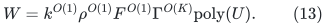
This is where <code class="math">\Gamma^{O(K)}</code> replaces the previous
<code class="math">\Gamma^{O(K^2)}</code>. The improvement is insufficient by itself:
the multiplication of quality across recursive levels must
also be bounded.

## 5. Recursive pools, work, and quality

Apply the existing fixed port-fiber degree reset to each settled
selected graph. Each actual parent vertex lifetime has one
fiber; retained inactive fibers count in child size. Purely null
export over a retired parent lifetime is suppressed after all
real-edge retirement is complete. Stable core forests, frozen
gauges, physical provenance, and dormant motion counters retain
their existing lifetime interfaces.

For an enumerated positive integer <code class="math">c_C</code>, use the literal cap
<!-- math-display: bd0d247f78665e933e522263
C=2^{c_C(\lceil U/K\rceil+t^2h+h)},\qquad
                    P=C^{c_P},
 \tag{14}
-->
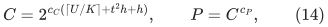
where <code class="math">c_P</code> is the fixed polynomial encoding/pool exponent
of the chosen implementation. Increasing the fixed <code class="math">c_C</code>
absorbs the source constants in (11). The port scale is
<!-- math-display: 30fbb15e084e2a502523a171
H_{\rm port}
       =2^{\lceil\log_2(4(\log_2C+1))\rceil}.
 \tag{15}
-->
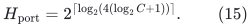
Real child lengths and gradients are scaled by this value;
null fiber connectors have integer length one and gradient
zero. In particular <code class="math">\log H_{\rm port}=O(\log U)</code>.

Set
<!-- math-display: 2f7aa0e1067af338cba38f32
d_*=\lceil8U/x\rceil+10=O(t).
 \tag{16}
-->
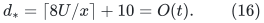
The actual child size is at most its parent size times <code class="math">P/k</code>,
up to the stated period credit. Since
<!-- math-display: 47eae13e2603c25025bfdefb
\frac{\log P}{x}
      =O\!\left(\frac1t+\frac{t^3h}{U}\right)=o(1),
 \tag{17}
-->
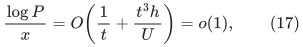
every nonbase level shrinks by at least <code class="math">k^{1/2}</code> eventually.
Thus the depth guard (16) has constant slack.

Let <code class="math">G_d</code> bound occurrence and answer size, <code class="math">J_d</code> be the
initial work allowance per actual record, and <code class="math">T_d</code> be
amortized update work. The safe coupled recurrence is
<!-- math-display: 02de69d40f88b2f1f04d6b3a
\begin{aligned}
 G_d&\leq P(G_{d-1}+1),\\
 J_d&\leq W+P(G_{d-1}+1)
                  +(P/k)(J_{d-1}+T_{d-1}),\\
 T_d&\leq O(kW+kP(G_{d-1}+1))
                  +O(P)(J_{d-1}+T_{d-1}).
 \end{aligned}
 \tag{18}
-->
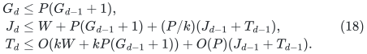
The <code class="math">T_{d-1}</code> term in the initialization allowance pays for
late spending of additive child-update credit. With
<code class="math">\mathcal H_d=J_d+T_d/k</code>, (18) gives
<!-- math-display: ef7e9cc15b36d88666b7f365
\mathcal H_d\leq O(W+P(G_{d-1}+1))
                         +O(P)\mathcal H_{d-1}.
 \tag{19}
-->
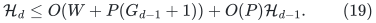
Work, occurrence counts, and output-piece counts are bounded by
<!-- math-display: eb74c5826be74b1529aed1c4
k^{O(1)}W(cP)^{O(d_*)}.
 \tag{20}
-->
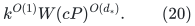
Actual initialization is actual size times this quantity.
There is one overall polynomial factor in <code class="math">k</code>, not a new
factor <code class="math">k</code> on each recursive child edit.

The distance-spanner stretch in one level is
<code class="math">\Gamma^{O(K)}</code>. The raw-cycle inverse quality over all
levels is therefore bounded by
<!-- math-display: 500a2f86b57d6a6b2050b734
k^{O(1)}
             \exp O(d_*K\log\Gamma+d_*\log U).
 \tag{21}
-->
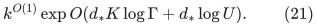
The factor involving <code class="math">d_*K</code> must not be omitted. Local
correction circulations and same-tree loops are extracted
explicitly before recursion, with their actual lengths charged
to (13). Open edges use the established gauge correction;
zero-link contraction preserves circulation gradients.

## 6. The 5/6 balance

Substitution into (1) yields
<!-- math-display: 8213604c23009a02d2ec90a9
\log\Gamma=O(t^2h),\qquad
          \log F=O(U/t+t^2h)=O(x).
 \tag{22}
-->
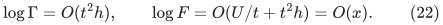
The local repair term is
<!-- math-display: 3b56a83a017ef3e92629b044
K\log\Gamma=O(t^4h)=O(x).
 \tag{23}
-->
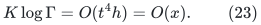
The propagated occurrence/work term is
<!-- math-display: 40d1ef6da5592e021b94dfb0
d_*\log P
    =O\!\left(t(U/t^2+t^2h+h)\right)
    =O(U/t+t^3h)=O(x).
 \tag{24}
-->
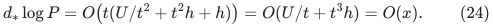
Finally the full quality loss is
<!-- math-display: 1b7389d8bbcd7e3cee03c548
d_*K\log\Gamma=O(t^5h)\leq O(U/t)
                                                    =O(x).
 \tag{25}
-->
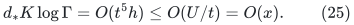
The last inequality uses precisely <code class="math">t^6h\leq U</code>.
It is the strongest of these parameter constraints.

Thus all quantities in (20)--(21) have a common logarithmic
envelope
<!-- math-display: 0ddd8dfb718b1144a5864b84
\begin{split}
 O\!\left(
 x+\log F+K\log\Gamma+
 \frac Ux\left(\frac UK+\log\Gamma+K\log\Gamma\right)
 \right)
 &=O(U^{5/6}(\log(U+4))^{1/6}).
 \end{split}
 \tag{26}
-->
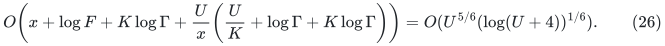
The construction-work factor has not been mistaken for
structural quality, and the hierarchy-wide quality term has
not been mistaken for a one-level cost.

## 7. Bits, guards, and root raw certificates

Retain the conservative finite-word envelope from the degree-reset
backend. A core stored length is at most a polynomial in its
level's graph size times the parent maximum length. Port scaling
contributes <code class="math">O(\log U)</code> bits. Frozen potential sums and gradients
obey the same crude per-level bound. If root prices have at most
<code class="math">c_0U</code> bits, declare
<!-- math-display: 2795885f680081238083382a
b_*=(c_0+100)U(d_*+1)=O(Ut).
 \tag{27}
-->
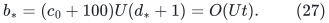
All arithmetic is charged at this precision. On a nonbase input
<code class="math">\log m\geq x-O(1)</code>, and
<!-- math-display: a85337f093ee81930db2cdd4
b_*/x^2=O(t^3/U)=o(1).
 \tag{28}
-->
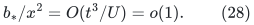
The safe source guard <code class="math">b_*\leq(\log m)^2</code> eventually holds.
Actual small bases use multiword arithmetic, not a false
<code class="math">O(\log m)</code>-bit root-price assumption.

For an enumerated positive integer <code class="math">c_E</code>, declare
<!-- math-display: ca851ff0273664bac859c888
E_*=2^{c_Ex}.
 \tag{29}
-->
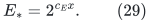
For one fixed sufficiently large <code class="math">c_C</code>, followed by a fixed
sufficiently large <code class="math">c_E</code>, (29) bounds initialization per actual
record, update work, output pieces, route notifications, flat
multiplicity, and inverse raw quality. Check all declared degree,
size, transcript-prefix, bit, lifetime, and depth caps before
using an answer. The safe transcript guard includes its initial
credit unless the optional fresh-base proof has been invoked.

Deep abstract lengths need not be rounded into a short root
certificate. The root client sums physical root input lengths
along the exposed returned forest paths, counting every repeated
occurrence and unit signed piece. With at most <code class="math">E_*</code> pieces and
root forest size at most <code class="math">ME_*</code>,
<!-- math-display: e7de36ef0186a32a7fb847aa
V\leq ME_*^2\max_e\ell_e,\qquad
 |N|\leq ME_*^2\max_e|g_e|.
 \tag{30}
-->
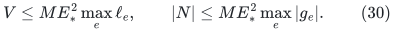
For a fixed favorable tuple, <code class="math">\log E_*=o(U)</code>, so both quantities
have <code class="math">O(U)</code> root bits. Exact raw <code class="math">V</code> is no greater than the
inherited upper certificate; replacing that certificate by <code class="math">V</code>
only improves the ratio. Internal arithmetic is still charged
at (27).

The guards do not certify the imported mathematical contracts.
Their purpose is to make a single finite program and its
first-failure analysis explicit. Eventual fast correctness
uses the constructions in Sections 1--5.

## 8. Decoupled ledgers and numerical work

Let <code class="math">S=2^s</code> bound the physical degree-three matching instance,
and use master <code class="math">U=2s</code>. The independent binary-ledger proof gives
<!-- math-display: a801204a7ef154aa71773d35
a=s,\qquad C_{\rm ledger}=s+1,\qquad b_j=2^{s-j}.
 \tag{31}
-->
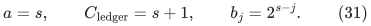
Set
<!-- math-display: 91d15dd5ffc9a08b475f2736
D=2^{\lceil\log_2\max\{16,4E_*\}\rceil},
                     \qquad q_{\rm num}=1/(16D).
 \tag{32}
-->
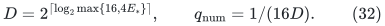
The grid choices <code class="math">\delta=S^{-1000}</code>,
<code class="math">\epsilon=S^{-3000}</code>, and the existing root price scale remain
unchanged. Eventually <code class="math">D\leq S^2</code> and
<code class="math">q_{\rm num}\geq S^{-1}</code>; the strict acceptance margin
<code class="math">1/(4D)&gt;2q_{\rm num}</code> holds literally.
The ledger base is two and need not dominate <code class="math">E_*</code>.

Use the actual nominal size
<!-- math-display: 5ae4e9b4f28706609421812c
M=2^{\lceil\log_2(16(R_{\rm nom}+2))\rceil}.
 \tag{33}
-->
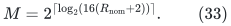
The top choice <code class="math">R_{\rm nom}=S(s+1)^{10}</code> and the local choice
<code class="math">8192(P_{\rm debt}+1)</code> are at most <code class="math">S^2=2^U</code> eventually.
There is no rounding to a multiple of <code class="math">2a^2</code>.

The structural proof bounds the lower-ledger reset sum by
<code class="math">O(s^3S)</code>, global resets by <code class="math">O(s)</code>, and the number of gap
phases by <code class="math">O(s^2)</code>. The
[decoupled numerical client](decoupled-numerical-client.md)
has work
<!-- math-display: be6668e5142ff9325f3eb2cb
O(MD+QD+D^2J)\mathrm{poly}(s),
 \tag{34}
-->
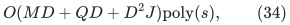
where <code class="math">J</code> counts accepted steps and <code class="math">Q</code> includes client calls
and refreshes. Local and all-expanded exact recovery cost
<code class="math">(P_{\rm debt}+1)D^4\mathrm{poly}(s)</code>; the top run costs
<code class="math">SD^4\mathrm{poly}(s)</code>. These recoveries round the
already conserved grid flow and use ordinary residual searches.
They do not call a new static max-flow routine.

After all resets and phases, a favorable complete branch costs
<!-- math-display: 8dddeaa9ee4f5e58965f0670
SE_*^4\mathrm{poly}(s)
    =S\exp O\!\left(s^{5/6}(\log(s+4))^{1/6}\right).
 \tag{35}
-->
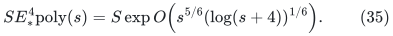
The exact all-expanded recovery, binary-ledger budget,
persistent integral carrier, and general-gap driver are the
same previously proved interfaces. Before the first guard
failure, old states are valid and the physical/padded debt
bounds control the current attempted projection. Equations
(22)--(35) then show that the fixed favorable tuple cannot
reach a guard failure on sufficiently large inputs. This is
a mathematical consequence of the supplied contracts, not
of a final matching verifier.

## 9. One computable program, all graphs, and the optional kernel

Clean the input once: ignore self-loops for cardinality matching,
retain one representative of each parallel pair, and compact the
nonisolated vertices. In the usual integer-labeled graph input
model this costs <code class="math">O(n+m)</code>. Let <code class="math">m_s</code> be the resulting
number of simple edges.

The exact odd-path degree-three gadget from
[general-graph-gap-reduction.md](general-graph-gap-reduction.md)
has size <code class="math">O(m_s)</code>, a known optimum offset, and a decoder for
arbitrary auxiliary maximum matchings. The gap phase is applied
without a perfect-matching promise; its LOW implication is the
general improvement-target statement. Thus the graph class has
not been restricted in the numerical composition.

Enumerate all positive integer pairs <code class="math">(c_C,c_E)</code>. Give each
guarded branch a fixed positive geometrically decreasing share
of word instructions, and give one deterministic classical exact
matching branch a fixed positive share. Source algorithms,
allocation, callbacks, large-integer arithmetic, and verification
are charged within these instruction budgets; no long subroutine
is treated as an indivisible unit.

For each decoded proposal, validate that it is a matching on the
compact working graph, and run one exact deterministic
general-graph augmenting-path search. Accept only when no
augmenting path exists. This validation runs in that branch's
budget. The classical branch ensures termination and exact
output even if another branch makes an incorrect early LOW
claim or suspends.

One fixed pair has all the eventual fast-time bounds above.
Its budget share is a fixed positive constant, so it preserves
the asymptotic time. The same finite program handles the
finitely many exceptional smaller sizes, without knowing their
threshold or the favorable pair. The resulting all-graph
research bound is
<!-- math-display: 0bd59fe506d6cfa4a50dd6ed
\boxed{
 O(n+m)+(m_s+1)\exp O\!\left(
       (\log(m_s+2))^{5/6}
       (\log\log(m_s+4))^{1/6}
                         \right).
 }
 \tag{36}
-->
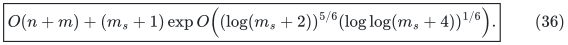

Optionally apply the exact matching-size kernel once, before
starting workers. A maximal matching gives a vertex cover <code class="math">C</code>.
Keep every edge inside <code class="math">C</code>, and for each <code class="math">v\in C</code> keep
<code class="math">&#124;C&#124;+1</code> arbitrary neighbors outside <code class="math">C</code>, or all of them if
there are fewer. An omitted matched neighbor can be replaced by
an unused retained one: at most <code class="math">&#124;C&#124;</code> outside vertices are
occupied by the matching. Iterating this exchange preserves
the optimum. The kernel has
<!-- math-display: b97eb366ea557c99c9f9d971
m_c\leq\min\{m_s,O(\nu^2)\}.
 \tag{37}
-->
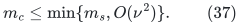
All workers, including the classical branch and every verifier,
then operate on this compact kernel. Only the winning matching
is mapped once to original edge IDs. This gives (36) with
<code class="math">m_s</code> in its second term replaced by <code class="math">m_c</code>, while retaining
the one-time <code class="math">O(n+m)</code> input term.

Exact output of this finite program and its fast-time proof are
separate statements. The first follows from the classical branch
and exact augmenting-path verification. The second depends on
the reconstructed source primitives, the new normalized-route
static sparsifier, dynamic lifetime and raw-cycle interfaces,
and the shared matching correctness proofs. Independent review
of these notes does not constitute external verification.
