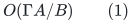
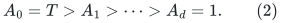
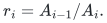
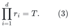
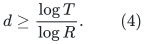
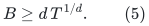
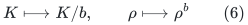
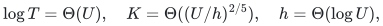
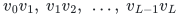
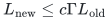

# Repair-window depth and the cost of bypassing layers

**Separate exploration, 24 October 2026.** This note studies the
particular touched-set repair architecture used by the current
distance sparsifier. It gives two precise obstacles to improving
its quality by rearranging existing layers or replacing only their
route records. It is not a lower bound for dynamic spanners or
minimum-ratio-cycle algorithms. The reviewed <code class="math">4/5</code> matching
composition is unchanged.

The starting constructions are
[normalized-projected-route-composition.md](normalized-projected-route-composition.md)
and
[amortized-static-base-distance-sparsifier.md](amortized-static-base-distance-sparsifier.md).
The source repair is Chen et al.,
[arXiv:2311.18295v1](https://arxiv.org/pdf/2311.18295),
Definition 7.13 and Algorithm 7.

## 1. Why one repair uses the preceding window

Suppose a lower collection of selected layers last supplied a valid
route for every demand at time <code class="math">\tau</code>. At current time <code class="math">t</code>, its
stored routes may be broken. The repair uses all vertices touched
since <code class="math">\tau</code>, not just vertices touched since the last invocation
of the repair itself. Exterior prefixes up to the first touched
vertex remain valid. A projected demand connects the two first
touched anchors, and its preliminary image consists of those
prefixes and its own current central input edge.

If the lower certificate can be <code class="math">A</code> edits old, a new projected
instance can therefore have <code class="math">\Theta(A)</code> touched vertices.
Rebuilding the upper repair every <code class="math">B</code> edits gives the selected
membership budget
<!-- math-display: d1c2ee3f47a1d97bc69362e4
O(\Gamma A/B)
 \tag{1}
-->

per edit, apart from the established fixed polynomial factors.
This statement uses the actual initial history when shorter than
<code class="math">A</code>, as in the prefix-safe source construction.

The dependence on the touched-set size is not merely a consequence
of representing routes explicitly. A projected instance can be a
tree on its touched vertices whose distinct central IDs do not
already belong to the retained lower layers. Any subgraph routing
every projected edge must then retain all tree edges. Thus there
are individual legal projected instances requiring
<code class="math">\Omega(&#124;S&#124;)</code> selected central IDs.

This observation does not assert that every window in one
adversarial update sequence simultaneously realizes that extreme.
It explains why a proof using only the existing static-subgraph
interface must retain the <code class="math">A/B</code> factor in its worst-case budget.

## 2. A telescoping lemma for reparented window dependencies

Consider a chain of repair dependencies with declared window
lengths
<!-- math-display: b2c879620e1ee0d99c023675
A_0=T>A_1>\cdots>A_d=1.
 \tag{2}
-->

At step <code class="math">i</code>, a repair scheduled every <code class="math">A_i</code> edits relies on a
certificate whose validity can be <code class="math">A_{i-1}</code> edits old. Put
<!-- math-display: 98e03d1d7374655240a36a8f
r_i=A_{i-1}/A_i.
-->

Then, exactly,
<!-- math-display: 86735436c7782a1eb29d9da3
\prod_{i=1}^d r_i=T.
 \tag{3}
-->

Consequently:

**Window-depth lemma.** If every dependency is budgeted at window
ratio at most <code class="math">R</code>, then
<!-- math-display: 8dde457db23f5b1cc2d88a93
d\geq\frac{\log T}{\log R}.
 \tag{4}
-->

If the sum of its window-ratio budgets is at most <code class="math">B</code>, then
AM--GM gives
<!-- math-display: 4ad635283b3c1a900401f39f
B\geq d\,T^{1/d}.
 \tag{5}
-->

The same statement holds on any chosen base-to-current dependency
path in a directed acyclic organization of windows. Parallel
branches do not change the telescoping equality on such a path.
The hypotheses require each dependency to be certified by the
existing first-touched-prefix argument; a new validity invariant
could fall outside this model.

The ordinary radix construction has <code class="math">T=\rho^K</code> and essentially
all <code class="math">r_i=\rho</code>. It is already balanced for (5).

### Skipping several layers

If a new repair bypasses <code class="math">b</code> ordinary levels, its lower window is
<code class="math">\rho^b</code> times its own rebuilding interval. Its budget in (1)
becomes <code class="math">O(\Gamma\rho^b)</code>, while the number of static
compositions on a dependency chain decreases by a factor of about
<code class="math">b</code>. Thus the elementary substitution
<!-- math-display: f1c2d46fadb42332c4e25e3f
K\longmapsto K/b,\qquad
                \rho\longmapsto\rho^b
 \tag{6}
-->

does not create a new quality/recourse tradeoff. It changes the
effective radix parameter.

In particular, replacing <code class="math">K</code> serial dependencies by
<code class="math">O(\log K)</code> dependencies through ordinary reparenting forces some
window ratio to be at least <code class="math">T^{1/O(\log K)}</code>. A balanced binary
picture of the same chronological windows does not by itself
avoid this cost.

For the current <code class="math">4/5</code> choice,
<!-- math-display: 24e76b9e3dbb6902c9f55629
\log T=\Theta(U),\quad
 K=\Theta((U/h)^{2/5}),\quad h=\Theta(\log U),
-->

reducing dependency depth to <code class="math">O(\log K)</code> this way would give a
logarithmic recourse budget of order <code class="math">U/\log U</code>. This is larger
than the retained <code class="math">O(U^{4/5}h^{1/5})</code> total overhead. This is a
comparison inside the declared-window model, not a universal
lower bound.

## 3. A fixed selected support cannot always be shortcut geometrically

A separate proposal is to leave every selected central membership
unchanged and periodically replace the demand routes by better
paths. Such an operation may reduce a poor chosen route, but it
cannot improve the distance of the selected graph itself.

For a concrete example, let the native graph consist of a unit
path
<!-- math-display: e1d2b33fab0fc30743b6af15
v_0v_1,\ v_1v_2,\ \ldots,\ v_{L-1}v_L
-->

and one extra unit edge <code class="math">e=v_0v_L</code>, with <code class="math">L\geq2</code>.
Let the selected support contain exactly the path edges. Every
endpoint-preserving walk for <code class="math">e</code> in that support has length at
least <code class="math">L</code>, and its unique simple route has length exactly <code class="math">L</code>.
No loop erasure, route-owner change, inverse-index rebuilding, or
shortest-path calculation changes that fact.

This support satisfies an abstract stretch upper bound
<code class="math">\Gamma^K</code> whenever <code class="math">L\leq\Gamma^K</code>. Therefore a black-box
contract that promises only this upper bound cannot justify
replacing it by <code class="math">\Gamma^{O(\log K)}</code> using route-only work.
This example does not show that the current deterministic repair
algorithm reaches this support from its particular initial base.
A reachability proof or a stronger maintained-distance invariant
would be needed for that claim.

Adding the missing unit edge <code class="math">e</code> solves this one example. In the
actual dynamic construction, adding such edges changes selected
memberships, native degree feedback, child topology, and possibly
child metric records. Those effects require a recourse bound; they
cannot be charged as a pure local demand reroute.

## 4. What a positive replacement would have to add

The current route recurrence
<!-- math-display: d260bc3d49e7b2e2b15af902
L_{\rm new}\leq c\Gamma L_{\rm old}
-->

is an upper bound on an explicit valid walk. Improving it could
follow from any of the following genuinely additional statements:

1. a repair algorithm with a touched-set validity certificate that
   does not inherit the full preceding window;
2. an incremental merge of projected instances whose membership
   cost is below recomputing an entire preceding touched window;
3. a maintained selected support with substantially better actual
   distances than the present <code class="math">\Gamma^{O(K)}</code> guarantee, together
   with an efficient procedure finding those shorter routes;
4. a cycle-comparison theorem that pays less than the largest
   geometric stretch, even when the retained support has a long
   route for an individual native edge.

The fourth possibility is different from changing window schedules.
It must account for the numerator and raw traversal of all
correction circulations. Exact telescoping alone does not establish
it. The separate comparison investigation should keep that scope
distinct from (1)--(6).

Neither a balanced redraw of the existing window chain nor a
route-only refresh currently proves a new quantitative exponent.
