# A stronger public APSP comparison at exactly the same stretch scale

**Root mathematical and source audit, 25 October 2026.**

The public joint rederivation in [public-apsp-joint-retuning-audit.md](public-apsp-joint-retuning-audit.md)
changes the comparison with the numerical APSP construction. It is
stronger than simply retuning the fixed local theorem. This note
checks the separated budgets, records the conservative small-instance
implementation, and compares the two constructions at the same
asymptotic stretch scale.

## 1. Two distinct provider interfaces

Write <code class="math">U=\log(N+4)</code> and <code class="math">h=\log(U+4)</code>. The reconstructed public
metric provider has a cut-player parameter <code class="math">r</code> and a separate
expander-path depth <code class="math">q</code>. Its output quality and construction work
can be bounded by

<!-- math-display: 4f422b6aa4cfc6772bdae19f
g_{\rm pub}=O(qrh),\qquad
 f_{\rm pub}=O(U/q+U/r+r^2h+q^2rh).
 \tag{1}
-->
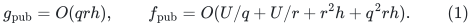

The last term is a conservative work allowance for small local
expander instances. It is not inserted into output path length.
The public ambient congestion factor still includes the length
of the input embedding.

The current research provider has the different interface

<!-- math-display: c4d16316693c51caaaced292
g_{\rm new}=O((p+r)h),\qquad
 f_{\rm new}=O(U/p+U/r+r^2h+(p+r)h).
 \tag{2}
-->
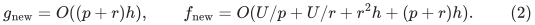

Its normalized ambient composition removes the input-path-length
multiplier. Neither of these two changes is silently attributed
to the public primitive.

## 2. Checks on the public reconstruction

I read the actual stage and path recurrences in CS21, Lemmas
3.10--3.11, rather than using its single packaged overhead
parameter. The work for one stage includes the terminal-expander
construction cost. The number of child stages depends on deleted
edges, embedding congestion, and pruning. Thus the construction
cost occurs once when stage work is multiplied by the stage count.
The path recurrence uses the embedding path length instead.

The conservative implementation activates the <code class="math">q</code>-level structure
only when the local logarithmic size is at least <code class="math">Cq^2rh</code>.
Then the smallest nominal size gap is at least
<code class="math">\exp(Cqrh)</code>, which covers the cut-player cutoff, degree losses,
and positive deletion budgets. Smaller components use pruning
and direct BFS. Their path length still follows from expansion;
their larger search work is charged in <code class="math">f_{\rm pub}</code>. The two
static sparsifier passes make only an input-linear number of
path queries, times fixed powers of the output factors, so this
fallback does not turn a work factor into a quality factor.

The degree-band adapter must also be stated explicitly. The
literal artificial-self-loop version cannot simply be passed to
a loopless cut primitive or materialized at an <code class="math">n\Delta</code> cost.
The actual-size loopless construction starts at average degree,
uses public decomposition and pruning, and moves a geometrically
shrinking residual to the next band. Weighted witnesses use
explicit ports of total size proportional to their total weight.
These elementary domain adapters are part of the reconstruction,
not a claim that the source pseudocode already supplies them.

I also checked CKL Section 5.1, Claims 5.7--5.8 and Lemma 5.9.
With the public ambient length factor retained, its repair
recurrences give path length <code class="math">\exp O(Kg_{\rm pub})</code> and
congestion <code class="math">\exp O(K^2g_{\rm pub})</code>. The selected-edge output
count is controlled separately. A static work factor multiplying
one reconstruction job does not appear in its selected output.

The use of standard public deamortization is a work-budget
substitution: increase the computation allotted to a job by the
same factor as its work, retaining its logical update deadline
and catch-up schedule. Candidate outputs and their switch times
are not postponed to obtain the improved recourse bound. This
uses the public scheduler and its ordinary resumable-computation
model; it does not claim a worst-case update bound for the whole
APSP hierarchy.

The relevant primary sources are
[CS21](https://arxiv.org/abs/2009.08479),
[CKL22](https://arxiv.org/abs/2203.00671),
[the deterministic static replacement](https://arxiv.org/abs/2309.16629),
and [KMG](https://arxiv.org/abs/2311.06402).
The detailed reconstruction gives their exact theorem and
algorithm locations.

## 3. The public parameter balance

Using ordinary positive binary port trees at every recursive
boundary, the reconstructed public hierarchy has

<!-- math-display: bea26a0d672b18ccf82db36b
\begin{aligned}
 B_{\rm pub}
   &=O\bigl(x+f_{\rm pub}+K^2g_{\rm pub}
                +d(U/K+g_{\rm pub}+h)+h\bigr),\\
 a_{\rm pub}
   &=O(dKg_{\rm pub}+dh).
 \end{aligned}
 \tag{3}
-->
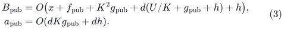

Here <code class="math">B</code> is logarithmic update overhead and <code class="math">a</code> is logarithmic
stretch. Take

<!-- math-display: f0016f9085e0c0296eef6670
q=r=t,\quad K=t^2,\quad x=\Theta(U/t),\quad d=O(t).
-->
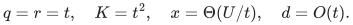

For the public provider this gives

<!-- math-display: f2b8eed2d63bd0387af39b84
B_{\rm pub}=O(U/t+t^6h),
       \qquad a_{\rm pub}=O(t^5h).
 \tag{4}
-->
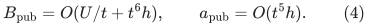

The conservative <code class="math">q^2rh=t^3h</code> work term is smaller than the
displayed <code class="math">t^6h</code> term. Taking <code class="math">t=\Theta((U/h)^{1/7})</code>
therefore proves the derived point

<!-- math-display: 2e320bba0b10675a164db03d
B_{\rm pub}=O(U^{6/7}h^{1/7}),\qquad
 a_{\rm pub}=O(U^{5/7}h^{2/7}).
 \tag{5}
-->
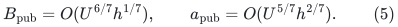

This is a new reconstruction from public ingredients. It is
not the printed KMG theorem, and it replaces the previously
checked <code class="math">59/63</code> composite as the stronger current comparator.

## 4. Matching that stretch with the research construction

The independently audited research hierarchy has

<!-- math-display: 3716fee9bf633f92d22c4c1b
B_{\rm new}=O(U/t+t^3h),
       \qquad a_{\rm new}=O(t^4h).
 \tag{6}
-->
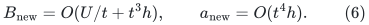

Choose

<!-- math-display: 86ee61722d6c3631b8e83f7f
t=\Theta((U/h)^{5/28}).
-->
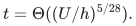

Then

<!-- math-display: d9102ce1ae18d50cdc15e946
a_{\rm new}=O(U^{5/7}h^{2/7}),
-->
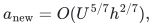

the same asymptotic stretch scale as (5), while

<!-- math-display: dae262aee6700f4bb393e41e
\begin{aligned}
 U/t&=U^{23/28}h^{5/28},\\
 t^3h&=U^{15/28}h^{13/28}
           =o(U^{23/28}h^{5/28}).
 \end{aligned}
-->
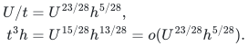

The matched comparison is thus

| Construction | Amortized update overhead | Stretch |
|---|---|---|
| Reconstructed public composition | <code class="math">\exp O(U^{6/7}h^{1/7})</code> | <code class="math">\exp O(U^{5/7}h^{2/7})</code> |
| Research construction | <code class="math">\exp O(U^{23/28}h^{5/28})</code> | <code class="math">\exp O(U^{5/7}h^{2/7})</code> |

Both use arbitrary-degree undirected graphs, numerical distance
queries in polynomial logarithmic time, positive polynomial-range
external integer lengths, and amortized initialization/update
accounting. The constants hidden in the two stretch bounds
need not be identical; choosing the fixed parameter constants
against a specified allowed envelope gives a common scale.
No practical constant-factor performance comparison is implied.

## 5. A curve, not one isolated substitution

For a desired logarithmic stretch envelope <code class="math">A</code>, with
<code class="math">h\ll A=o(U)</code>, (4) can take

<!-- math-display: 1d03fd478b90ae70825a6d25
t_{\rm pub}=\Theta\!\left(
  \min\{(U/h)^{1/7},(A/h)^{1/5}\}\right).
-->
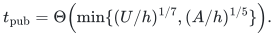

This gives the sufficient public work envelope

<!-- math-display: 6f2aa8f9c38962c689fdc379
B_{\rm pub}=O\!\left(
       \max\{U^{6/7}h^{1/7},\,U(h/A)^{1/5}\}\right).
 \tag{7}
-->
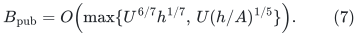

Equation (6) instead takes <code class="math">t_{\rm new}=\Theta((A/h)^{1/4})</code>,
giving

<!-- math-display: 7d875b6638819813cc3fd85d
B_{\rm new}=O(U(h/A)^{1/4}).
 \tag{8}
-->
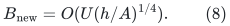

The construction and shrink guards have slack in these ranges.
These are upper envelopes for two specified constructions,
not claims of optimality among all public methods. Numerical
distance guarantees do not become exact matching or ordinary
output-sensitive path-reporting guarantees by this substitution.

The earlier <code class="math">11/14</code> update point at logarithmic stretch
<code class="math">O(U^{6/7}h)</code>, and the <code class="math">3/4</code> point with a larger
subpolynomial stretch, remain valid. This note adds a fair
comparison against a stronger reconstructed public interface
at its own smaller stretch scale. The unrestricted exact
general-graph maximum-matching exponent remains <code class="math">4/5</code>.

## 6. Nonuniform tuning inside the public positive-charge model

There is a useful algebraic check on (7). It is explicitly a statement
about optimizing the displayed accounting, not a lower bound on the
actual algorithm or on the APSP problem. An upper-bound expression
does not by itself prove that the implementation must incur that cost.

Consider the first part of a hypothetical nonuniform hierarchy while
the local logarithmic size <code class="math">u_i</code> stays between <code class="math">U/2</code> and <code class="math">U</code>.
Require its positive work budget <code class="math">B</code> to dominate, up to fixed
constants, all the charged terms
<!-- math-display: b480dcc04da125d831638fcd
x_i,\quad u_i/q_i,\quad u_i/r_i,\quad K_i^2q_ir_i h,
 \qquad\text{and}\qquad \sum_i u_i/K_i .
 \tag{9}
-->
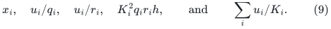
Its logarithmic metric budget must dominate
<!-- math-display: 37972c44dcfd454b9e363417
A_{\rm charge}=\sum_i K_iq_ir_i h.
 \tag{10}
-->
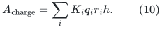
The nominal total shrink in this part is at least a constant times
<code class="math">U</code>. Since <code class="math">x_i\lesssim B</code>, it has
<code class="math">j\gtrsim U/B</code> levels. Also
<!-- math-display: 97746dac0c6c8008941a9c84
q_ir_i\gtrsim U^2/B^2,\qquad
 K_i\lesssim B^{3/2}/(U\sqrt h).
-->
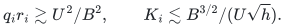
Consequently (9) implies
<!-- math-display: 48f597533021705b228b1d70
B\gtrsim\sum_i u_i/K_i
   \gtrsim j\,U^2\sqrt h/B^{3/2}
   \gtrsim U^3\sqrt h/B^{5/2}.
-->
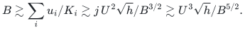
Thus
<!-- math-display: 592f7ad34e139c4d032346f1
B^7\gtrsim U^6h.              \tag{11}
-->
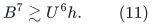

Independently, Cauchy's inequality and
<code class="math">\sum_i1/K_i\lesssim B/U</code> give
<!-- math-display: c94246be31e98b376a310372
\sum_iK_i\gtrsim j^2U/B\gtrsim U^3/B^3.
-->
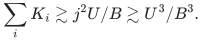
Substituting into (10) yields
<!-- math-display: f15c08beed9438baa34bb903
A_{\rm charge}\gtrsim U^5h/B^5.              \tag{12}
-->
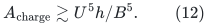
If the same accounting is to certify <code class="math">A_{\rm charge}\lesssim A</code>,
then (11)--(12) require
<!-- math-display: 1ac03a21f6ea89341ec85c99
B\gtrsim
     \max\{U^{6/7}h^{1/7},\,U(h/A)^{1/5}\}.
-->
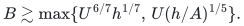

This reproduces (7) inside the positive-charge model even when
parameters vary between levels. It does not certify global optimality:
a better provider, a different repair recurrence, a different
composition proof, or cancellation not captured by these charges can
change the conclusion. The analogous research-provider calculation
appears in [nonuniform-parameter-budget-frontiers.md](nonuniform-parameter-budget-frontiers.md).
