# Separating metric stretch, forest congestion, and work

**Research proof assembly, 25 October 2026.** This note develops a
second use of the deterministic sparse-graph engine. The target here is
the strong, path-reporting decremental shortest-path interface used in
the deterministic Gomory--Hu paper, rather than numerical distance
estimates alone. The central quantitative candidate is

<!-- math-display: c0d8b152d7fc1c8d24d2d7f9
m\exp O\!\left((\log(m+4))^{7/8}
                  (\log\log(m+16))^{1/8}\right).
 \tag{1}
-->
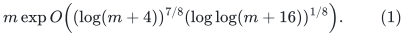

The proof imports named public primitives and the current checkpoint's
new static router, normalization, repair, and degree-reset lemmas. It is
not an implementation or an external certification. Section 11 states
exactly which public application reductions have and have not yet been
quantified. In particular, this note does not infer a Gomory--Hu bound
merely by substituting a faster static maximum-flow algorithm.

## 1. The strong output contract

For the main theorem, let <code class="math">G</code> be an undirected bounded-degree graph,
with a fixed vertex set, positive integer lengths of polynomial aspect
ratio, a fixed source <code class="math">s</code>, and a sequence of edge deletions. Let
<code class="math">\epsilon\geq1/\mathrm{polylog}(m+4)</code>. The proposed data structure
maintains an explicit forest <code class="math">F</code>, an injection
<code class="math">\iota:V(G)\to V(F)</code>, a vertex-image map
<code class="math">\pi:V(F)\to V(G)</code>, and an edge-image map
<code class="math">\eta:E(F)\to E(G)</code>, with the following contract.

1. <code class="math">\pi\circ\iota</code> is the identity. Each <code class="math">\iota(v)</code> remains the same
   node for the entire lifetime of <code class="math">v</code>. Each forest node's physical
   image remains fixed during that node's lifetime.
2. A forest edge maps to one currently present original edge, with the
   corresponding endpoints. Its length is that original edge's length.
   There are no exposed null edges in this final forest.
3. If <code class="math">v</code> is reachable from <code class="math">s</code>, the two distinguished nodes lie in
   one tree, and their forest path has length at most
   <code class="math">(1+\epsilon)\mathrm{dist}_G(s,v)</code>. Its projection is an
   original-edge walk; loop erasure, if a simple path is desired, takes
   linear time in the reported walk.
   A vertex outside the initial source-reachable set is retained as an
   isolated permanent canonical node. Deletions cannot make it reachable
   later. Canonical nodes are likewise retained when their labels become
   infinite.
4. The simultaneous number of copies of any original edge, and the
   simultaneous number of forest nodes with any fixed physical image,
   are at most <code class="math">E</code>. The number of forest records is <code class="math">O((n+m)E)</code>.
5. Initialization, the whole deletion sequence, and all explicit forest
   and map changes together cost <code class="math">O((n+m)E)</code>, where
   <code class="math">E=\exp O(U^{7/8}h^{1/8})</code>, <code class="math">U=\log(m+n+4)</code>, and
   <code class="math">h=\log(U+4)</code>. Dynamic trees can report a current forest path with
   logarithmic overhead per reported edge.

The vertex-image map <code class="math">\pi</code> is generally many-to-one. It cannot also be
injective when the forest contains several copies of an original vertex.
The required injection is <code class="math">\iota</code>, together with its right-inverse
identity. The two maps are distinguished throughout this note.

The strong contract is substantially more than a distance-label data
structure. A min-ratio-cycle answer, even one represented by short tree
paths, does not imply this contract. Sections 3--7 provide separate
metric and forest arguments.

## 2. Local parameters and source imports

All logarithms below can be taken to base two. A master value <code class="math">U</code>
bounds the logarithm of the actual record inventory; it does not permit
padding a small instance to the master size. Put <code class="math">h=\log(U+4)</code>.
Let <code class="math">p,r,K</code> be positive integers, and put <code class="math">k=2^x</code>, rounding to an
integer power of two. The parameter <code class="math">K</code> is the local repair depth.
It is distinct from the covering parameter introduced later.

The existing static provider has structural factor <code class="math">\Gamma</code> and work
factor <code class="math">F_{\rm stat}</code>, with

<!-- math-display: 416cd810c44233061a751366
g:=\log\Gamma=O((p+r)h),\qquad
 f:=\log F_{\rm stat}
    =O(U/p+U/r+r^2h+(p+r)h).
 \tag{2}
-->
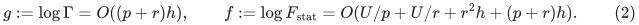

Its relevant proof chain is:

* [linear-parameter-static-sparsifier.md](linear-parameter-static-sparsifier.md), using
  [sequential-expander-routing-tradeoff.md](sequential-expander-routing-tradeoff.md) and the explicitly named
  deterministic cut, routing, and weighted-selection ingredients;
* [normalized-projected-route-composition.md](normalized-projected-route-composition.md);
* [amortized-static-base-distance-sparsifier.md](amortized-static-base-distance-sparsifier.md), with
  the normalized recurrence substituted for its older quadratic-in-<code class="math">K</code>
  route recurrence;
* [demand-route-notifications-and-local-work.md](demand-route-notifications-and-local-work.md);
* [distance-degree-reset-candidate.md](distance-degree-reset-candidate.md);
* [disconnected-component-backend-wrapper.md](disconnected-component-backend-wrapper.md) and
  [polynomial-bit-stretch-stable-forest-integration.md](polynomial-bit-stretch-stable-forest-integration.md).

The construction-level uniformity audit is
[uniform-source-interfaces-for-4-5.md](uniform-source-interfaces-for-4-5.md). We import the
following public components from Kyng--Meierhans--Probst Gutenberg
(KMG), [arXiv:2311.06402v1](https://arxiv.org/pdf/2311.06402v1).

| Public component | Exact role retained here | Parameter dependence used |
|---|---|---|
| Appendix A.1 and Theorem 3.2 | Deterministic centers, strict balls, and inverse clusters | Fixed polynomial in <code class="math">k,U</code> |
| Theorem 3.3 and Claim 3.10 | Exact nearest-pivot forest and local distances | <code class="math">\mathrm{poly}(k,U)</code> work; <code class="math">k\mathrm{poly}(U)</code> nearest-pivot forest changes |
| Lemma 3.5, from CKL Lemma 6.5 | Stable core forest family, endpoint/root promotion, fixed stretch labels | <code class="math">\mathrm{poly}(U)</code> stable forest cuts per elementary promotion or edit; local work polynomial in <code class="math">k,U</code> |
| Lemmas 3.12--3.14 | The future-path family and pivot-pair metric comparison | <code class="math">\mathrm{poly}(U)</code> factor, separately from the dynamic spanner |
| Theorem 3.8 | Selected-degree feedback by partitioning a physical tree | Fixed polynomial local work |
| Theorem 4.7 | Marked-ancestor dynamic-tree operations for diameter witnesses | <code class="math">\mathrm{poly}(U)</code> per operation |
| Theorem 5.3 | Decremental sparse covers from the APSP interface | Explicit covering formula in Section 8 |
| Theorems 5.12 and 5.14 | Hopsets and approximate-ball forests | Explicit scale constraint and <code class="math">n^{O(1/\Lambda)}</code> work |
| Section 5.3, Algorithm 10 | Flattening hopset forests to original-edge forests | Copy-count recurrence in Section 8 |

We do **not** invoke the old complete KMG Theorem 3.1 or 3.7 at the
growing repair depth used below. Their displayed range for that older
spanner would be insufficient. The local dynamic spanner is instead the
elementary, amortized static-base repair in the current checkpoint.

After selected-degree feedback and the fixed port reset, choose a common
factor <code class="math">P</code> that covers child size, encoded child edits, stable-core
changes, and one-level forest occurrence multiplication. The established
local envelopes are

<!-- math-display: 8468edb81be071407bea2c1d
\log P=O(U/K+g+h),
 \qquad
 \log W=O(x+U/K+f+Kg+h).
 \tag{3}
-->
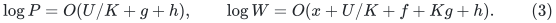

For a local parent period of initial actual size <code class="math">m_0</code>, a chronological
prefix of <code class="math">z</code> elementary parent edits emits at most
<code class="math">O(m_0P/k+Pz)</code> child edits and records. The additive term can be spent
after initialization. It must not be discarded from the recursion.
Local nearest-pivot-forest changes belong to <code class="math">W</code>, not to the
<code class="math">P</code>-bounded child transcript.

An explicit `Promote(v)` operation is also allowed. It adds <code class="math">v</code> to the
logical pivot set and invokes the existing endpoint-promotion routine in
each stable forest. Its work and child transcript obey the same envelope
as one elementary parent edit. This is the constructive routine used
before an inserted or deleted edge's endpoints are processed; it does not
require changing any distances. It may alternatively be implemented by
actually forwarding a temporary positive self-loop insertion and deletion
through that routine. In that implementation, a loop filter must not
intercept it before the pivot update. The temporary maximum degree is a
different fixed constant, and no loop is published in the settled metric
forest. Direct promotion is the preferred implementation.

## 3. The local metric interface, independently of cycle quality

Let <code class="math">A</code> be the current logical pivots. The future-path inventory includes
the closed convention <code class="math">B^+(v,A)=B(v,A)\cup\{v\}</code>, direct old terminal
edges, and the potential later pivot legs. Thus KMG's pivot-pair argument
still applies after the disconnected-component and finite-bit adapters.
The sum of the native core graphs, with aliases of equal physical roots
identified, gives an upper approximation for every pair in <code class="math">A</code>.

The normalized repair supplies, for every positive native demand edge,
an endpoint-preserving walk in selected central native edges, with
length inflation at most <code class="math">\Gamma^{O(K)}</code>. Length bucketing costs only
a fixed polynomial in <code class="math">U</code>. Erasing a closed native subwalk cannot
increase positive metric length. Replacing each edge of a core walk by
its same-core selected route, while retaining the zero alias identifications,
therefore proves

<!-- math-display: 2de9454cb5f30cec8f40cca6
\mathrm{dist}_G(a,b)
 \leq \mathrm{dist}_S(a,b)
 \leq \rho\mathrm{dist}_G(a,b),\qquad a,b\in A,
 \quad \log\rho=O(Kg+h).
 \tag{4}
-->
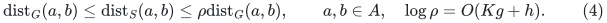

For every selected edge, the stored length dominates its literal
physical parent walk. A route-gradient identity is neither required nor
asserted here. Positive native loops may be omitted from the metric
sparsifier, because they do not improve a positive-distance shortest
path. Isolated pivot roots needed as query or anchor handles are retained
explicitly, or are served by the local component case below.

Equation (4) is deliberately restricted to pivots. It does not say that
every extra core root has all-pairs stretch <code class="math">\rho</code>. Confusing these two
statements creates a gap in a naive low-diameter-tree proof. Section 6
avoids that gap by carrying an anchor through the hierarchy.

### Fixed port reset

Replace each selected vertex <code class="math">v</code> by a fixed binary tree with <code class="math">C</code>
leaves, where <code class="math">C\leq P</code> is a declared selected-degree cap. Give internal
connectors length one. A selected edge of length <code class="math">\ell</code> becomes an
edge between assigned leaves of length <code class="math">H\ell</code>, where <code class="math">H</code> is a
power of two at least <code class="math">4(\log_2 C+1)</code>. Let <code class="math">q(v)</code> be the root of
the port tree. For distinct connected selected vertices,

<!-- math-display: e39e067d5d9499917b3d8891
\mathrm{dist}_S(v,w)
 \leq H^{-1}\mathrm{dist}_{B}(q(v),q(w))
 \leq 2\mathrm{dist}_S(v,w).
 \tag{5}
-->
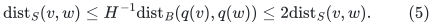

The right inequality routes a simple selected path through the port
trees. It uses at most <code class="math">2\log_2 C</code> unit connectors per selected edge,
and every selected edge has length at least one. The left inequality
projects any port walk and drops its nonnegative connector length.
For equal endpoints the query returns zero. A port walk projects to a
parent walk whose literal length is at most its port length divided by
<code class="math">H</code>.

The root <code class="math">q(v)</code> is stable for the actual parent vertex lifetime within
the parent period. Empty fibers are reused on reactivation. Old period
fibers are completely retired before a new period is published. All
historical ghosts count toward actual size and recourse.

## 4. APSP and the marked-diameter interface

Let <code class="math">G_0=G</code>, and let each <code class="math">G_{i+1}</code> be the degree-reset child of
<code class="math">G_i</code>. Write <code class="math">H_i</code> for its scale and
<code class="math">\sigma_i=\prod_{j&lt;i}H_j</code>. A recursive distance query performs the
following operations at level <code class="math">i</code>.

* If the two current vertices coincide, return zero for this level.
* If the second vertex is in the first vertex's strict pivot ball or is
  its pivot, use the explicitly stored exact local distance.
* Otherwise add the two exact nearest-pivot legs, recurse between the
  two canonical child port roots, and divide the recursive answer by
  <code class="math">H_i</code>.
* At an actual-size base instance, use exact APSP.

If <code class="math">v\notin B(u,A)</code>, nearest-pivot minimality and the triangle inequality
give

<!-- math-display: 26841e310aac67ac1f9bbd48
d(u,p(u))\leq d(u,v),\quad
 d(v,p(v))\leq2d(u,v),\quad
 d(p(u),p(v))\leq4d(u,v).
 \tag{6}
-->
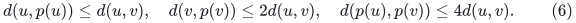

Equations (4)--(6) prove an approximation factor
<code class="math">(c\rho)^d</code> over <code class="math">d</code> levels. Every returned quantity is an upper
bound on the real distance, because every constituent estimate is the
length of a valid lifted walk. In particular,

<!-- math-display: aedf0e1749e2ce10006fcfbe
a_{\rm APSP}:=\log\gamma_{\rm APSP}=O(dKg+dh).
 \tag{7}
-->
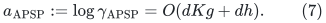

There is no factor <code class="math">k^{O(1)}</code> in (7). Such a factor appearing in a
different min-ratio-cycle extraction is not a metric query loss.
The query evaluates one pivot per level and therefore costs
<code class="math">O(d\mathrm{poly}(U))</code>. Outputting its path costs the literal
output size times the same logarithmic overhead. The later strong-forest
argument does not rely on enumerating all these query paths.

### Diameter witnesses

Maintain the pivot-chain meta-forest, whose level-<code class="math">i</code> vertex <code class="math">v</code>
points to <code class="math">q(p_i(v))</code>, with edge weight
<code class="math">\mathrm{dist}_{G_i}(v,p_i(v))/\sigma_i</code>. Original marked
vertices lie at level zero. KMG Theorem 4.7 supplies a farthest marked
descendant/ancestor operation, depending on the chosen orientation,
and temporary subtree unmarking with rollback.

For one fixed marked vertex <code class="math">x</code>, enumerate the local ball and its pivot
at every level of <code class="math">x</code>'s chain. At the base, also enumerate **all base
vertices**. This last enumeration is included explicitly rather than
being left implicit in the source's abbreviated pseudocode. For each
enumerated vertex <code class="math">w</code>, select the still-marked vertex whose chain
reaches <code class="math">w</code> with the largest accumulated leg length, inspect its full
distance estimate from <code class="math">x</code>, and temporarily remove that meta-subtree.

The buckets partition marked vertices according to the first level at
which the distance query terminates. Within a bucket, the term from
<code class="math">x</code> and the middle exact distance are fixed, and the chosen marked
vertex maximizes the other accumulated-leg term. Therefore the largest
inspected estimate dominates the estimate for a farthest marked vertex.
The selected pair has real distance at least
<code class="math">\mathrm{diam}(X)/(2\gamma_{\rm APSP})</code>.

The inspection costs <code class="math">k^{O(1)}\mathrm{poly}(U)</code>, including the
base. It can be recomputed after each settled graph or mark-set update
and stored, so the exposed diameter query is constant time. The
meta-forest changes are generated by the exact nearest-pivot-forest logs
and hierarchy restarts and are included in local work. Mark-set changes
do not change any recursive graph.

Disconnected queries return infinity when appropriate. Initially small
components have one local pivot and an exact local table; when a later
edge joins components, its endpoints are promoted before insertion.
Thus two vertices whose projection is the same unexported local pivot
can finish locally, while every nontrivial inter-pivot connection has a
real child handle. Private physical isolates are not rescanned at every
source restart.

## 5. A lift for arbitrary metric forests

This is an independent property of the construction. It does not follow
from the ability to output one useful cycle.

For each physical root <code class="math">v</code>, let <code class="math">T_v</code> be the direct sum, identified
at the root, of the stable core-forest trees rooted at <code class="math">v</code>. If a child
forest contains at most <code class="math">G_\star</code> occurrences per child input vertex,
then at most <code class="math">2CG_\star</code> such occurrences project to one logical
selected root. Assign each a different copy index in preallocated trees
<code class="math">T_{v,j}</code>. A child forest vertex's assigned pool root is its terminal
handle in the parent lift.

For a real selected child edge, add one connecting parent-edge copy
between the appropriate interior vertices of its two pool trees. Its
stable-core provenance identifies these vertices. For a port connector
or an immediate child-null edge, connect the two assigned roots by a
typed true-null link. Their physical images agree. These are different
provenance cases, even though both links are null after this projection.

Contracting each assigned pool tree recovers the input child forest;
unassigned pools are separate trees. The lift is consequently a forest.
The parent length of every lifted terminal-to-terminal path is at most
the child length divided by the local port scale. Between two connecting
edges, the actual pool path is no longer than the sum of the two charged
root legs, which were included in the corresponding selected-edge labels.

Every physical vertex belongs to at most a fixed polynomial in <code class="math">U</code>
stable forest copies before pooling. Hence the occurrence bound is

<!-- math-display: a862dec7490247b0a6e9da9a
G_{\rm parent}\leq P(G_\star+1).
 \tag{8}
-->
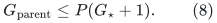

A child edge log changes one connecting record, and a child vertex log
claims or releases one pool index. It does not copy a <code class="math">k</code>-vertex tree.
Changes to a parent stable forest are a different charge: they affect
its pool copies, costing <code class="math">P(G_\star+1)</code> per source-sized change.
Their work is local and is not a factor multiplying child update time.
Common copy-index capacity is doubled on demand; its total allocation
cost is bounded by twice the final capacity times the actual parent
inventory. Late allocation is charged to the initialization allowance.

Images of existing pool nodes are never renamed to new physical
vertices. A root split cuts old attachments before the old root region
is changed. Parent period replacement retires old occurrences and then
creates new ones. Throughout intermediate levels, these are typed-null
forests; they are **not** contracted at every recursive level. This
retains the different handles of child terminals that share a physical
image.

## 6. An anchored low-diameter forest with small metric stretch

The original source's low-diameter application uses a common large
factor for work, stretch, and congestion. For the present calculation,
that bundling is too weak. There is also a genuine logical issue with
trying to prove that every auxiliary child vertex has small diameter:
(4) guarantees only pivot-pair distances. The following anchored
construction needs no such assertion.

Choose a current original anchor <code class="math">s_0</code>. At every level force <code class="math">s_i</code>
to be a logical pivot, and define <code class="math">s_{i+1}=q(s_i)</code>. Preserve its child
port fiber even if it currently has no selected real incidence. At a
nonbase level its extra size is <code class="math">O(P)</code>, which is within
<code class="math">O(m_iP/k)</code> because <code class="math">m_i\geq k</code>. An actual-size base uses an exact
shortest-path tree rooted at its anchor in the anchor's component.
Other components can have their own arbitrary shortest-path trees.

For each level use the exact nearest-pivot forest <code class="math">N_i</code> on <code class="math">G_i</code>.
Lift these forests through their ancestors by Section 5. Glue the one
canonical endpoint of each lower-level pivot to the corresponding
canonical port-root endpoint of the next lifted forest using a null
link. A lower-level nearest-pivot component has exactly one such root,
so the result is acyclic. The base connects all chains relevant to the
original anchor's component.

For any original <code class="math">v=v_0</code>, let
<code class="math">v_{i+1}=q(p_i(v_i))</code>, and define

<!-- math-display: 8c48a9af1755f92e41969fa5
D_i=\sigma_i^{-1}\mathrm{dist}_{G_i}(v_i,s_i).
 \tag{9}
-->
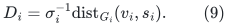

Since <code class="math">s_i</code> is one of the pivots,

<!-- math-display: be1b845b83f12e985d273bc0
\mathrm{dist}_{G_i}(v_i,p_i(v_i))
       \leq\mathrm{dist}_{G_i}(v_i,s_i).
 \tag{10}
-->
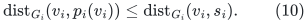

Both <code class="math">p_i(v_i)</code> and <code class="math">s_i</code> are pivots, so (4)--(5) and the triangle
inequality give

<!-- math-display: 2be8930517a725ec3d43b4bf
D_{i+1}\leq 2\rho\,
       \sigma_i^{-1}\mathrm{dist}_{G_i}(p_i(v_i),s_i)
       \leq4\rho D_i.
 \tag{11}
-->
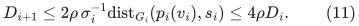

The harmless constant in (11) includes the port factor. The physical
length from <code class="math">v</code> along the assembled forest to <code class="math">s_0</code> is at most
the sum of its nearest-pivot leg lengths in root units plus the exact
base distance. Therefore it is at most

<!-- math-display: 63aa21af4569a12c28f2c524
(d+1)(4\rho)^d\mathrm{dist}_G(v,s_0).
 \tag{12}
-->
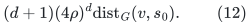

In a connected graph this implies terminal diameter at most
<code class="math">2(d+1)(4\rho)^d\mathrm{diam}(G)</code>. Thus

<!-- math-display: a943a01a51ff55b4b5d8b0ca
a_{\rm diam}:=\log\gamma_{\rm diam}=O(dKg+dh).
 \tag{13}
-->
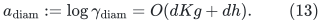

Notice what (12) does and does not use. It bounds only the chains
originating at original terminals. Arbitrarily distant auxiliary core
roots or inactive port ghosts are harmless. No <code class="math">k</code> factor is charged
as a metric loss at any level.

### Changing or deleting the anchor

The low-diameter client may delete vertices from its terminal graph.
If its current anchor is deleted, choose any surviving vertex as the new
anchor. Promote it at level zero, settle the emitted child transcript,
promote its canonical child root at level one, and continue. This adds
one explicitly charged promotion per level. It does not propagate all
nearest-pivot changes as new terminal registrations.

The old pivot may remain a pivot when its physical lifetime survives;
actual deletion is handled by the ordinary retirement rules. A hierarchy
restart initializes the new instance with the then-current anchor.
One anchor replacement per actual anchor deletion costs at most a
factor <code class="math">O(d)</code> times the already bounded hierarchy update work. If the
terminal graph is empty there is no diameter obligation. Temporarily
disconnected transactions are allowed internally; only settled connected
cover states require (12) for all current terminals.

### Fixed distinguished root vertices

At the outermost low-diameter instance, the level-zero vertex records
of <code class="math">N_0</code> are permanent records for the actual input vertex lifetimes.
Reinitializing its hierarchy replaces edges and auxiliary nodes but
reuses those level-zero records. They are the distinguished vertices
<code class="math">\iota(v)</code>. Higher-level copies have separate identities. All gluing
is represented by typed null links until the final contraction below.
Thus a restart does not silently replace <code class="math">\iota(v)</code>.

## 7. Congestion, null contraction, and total work

Summing the lifted nearest-pivot forests and using (8) gives

<!-- math-display: 1859e60b6a8912b01ac5d59e
c:=\log\gamma_{\rm cong}=O(d\log P+dh).
 \tag{14}
-->
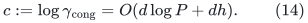

This bounds both edges and vertices, including isolated and dormant
occurrences. It is not inferred solely from edge congestion.

To obtain an ordinary flat forest, contract true-null edges **only at
the final root of this metric-forest instance**. Every null component
contains aliases of one physical vertex. It contains at most one
distinguished root terminal, because there is exactly one permanent
<code class="math">\iota(v)</code> for each physical <code class="math">v</code>. If it contains one, choose that
permanent record as its representative. Otherwise use a deterministic
auxiliary representative; it may be retired on a subsequent split.

A component contains at most <code class="math">\gamma_{\rm cong}</code> nodes. Since the
physical root graph has bounded degree, its incident real forest edges
number at most a fixed constant times the edge-congestion bound. A
single null-link change can consequently rebuild its affected quotient
components, update all incident real edge endpoints, and preserve any
distinguished representative in
<code class="math">\gamma_{\rm cong}\mathrm{poly}(U)</code> work and recourse. A
new real edge requires only its two current representatives. Contracting
forest edges preserves acyclicity, preserves physical terminal lengths,
and does not increase edge or vertex congestion.

This quotient argument uses the bounded degree of the physical root
graph. It must not be invoked without modification on an arbitrarily
high-degree physical vertex. Internal recursion is left uncontracted,
so several different child terminal handles mapping to one parent vertex
never have to maintain one impossible shared fixed representative.

For initialization allowances <code class="math">J_j</code>, update work <code class="math">T_j</code>, and
occurrence caps <code class="math">G_j</code>, retain the safe recurrences

<!-- math-display: e3bd885493dd8c4ab55e097f
\begin{aligned}
G_j&\leq P(G_{j-1}+1),\\
J_j&\leq W+P(G_{j-1}+1)
                +(P/k)(J_{j-1}+T_{j-1}),\\
T_j&\leq O(kW+kP(G_{j-1}+1))
                +O(P)(J_{j-1}+T_{j-1}).
\end{aligned}
\tag{15}
-->
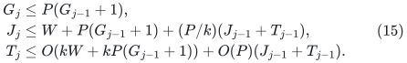

The <code class="math">T_{j-1}</code> in the second line pays for initial selected credit
that becomes child updates later. Defining <code class="math">Z_j=J_j+T_j/k</code> solves
(15) by <code class="math">k^{O(1)}W(c_0P)^{O(j)}</code>. Nearest-pivot logs, marked-diameter
maintenance, and the anchor promotions fit the local envelope or an
additional polynomial in <code class="math">U</code>. The final null quotient multiplies
work by at most <code class="math">\gamma_{\rm cong}</code>, whose logarithm is already a
term in the same envelope. Thus both APSP and the anchored low-diameter
forest have logarithmic work and explicit recourse bounded by

<!-- math-display: 9fcaaff95523404c689466af
B=O\left(x+f+Kg+d\log P+h\right),
 \qquad d=O(U/x),
 \tag{16}
-->
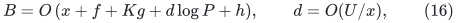

provided <code class="math">x</code> exceeds a sufficiently large constant times <code class="math">\log P</code>.
Their metric stretch is <code class="math">\exp O(dKg+dh)</code>; the low-diameter forest's
congestion is <code class="math">\exp O(d\log P+dh)</code>. These are three distinct factors.

All labels remain short integers or dyadic scaled integers. Each local
core length is a finite sum of physical tree-path lengths; each port
scale contributes only <code class="math">O(\log U)</code> bits. Over <code class="math">d</code> levels a generous
length-bit bound is <code class="math">O(Ud)</code>. The polynomial-bit forest adapter and
deterministic symbolic shortest-path tie rule in the checkpoint apply.
The aspect-dependent number of weighted forest calls is polynomial in
this bit count, and is included in <code class="math">h</code>-order terms. No exact sum of
arbitrary reciprocals or unbounded rational common denominator is used.

## 8. Re-reading the outer covering and hopset proof with three factors

Let <code class="math">a</code> dominate (7) and (13), let <code class="math">c</code> be (14), and let <code class="math">B</code>
be (16). Set

<!-- math-display: ba016800b879a3bd1351dd93
\gamma_{\rm cover}\geq
       \max\{2\gamma_{\rm APSP}^2,\gamma_{\rm diam}\}
       \mathrm{poly}(U),\qquad
       \log\gamma_{\rm cover}=O(a+h).
 \tag{17}
-->
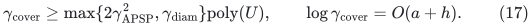

Write <code class="math">K_{\rm cov}</code> for the cover parameter and <code class="math">\Lambda</code> for the
hopset scale parameter. KMG Theorem 5.3 gives overlap

<!-- math-display: ebe898cb1ce9e150a6295287
\Delta=\widetilde O(K_{\rm cov}n^{2/K_{\rm cov}}),
 \qquad \log\Delta=O(U/K_{\rm cov}+h),
 \tag{18}
-->
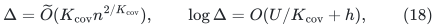

and total cover-maintenance work
<code class="math">n\exp O(B+U/K_{\rm cov}+h)</code>. Its proof charges the sum of all
APSP initialization and update operations, so amortized APSP updates
are sufficient. It does not need the old worst-case deamortization.

Theorem 5.3 includes an APSP call on a graph with its current core
contracted. For a literal positive-length bounded-degree implementation,
use a fixed binary auxiliary tree with one leaf per initial core-graph
vertex. A current core vertex connects to its assigned leaf. Give
auxiliary edges a sufficiently small common dyadic length and scale all
lengths to positive integers; split the constant-degree attachment if
needed. Represent all current core vertices by the tree's root in
queries and in the marked set, remembering a current original witness.
Core-to-core distances are returned as zero directly. Every nonzero
quotient distance is at least one before scaling, so the additive tree
overhead can be made a fixed <code class="math">(1+o(1))</code> factor. A core deletion changes
one connection and a constant number of original incidences. The tree
has actual size proportional to that cover instance. This implements
the contraction/uncontraction requests without an uncharged high-degree
source vertex. Polynomial scale changes only the logarithmic factors.
The dyadic denominator may be chosen once as a fixed polynomial of the
master inventory bound <code class="math">N</code>, so every positive query distance is
distorted by only a fixed small relative error. This numerical scale
does not allocate <code class="math">N</code> vertices to a small instance: its binary tree
and every local scan use only the actual initial cover-graph inventory.
When the marked set has at most one distinct quotient vertex, the
diameter witness is handled directly. Multiple marked core vertices
share the one quotient mark and a retained current physical witness.

KMG Theorems 5.12 and 5.14 apply under

<!-- math-display: 7c153946c943c17861e8c581
n^{1/\Lambda}>
 \left(\frac{2000\gamma_{\rm cover}\log n}
                  {\epsilon_{\rm int}}\right)^{K_{\rm cov}},
 \quad\text{equivalently}\quad
 K_{\rm cov}\Lambda\,(a+O(h))\leq c_1U
 \tag{19}
-->
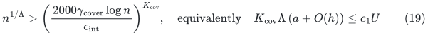

for a sufficiently small fixed <code class="math">c_1</code>. Use
<code class="math">\epsilon_{\rm int}=\epsilon/O(\Lambda)</code>; it still has inverse
polylogarithmic size. The hopset and approximate-ball work has the form
<code class="math">m\Delta\exp O(U/\Lambda+h)</code>, with fixed absolute powers. The
number of scale levels is <code class="math">O(\Lambda)</code> for every fixed polynomial
length aspect ratio.

For each cover <code class="math">C</code>, stitch its approximate-ball forest to its anchored
low-diameter forest. The distance replacement argument uses only
<code class="math">\gamma_{\rm diam}\leq\gamma_{\rm cover}</code>: two hopset edges
through a cover center pay for a path across that cover plus the two
outside legs. At most a factor <code class="math">1+\epsilon_{\rm int}</code> is lost per
flattening level.

The copy-count argument uses the **congestion** factor instead. Let
<code class="math">A_i</code> denote an occurrence capacity after flattening level <code class="math">i</code>.
The same accounting as KMG Algorithm 10 and Claim 5.15 gives

<!-- math-display: da114f3848747cec8a6a8c26
A_i\leq
       \bigl(1+\Delta^2+\Delta\gamma_{\rm cong}\bigr)
       A_{i+1},\qquad A_{O(\Lambda)}=1.
 \tag{20}
-->
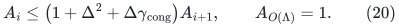

The three terms correspond to existing occurrences, approximate-ball
forest copies, and low-diameter forest copies. Metric stretch never
appears in this counting step. Conversely, construction work is not
raised to the number of flattening levels: it is performed for each
cover instance and then its explicit changes are forwarded to its
preallocated copies. The low-diameter graph's terminal map is fixed
for each vertex lifetime, as proved in Section 6, so these stitchings
do not require a global remapping on every update.

It follows that the strong forest's congestion, recourse, and total
logarithmic overhead are bounded by

<!-- math-display: c3d967a5ded9f29c96638a1c
O\left(
 B+U/\Lambda+U/K_{\rm cov}
   +\Lambda U/K_{\rm cov}+\Lambda c+h
 \right).
 \tag{21}
-->
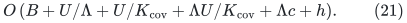

Original distinguished vertices are inherited from the single-source
approximate-ball forest, which contains one canonical node for each
original vertex. Replacing cover-center occurrences retains these nodes
and their identities. All low-diameter forests supplied here are already
flat original-edge forests, so after the final hopset level every
exposed edge maps to one original input edge. Rescaling the internal
accuracy gives the <code class="math">(1+\epsilon)</code> guarantee in Section 1.

## 9. The joint 7/8 balance

Set

<!-- math-display: cb0faa306e3e231d52add180
t=(U/h)^{1/8},\qquad
 p=r=\Theta(t),\qquad K=\Theta(t^3),\qquad
 x=\Theta(U/t)=\Theta(t^7h).
 \tag{22}
-->
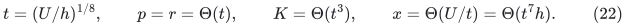

Integer rounding and fixed finite base cases are harmless. Fixed
constants in the definitions can be chosen in order; in particular,
<code class="math">x\gg\log P</code> eventually. Equations (2)--(3) and (7), (13)--(16)
then give

| Quantity | Logarithmic bound |
|---|---:|
| Static structural factor <code class="math">\Gamma</code> | <code class="math">O(th)</code> |
| Static work factor <code class="math">F_{\rm stat}</code> | <code class="math">O(t^7h)</code> |
| One-level child/occurrence factor <code class="math">P</code> | <code class="math">O(t^5h)</code> |
| Hierarchy depth <code class="math">d</code> | <code class="math">O(t)</code> |
| APSP and anchored-diameter stretch | <code class="math">a=O(t^5h)</code> |
| Low-diameter forest congestion | <code class="math">c=O(t^6h)</code> |
| Work and explicit recourse | <code class="math">B=O(t^7h)</code> |

Choose

<!-- math-display: 92e38e49c62e3c86e2ec773f
K_{\rm cov}=\lfloor\alpha t^2\rfloor,
 \qquad \Lambda=\lfloor\beta t\rfloor,
 \tag{23}
-->
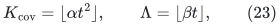

for sufficiently small fixed positive <code class="math">\alpha,\beta</code>, and use a
fixed small-size case when either floor is zero. The left side of
(19) is at most a fixed constant times
<code class="math">\alpha\beta t^8h=\alpha\beta U</code>, so the scale condition holds.
Further,

<!-- math-display: 84f5fc7b07c57251a31c9ba3
U/\Lambda=O(t^7h),\quad
 U/K_{\rm cov}=O(t^6h),\quad
 \Lambda U/K_{\rm cov}=O(t^7h),\quad
 \Lambda c=O(t^7h).
 \tag{24}
-->
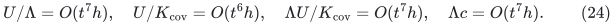

Substitution into (21) proves the claimed exponent in (1), conditional
only on the explicitly named component constructions. The previous
shortcut of assigning every base property the same 4/5 exponent would
instead give a weaker outer result. The separated quantities and the
anchored proof are both necessary for the displayed 7/8 calculation.

## 10. Baseline and meaning of the result

KMG's printed strong-forest theorem has a factor
<code class="math">\exp O(U^{83/84}h)</code>. The present proposed factor is
<code class="math">\exp O(U^{7/8}h^{1/8})</code>, for the same bounded-degree positive-length
decremental strong interface. This is an explicit subpolynomial-factor
improvement, not a change from a polynomial bound to almost-linear time.
KMG already supplies a deterministic almost-linear strong forest.

The printed exponent is not the strongest audited public comparison.
[public-strong-forest-retuning-baseline.md](public-strong-forest-retuning-baseline.md) keeps KMG's published
APSP/low-diameter black boxes and retunes only the public covering and
hopset parameters. It obtains the derived public envelope
<code class="math">\exp O(U^{62/63}h^{1/3})</code>. Thus the proposed 7/8 result should be
compared at least with that 62/63 envelope. No claim is made that 62/63
optimizes every possible combination of all public ingredients.

Faster numerical decremental directed-SSSP results do not automatically
replace this interface. A comparison must inspect explicit path
extraction, fixed canonical nodes, original-edge embedding, simultaneous
congestion, and total representation recourse. The October 2026 paper
[arXiv:2610.07468v1](https://arxiv.org/html/2610.07468v1) explicitly
restricts its main theorem to numerical estimates. Its Appendix C and
Section 9.4 explain obstacles to turning those labels and auxiliary
cut structures into fast original paths. It therefore does not supply
the strong forest contract used here.

The static minimum-cost-flow 4/5 exponent is also obtainable by a joint
retuning of existing public ingredients, as recorded in
[public-dual-reoptimization.md](public-dual-reoptimization.md) and
[public-dual-uniform-wrapper-audit.md](public-dual-uniform-wrapper-audit.md). It is therefore not counted as a
separating new application here.

## 11. The quantified Gomory--Hu application

Abboud et al.,
[Deterministic Almost-Linear-Time Gomory--Hu Trees,
arXiv:2507.20354v1](https://arxiv.org/html/2507.20354v1), use exactly a
strong low-congestion forest in their Theorem 4.7. Their MWU iteration
count depends on its congestion, so numerical distance estimates alone
are insufficient. Their own theorem already gives deterministic
<code class="math">m^{1+o(1)}</code> time on general polynomially weighted undirected graphs.

The application adapters, finite arithmetic, and quantitative skeleton
calculation are now developed in
[gomory-hu-seven-eighths-dependency-audit.md](gomory-hu-seven-eighths-dependency-audit.md), with independent numerical
and skeleton checks in [finite-mwu-and-li-skeleton-independent-audit.md](finite-mwu-and-li-skeleton-independent-audit.md).
The direct multi-source strengthening is proved in
[multisource-rooted-approximate-ball-forest.md](multisource-rooted-approximate-ball-forest.md). These settle the
length-increase, physical-degree, source-root, finite-bit, and packing
interfaces. Physical degree is handled at every actual guide-packing
call by a linear-size cut-preserving degree-three expansion. Fixed
binary port trees handle the subsequent geometric length copies; the
final null quotient is taken relative to that bounded-degree physical
input.

The fixed-parameter guide-tree mincut interface required an additional
construction, rather than an automatic citation. It is now proved in
[deterministic-fixed-k-tree-mincut-adapter.md](deterministic-fixed-k-tree-mincut-adapter.md). The new leaf routine's
maximizer includes source-arm targets, and its choice of one full child
or two disjoint uncontracted children preserves the cut cases and the
aggregate inventory simultaneously. Non-source contracted targets are
broadcast correctly, and the leaf parameter-one base uses one exact
set mincut. Its independent audit is
[fixed-k-global-max-leaf-independent-audit.md](fixed-k-global-max-leaf-independent-audit.md).

The expander-decomposition overhead explicitly displayed in the
Gomory--Hu paper has leading power 4/5 and is below 7/8 for polynomial
weights. Its final recursive instance inventory is only a polylogarithmic
factor larger than the original graph. The updated Li skeleton has
leading power 5/6, including its output mincut value and guide-family
size. All those factors are below 7/8. Their detailed quantitative audit
is [gomory-hu-external-factors-except-fixed-k.md](gomory-hu-external-factors-except-fixed-k.md).

Together these constructions give the research proof assembly of an
exact Gomory--Hu tree for general polynomially weighted undirected
graphs in <code class="math">O(n+m)+(m+1)\exp O(U^{7/8}h^{1/8})</code> time. This
application is not conditional on a still-unresolved SSMC interface;
its remaining proof imports are the named component constructions
already recorded in this note. It remains a research proof assembly,
not an implemented or externally certified algorithm.

## 12. Proof obligations to preserve during further edits

The following are part of the construction, not optional implementation
details:

1. Use the all-pairs pivot metric statement (4), not the raw-cycle
   approximation theorem, for the distance query.
2. Force and charge one anchor at every level before applying (11).
   Bounding the diameter of every auxiliary child vertex is unnecessary
   and was not proved.
3. Execute `Promote` through the actual constructive pivot/root routine;
   a loop intercepted by an unrelated raw-cycle loop heap is not a
   promotion.
4. Preserve permanent root canonical nodes and leave internal typed-null
   handles distinct until the final root quotient.
5. Count vertex occurrences, dormant pools, port ghosts, and additive
   initial selected credit. Use the coupled recurrence (15).
6. Use metric stretch only in the cover-scale condition, congestion only
   in the flattening copy recurrence, and construction work once per
   actual local instance and its updates.
7. Keep all public primitives within their literal ranges and charge
   finite-bit work. The old complete dynamic-spanner theorem is not the
   growing-parameter primitive.

These conditions make the candidate checkable and identify where a
counterexample or a missing source interface would invalidate it. They
do not claim that a written proof has already been externally verified.
