# Separating the output quality and construction work of deterministic sparsifiers

**Research derivation, 24 October 2026.** This note reconstructs a parameterized
version of the deterministic static sparsifier used by the distance backend.
The reconstruction keeps the input-path-length factor in the published ambient
congestion theorem. Its different point is that the work of constructing short
paths need not be used as an upper bound on the lengths of those paths.

The existing 14/15 checkpoint is unchanged. The final section records a candidate
parameter balance for a separately composed backend; it is not an independently
implemented or externally verified algorithm.

## 1. Primary statements and parameters

The constructive dependencies are:

* [Chuzhoy, Gao, Li, Nanongkai, Peng and Saranurak,
  arXiv:1910.08025v2](https://arxiv.org/pdf/1910.08025), Theorem 1.6,
  Theorem 5.1, and the balanced-cluster recursion in the proof of Corollary 6.1.
* [Chuzhoy and Saranurak, arXiv:2009.08479v1](https://arxiv.org/pdf/2009.08479),
  Appendix B.4, Theorem 3.7, and the actual stage and path recurrences in
  Section 3.2, especially Lemmas 3.10 and 3.11.
* [van den Brand et al., arXiv:2309.16629v1](https://arxiv.org/pdf/2309.16629v1),
  Algorithm 4 and its proof, Theorem 8.1, and Appendix B's degree-band reduction.

Let <code class="math">U\geq 2</code> be a master logarithmic size bound; all graphs in the following
static computations have at most <code class="math">2^{O(U)}</code> explicit records. Put

<!-- math-display: dcd06de69506103d55469cd6
h=\lceil\log_2(U+2)\rceil.
-->
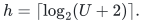

There are two independent integer parameters:

* <code class="math">r\geq 1</code>, the recursion parameter of the deterministic cut player;
* <code class="math">q\geq 2</code>, the number of levels in the decremental expander path oracle.

They are distinct from the later touched-set batching depth <code class="math">K</code> and the
numerical hierarchy's size-reduction parameter <code class="math">k</code>. We use them only in a
range where <code class="math">r,q\leq U</code> and <code class="math">qrh\leq U</code>. The latter condition keeps
all constructed witnesses within <code class="math">2^{O(U)}</code> records; it has ample
slack for the parameters in Section 6. Fixed constants in the bounds below come from the
named constructive algorithms, not from a choice depending on the input.

For sufficiently large fixed constants, define a common conductance threshold
and a cut-player work factor by

<!-- math-display: 859f692551d7e1011818f100
\phi^{-1}=2^{O(rh)},\qquad
 F_r=2^{O(U/r+r^2h)}.                                      \tag{1}
-->
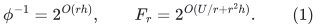

Their roles are different: <code class="math">\log\phi^{-1}=O(rh)</code>, whereas
<code class="math">\log F_r=O(U/r+r^2h)</code>. The latter is not raised to the path-oracle
depth in the stage-count argument below.

## 2. Expander decomposition with separate conductance and work bounds

CGLNPS Theorem 5.1, with its parameter denoted here by <code class="math">r</code>, returns a cut
of size at most <code class="math">\theta\mathrm{vol}(G)</code>. Either both sides have
constant-fraction volume, or one constant-fraction side has conductance at
least

<!-- math-display: 331cfb7ee96e2e5cb2a1cc45
\theta/(\log m)^{O(r)}.
-->
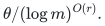

Its time is

<!-- math-display: ca43a4b1ce6b343629e062df
m^{1+O(1/r)}(\log m)^{O(r^2)}/\theta^2.       \tag{2}
-->
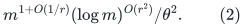

Run the ordinary balanced-cluster recursion with
<code class="math">\theta=\varepsilon/(c\log(m+2))</code>. A balanced return recurses on both
sides; an expanding return finishes its large side and recurses on the other.
Every active cluster's volume falls by a constant factor at each iteration.
There are <code class="math">O(\log m)</code> iterations, their graphs are edge-disjoint within an
iteration, and their cut budgets sum to at most <code class="math">\varepsilon m</code>, after
adjusting <code class="math">c</code>. The resulting pieces have conductance at least

<!-- math-display: 6df11c50ceb97b312de03caa
\varepsilon\,2^{-O(rh)},
-->
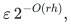

and total work <code class="math">mF_r\mathrm{poly}(U)/\varepsilon^2</code>.
This uses Theorem 5.1's actual output guarantee. The larger <code class="math">r^2</code> exponent
printed in the packaged Corollary 6.1 is not needed in this recursion.

When a recursive cluster is too small for a given source parameter <code class="math">r</code>, use
<code class="math">r'=\min\{r,\lfloor\log &#124;E&#124;/c_0\rfloor\}</code>, with a constant-size base
case. The source's absolute cutoff is met by a sufficiently large fixed <code class="math">c_0</code>.
The output guarantee only improves. Its time still fits the master envelope:
when <code class="math">r'&lt;r</code>, <code class="math">\log &#124;E&#124;/r'=O(1)</code>, and
<code class="math">(r')^2\log\log(&#124;E&#124;+2)\leq O(r^2h)</code>. No small invocation is padded
to master size.

### Actual-size degree bands without artificial self-loops

In the degree-band reduction, start with the nonisolated vertex count <code class="math">n</code> and
edge count <code class="math">m</code>, and set

<!-- math-display: cbe4d06b18abfbff13901e90
\ell=\max\{0,\lceil\log_2(2m/n)\rceil\},\qquad G_\ell=G.
-->
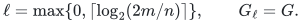

The invariant is <code class="math">&#124;E(G_i)&#124;\leq 2^i n</code>. No maximum-degree condition is
needed. At stage <code class="math">i&gt;0</code>, apply the preceding loopless decomposition with
crossing-edge budget at most <code class="math">&#124;E(G_i)&#124;/4</code>, obtaining components of
conductance at least <code class="math">\phi</code>. In each nontrivial component <code class="math">C</code>, initialize
CS21 Theorem 3.7's deterministic expander-pruning structure.
For a loopless multigraph, use the simple subdivision and projection
adapter proved in Section 4 for pruning as well as for path queries.
Fix an absolute constant <code class="math">c_{\rm pr}</code> covering this adapter: up to
<code class="math">\phi &#124;E(C)&#124;/c_{\rm pr}</code> original-edge deletions, it removes
original volume at most <code class="math">c_{\rm pr}t_C/\phi</code>, leaves a strong
<code class="math">\phi/c_{\rm pr}</code>-expander with respect to the original component,
and has work <code class="math">O(t_C\mathrm{poly}(U)/\phi^2)</code>.
All constants below use this literal simple-graph reduction.

Fix an absolute constant <code class="math">C_b</code>, sufficiently large, and put

<!-- math-display: c4d7c7230936b2bd72d2a306
\delta_i=\phi 2^i/C_b.
-->
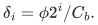

While a surviving vertex has positive current degree smaller than
<code class="math">\delta_i</code>, choose it and explicitly request deletion of all its current
incident edges. Settle the pruning structure before choosing the next
vertex. A chosen vertex becomes isolated and never acquires an edge again;
there are at most <code class="math">n</code> choices. Thus the number <code class="math">t_i</code> of explicitly
requested edge deletions, summed over all initial components of the band,
satisfies

<!-- math-display: 540ed6190a2d9ad72289fae1
t_i<\delta_i n.
-->
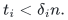

Move to the next residual graph every explicitly deleted edge and every
original component edge incident to a pruned vertex. The latter includes
edges on an earlier pruning boundary, not only edges present when that
vertex is finally processed. The pruning theorem bounds this count by the
initial volume of the pruned set, at most <code class="math">c_{\rm pr}t_C/\phi</code> in a component
with <code class="math">t_C</code> explicit requests.

If a component's next request would exceed its allowed budget
<code class="math">\lfloor\phi &#124;E(C)&#124;/c_{\rm pr}\rfloor</code>, count that first excess request and
move the whole remaining component to the residual graph. Its original
edge count is then smaller than <code class="math">c_{\rm pr}t_C/\phi</code>. This convention also
handles a quota below one: the first actual edge-deletion request pays
for discarding the component. Already moved edges are counted only once.
Therefore, for an absolute constant <code class="math">c_b</code>,

<!-- math-display: f2b104f7fc73e50f73fd38cd
|E(G_{i-1})|
   \leq |E(G_i)|/4+c_b t_i/\phi
   \leq 2^i n(1/4+c_b/C_b)
   \leq 2^{i-1}n.                                      \tag{2a}
-->
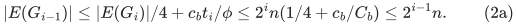

Choose <code class="math">C_b\geq 4c_b</code>. The retained graph <code class="math">J_i</code> is the union of
the final surviving component graphs. Every nontrivial component has
conductance at least <code class="math">\phi/c_{\rm pr}</code> and minimum degree at least
<code class="math">\delta_i</code>. Zero-edge isolates are omitted. The final residual
<code class="math">G_0</code> has at most <code class="math">n</code> edges and is retained directly.
For Algorithm 4's interface, use the common parameter
<code class="math">\bar\phi=\phi/\max\{c_{\rm pr},C_b\}</code>. Then both required properties hold
literally: conductance at least <code class="math">\bar\phi</code> and minimum degree at least
<code class="math">\bar\phi 2^i</code>. Below, <code class="math">\phi</code> may denote this smaller common
parameter; all displayed envelopes are unchanged by this fixed factor.

A heap or degree bucket detects low-degree vertices. Each moved edge is
scanned only a constant number of times within its band. Pruning and
whole-component quota handling cost
<code class="math">O(&#124;E(G_i)&#124;+t_i\mathrm{poly}(U)/\phi^2)</code>, in addition to the
decomposition. Since <code class="math">2^\ell n\leq 4m</code>,

<!-- math-display: ec6c74ddddac2db5829afc49
\sum_{i=1}^{\ell}2^i n=O(m).
-->
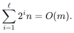

Consequently all band construction work is
<code class="math">mF_r\mathrm{poly}(U,\phi^{-1})</code>, and there is no
<code class="math">n\Delta</code> padding cost. High-degree vertices remain permitted. The
witness size for a band is bounded through its total degree:
<code class="math">&#124;E(G_i)&#124;/(\phi2^i)=O(n/\phi)</code>.

This loopless construction replaces the artificial-loop degree-band step
of the packaged static sparsifier. It invokes CGLNPS Theorem 5.1 only on
inputs covered by its literal loopless-multigraph convention.

### Loopless weighted witnesses in the degree bands

Algorithm 4 needs a constant-conductance witness with degrees comparable to
<!-- math-display: e13fd73258300caad42016b0
w_v=\deg_{J_i[X]}(v)/(\phi2^i)\geq1.
-->
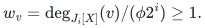
These weights are balanced: because the component is loopless,
<code class="math">w_v\leq\sum_{u\ne v}w_u</code>. Put <code class="math">p_v=\lceil w_v\rceil</code> and
<code class="math">N=\sum_v p_v</code>. Then <code class="math">p_v\leq\sum_{u\ne v}p_u</code>, so every
fiber has at most <code class="math">N/2</code> ports.

Apply CGLNPS Theorem 2.4 to <code class="math">N</code> ports, obtaining a graph of fixed
maximum degree <code class="math">D_0</code> and fixed positive edge expansion <code class="math">\alpha_0</code>.
Group <code class="math">p_v</code> ports into the fiber for <code class="math">v</code>, contract each fiber,
and discard all edges internal to a fiber. Retain parallel crossing
edge IDs. For one fiber its boundary has at least <code class="math">\alpha_0p_v</code>
edges. Replicate every remaining edge a fixed integer
<code class="math">c_w\geq1/\alpha_0</code> times. The resulting loopless multigraph has
<!-- math-display: c6e207d9992943a7b096edf8
w_v\leq p_v\leq\deg_W(v)
       \leq c_wD_0p_v\leq 2c_wD_0w_v.
-->
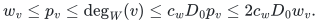
For any union of vertex fibers, its crossing edge count is at least
<code class="math">c_w\alpha_0</code> times the smaller port-side cardinality, while each
side's witness volume is at most <code class="math">c_wD_0</code> times its port cardinality.
Thus <code class="math">W</code> has conductance at least <code class="math">\alpha_0/D_0</code>.

This construction takes <code class="math">O(\sum_v w_v)</code> time and space, with fixed
constant factors. It gives exactly the degree comparisons needed in
Algorithm 4's two routing tasks. It does not require an arbitrary-weight
loopless version of the packaged witness theorem. Every graph sent to
the path oracle remains loopless; parallel edges use the subdivision
adapter below.

## 3. A terminal expander with a cheap output and more expensive construction

CGLNPS Theorem 1.6 is a cut player on graphs of maximum degree
<code class="math">O(\log &#124;T&#124;)</code>. Its certificate has sparsity
<code class="math">(\log &#124;T&#124;)^{-O(r)}</code>, and its time is
<code class="math">&#124;T&#124;^{1+O(1/r)}(\log &#124;T&#124;)^{O(r^2)}</code>. Run the cut-matching game
of CGLNPS Theorem 2.5, using the following explicit moves. If the cut player
returns a sparse cut <code class="math">A_i,B_i</code> with
<code class="math">&#124;T&#124;/4\leq &#124;A_i&#124;\leq &#124;B_i&#124;</code>, **extend**
<code class="math">A_i\subseteq A_i'</code> to a balanced partition
<code class="math">(A_i',B_i')</code>; the matching player supplies a perfect matching between
those two sides. If the cut player instead certifies an expanding set
<code class="math">S</code> with <code class="math">&#124;S&#124;\geq &#124;T&#124;/2</code>, supply one final matching from
<code class="math">T\setminus S</code> into distinct vertices of <code class="math">S</code>. CGLNPS Observation 2.3
then extends the certified sparsity to all terminals. These are the moves
specified in the primary CGLNPS proof; they avoid the reversed inclusion
and final-side typographical errors in CS21 Appendix B.4.

The game has <code class="math">O(\log &#124;T&#124;)</code> rounds. Its final terminal graph has maximum
degree <code class="math">O(\log &#124;T&#124;)</code> and conductance <code class="math">2^{-O(rh)}</code>. If the terminal
cardinality is odd, run the even game on all but one terminal and attach
the last terminal by one additional matching edge; the same bounds hold.

The matching player is CS21 Theorem B.9. In an input expander of conductance
at least a fixed positive constant times <code class="math">\phi</code>, it constructs each matching with paths of length
<code class="math">O(U/\phi)</code>, edge congestion <code class="math">O(U^2/\phi^2)</code>, and time
<code class="math">m\mathrm{poly}(U)/\phi^3</code>. Unioning the matchings gives the
safe bounds

<!-- math-display: 1bdf43a8db5989a49efd728d
\lambda=O(U/\phi),\qquad
      \eta=O(U^3/\phi^2),                                \tag{3}
-->
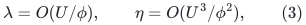

for the terminal embedding. We use the proof's <code class="math">U^3</code> congestion bound;
Theorem 3.8's displayed <code class="math">U^2</code> bound omits the union over matching rounds.
The construction time is at most

<!-- math-display: 3b56f56999e217c960510e16
m F_r\mathrm{poly}(U)/\phi^3.    \tag{4}
-->
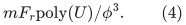

In particular <code class="math">F_r</code> changes the cost of building this object, not its
<code class="math">\lambda,\eta</code> or its output conductance.

For a simple-graph implementation of the subsequent path oracle, deduplicate
parallel witness edges after the whole cut-matching game. Their multiplicity
is at most <code class="math">O(\log &#124;T&#124;)</code>. Keeping one edge and its associated embedding path
loses at most that factor in conductance, while decreasing embedding
congestion and maximum degree. This loss is absorbed when choosing the
common <code class="math">\phi=2^{-c rh}</code>. Do not deduplicate during the game itself.

## 4. A parameterized decremental expander path oracle

Take an initially <code class="math">\phi</code>-expanding graph of actual size <code class="math">m</code>.
Use the CS21 Section 3.2 hierarchy with <code class="math">q</code> levels and nominal level sizes
<code class="math">m^{i/q}</code>, rounded by integer ceilings. At each stage, construct the
next smaller terminal expander by Section 3. Its output conductance is at
least the common <code class="math">\phi</code>, independently of the larger work factor
<code class="math">F_r</code>. Expander pruning is CS21 Theorem 3.7, whose update work is
<code class="math">O(tU/\phi^2)</code>, removed original volume is at most
<code class="math">O(t/\phi)</code>, and surviving conductance is at least
<code class="math">\phi/c_{\rm pr}</code> after the multigraph adapter.

The top input may be a loopless multigraph. Subdivide every input edge once,
retaining its original edge ID on the two-edge representation. This gives a
simple graph of constant-factor size and constant-factor smaller conductance.
An original deletion gives two subdivision-edge deletions. Expose only pruned
original vertices, and project returned subdivision paths to original edge
IDs. The removed original volume is bounded by the removed subdivision
volume. The returned paths exist in the original graph with its pruned
original vertices removed. Strong expansion also projects: extend any
cut of surviving original vertices by placing a surviving subdivision
vertex with its same-side endpoint, or with either endpoint when that
edge crosses the cut. The subdivision cut is no larger than the
corresponding original cut, and the original-subdivision volume of
each side is at least the original volume of its original vertices.
Internal witness graphs can be simple by the
deduplication just described. Original input loops have empty routes and are
handled outside this path oracle.

### Current roots and deletion order

The ES tree at level <code class="math">i</code> is rooted at the CURRENT surviving vertices of the
level-<code class="math">(i-1)</code> expander, not the terminal set as it stood at that expander's
birth. Represent these roots by super-source edges. When a lower terminal is
pruned, delete its super-source edge. On a stage restart install the new root
set and rebuild the corresponding ES tree. These are deletion-only changes
within a stage and cost at most one root-edge deletion per terminal.

Complete parent-edge deletions, all embedding-preimage deletions, all
resulting lower prunings/restarts, and all super-source root-edge deletions
before answering a query. Thus the two ES legs always end at living lower
terminals, and the recursive middle query is legal. Parent-pruned endpoints
also remove the associated embedded lower edges before querying. These
explicit steps repair an ambiguity in the source's abbreviated pseudocode
without changing its stage bound.

Apply pruning at the bottom level <code class="math">G_1</code> as well. After a settled
bottom edge deletion and its pruning output, recompute a BFS tree on
the surviving bottom expander, rooted at any surviving vertex.
Remove pruned bottom vertices from the parent ES root set before
queries. The printed <code class="math">i=1</code> deletion branch omits this pruning
operation, although the accompanying proof assumes that every
current <code class="math">G_i</code> is pruned; simply recomputing a tree in an unpruned
graph could leave an isolated terminal unreachable. A base stage
has <code class="math">O(m^{1/q}\mathrm{poly}(U))</code> edges and at most that
many deletions, so these BFS recomputations cost
<code class="math">m^{2/q}\mathrm{poly}(U,\phi^{-1})</code>, already covered by
the <code class="math">i=1</code> case of (5).

Whenever a stage is rebuilt, retire its old embedding and deletion
queue records by generation. A callback from an old generation
cannot delete an edge of a newly built child. Finish the replacement
and all current-generation prune/root changes before queries.

### Small instances

If <code class="math">\log(m+2)&lt;c_1qrh</code>, use ordinary expander pruning and perform a
direct BFS for each query. This costs at most <code class="math">2^{O(qrh)}</code> per query, and
the initialization plus all pruning costs are <code class="math">m2^{O(qrh)}</code>. Otherwise
the smallest nominal terminal set has logarithmic size at least
<code class="math">c_1rh</code>. It satisfies the cut-player cutoff
<code class="math">&#124;T&#124;^{1/r}\geq N_0</code>, and consecutive hierarchy sizes have enough
slack to dominate the <code class="math">O(U)</code> maximum degree and pruning losses. This is an
actual-size base case, not a master-sized allocation.
In particular, choose <code class="math">c_1</code> large enough that
<code class="math">m^{1/q}\geq U^{c_2}\phi^{-c_2}</code> for the fixed constants used
in the stage proof. Then the smallest nonbase stage has a positive
deletion budget and enough surviving vertices to supply the next
terminal set. Integer floors in the quota and hierarchy sizes
change only fixed factors.

### Stage work and stage counts

Let <code class="math">B=\mathrm{poly}(U,\phi^{-1})=2^{O(rh)}</code>. A single
level-<code class="math">i</code> stage costs at most

<!-- math-display: fd45348e47ddb9e8c015a4e4
m^{(i+1)/q}F_r B                      \tag{5}
-->
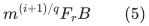

apart from recursively charged lower stages. This includes one terminal
expander construction, its explicit inverse embedding lists, its ES tree,
pruning, and processing the at most <code class="math">\eta</code> immediate preimages of
each deleted edge.

One stage at level <code class="math">i+1</code> causes at most

<!-- math-display: 3519bdf1800d9daa4b452fd0
m^{1/q}B                       \tag{6}
-->
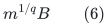

level-<code class="math">i</code> stages. This is exactly the source's counting argument: pruning
removes at most a <code class="math">1/\phi</code> multiple of deleted-edge volume, the
embedding amplifies deletions by at most <code class="math">\eta</code>, and a child stage
requires a <code class="math">\phi</code> fraction of its initial edges to disappear.
Only output congestion and conductance occur in <code class="math">6</code>. **The construction
factor <code class="math">F_r</code> does not occur in the number of stages.**

Multiplying <code class="math">5</code> by the number
<code class="math">m^{(q-i)/q}B^{O(q-i)}</code> of level-<code class="math">i</code> stages and summing gives

<!-- math-display: 78e83f385ee6c6ec2c9a850e
\boxed{
    \text{initialization plus all deletion work}
      \ \leq mF,
    \qquad
    F=2^{O(U/q+U/r+r^2h+qrh)}.
 }                                                         \tag{7}
-->
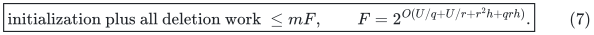

For queries the source recurrence is

<!-- math-display: 7d06dcf621fa7f8bcb697ccf
L_i\leq O(U/\phi)\,[1+L_{i-1}],
-->
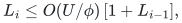

so a returned simple path and its computation have size at most

<!-- math-display: 4678fa3f2c035f6532f0f108
\Lambda=2^{O(qrh)}.             \tag{8}
-->
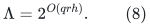

The path is made simple by deleting closed subwalks in linear time in its
explicit length. Only the final simple path is charged to ambient vertex
congestion in the static sparsifier.

The source and multigraph adapter support at most
<code class="math">\phi m/c_{\rm pr}</code> original-edge deletions before the top
expander is exhausted. At the first request beyond that budget, declare every
remaining original vertex pruned and stop that oracle. This costs <code class="math">O(m)</code>
once and keeps removed volume <code class="math">O(t/\phi)</code>, after increasing the absolute
constant. It supplies the all-deletion convention used by Algorithm 4.

## 5. Consequences for the literal ambient static sparsifier

Let <code class="math">J</code> be the demand graph and <code class="math">\Pi:J\to H</code> an explicit ambient
embedding. Let <code class="math">L_0\geq1</code> be its maximum path cardinality and <code class="math">C_0</code> its
vertex congestion. Apply the degree-band decomposition from Section 2 and
Algorithm 4 of van den Brand et al., using Section 4's oracle.

Here is an explicit weighted version of the two charging arguments.
It is useful because the published proof has a few numerical slips that
are immaterial to its asymptotic conclusion but should not be copied.
Count repeated ambient path occurrences in <code class="math">C_0</code> and in the maintained
loads; this is at least the number of distinct demand IDs using a vertex.

Give every witness edge in band <code class="math">i&gt;0</code> weight
<code class="math">\rho_i=\phi2^i</code>, and give the directly retained <code class="math">J_0</code> edges weight
one. The weighted witness degrees obey
<!-- math-display: 9cdb7404dbff7a5d893c849c
\deg_{J_i}(v)\leq \rho_i\deg_{W_i}(v)
                      \leq D_w\deg_{J_i}(v)
-->
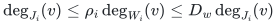
for a fixed <code class="math">D_w</code>. The nonbase witness edge IDs are fresh and distinct
from all demand IDs, even when their endpoint pairs agree.

**Route the witness into <code class="math">J</code>.** In each round, initialize a fresh
path oracle on each band component. Route every still-unrouted witness
edge whose endpoints survive, using a simple path in its own band.
Retain the route permanently once assigned. At ambient vertex <code class="math">x</code>,
maintain the weighted, occurrence-counted load of the composed routes
<code class="math">\Pi\circ\Pi_{W\to J}</code>. In round <code class="math">j</code>, when that load reaches
<code class="math">j\tau_1</code>, delete from the current oracles every original demand edge
whose input path uses <code class="math">x</code>, where
<!-- math-display: dca3ce6d49f7fcdf3427e82c
\tau_1=c_1'\Lambda(L_0+1)(C_0+\Delta(J))/\phi.
-->
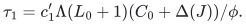
Use a sufficiently large fixed <code class="math">c_1'</code>.

One newly assigned witness route increases any one ambient load by at
most <code class="math">\Delta(J)\Lambda(L_0+1)</code>, because its edge weight is at most
<code class="math">\Delta(J)</code>. Thus the overshoot is at most <code class="math">\tau_1/2</code>. Each
ambient vertex disabled in a round has accumulated at least
<code class="math">\tau_1/2</code> new load in that round. If <code class="math">B</code> is the weighted mass of
witness edges assigned during the round, total new ambient load is at
most <code class="math">\Lambda(L_0+1)B</code>. The total number of original demand edges
explicitly deleted from all band oracles is therefore at most
<!-- math-display: e3d63bd425b1db64c32e1fa4
2C_0\Lambda(L_0+1)B/\tau_1.
-->
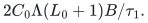
Pruning removes initial band volume at most a fixed constant times this
quantity divided by <code class="math">\phi</code>. Every witness edge left unrouted has a
pruned endpoint. Its total weighted mass is at most <code class="math">D_w</code> times the
removed initial band volume. Choosing <code class="math">c_1'</code> sufficiently large makes
that remaining mass at most a fixed multiple of <code class="math">B</code>, and even at most
<code class="math">B/2</code> if desired. Consequently each round makes constant-factor
progress. This is the correct constant-fraction conclusion; the
factor <code class="math">18</code> is reversed in one displayed deduction of the source's
Claim 8.7, without affecting this argument.

The total initial weighted mass is <code class="math">O(&#124;E(J)&#124;)</code>; every positive
witness weight is at least <code class="math">\min\{1,\phi\}</code>. Hence the number of
rounds is <code class="math">O(\log(&#124;E(J)&#124;+2)+\log(1/\phi))=O(U)</code>.
The final weighted ambient congestion is <code class="math">O(U\tau_1)</code>.

**Route <code class="math">J</code> into the witness.** Define normalized witness-edge load
as the number of assigned unit-demand routes using that edge, divided
by its weight <code class="math">\rho_i</code>. In round <code class="math">j</code>, use a fresh path oracle in
each witness component and delete an edge from that round's oracle
when its normalized load reaches <code class="math">j\tau_2</code>, where
<!-- math-display: 5c4e835da512c08061cf3e37
\tau_2=c_2'\Lambda/\phi.
-->
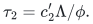
Every new simple route increases the load of an edge by
<code class="math">1/\rho_i\leq1/\phi</code>, so a sufficiently large fixed <code class="math">c_2'</code>
again bounds the overshoot by <code class="math">\tau_2/2</code>. The increase need not be
at most one; this is the normalized-weight correction to the
published Invariant 2.

If <code class="math">B'</code> demand edges are assigned in a round, the sum of
<code class="math">\rho_i</code> times the new normalized edge load is at most
<code class="math">\Lambda B'</code>. Thus the total weight of explicitly deleted witness
edges is at most <code class="math">2\Lambda B'/\tau_2</code>. The witness weights are
uniform within each component, so ordinary pruning bounds the
removed weighted volume by a fixed constant times this deleted
weight divided by <code class="math">\phi</code>. The degree lower bound
<code class="math">\rho_i\deg_{W_i}\geq\deg_{J_i}</code> shows that the number of still
unrouted demand edges is no larger than that removed weighted
volume. For a sufficiently large fixed <code class="math">c_2'</code>, each round again
makes constant progress. There are <code class="math">O(\log(&#124;E(J)&#124;+2))</code> rounds,
and the final normalized edge congestion is <code class="math">O(U\tau_2)</code>.

The directly retained <code class="math">J_0</code> edges use their own identity routes;
they fit the initial-load bounds and require no path-oracle call.
For the other edges, both witness-routing steps have maximum path
length <code class="math">\Lambda</code>. Weighted composition of the two embeddings gives
ambient congestion
<!-- math-display: 1f744f542d56a72b0c2b4938
O(U^2\tau_1\tau_2)
 =O\!\left(
  U^2\Lambda^2\phi^{-2}(L_0+1)(C_0+\Delta(J))
 \right).
-->
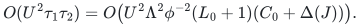
Because <code class="math">L_0\geq1</code>, the factor <code class="math">L_0+1</code> is absorbed by <code class="math">2L_0</code>.
With a common output envelope

<!-- math-display: 3bc8f29495daa8b041454989
\Gamma=2^{O(qrh)},              \tag{9}
-->
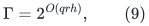

the resulting selected subgraph and explicit embedding satisfy

<!-- math-display: 65884812e9ae45107e1bba3a
|E(\widetilde J)|\leq |V(J)|\Gamma\mathrm{poly}(U),
 \qquad L(\widehat\Pi)\leq\Gamma,\qquad
 L(\Pi\circ\widehat\Pi)\leq\Gamma L_0,
-->
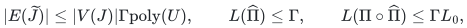

<!-- math-display: 10a143b159a562c6a2995fdc
C(\Pi\circ\widehat\Pi)
       \leq \Gamma L_0[C_0+\Delta(J)].                    \tag{10}
-->
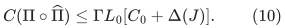

For example, the source proof gives a congestion factor proportional to
<code class="math">\Lambda^2\phi^{-2}\mathrm{poly}(U)</code>, and path factor
<code class="math">\Lambda^2</code>; both fit <code class="math">9</code>. The selected witness-path count and total
support also fit that envelope. Every representative selected edge remains an
actual demand-edge ID, as required by the later core-edge lift.
If an interface requires each final route in <code class="math">\widetilde J</code> to be
simple, erase closed subwalks in that graph in time proportional to
the explicit route length. This only deletes occurrences from its
ambient expansion and cannot increase any of the stated bounds.

The initialization and all adaptive path-oracle deletions cost at most a fixed
multiple of the actual host size times <code class="math">F</code>, for each of the <code class="math">O(U)</code>
rounds. Explicit path output, ambient inverse indexing, and
edge updates contribute fixed factors of <code class="math">\Gamma</code> and <code class="math">L_0</code>.
Thus a safe runtime is

<!-- math-display: 651784bc3b7bd297eec07f7d
|E(J)|\,F\,\Gamma^{O(1)}
                      (L_0+1)\mathrm{poly}(U).    \tag{11}
-->
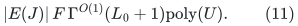

An ambient graph is represented by the union of the supplied explicit paths
and relevant central edges. Unrelated ambient isolates are not scanned. The
same conventions on parallel IDs, loop demands, original endpoints and
explicit route-owner records apply as in
[demand-route notifications](demand-route-notifications-and-local-work.md).

Formula <code class="math">10</code> is **not** the unsupported length-free restatement. The new
separation is between the larger local work factor <code class="math">F</code> and the smaller
output factor <code class="math">\Gamma</code>.

### Finite arithmetic and primitive boundaries

Choose the common <code class="math">\phi</code> as a reciprocal power of two below the
proved conductance threshold, for example
<code class="math">2^{-c_\phi r h}</code> for a sufficiently large fixed integer
<code class="math">c_\phi</code>. The component quotas, witness port counts, normalized
loads, and threshold comparisons then use integers or dyadic
rationals. The positive weights have logarithmic magnitudes
<code class="math">O(U+rh)</code>, and input-path indices and explicitly generated path
records are charged at their actual lengths. Floors and ceilings of
the hierarchy sizes <code class="math">m^{i/q}</code> are computed by integer power
comparisons. No real-arithmetic oracle or uncharged implicit path
enumeration is required.

The source algorithms are used with their constructive cut-player,
matching-player, pruning, and ES-tree procedures. Fixed constants
such as the cutoff <code class="math">N_0</code> and the large absolute constants in this
note belong to a fixed finite program or to its enumerated
constant-parameter family. They are not input-dependent advice.
For the growing parameters of Section 6, all declared counts and
integer bit lengths are <code class="math">2^{O(U)}</code> and <code class="math">O(\mathrm{poly}U)</code>,
respectively; the master backend charges their arithmetic and may
guard the corresponding explicit bounds.

The result proved here is a STATIC subgraph and explicit-routing
primitive. It does not by itself provide a native split data
structure, a fully dynamic cycle oracle, or a matching algorithm.
Those interfaces are the separate constructions named below.

## 6. Candidate balance after short-period batching and degree reset

This section assumes the separately documented
[amortized static-base distance sparsifier](amortized-static-base-distance-sparsifier.md)
and its complete degree-reset/raw-lift interfaces. It uses that construction's
own integer batching clock, not the different KMPG black-box restriction on
<code class="math">K</code>. The original length-sensitive recurrence gives local work
<code class="math">\Gamma^{O(K^2)}</code>, while selected recourse remains a fixed power of
<code class="math">\rho\Gamma\mathrm{poly}(U)</code>, where
<code class="math">\log\rho=O(U/K)</code>.

Writing <code class="math">x=\log k</code>, a safe prospective total logarithmic overhead is

<!-- math-display: 2dd18db06da78ee23b06ccd3
O\!\left(
 x+U/r+U/q+r^2h+qrh+K^2qrh
       +\frac{U^2}{Kx}+\frac{Uqrh}{x}
       +\frac{UKqrh}{x}
 \right).                                                 \tag{12}
-->
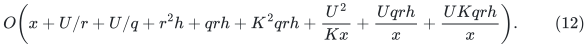

Here the work factor <code class="math">F</code> is local/additive. It is not inserted into the
selected-degree cap, the recursive update multiplier, or the exposed forest
occurrence cap. The last term explicitly charges the raw-quality loss:
each numerical level may lose <code class="math">\Gamma^{O(K)}</code>, across
<code class="math">O(U/x)</code> levels. When <code class="math">K^2qrh=o(U)</code>, the one-level path-quality factor
<code class="math">\Gamma^{O(K)}</code> is also bounded by a fixed power of the recourse
envelope, so its multiplication through the hierarchy is included.

The power/logarithm balance suggested by <code class="math">12</code> is

<!-- math-display: b644489179ce6aee58f20d8d
r,q=\Theta(U^{1/7}h^{-1/7}),\qquad
 K=\Theta(U^{2/7}h^{-2/7}),\qquad
 x=\Theta(U^{6/7}h^{1/7}).                                \tag{13}
-->
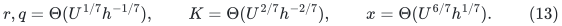

It gives <code class="math">\log\Gamma=O(U^{2/7}h^{5/7})</code>,
<code class="math">\log F=O(U^{6/7}h^{1/7})</code>, and makes every term in <code class="math">12</code> at most
<code class="math">O(U^{6/7}h^{1/7})</code>. For instance
<code class="math">K^2qrh=\Theta(U^{6/7}h^{1/7})=o(U)</code>,
while <code class="math">\log R=O(U^{5/7}h^{2/7})=o(x)</code>.

This is a proposed composition rate to audit, not a claim that merely replacing
a printed <code class="math">2/3</code> by a smaller number proves a matching theorem. The
short-period selected transcript, delayed-initial-credit accounting, master
bit and horizon guards, complete raw certificates, exact projection recovery,
and final optimality verification must all be carried through a separate
composition. None of those obligations is replaced by the static result here.
