# Sequential fresh-cut matching without an initial-cut ambiguity

**Mathematical implementation lemma, 24 October 2026.** This note
supplies the matching/cut interface used by the reconstructed virtual
hierarchy. It uses the exact bounded-length packing and the complete
empty-initial-cut lemma proved in
[sequential-short-path-matching.md](sequential-short-path-matching.md),
Section 2.1. It does not import the general <code class="math">C_{\rm in}</code> bookkeeping
in the abbreviated proof of Chang--Saranurak,
[arXiv:2007.14898](https://arxiv.org/pdf/2007.14898), Lemma D.12.

The changes are sequential implementations of the required structural
interfaces. No CONGEST round bound is converted to work without
accounting for its operations. The 5/6 matching construction is
independent of this additional hierarchy route.

## 1. The proved empty-cut one-round primitive

Let <code class="math">H</code> have <code class="math">N</code> vertices, <code class="math">m</code> edge IDs, and maximum degree
<code class="math">\Delta\geq1</code>. Let <code class="math">(S_i,T_i)_{i=1}^k</code> be disjoint terminal
pairs, with <code class="math">0&lt;&#124;S_i&#124;\leq&#124;T_i&#124;</code>. Let <code class="math">0&lt;\eta\leq\Delta</code>,
<!-- math-display: b36b1007d0aff352b25276de
d=\left\lceil c\Delta\eta^{-1}\log(N+2)\right\rceil,\qquad
 \zeta=\frac{\eta}{100\Delta(d+1)}.                       \tag{1}
-->
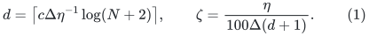
A sufficiently large fixed <code class="math">c</code> gives this deterministic alternative:

* return at least <code class="math">\zeta\sum_i&#124;S_i&#124;</code> vertex-disjoint
  same-color paths, each of length at most <code class="math">d</code>; or
* return an actual host cut <code class="math">C</code>, with <code class="math">&#124;C&#124;\leq N/2</code>
  and <code class="math">\Psi_H(C)\leq\eta/2</code>, which either has
  <code class="math">&#124;C&#124;\geq N/3</code>, or satisfies
  <!-- math-display: bdabbf8ba01eeb1ca0d75b51
  |C\cap(S_i\cup T_i)|\geq |S_i| \quad\text{for all }i.
                                                                 \tag{2}
  -->
  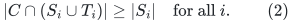

The work is
<!-- math-display: 07303b78590e568fa86ca9a4
O(k(m+N)(d+2)),                            \tag{3}
-->
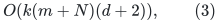
apart from fixed polynomial word costs. Path congestion is
literally one, independent of <code class="math">k</code>.

For completeness, the key cut accounting is as follows.
Greedily process colors with exact maximal short vertex-disjoint
path packing. If the number of paths is too small, their vertex
set <code class="math">W</code> has <code class="math">\Delta&#124;W&#124;&lt;\eta\sum_i&#124;S_i&#124;/100</code>.
Delete its incident edges but retain all vertex slots. Every
same-color terminal distance now exceeds <code class="math">d</code>. Repeated
distance-ball separators yield a cut of sparsity at most
<code class="math">\eta/4</code> before the deleted edges are restored.

If that cut is unbalanced, (2) and disjointness imply
<code class="math">&#124;C&#124;\geq\sum_i&#124;S_i&#124;</code>. If it is balanced, then
<code class="math">\sum_i&#124;S_i&#124;\leq N/2\leq3&#124;C&#124;/2</code>.
Either inequality pays for all restored incident edges.
No terminal lies outside the stated host universe, and no
previous cut is silently deleted.

For one color, the returned cut separates all of its current
source terminals from all of its current sink terminals.
It can be oriented to put the sources on its designated side.
Sparsity is unchanged by this orientation, although that
designated side need not be the smaller side.

## 2. Match half of every pair, or certify failed pairs

Fix initial disjoint pairs <code class="math">(S_i^0,T_i^0)</code>, with
<code class="math">&#124;S_i^0&#124;\leq&#124;T_i^0&#124;</code>, and put
<!-- math-display: a1bd28966742c60e91e62ff8
b=\min_i |S_i^0|/N>0.
 \tag{4}
-->
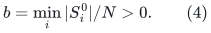
Start with empty matchings. In each round, apply Section 1
to the still-unmatched terminal sets of the active pairs.
A pair becomes inactive once at least half of its original
sources have been matched. Previously used matching endpoints
are removed from their own terminal sets, but the physical
host <code class="math">H</code> is unchanged.

If paths are returned, add them to the relevant matchings.
If a cut is returned, stop and publish that cut and all
previously found matching paths.

While pair <code class="math">i</code> is active, its current source set satisfies
<!-- math-display: d6d59fa9e421db0784705602
|S_i|>|S_i^0|/2\geq bN/2.
 \tag{5}
-->
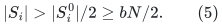
A successful round reduces the active unmatched source total
by a factor at most <code class="math">1-\zeta</code>; removing newly finished pairs
only helps. Initially this total is at most <code class="math">N/2</code>. Thus the
number of successful rounds before all pairs finish or a cut
occurs is
<!-- math-display: 9daf2e6e6bdd7ce2a4d74965
R=O\!\left(\zeta^{-1}\log(2/b)\right)
  =\mathrm{poly}(\Delta,\eta^{-1},\log(N+2),\log(2/b)).
                                                               \tag{6}
-->
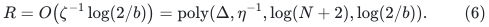
The graph never accumulates removed path vertices between
different rounds. Only one round's temporary packing is
vertex-disjoint; the resulting total path congestion is at
most <code class="math">R</code>, and dilation is at most <code class="math">d</code>.

An unbalanced returned cut contains at least
<code class="math">&#124;S_i&#124;&gt;&#124;S_i^0&#124;/2</code> original terminals of every unfinished pair,
by (2). Finished pairs already have the required matching.
Consequently the exact output contract is:

* every pair has a matching of size at least half its original
  source set; or
* a balanced cut is returned; or
* a cut of sparsity at most <code class="math">\eta/2</code> contains at least
  half the original source count in <code class="math">S_i^0\cup T_i^0</code>
  for every pair that did not receive its required matching.

The work is
<!-- math-display: 09c5e8365ad7770b57d81b41
O(k(m+N)(d+2)(R+1)).                           \tag{7}
-->
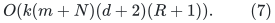
The polynomial <code class="math">k</code> factor is construction work only.
In the hierarchy <code class="math">b=\Omega(1/k)</code>, so its influence on path
congestion is only <code class="math">\log(2/b)=O(\log(k+2))</code>.
All constants are independent of the hierarchy depth.

No general nonempty-<code class="math">C_{\rm in}</code> theorem was used.

## 3. Fresh cuts in the outer cut-matching games

In the simultaneous KKOV games on parts <code class="math">V_1,\ldots,V_k</code>,
let <code class="math">j=1,2,\ldots</code> be the outer matching-round index.
Each active game asks for a matching between
<!-- math-display: a7fbbcc5a49601e50a29d2d1
|V_i|/4\leq|S_i^0|\leq|V_i|/2,\qquad T_i^0=V_i\setminus S_i^0.
                                                               \tag{8}
-->
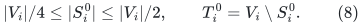
Run Section 2 on the FULL current host graph with cutoff
<!-- math-display: 9d73800459610d2f83952ea4
\eta_j=\psi/(16j^2).            \tag{9}
-->
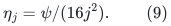
An accumulated failure cut is used only for bookkeeping;
its vertices are not removed from this call. The embedded
paths are allowed to pass through that accumulated set.

If the new cut <code class="math">C_j</code> is balanced, stop the weak hierarchy
routine and return a cut-only answer. Otherwise mark as failed
exactly those active games whose current matching request
received fewer than half of its original sources, and add
<code class="math">C_j</code> to the accumulated union <code class="math">C_{\rm acc}</code>.
If every request received its half-matching, add no failure
cut and mark no game as failed. Such a failed block contributes at
least <code class="math">&#124;V_i&#124;/8</code> of its vertices to the union, by (8) and
Section 2. Continue each other active game with its new
matching. Finished games retain their successful virtual
expander and embedding.

Stop the entire weak routine as soon as
<!-- math-display: 937309b5ae0627c254115ddc
|C_{\rm acc}|\geq\beta N,
                  \qquad \beta=1/1000.                     \tag{10}
-->
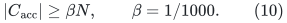
Before the last addition the union has size below <code class="math">\beta N</code>;
each new cut has size at most <code class="math">N/2</code>. Therefore at the first
crossing its size is at most <code class="math">(1/2+\beta)N</code>. If necessary
return its complement. Both choices have fixed positive
balance, and complementation loses less than a factor two
in boundary-to-side ratio.

For every prefix, even with overlapping cuts,
<!-- math-display: 1afee902e129f51bd3395a19
\begin{split}
 |\partial C_{\rm acc}|
 &\leq\sum_j|\partial C_j|
 \leq\sum_j(\eta_j/2)|C_j|\\
 &\leq\left(\sum_{j\geq1}\frac{\psi}{32j^2}\right)
                                      |C_{\rm acc}|
 <(\psi/8)|C_{\rm acc}|.
 \end{split}                                                \tag{11}
-->
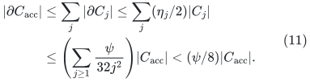
Each <code class="math">C_j</code> is a subset of its final union; this is why
overlap creates no problem. Thus the returned actual-host
cut has sparsity below <code class="math">\psi</code>, with substantial fixed slack.

Each recursive cut player on an ABSTRACT matching graph is
requested to return continuing cuts of sparsity at most <code class="math">1/8</code>.
The explicit proof in
[half-matching-entropy-progress.md](half-matching-entropy-progress.md)
then bounds the number of active matching rounds by
<code class="math">512\lceil\log_2(N+2)\rceil</code>. It uses the actual balanced
cuts and half-matchings, counting parallel occurrences separately.
This abstract cut-player threshold is distinct from the
actual embedding-host cutoff <code class="math">\eta_j</code> in (9). A virtual-expander
success stops that game's execution and does not need to be
inserted into its unfinished matching graph. The source's
incorrect per-round entropy calculation at threshold <code class="math">1/2</code>
is not used.

Consequently
<!-- math-display: 6f195f513767b532eb8c97c5
\eta_j^{-1}\leq
           \mathrm{poly}(\log(N+2))\,\psi^{-1}
 \tag{12}
-->
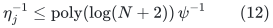
throughout the actual execution. Path length, union congestion,
and work in (6)--(7) remain fixed polynomials in
<code class="math">\Delta,\psi^{-1},\log N</code>, apart from the explicit local
construction factor <code class="math">k</code>. Formula (9) is executable without
knowing the constant hidden in the <code class="math">O(\log N)</code> round theorem.

This is the interface needed by the weak virtual hierarchy.
It avoids all clipping or source/sink balance questions created
by restricting an old terminal pair to <code class="math">V\setminus C_{\rm in}</code>.

## 4. Exact saturation on a proved expander

Suppose <code class="math">H</code> has edge sparsity at least <code class="math">\sigma&gt;0</code>, and
<code class="math">S,T</code> are disjoint with <code class="math">&#124;S&#124;\leq&#124;T&#124;</code>. Apply Section 1 with
one color and <code class="math">\eta&lt;\sigma</code>, always on the unchanged graph.
A returned cut would have sparsity at most <code class="math">\eta/2&lt;\sigma</code>
and is therefore impossible while any source remains.

Every round matches at least a <code class="math">\zeta</code> fraction of the
remaining sources. Matching endpoints are removed only from
the source/sink sets. After
<!-- math-display: 33229c3ea56fd68bd58023c9
O(\zeta^{-1}\log(N+2))                    \tag{13}
-->
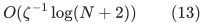
rounds every source is matched. All paths are explicit,
have length <code class="math">O(\Delta\sigma^{-1}\log N)</code>, and total
vertex congestion
<code class="math">\mathrm{poly}(\Delta,\sigma^{-1},\log N)</code>.
Work is
<!-- math-display: 523add99c0870b2d22a82091
(m+N)\mathrm{poly}
                           (\Delta,\sigma^{-1},\log N).
                                                               \tag{14}
-->
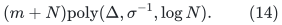
No small-leftover parameter <code class="math">\beta=1/N</code>, exponential local
search, or distributed scheduling theorem is needed.
This supplies the matching player for the precomputed
shufflers on already certified virtual expanders.

## 5. The covering matching on an arbitrary host

The hierarchy also needs to enlarge disjoint good sets
<code class="math">U_i</code> whose union <code class="math">T</code> has cardinality above <code class="math">11N/20</code>.
Set <code class="math">S=V(H)\setminus T</code>. Use the same one-color iteration
as Section 4, with a requested cut threshold <code class="math">\eta</code>,
but do not assume the host is an expander.

It either saturates all of <code class="math">S</code>, or returns a cut separating
the still-unmatched <code class="math">S'</code> from the still-unmatched <code class="math">T'</code>.
Orient the latter cut so <code class="math">S'</code> lies on its designated side.
Since a matching removes the same number of vertices from
each terminal set,
<!-- math-display: e4b2a01ae5b38002144326af
|T'|-|S'|=|T|-|S|>N/10.                 \tag{15}
-->
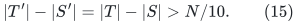
The complementary side contains <code class="math">T'</code>, so its cardinality
is always above <code class="math">N/10</code>. If the designated source side
also has size at least <code class="math">N/10</code>, return the smaller side as
a balanced cut-only answer. Otherwise it is a small cut
containing every uncovered source.

Assign each matched source vertex to the block <code class="math">U_i</code>
containing its unique matched sink. This gives disjoint
<code class="math">U_i^*=U_i\cup U_i'</code>, an injective covering matching,
<code class="math">&#124;U_i'&#124;\leq&#124;U_i&#124;</code>, and
<!-- math-display: 4a329a27c145d478f6c923b4
V(H)\setminus\bigcup_iU_i^*
                              \subseteq C_1.                \tag{16}
-->
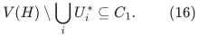
There is no small unmatched leftover set outside <code class="math">C_1</code>.
The path and work bounds are those of (13)--(14), with
<code class="math">\sigma</code> replaced by the requested threshold <code class="math">\eta</code>.
This is a stronger sequential interface than the source's
allowed small-leftover alternative.

In particular, when the host itself is a certified expander
and the cutoff is below its true sparsity, the covering
matching saturates every outside vertex. This can simplify
root coverage, although a caller may retain a separately
proved covering wrapper for consistency.

## 6. Precision and preprocessing scope

Packing, distance balls, endpoint lists, and actual cuts use
only original graph IDs, counters, and exact integer comparisons.
The cutoff (9) is rational with an explicitly represented
<code class="math">j^2</code> denominator. Its bit length is the input cutoff bit
length plus <code class="math">O(\log(j+2))</code>. The depth <code class="math">d</code> is an integer
ceiling; one may use powers of two for conservative caps.

Exact spectral and moment routines elsewhere in the hierarchy
may have larger polynomial-<code class="math">(k,\text{word size})</code> temporary
integers. Those costs belong to the construction-work factor.
They do not change the geometric bounds proved here and
must not be hidden inside the numerical client's smaller
stored-label word cap.
