# Explicit sequential preprocessing for the leaf routing step

This note isolates a constructive repair to one sequential-work boundary in
[Chang--Huang--Su, arXiv:2405.03908v1](https://arxiv.org/abs/2405.03908).
It does not infer sequential work by multiplying the stated CONGEST round
bound by the number of edges.

The source's Section 6.4 gathers the topology of a leaf graph and then computes
an embedded sorting network using unrestricted local computation. Appendix B.1
has a separate exhaustive cut-player search. The lemma below replaces the leaf
step by a polynomial-work construction. A complete sequential interpretation
also needs a constructive replacement for Appendix B.1 and an explicit work
account for the inherited hierarchy.

## 1. A small-graph permutation-routing lemma

Let <code class="math">H</code> be a connected loopless undirected multigraph with <code class="math">h\geq2</code> vertices,
maximum degree at most <code class="math">\Delta</code>, and edge expansion at least <code class="math">\psi&gt;0</code>:
<!-- math-display: c00b818f7d650d2bdfe40224
|\partial_H X|\geq\psi\min\{|X|,h-|X|\}.
-->
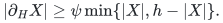
Parallel edges retain distinct IDs. Suppose a list of demands has at most
<code class="math">b=O(1)</code> occurrences of each vertex as a source and as a destination.

There is a deterministic algorithm, polynomial in
<code class="math">h,\Delta,\psi^{-1}</code> and the bit size of the stated lower bound <code class="math">\psi</code>,
that produces an explicit path for each demand with
<!-- math-display: 6e61ea0355e2e4277fb38e7d
\mathrm{length}\leq 2T,\qquad
 \mathrm{edge\ congestion}=O(bT\log(h+\Delta+2)),
 \tag{1}
-->
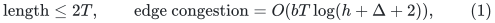
where
<!-- math-display: 7aaa74cce9c124e84d5796e5
T=O(\Delta^2\psi^{-2}\log(h+2)).
 \tag{2}
-->
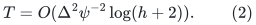
The polynomial has fixed degree. In particular, it does not enumerate paths or
cuts exponentially in <code class="math">h</code>.

### 1.1 A finite rational distribution of short walks

Let <code class="math">D</code> be a power of two satisfying
<code class="math">\max\{1,\Delta\}\leq D&lt;2\max\{1,\Delta\}</code>. Define a symmetric lazy transition
matrix <code class="math">P</code> by assigning probability <code class="math">1/(2D)</code> to each oriented genuine edge
ID and using the remaining probability at each vertex as a holding step.
Holding steps are bookkeeping, not extra genuine graph edges.

The stationary distribution is uniform. The conductance of this chain is at
least <code class="math">\psi/(2D)</code>. The usual elementary conductance-to-spectral-gap bound,
followed by the spectral expansion of the symmetric lazy matrix, gives
<!-- math-display: ae66086d074024bdaba570e0
P^T(u,v)\geq\frac1{2h}\quad\hbox{for every }u,v
 \tag{3}
-->
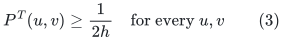
when <code class="math">T</code> is a sufficiently large integer multiple of
<code class="math">D^2\psi^{-2}\lceil\log_2(2h)\rceil</code>.
Equivalently, (3) may be checked directly by exact matrix multiplication while
doubling <code class="math">T</code>; the bound (2) controls how many such doublings are necessary.
Thus the algorithm does not need an exact eigenvalue computation.

For a demand <code class="math">a\to b'</code>, choose an intermediate vertex <code class="math">z</code> uniformly from
<code class="math">V(H)</code>. Choose a length-<code class="math">T</code> <code class="math">P</code>-walk from <code class="math">a</code> conditioned on ending at
<code class="math">z</code>, and independently such a walk from <code class="math">b'</code> to <code class="math">z</code>. Concatenate the first
walk and the reversal of the second. This is a distribution on walks of length
at most <code class="math">2T</code> after holding steps are omitted.

The marginal distribution of either half has density at most two relative to
an unconditioned <code class="math">T</code>-step walk: a walk ending at <code class="math">z</code> is reweighted by
<!-- math-display: cc753692ec19888f4b6b394e
\frac{1}{hP^T(a,z)}\leq2.
 \tag{4}
-->
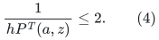
For any fixed genuine undirected edge ID <code class="math">e</code>, <code class="math">b</code> walks started at each
vertex have total expected traversals of <code class="math">e</code> at most <code class="math">bT/D</code>, since <code class="math">P</code> is
doubly stochastic. Applying (4) to both halves gives
<!-- math-display: 90433eaadd6e515b3e59da61
\sum_{\text{demands }d}\mathbb E[N_e(d)]\leq 4bT/D.
 \tag{5}
-->
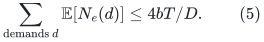
Here <code class="math">N_e(d)</code> counts repeated traversals, so this estimate does not confuse
edge occurrence congestion with the number of distinct paths using an edge.

### 1.2 Deterministic conditional expectations

Choose all demand walks independently for the analysis and put
<!-- math-display: 9796e06fe6d64d70fd6fa184
q=1+\frac1{2T},\qquad
 \Phi=\sum_{e\in E(H)}q^{\sum_d N_e(d)}.
 \tag{6}
-->
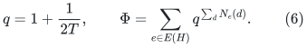
For <code class="math">0\leq x\leq2T</code>, convexity gives
<!-- math-display: 1266a4d6d0e9c91b51204609
q^x\leq 1+\frac{x}{2T}(q^{2T}-1)
       \leq1+\frac{(e-1)x}{2T}.
 \tag{7}
-->
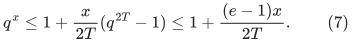
Independence, (5), and <code class="math">1+x\leq e^x</code> imply
<!-- math-display: 11c86094ff9ab295164ab138
\mathbb E[\Phi]\leq |E(H)|\exp(2b(e-1)/D).
 \tag{8}
-->
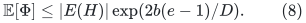
Fix first an intermediate vertex and then the two walks, one next-step choice
at a time, always choosing a positive-probability option whose conditional
expectation is no larger than the current one. Such an option exists by
averaging. A next-step choice specifies an oriented genuine edge ID or the
holding symbol, rather than only a neighboring vertex; this preserves the
separate congestion accounting for parallel IDs. At the end, (8) and
<code class="math">\log(1+1/(2T))\geq1/(4T)</code> prove (1).

Every conditional expectation in this procedure is computable in polynomial
time with exact rational arithmetic. For a fixed edge ID <code class="math">e</code>, let <code class="math">P_e</code>
be <code class="math">P</code> with that edge's two oriented contributions multiplied by <code class="math">q</code>.
If the intermediate vertex is not fixed, the moment for a demand is
<!-- math-display: 62451184cddb21a45708c7f3
\mathbb E[q^{N_e(d)}]
 =\frac1h\sum_z
   \frac{P_e^T(a,z)}{P^T(a,z)}
   \frac{P_e^T(b',z)}{P^T(b',z)}.
 \tag{9}
-->
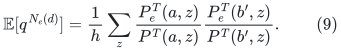
After fixing an intermediate vertex and a prefix, the corresponding factor is
the known prefix factor times
<!-- math-display: dd7d915f5bcd6794c0d98d15
\frac{P_e^{\,T-j}(v,z)}{P^{\,T-j}(v,z)}.
 \tag{10}
-->
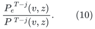
Zero-probability choices are omitted. Products of these factors over the
unfixed independent demands, followed by a sum over edge IDs, evaluate (6).
Parallel edge IDs are weighted separately in <code class="math">P_e</code>.

The matrices in (9)--(10) have rational entries with numerators and
denominators of <code class="math">O(T\log(DT))</code> bits before sums and products. Even using
unsophisticated exact rational operations, all subsequent bit lengths are
polynomial in <code class="math">h,\Delta,T</code>. There are only polynomially many choices and
matrix computations. This is sufficient for the small-graph application; no
near-linear local matrix algorithm is claimed.

Finally erase holding steps and erase cycles from each selected walk by a
stack traversal. Endpoints are preserved, and both length and every
edge-occurrence load can only decrease. The returned routes are actual simple
paths with original edge IDs. A demand with identical endpoints uses the empty
path from the outset.

## 2. A constructive leaf sorting network

Replace the source's existential embedded AKS network by a standard
constructible bitonic sorting network. It has <code class="math">O(\log^2(h+2))</code> comparator
layers. Padding to a power of two creates fewer than <code class="math">2h</code> positions; assign
at most two positions to any physical vertex. Consequently each layer is a
demand list with the constant endpoint multiplicity allowed above.

Preprocess each layer using Section 1. The resulting explicit route inventory
has polynomial size and is computed in fixed polynomial time in
<code class="math">h,\Delta,\psi^{-1}</code>. Its union congestion and concatenated path lengths are
bounded by a fixed polynomial in
<code class="math">\Delta,\psi^{-1},\log(h+2)</code>.

For blocks of <code class="math">L</code> tokens at a position, initially sort each local block and
then implement a comparator by merging its two sorted blocks and returning
the smaller and larger halves. This takes linear work in the block size per
comparator after the initial local sorts. Moving blocks uses the precomputed
paths; reversing a previous route is explicit. All real and dummy token
trajectories needed by the meet-in-the-middle construction can therefore be
recorded and subsequently reversed with work proportional to their recorded
lengths. The logarithmic-depth AKS property is unnecessary: replacing it by
the extra logarithmic factor of a bitonic network remains inside the source's
polylogarithmic factors.

For completeness, the compare-split block implementation is correct for the
bitonic network by the usual zero-one induction. After fixing any threshold,
a bitonic input has its zeros in one cyclic interval. At a bitonic-merge
stage, pairing opposite blocks and placing the smaller <code class="math">L</code> entries first
folds that interval into two bitonic halves. If the total number of zeros is
at most half the total number of positions, the second half has no zeros;
if it is at least half, the first half consists entirely of zeros. Recursing
on the halves therefore sorts the zero-one sequence. This holds for every
threshold, and hence for the original ordered keys. Padding tokens use a
sentinel larger than every genuine key.

In CHS Section 6.4 the leaf size is <code class="math">h=O(k^4)</code>, with
<code class="math">k=n^{1/p}</code>, and the leaf's expansion lower bound has inverse
<code class="math">\mathrm{poly}(\psi_{\rm root}^{-1},(\log n)^p)</code>.
Thus the replacement costs
<!-- math-display: 64e0e83724effd5f60ce28ac
\mathrm{poly}(k,\psi_{\rm root}^{-1},(\log n)^p)
 \tag{11}
-->
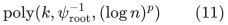
per leaf, with fixed polynomial degree. Leaf vertex sets are disjoint.
Even the deliberately loose sum of (11) over at most <code class="math">n</code> leaves is
<!-- math-display: 78bb8e73ca172b71ada47341
n\exp\!\left(O\!\left(\frac{\log n}{p}
               +p\log\log(n+2)+\log\psi_{\rm root}^{-1}\right)\right).
 \tag{12}
-->
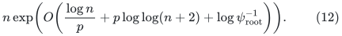
The query path length and congestion contain no polynomial <code class="math">k</code> factor.

## 3. What this establishes, and what it does not

The leaf topology gathering and zero-round embedding sentence in CHS can be
replaced by a uniform deterministic polynomial-work procedure with explicit
short route lists. This does not by itself establish the sequential work of
the complete CHS router.

The separate Appendix B.1 cut-player search needs replacement. In particular,
its condition concerns squared-distance energy for every map from one
cluster set to the other, not merely the existence of a balanced sparse cut.
The printed random-projection calculation must not be treated as a sequential
algorithm.

The inherited Chang--Saranurak hierarchy has a more favorable explicit
source boundary: [arXiv:2007.14898](https://arxiv.org/abs/2007.14898), Section 4.3,
contains a paragraph titled “A note on local computation time” replacing its
own <code class="math">2^{O(k)}</code> coarse-cut search by a polynomial-<code class="math">k</code> approximate balanced-cut
algorithm. Its conclusion also discusses deterministic PRAM work, rather than
round complexity alone. A complete parameterized work proof should use that
replacement and account for the matching/path primitives and virtual-graph
simulation explicitly. It should not silently apply the same replacement to
CHS's different Appendix B.1 energy condition.
