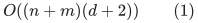
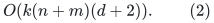
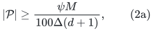
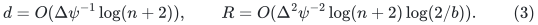
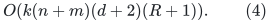
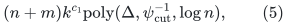
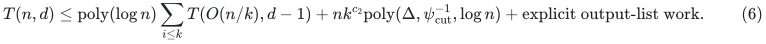
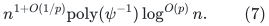

# Explicit sequential short-path packing for recursive expander construction

**Mathematical implementation lemma, 24 October 2026.** The sequential
construction does not need to simulate the distributed scheduling of the
nearly maximal flow subroutine in Chang--Saranurak,
[arXiv:2007.14898v1](https://arxiv.org/pdf/2007.14898), Appendix D.
An elementary decremental breadth-first-search implementation returns an
EXACT maximal packing of short vertex-disjoint paths. Its work replaces
the distributed-round bound, while its stronger output satisfies the
same interface used in Lemmas D.9, D.11, and D.12.

This note concerns construction of the hierarchy and its matching
embeddings. It is independent of the threshold token router used in
the 5/6 matching composition.

## 1. One source set and one sink set

Let <code class="math">G=(V,E)</code> be an unweighted undirected multigraph with explicit
edge IDs, <code class="math">n=&#124;V&#124;</code>, and <code class="math">m=&#124;E&#124;</code>. Let <code class="math">S,T\subseteq V</code>
be disjoint, and let <code class="math">d\geq1</code> be an integer. There is a
deterministic algorithm returning vertex-disjoint <code class="math">S</code>-to-<code class="math">T</code>
paths of length at most <code class="math">d</code>, such that no further such path is
vertex-disjoint from all returned paths. Its total work is

<!-- math-display: 6b15da75fdf321ed96e5d4bc
O((n+m)(d+2))
 \tag{1}
-->

up to the stated word-operation cost. The output has at most
<code class="math">n</code> original vertex occurrences. There is NO exceptional set of
leftover vertices.

### Algorithm

Add a supersource <code class="math">s_0</code> and supersink <code class="math">t_0</code>. Replace each
undirected edge by its two directed orientations, keeping the
original edge ID. Add arcs <code class="math">s_0\to s</code> for <code class="math">s\in S</code>, and
<code class="math">t\to t_0</code> for <code class="math">t\in T</code>. These attachment arcs have no
reverse orientation.

Maintain exact distances from <code class="math">s_0</code>, truncated after depth
<code class="math">d+2</code>, under deletions by an Even--Shiloach breadth-first-search
tree. Whenever <code class="math">t_0</code> has distance at most <code class="math">d+2</code>, extract its
parent path. Delete its two attachment arcs from the reported path,
save the resulting original-edge path, and delete EVERY original
vertex on it from the maintained graph. Implement a vertex deletion
by deleting its incident arcs and attachment arcs. Continue until
<code class="math">t_0</code> is beyond the depth cap or unreachable.

The shortest parent path is simple. Its internal original segment
contains no additional source or sink vertex: such a vertex would
give a shorter supersource or supersink route. This observation is
not needed for maximality, but verifies that each returned path is a
legitimate matching path with one selected source and sink.

### Correctness and work

All extracted paths have at most <code class="math">d</code> original edges. Every
selected original vertex is deleted before the next query, so paths
are vertex-disjoint. At termination the residual graph contains no
<code class="math">S</code>-to-<code class="math">T</code> path of length at most <code class="math">d</code>; any path disjoint
from the output would still be a residual path. This is exactly the
claimed maximality.

The directed augmented graph has <code class="math">O(n+m)</code> arcs. Each is deleted
at most once. In the truncated decremental BFS implementation,
distance labels only increase and have at most <code class="math">d+3</code> distinct
finite/capped values. For each vertex and each label, scan its
incoming adjacency until finding a predecessor at the preceding
label, or increase its label and restart the scan. When a parent
arc or a predecessor label becomes invalid, queue the affected
vertex and finish all necessary increases before the next query.
Each arc is scanned at most a constant number of times per label.
Initialization and updates therefore take (1). This is the usual
Even--Shiloach accounting, supplied here to specify actual sequential
work rather than infer it from a distributed round count.

Extracted paths use disjoint original vertices, so their total
extraction and vertex-deletion list work is <code class="math">O(n+m)</code>. If
<code class="math">d\geq n</code>, one may cap the original path depth at <code class="math">n-1</code>;
every simple path is already below that bound. Isolated input
vertices are retained at their actual <code class="math">O(n)</code> bookkeeping cost.

The source Lemma D.8 permits a leftover set <code class="math">B</code> of cardinality
at most <code class="math">\beta n</code>. Our algorithm satisfies its conclusion for
EVERY <code class="math">\beta&gt;0</code>, using <code class="math">B=\varnothing</code>. The subroutine's
work has no <code class="math">\beta^{-1}</code> factor.

## 2. Several colors in one packing round

Let <code class="math">(S_1,T_1),\ldots,(S_k,T_k)</code> be the disjoint terminal
pairs used in source Lemma D.12. Process the colors in a fixed order.
For color <code class="math">i</code>, run Section 1 on the graph after removing every
vertex already used by earlier colors, using its still-present
source and sink vertices. Delete all vertices of the new paths as
well before moving to the next color.

The union <code class="math">\mathcal P</code> is vertex-disjoint across ALL colors,
and its paths have length at most <code class="math">d</code>. For each color, there is
no length-<code class="math">d</code> or shorter path in the final residual graph:
maximality held when that color finished, and later processing only
deletes more vertices. A terminal removed by an earlier color is
already a member of <code class="math">V(\mathcal P)</code>, so no unaccounted leftover
terminal is introduced.

Thus this one-round output satisfies the interface used in source
Lemma D.12 with every <code class="math">B_i=\varnothing</code>. Its congestion is
literally ONE, independent of <code class="math">k</code>. Initializing an actual
decremental BFS instance for each color costs

<!-- math-display: 328a55f2ee2a03c365a0291e
O(k(n+m)(d+2)).
 \tag{2}
-->

This <code class="math">k</code> is a construction-work factor only. It does not
multiply path length, vertex congestion, or the later embedding
quality. The same graph and original-ID tables can be used with
generation marks; even a full actual-size scan per color is paid
by (2).

### 2.1 A complete empty-initial-cut progress-or-cut contract

The version with NO prior cut has a short direct proof. Let
<code class="math">M=\sum_i&#124;S_i&#124;</code>, assume <code class="math">&#124;S_i&#124;\leq&#124;T_i&#124;</code>, and let
<code class="math">0&lt;\psi\leq\Delta</code>. Choose
<code class="math">d=\lceil c\Delta\psi^{-1}\log(n+2)\rceil</code>, with a
sufficiently large absolute constant <code class="math">c</code>. Perform Section 2's
simultaneous packing. If

<!-- math-display: 93e9381cc6288f46dd715694
|\mathcal P|\geq
                 \frac{\psi M}{100\Delta(d+1)},
 \tag{2a}
-->

return those paths. Otherwise put <code class="math">W=V(\mathcal P)</code>. Then
<code class="math">\Delta&#124;W&#124;&lt;\psi M/100</code>. Remove the incident edges of <code class="math">W</code>
but retain its vertices as isolated slots. Every original terminal
set is still a subset of this full vertex universe, and every
same-color source/sink distance is greater than <code class="math">d</code>.

The following elementary distance-ball construction supplies a cut.
For one pair of nonempty terminal sets at distance greater than
<code class="math">d</code>, their radius-<code class="math">\lfloor d/2\rfloor</code> balls are disjoint;
at least one ball has cardinality at most half the current universe.
Among its successive radii choose the minimum growth ratio. The
product of those ratios is at most <code class="math">n</code>, so one radius has
relative growth <code class="math">O(\log(n+2)/d)</code>. Its boundary is at most
<code class="math">\Delta</code> times the new layer cardinality. This gives a cut
separating the two sets with sparsity
<code class="math">O(\Delta\log(n+2)/d)</code>. All radii, sizes, and candidate ratios
are obtained by BFS and integer comparisons. An empty terminal
set requires no new cut.

For several colors, start with an empty removed union and process
the pairs in order. In the graph induced by the remaining universe,
apply the preceding construction to the surviving parts of that
pair, and add its returned smaller-side cut to the removed union.
If the union first reaches one third of the original universe,
return it or its complement, whichever is smaller. Its cardinality
lies between one third and one half: immediately before the last
addition the union had size below one third, and the added set was
at most half the remainder. If no such crossing occurs, return the
final union.

The accumulated boundary is at most the common small sparsity
times the accumulated size; complementation at the first crossing
loses at most a fixed factor. If the final union is unbalanced,
it contains at least <code class="math">\min\{&#124;S_i&#124;,&#124;T_i&#124;\}=&#124;S_i&#124;</code> terminals
from every pair. To see this, if a previous union removed <code class="math">a</code>
and <code class="math">b</code> terminals of the two sides, the next separating cut
contains at least <code class="math">\min\{&#124;S_i&#124;-a,&#124;T_i&#124;-b\}</code>; adding
<code class="math">a+b</code> makes the total at least the original minimum. All pairs
are disjoint, so an unbalanced final cut has cardinality at least
<code class="math">M</code>.

Choose the constant in <code class="math">d</code> so that this cut has sparsity at
most <code class="math">\psi/4</code> before restoring the edges incident to <code class="math">W</code>.
Restoration adds at most <code class="math">\Delta&#124;W&#124;&lt;\psi M/100</code> boundary
edges. For an unbalanced cut, <code class="math">&#124;C&#124;\geq M</code> pays this directly.
For a balanced cut, <code class="math">&#124;C&#124;\geq n/3</code> and <code class="math">M\leq n/2</code>,
so <code class="math">M\leq3&#124;C&#124;/2</code> pays it with the same constant slack.
The final actual-host cut has sparsity at most <code class="math">\psi/2</code>.

We have therefore proved, with no original-terminal clipping:
either (2a) vertex-disjoint short paths are returned, or an actual
cut of sparsity at most <code class="math">\psi/2</code> is returned that is balanced
or contains at least <code class="math">&#124;S_i&#124;</code> terminals of every color. Its
work is <code class="math">O(k(n+m)(d+2))</code>. This is the clean empty-prior-cut
interface that can be called on an induced residual host by an
explicit outer adapter.

## 3. Simultaneous half-matching with fresh cuts

Use the complete empty-prior-cut interface of Section 2.1 and the
explicit repetition/union wrapper in
[sequential-fresh-cut-matching-adapter.md](sequential-fresh-cut-matching-adapter.md).
The GENERAL nonempty initial-cut implementation in the source's
abbreviated Lemma D.12 proof is not used. That proof restricts its
host to the complement of an old cut while still writing the
original terminal sets; the fresh-cut wrapper avoids that interface
rather than assuming the missing clipping charge.

For one simultaneous matching request, retain the original terminal
sets and repeat Section 2.1 on the FULL host, updating only matched
endpoints in those sets. Remove a color from the active requests
once it has received at least half its original source count. A
successful packing round reduces the active unmatched source total
by a fixed fraction. A cut round either is balanced or covers at
least half the original source count of every unfinished request.
With <code class="math">b=\min_i&#124;S_i^0&#124;/n</code>, the number of rounds is
<!-- math-display: d1facb3d9f0e3483721c1067
d=O(\Delta\psi^{-1}\log(n+2)),\qquad
 R=O(\Delta^2\psi^{-2}\log(n+2)\log(2/b)).
 \tag{3}
-->

The explicit simultaneous embedding has dilation at most <code class="math">d</code>,
vertex congestion at most <code class="math">R</code>, and work at most
<!-- math-display: 276ca812eb44fc0179d22ce3
O(k(n+m)(d+2)(R+1)).
 \tag{4}
-->

A color's returned paths are a matching because only unmatched
endpoints are used. Different rounds may reuse host vertices;
the round count, not the number of colors, bounds that reuse.

In outer KKOV matching round <code class="math">j</code>, call this routine on the FULL
host with cutoff <code class="math">\psi/(16j^2)</code>. Old failed cuts are bookkeeping
sets and are not removed from the host. Keep the union of fresh
failure cuts, stopping the weak cut routine at its fixed small
balance threshold. The convergent sum <code class="math">\sum_j j^{-2}</code> bounds
that union's actual sparsity, including overlapping cuts and a
possible final complementation. Every failed block contributes a
fixed fraction of its own terminals to the union. The surviving
blocks receive the required half-matchings. Every continuing game's
balanced cut has sparsity at most <code class="math">1/8</code>, so the corrected argument in
[half-matching-entropy-progress.md](half-matching-entropy-progress.md)
gives constant-times-<code class="math">n</code> entropy progress. The source's printed
threshold-<code class="math">1/2</code> half-matching calculation is not used. Intermediate
game graphs retain every parallel matching-round occurrence as a
distinct edge ID.

There are <code class="math">O(\log n)</code> outer rounds, so their changing cutoffs
cost only fixed polylogarithmic factors in (3)--(4). The formula
for the cutoff is executable without knowing the hidden constant
in the round bound. In the hierarchy <code class="math">b=\Omega(1/k)</code>, so the
only quality dependence on the number of colors is
<code class="math">\log(2/b)=O(\log(k+2))</code>. The explicit factor <code class="math">k</code> in
construction work never enters the embedding quality.

## 4. Single-color covering matchings without residual exceptions

For the covering-matching step, the same replacement may be used in
source Lemma D.9. One can retain any positive allowed leftover
parameter and stop at its threshold. Alternatively, stop only when
no source remains, and return a cut whenever a round has too small
a packing. The latter has no exceptional leftover set.

Here is the work and progress check for the stronger version. In a
round with live unmatched sets <code class="math">S_i,T_i</code>, either the packing has
size at least
<code class="math">&#124;S_i&#124;/(d^2\log(n+2))</code>, or discard that round's tentative paths
and use the source distance-ball cut lemma after isolating all their
vertices. The number of isolated vertices is less than
<code class="math">(d+1)&#124;S_i&#124;/(d^2\log(n+2))</code>. Restoring their incident edges
increases cut sparsity by at most this number times <code class="math">\Delta/&#124;S_i&#124;</code>,
which is absorbed by choosing the fixed constant in
<code class="math">d=O(\Delta\psi^{-1}\log(n+2))</code> sufficiently large.

In a successful round, delete only the matched endpoints from the
terminal lists; the next round again uses the full original host.
Each round contributes vertex congestion at most one. Successful
rounds reduce <code class="math">&#124;S_i&#124;</code> by a fixed reciprocal polynomial in
<code class="math">d</code> and <code class="math">\log n</code>, so there are
<code class="math">O(d^2\log^2(n+2))</code> rounds before every source is matched or a
cut is returned. This gives fixed-polynomial dependence on
<code class="math">\Delta,\psi^{-1},\log n</code> for both output quality and work.
If the host is an expander with sparsity strictly above the requested
cut threshold, the nonempty-cut alternative is impossible, so the
matching saturates all sources.

Using this stronger single-color version in the virtual-hierarchy
construction can make its tiny uncovered set <code class="math">B</code> empty. Keeping
the more conservative source leftover allowance is also valid and
does not change any envelope.

## 5. The hierarchy work recurrence

The new coarse merge in
[virtual-expander-hierarchy-reconstruction.md](virtual-expander-hierarchy-reconstruction.md)
uses a polynomial number of exact rational matrix operations on
<code class="math">k</code> blocks. Section 2 supplies the matching work on actual host
records. The base cut player there has at most <code class="math">Ck^5\lambda_{\rm cap}^2</code>
actual vertices and polynomial work in <code class="math">k</code> and <code class="math">\log n</code>. Thus local construction work has
the form

<!-- math-display: 5b900b7fda9c9e4f49c81c82
(n+m)k^{c_1}\mathrm{poly}
            (\Delta,\psi_{\rm cut}^{-1},\log n),
 \tag{5}
-->

for one absolute exponent <code class="math">c_1</code>. It is not a separate factor
<code class="math">k^{c_1}</code> on every recursive branch.

The polynomial in (5), and the final envelope (7), include the FULL
bit work of temporary exact rationals. The PSD matrices may use
<code class="math">\mathrm{poly}(k,\log n,\log\psi^{-1})</code>-bit numbers.
The separate leaf moment computations can use the larger
<code class="math">\mathrm{poly}(k,\psi^{-1},\log^{O(p)}n)</code>-bit numbers,
because their explicit lazy-walk length depends polynomially on the
leaf's inverse expansion. Their stated polynomial bit work is charged
to the same local construction envelope. These numbers are local
preprocessing state and are not tested against
a backend's smaller numerical length/gradient-label cap. Only finite
graph records, source vertex/edge IDs, and explicit unweighted path
lists leave this preprocessing routine. Those labels have
<code class="math">O(\mathrm{poly}(\log n+\log\psi^{-1}))</code> bits. The
overall guarded WORK allowance must pay for the temporary multiword
operations; treating them as constant-time arithmetic would not prove
(7).

Each simultaneous game invokes recursive cut routines on at most
<code class="math">k</code> disjoint terminal graphs of size <code class="math">O(n/k)</code>, for
<code class="math">O(\log n)</code> game rounds. A fixed number of balance-improvement
calls multiplies this by another fixed factor. The total matching-
graph edge count per recursive family is <code class="math">O(n\log n)</code>.
For recursion depth <code class="math">d</code>, a safe work recurrence therefore has
the form

<!-- math-display: d08deed1c3b8669d1c4dbc2f
T(n,d)\leq\mathrm{poly}(\log n)
       \sum_{i\leq k}T(O(n/k),d-1)
       +nk^{c_2}\mathrm{poly}
             (\Delta,\psi_{\rm cut}^{-1},\log n)
       +\text{explicit output-list work}.
 \tag{6}
-->

At every NONROOT call the cut threshold is an absolute constant
and the current matching-graph host has degree <code class="math">O(\log n)</code>.
Only the root pays the original expander's inverse sparsity.
The virtual embedding is flattened only once as proved in the
linked hierarchy note. With <code class="math">k</code> within a fixed factor of
<code class="math">n^{1/p}</code>, the recursion has depth <code class="math">O(p)</code>, and (6) gives

<!-- math-display: bafafe6124a5c63d5d371399
n^{1+O(1/p)}
                  \mathrm{poly}(\psi^{-1})
                  \log^{O(p)}n.
 \tag{7}
-->

All polynomial exponents outside <code class="math">p</code> are fixed. The same
envelope pays for the explicit root-embedding lists and for the
fixed-polynomial leaf preprocessing. No bound here charges an
exponential local search to zero distributed rounds.

Equation (7) is a construction-work statement for the reconstructed
hierarchy. It uses the corrected threshold-<code class="math">1/8</code> half-matching
entropy argument, the explicitly
proved empty-cut packing, and the fresh-cut adapter; it does not use
the ambiguous nonempty-initial-cut proof interface. It does not assert the
correctness of the full routing query recursion. That recursion,
its token loads, and its path reconstruction are separate interfaces.
