# A sharp logarithmic factor from a uniform constant portfolio

**Abstract.** Under the complete metric/lifetime realization and outer phase interfaces stated below, enumeration of fixed constants gives the bound
<!-- math-display: d7c9cc37cca561848a79593c
O(n+m)+(m_s+1)\exp\!\left[
 O\!\left((\log(m_s+2))^{167/168}
             (\log\log(m_s+4))^{1/4}\right)\right].
\tag{1}
-->
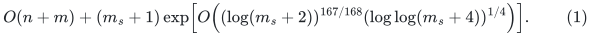
The parameter balance is proved explicitly. Its improved logarithmic factor comes from selecting one favorable fixed tuple of constants through a verified portfolio, without an additional slowly growing coefficient.

The numerical realization is an explicit premise of this historical
standalone parameter calculation. The current stronger
[main matching theorem](../../problems/general-matching/proof.md) has its
own completed cycle-search realization in Theorem 11.6 and its four-fifths
balance in Section 12. The portfolio and output verifier alone do not
establish a running-time bound; the applicable construction proof does.

The quantifier used here is a *fixed constant tuple*, chosen by a uniform
program through exhaustive interleaving. A favorable tuple is the same
for every sufficiently large input, and is not advice depending on that
input. No extra slowly growing factor is needed merely to dominate an
unknown fixed leading constant.

## 1. Dependencies and what is varied

The local metric modification is proved, under its typed-record and transaction interface, in
[local length-aspect preservation](local-length-aspect-preservation.md).
It contracts only true-null edges in the immediate cover map, exports
the original integer lengths on real edges, gives HRG linking edges
length one and paired edges length two, and uses a logarithmic-sized
integer scale for binary port fibers.

The parameterized construction and its recurrences are in
[growing-depth aspect exploration, Section 7](growing-depth-metric-recurrence.md)
and [A master-controlled hierarchy with exponent 209/210](hierarchy-parameter-balances.md).
The direct routing comparison is
[HRG routing from rounded covers](hrg-routing-from-rounded-covers.md).
The alias, geometric, disconnected-component, and lifetime interfaces
are unchanged:

* [Legal portal aliases](portal-alias-api-reconstruction.md).
* [Constant-degree Steiner bridge](constant-degree-steiner-bridge.md).
* [Disconnected routing components](disconnected-routing-components.md).
* [Numerical lifetime and loops](numerical-backend-lifetime-and-loops.md).
* [Source maps to real-edge provenance](snc-provenance-from-vertex-maps.md).
* [Consistent geometric gradients and raw lifts](alias-geometric-raw-bridge.md).

The published numerical inputs are the constant-degree sparse
neighborhood cover and legal fully dynamic spanner of Chen et al.,
[arXiv:2311.18295v1](https://arxiv.org/abs/2311.18295v1).
Their constructive local bounds, rather than a specialized
fixed-<code class="math">\kappa</code> HRG corollary, are the imported interfaces.

The outer ledger/projection argument is
[growing-parameter matching cost](growing-parameter-matching-cost.md).
Its fixed powers of <code class="math">B</code> are retained. We replace its sufficient
condition <code class="math">\log E=o(\log B)</code> by a direct inequality between the
backend factor and the chosen cap.

## 2. Computable master parameters

**Theorem 1 (conditional constant-portfolio bound).** Assume:

1. The typed null quotient, stored/analytical metrics, raw path lifts, and retirement transactions of [the length-aspect theorem](local-length-aspect-preservation.md) have a complete implementation.
2. The local primitive bounds and the aggregate recurrences in Section 5 have absolute polynomial degrees and constants independent of growing depth and of the supplied HRG level count.
3. Whenever the complete backend factor satisfies <code class="math">E_b\le B/4</code>, the outer projection and phase interfaces give the fixed-power inequalities (17), with their finite guards and charged arithmetic.
4. The deterministic matching verifier and polynomial fallback in [the uniformization theorem](deterministic-uniformization-by-optimality-check.md) are supplied.

Then one deterministic program returns an exact maximum matching with original edge identifiers within (1). The support for this theorem is the parameter and composition proof below; existence of the full numerical implementation in item 1 is not inferred from the recurrence solution.

**Proof.** Let <code class="math">S_b=2^U</code>, with integral <code class="math">U</code>, be the backend master bound.
Root size is at most <code class="math">S_b^2</code>; root lengths and gradients have at most
<code class="math">c_0U</code> bits for one fixed absolute <code class="math">c_0</code>. Write

<!-- math-display: 751a2b60e040ba3b137bddf4
p=\frac{41}{42},\qquad t=\frac1{84},\qquad
 \beta=\frac{83}{84},\qquad \alpha=\frac{167}{168},\qquad
 L_U=\lceil\log_2(U+4)\rceil .
-->
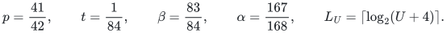

For positive integers <code class="math">c_\Gamma,c_A</code>, choose

<!-- math-display: eacce379909f16d7e055c9a6
\begin{split}
 \Gamma&=2^{\,c_\Gamma L_U\lceil U^p\rceil},\\
 \kappa&=\max\left\{3,
    \left\lceil\frac{\lceil U^t\rceil}{\lceil\sqrt{L_U}\rceil}
    \right\rceil\right\},\\
 C_{\rm port}&=2^{\lceil U^\beta\rceil},\\
 A&=2^{\,c_A\lceil U^\beta\rceil\lceil\sqrt{L_U}\rceil},\\
 k&=2^{\,\lceil U^\alpha\rceil\lceil L_U^{1/4}\rceil}.
 \end{split}                                                   \tag{2}
-->
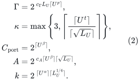

Every exponent in (2) is an integer. Rational powers of an integer
are computed by integer power comparisons; square and fourth roots
are rounded integer roots. The ceilings change only absolute constant
factors in the following estimates:

<!-- math-display: 69d66702993c0d9eef3fd65c
\begin{split}
 \log\Gamma&=\Theta(c_\Gamma U^pL_U),\\
 \kappa&=\Theta(U^t/\sqrt{L_U}),\\
 \log A&=\Theta(c_AU^\beta\sqrt{L_U}),\\
 \log k&=\Theta(U^\alpha L_U^{1/4}).
 \end{split}                                                   \tag{3}
-->
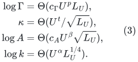

The identities used below are

<!-- math-display: 39c33134378c8b9059e28890
p+t=\beta,\qquad 1-t=\beta,\qquad
 \beta+1-\alpha=\alpha.                                        \tag{4}
-->
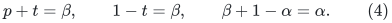

Use the same <code class="math">k,\Gamma,\kappa,C_{\rm port},A</code> at every recursive
level. Nonbase calls have nominal size exceeding <code class="math">4k</code>; a smaller
actual root uses the actual-size base solver. No array of size <code class="math">S_b</code>
is allocated merely because a call uses the master parameter <code class="math">U</code>.

The finite program may suspend a tuple on executable size, degree,
bit, or operation guards. For example it can require
<code class="math">\log A\le\frac12\log k</code> before making a nonbase call and require the
declared port capacity to exceed the explicit local degree formula.
These are eventual resource checks, not finite-size quality
certificates.

## 3. Why the length bound is still <code class="math">O(U)</code>

After the heavy private backbone is filtered, contract the connected
components of the true-null SNC edges. The quotient is a forest.
Marks are combined by logical OR, so all covered physical sets remain
unchanged. Surviving real edges retain their input identity, even if
they are real self-loops, have zero gradient, or become null only under
an earlier ancestor map.

A physical vertex has at most <code class="math">\Gamma</code> source occurrences. Its
incident retained edges lie in a forest on its own and at most three
neighboring fibers, with at most <code class="math">4\Gamma</code> vertices. Rebuilding its
quotient representation therefore uses at most a fixed polynomial in
<code class="math">\Gamma</code> records. The conservative <code class="math">O(\Gamma^2)</code> bound is adequate.
Inactive reserved slots expose no nonexistent client image. Activation,
retirement, and dormant counters follow the lifetime rules in the
length-aspect note.

Assign a retained real edge its original positive integer length.
This can only decrease its scaled rounded source length. Linking edges of
length one and paired edges of length two are also no longer than
their analytical HRG counterparts. The routing comparison remains
analyzed in the geometrically increasing abstract metric, while
every returned stored cycle has a valid physical lift.

Let <code class="math">\ell_{\max}</code> be the maximum current parent length. A compressed
Steiner edge lies within an initial <code class="math">O(k)</code>-volume piece or is a
direct tree-edit edge with promoted endpoints. Its length is
<code class="math">O(k\max\{\ell_{\max},2\})</code>. If the binary port-tree height is
<code class="math">h=\lceil\log_2 C_{\rm port}\rceil</code>, the dyadic scale

<!-- math-display: 6fedcf8e980fbaad8d862c48
H=2^{\lceil\log_2(4(h+1))\rceil}
-->
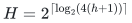

pays its unit-length fiber traversals with at most a factor-two
comparison loss. Thus, for an absolute <code class="math">c_K</code>,

<!-- math-display: 7aaffa387d54ffda66fc9799
\ell_{\max,\mathrm{child}}
 \le c_K k H\max\{\ell_{\max,\mathrm{parent}},2\}.                \tag{5}
-->
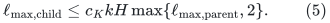

Since <code class="math">H</code> is a fixed power of <code class="math">U</code>, the length-bit increment is

<!-- math-display: 571e4d548fe02ff4e7c2144f
b_{\ell,i+1}\le b_{\ell,i}+\log_2 k+O(\log U).                 \tag{6}
-->
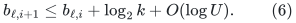

Impose the computable depth guard
<code class="math">\lceil8U/\log_2 k\rceil+10</code>, and predeclare the fixed integer
length-bit limit

<!-- math-display: 8e30c9577e3c05d33561d680
b_\star=\lceil(c_0+100)U\rceil .
-->
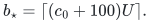

Equation (6), within that depth guard, is strictly below this limit
for all sufficiently large <code class="math">U</code>: the total <code class="math">\log k</code> contribution
is at most <code class="math">(8+o(1))U</code>, and the accumulated <code class="math">O(\log U)</code> term is
<code class="math">o(U)</code>. This proves the length limit before the eventual size-shrink
proof is used. That proof will show a smaller depth, so there is no
circular aspect argument. A finite violation suspends the branch.

Frozen gradient gauges are unchanged. Their bit bound can be
<code class="math">O_{c_0}(U(d+1))</code>, where <code class="math">d</code> is the depth. This enters only
polynomial-cost integer arithmetic, not the lengths passed to the
cover or spanner. Gauge potentials still telescope, and both scalar
certificate quantities are divided by the common port scale when
lifting. Traversal coefficients themselves remain integral and unit.

## 4. All local source factors fit <code class="math">A</code>

The cover sees only a fixed-degree private graph with integer lengths
in <code class="math">[1,m^8]</code>, regardless of the original aspect. Its resident and
reserved slots are counted in <code class="math">m</code>. For local sizes at most
<code class="math">S_b^{O(1)}</code>, Theorem 4.1 gives a fixed bound

<!-- math-display: 6cf89c3bc3746f4f06a48b7e
\log\gamma_{\rm SNC}\le C_{\rm SNC}U^pL_U .
-->
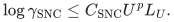

A sufficiently large fixed <code class="math">c_\Gamma</code> therefore bounds the source
cost, occurrence count, and explicit logs. Increasing <code class="math">c_\Gamma</code>
changes an absolute coefficient, not an exponent depending on <code class="math">U</code>.

Use <code class="math">\gamma_{\rm HRG}=2\Gamma</code>, and choose analytical scales by

<!-- math-display: 6cd1b36c6da053d0282fb249
\log_2\gamma_{\rm diam}
 =\left\lceil\max\left\{
 \log_2(8\gamma_{\rm HRG}^2),
 \frac{b_\star+2\log_2 m+\log_2\gamma_{\rm HRG}}
      {\kappa-1}
 \right\}\right\rceil .                                      \tag{7}
-->
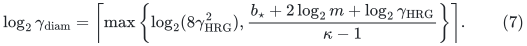

Here <code class="math">m</code> is the fixed nominal capacity of this local instance.
Both <code class="math">b_\star</code> and every radius are fixed when it is initialized;
the radii are not retuned to an observed current maximum length.
Changes of nominal capacity occur only at the already charged
instance restarts. This avoids an uncharged rebuild of all covers
when one input length grows. The length bound and (3) imply

<!-- math-display: 63d8a9a0a7718fa9d179f9f0
\log\gamma_{\rm diam}
 =O_{c_0,c_\Gamma}(U^\beta\sqrt{L_U}).                          \tag{8}
-->
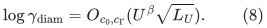

In particular <code class="math">U^pL_U=o(U^\beta\sqrt{L_U})</code>. The additional
integer ceiling in (7) and the number of scales do not enlarge
this order.

There is also an explicit bit bound for the largest analytical
radius. With <code class="math">D_i=\gamma_{\rm diam}^i</code>,

<!-- math-display: 26ffce00579acdc1e26b561a
\log_2D_{\kappa-1}
 \le b_\star+O(\log m)+O(\kappa\log\Gamma+\kappa)
 =O_{c_0,c_\Gamma}(U).
-->
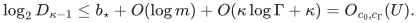

The analytical radii therefore have polynomial master magnitude
and are computed by integer arithmetic. No range of individual
length values or radii is enumerated.

The explicit tree collection of source Definition 4.30 has

<!-- math-display: 52bc6469d77f5e1b590d5e25
\Lambda\le (O(\gamma_{\rm HRG}^2\log m))^\kappa .
-->
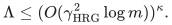

Hence

<!-- math-display: bdda12b961a070bcb02b814c
\log\Lambda
 =O\!\left(\kappa(\log\Gamma+\log\log m)\right)
 =O_{c_\Gamma}(U^\beta\sqrt{L_U}).                             \tag{9}
-->
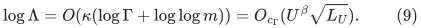

The source proof of Lemma 4.31 works for this supplied integer
<code class="math">\kappa</code>. At each layer only two vertices need prescribed outgoing
choices; a distinguishing identifier bit selects them. The
monotone-cycle decomposition contributes <code class="math">O(\kappa)</code>, not another
exponential family.

The other factors are smaller or already included:

| Factor | Logarithmic contribution |
|---|---:|
| Fixed powers of <code class="math">\Gamma</code>, including null quotient updates | <code class="math">O_{c_\Gamma}(U^pL_U)</code> |
| Fixed powers of <code class="math">C_{\rm port}</code> | <code class="math">O(U^\beta)</code> |
| A possible <code class="math">\kappa^{O(\kappa)}</code> bookkeeping bound | <code class="math">O(U^t\sqrt{L_U})</code> |
| Source spanner factor from Theorem 5.13 | <code class="math">O(U^{20/21}L_U)</code> |
| Fixed powers of identifier, hierarchy, aspect, and arithmetic bit counts | <code class="math">O(\log U)</code> |
| HRG comparison and the complete tree family | <code class="math">O_{c_0,c_\Gamma}(U^\beta\sqrt{L_U})</code> |

Marked-root maintenance introduces no missing exponential term.
A forest link/cut changes only constantly many component attachments;
a mark change affects one component. A marked-vertex aggregate finds
the replacement root in logarithmic time. This is repeated explicitly
over the <code class="math">\kappa</code> cover levels and over the already counted family.

The degree of one tree-cycle instance is at most

<!-- math-display: aa8d6c286823b5ee4dca0b9a
4\kappa(\gamma_{\rm HRG}+1)+2\gamma_{\rm HRG}+3.
-->
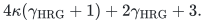

Its logarithm is <code class="math">O_{c_\Gamma}(U^pL_U)</code>, so <code class="math">C_{\rm port}</code>
dominates it eventually. This degree does not include the number
<code class="math">\Lambda</code> of different family members. There is no factor
<code class="math">C_{\rm port}^{\kappa}</code> in this construction.

The alias source counts, explicit length buckets, correction walks,
and path-pool operations involve fixed powers of the quantities in
the table. In particular they do not introduce
<code class="math">\Gamma^{\kappa^2}</code>, an aspect factor raised to <code class="math">\kappa</code>, or a
new power whose degree is a function of the recursion depth.

Consequently, under the uniform primitive and realization hypotheses, after fixing an adequate <code class="math">c_\Gamma</code>, a sufficiently
large fixed <code class="math">c_A</code> makes the <code class="math">A</code> in (2) dominate the entire local
interface. Any absolute constant slack needed in combining the
displayed factors can be included in this choice.

## 5. The common backend factor

With that adequate pair of constants, use the existing recurrences

<!-- math-display: 4c434155846c9e66d9866ada
\begin{split}
 G_r&\le A(G_{r-1}+1),\\
 J_r&\le A(G_{r-1}+1)+(A/k)J_{r-1},\\
 T_r&\le A T_{r-1}
     +O\!\left(k^2A(G_{r-1}+1)+A J_{r-1}\right).
 \end{split}                                                   \tag{10}
-->
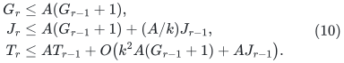

Here <code class="math">G_r</code> is occurrence multiplicity, <code class="math">J_r</code> initialization
cost per nominal record, and <code class="math">T_r</code> amortized update/query/log
cost. The child factor <code class="math">A</code> is summed over the entire family.
There is no extra factor <code class="math">k</code> on every recursive child edit.

The base initializes only its actual records; a single direct
query costs at most <code class="math">O((t+1)^3\mathrm{poly}(b_{\rm grad}))</code>
on actual size <code class="math">t\le4k</code>. Thus a loose common bound remains

<!-- math-display: 1ac6181d72fd3d8edfd55ac4
E_b\le k^{10} A^{C_{\rm rec}(d+1)}                            \tag{11}
-->
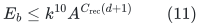

for an absolute <code class="math">C_{\rm rec}</code>. The same envelope covers raw
approximation loss, piece count, explicit log work, and occurrences.

Since <code class="math">\log A=o(\log k)</code>, total child size shrinks by at least
<code class="math">\sqrt{k}</code> eventually. Starting from size at most <code class="math">S_b^2</code>,

<!-- math-display: 4079b0ea510570c00b801391
d=O(U/\log k)=O(U^{1/168}L_U^{-1/4}).
-->
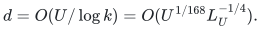

Equations (3), (4), and (11) give

<!-- math-display: 91aced28c097830d90842a16
\log E_b
 =O_{c_0,c_\Gamma,c_A}(U^{167/168}L_U^{1/4}).                 \tag{12}
-->
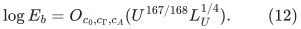

Internal gradient bits are at most
<code class="math">O_{c_0}(U^{169/168}L_U^{-1/4}+U)</code>; their fixed polynomial
arithmetic cost is included above. Length bits stay <code class="math">O_{c_0}(U)</code>.

### Local horizons are unchanged

During a local period of at most <code class="math">m/k</code> parent edits, the alias
spanner receives at most <code class="math">mA</code> total operations and
<code class="math">(m/k)A</code> expensive operations, including the charged initialization.
Because every nonbase <code class="math">m\ge k</code> and <code class="math">A=k^{o(1)}</code>, these are fixed
polynomial local horizons, for example at most <code class="math">m^2</code> eventually.
Cover instances can restart after <code class="math">m</code> local operations. Their
initialization and complete retirement are charged to those
operations, or to the shorter parent period as in (10).

All actually inserted isolated vertices, reserved slots, and still
resident history records are counted. Private never-exposed inactive
slots do not assert a nonexistent physical image. No small primitive
instance is asked to survive a master-length history in one invocation.
This supports a fixed polynomial master history such as <code class="math">S_b^{200}</code>,
with the prefix/amortized interpretation already used in the source
interfaces.

## 6. A fixed outer constant replaces the extra logarithmic slack

Let the subcubic graph size be bounded by <code class="math">S_o=2^s</code>, with one
fixed <code class="math">s</code> throughout the gap driver. Invoke the backend with
<code class="math">U=2s</code>, as in the earlier integration. The fixed root-price
bit constant is the same, for example <code class="math">c_0=1200</code>.

For a third positive integer <code class="math">c_B</code>, put

<!-- math-display: 20993a716fa5c10af08510c1
\begin{split}
 L_s&=\lceil\log_2(s+4)\rceil,\\
 a&=\left\lfloor
 \frac{\lfloor s^{1/168}\rfloor}
      {c_B\lceil L_s^{1/4}\rceil}
 \right\rfloor,\qquad
 v=\lceil s/a\rceil,\qquad B=2^v .
 \end{split}                                                   \tag{13}
-->
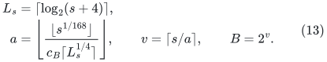

Compute <code class="math">a</code> first and suspend before the division in <code class="math">v</code> if
<code class="math">a&lt;1000</code>. Suspend also if its existing initial guards fail.
For each fixed <code class="math">c_B</code>, eventually

<!-- math-display: 54b46ff7d3038f82e55659c0
a=\Theta_{c_B}(s^{1/168}L_s^{-1/4}),\qquad
 v=\Theta(c_Bs^{167/168}L_s^{1/4}).                             \tag{14}
-->
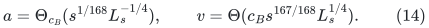

After fixing the adequate backend pair <code class="math">c_\Gamma,c_A</code>, choose
<code class="math">c_B</code> sufficiently large. Equation (12) then implies, uniformly
over all numerical instances of all sufficiently large inputs,

<!-- math-display: 7d04aa1b6ab335412c0e1aab
E_b\le B/4.                         \tag{15}
-->
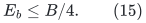

For example one may choose a constant making the coefficient of
<code class="math">\log B</code> at least twice the coefficient of <code class="math">\log E_b</code>; the
constant factor four then follows eventually. No unknown constant
is encoded as advice: Section 7 enumerates every tuple.

Retain the outer choices <code class="math">q=B^{-100}</code>, <code class="math">D_*=B^{10}</code>, the
dyadic precision grid, reset periods <code class="math">b_j=B^{a-j}</code>, and the
old finite action guards. The priced client requires backend
time, logs, pieces, and occurrence/inverse-quality bounds with
fixed slack below <code class="math">D_*</code>. Equation (15) is stronger than that
requirement. It does not require <code class="math">\log E_b=o(v)</code>.

All the other absorptions from the outer proof remain strict
little-oh estimates:

<!-- math-display: acdef897fe6a78cba1cc34ba
a=o(v),\qquad a^2=o(v),\qquad
 \mathrm{poly}(a,s)=2^{o(v)},\qquad v=o(s).
 \tag{16}
-->
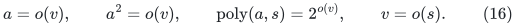

Thus the nominal rounding factor <code class="math">2^{2a^2}</code>, the factor <code class="math">2^a</code>
in <code class="math">b_0</code>, and every explicit polynomial in the number of ledger
levels fit the same fixed powers of <code class="math">B</code>. In particular the local
lifetime check
<code class="math">(a+3)2^a S_o/B=o(S_o)</code> and <code class="math">M\le S_o^2</code> still hold.
The guards <code class="math">q\ge S_o^{-1}</code>, <code class="math">D_*\le S_o^2</code>, and the polynomial
master-history caps eventually hold as well.

The exact-flow dependency has logarithmic overhead
<code class="math">O(s^{17/18}\log s)</code>, as derived in
[the quantitative exact-flow note](quantitative-exact-flow-dependency.md)
from van den Brand et al.,
[arXiv:2309.16629v1](https://arxiv.org/abs/2309.16629v1).
Its ratio to <code class="math">v</code> is

<!-- math-display: 69396c8d0426b310ebd14a7c
O_{c_B}\!\left(s^{-25/504}(\log s)^{3/4}\right)=o(1).
-->
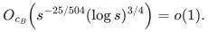

It therefore remains below one additional factor <code class="math">B</code>, including
the capacity-digit and polynomial bit overheads.

The full copy sweeps, genuine motion notifications, failed/LOW
queries, additive reset sum, and first-failure proof consequently
retain the existing conservative bounds

<!-- math-display: 25bd94d25cb5bb32f8fbcf83
T_{\rm projection}\le(P+B)B^{250},\qquad
 T_{\rm phase}\le S_oB^{300},\qquad
 T_{\rm complete}\le S_oB^{320}.                              \tag{17}
-->
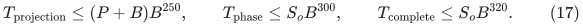

These powers are absolute. Their derivation substitutes the concrete
cap inequalities into the priced-step counts; it does not multiply
an unspecified parameter-dependent running time along the ledger
hierarchy. Hence a favorable fixed tuple has complete time

<!-- math-display: bba0feffb09902c96b1ed343
S_o\exp\!\left(
 O_{c_\Gamma,c_A,c_B}(s^{167/168}L_s^{1/4})\right).             \tag{18}
-->
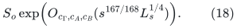

## 7. One uniform program, with no leading-constant advice

Enumerate all triples of positive integers
<code class="math">(c_\Gamma,c_A,c_B)</code>, for example by increasing sum and then
lexicographic order. Each triple specifies a finite computable
parameter branch using (2) and (13). Literal small-size or resource
guard failures suspend that branch; an inadequate numerical LOW is
never accepted as an external optimality certificate.

Run these candidates by instruction-level interleaving together
with one classical deterministic exact general matching algorithm.
The classical algorithm receives a fixed positive share. Candidate
number <code class="math">j</code> receives a share at least a fixed multiple of <code class="math">2^{-j}</code>.
The shares can be generated by the binary trailing-zero count of an
integer instruction counter. The construction creates candidate
states only when their first allotted instruction is reached.

Every candidate includes its own decoding, matching-validity check,
and one exact augmenting-path optimality search. The classical
independent interface is given in
[classical matching verification](classical-matching-optimality-verifier.md),
using Gabow,
[arXiv:1703.03998](https://arxiv.org/abs/1703.03998), and the
usual tree-union-find implementation. A valid proposed matching
with no augmenting path is maximum. Rejected or malformed proposals
suspend their branch. All verification work is charged inside that
branch's instruction allowance.

The finite computational model is the one in
[deterministic uniformization](deterministic-uniformization-by-optimality-check.md):

* Arithmetic and allocation are sequences of bounded physical-word
  operations; an enormous integer operation or allocation is not one
  indivisible step.
* Numerical source algorithms, data structures, and recursive lifts
  are ordinary computable procedures with that charged simulation.
* Every branch has private mutable state, while the cleaned graph and
  immutable compact endpoint data can be shared.
* The instruction counter and interleaving bookkeeping have at most
  polynomial logarithmic overhead before the classical branch ends.
  That overhead is absorbed into (18).
* No branch uses analytical convergence thresholds or hidden
  <code class="math">O(\cdot)</code> constants as executable advice.

There exists a sufficiently large *fixed* <code class="math">c_\Gamma</code>, followed by
a sufficiently large *fixed* <code class="math">c_A</code>, followed by a sufficiently
large *fixed* <code class="math">c_B</code>, for which Sections 3--6 apply to every input
beyond one fixed size threshold. This tuple has a finite index
<code class="math">j_*</code>. Its instruction-share penalty <code class="math">2^{j_*}</code> is a constant,
independent of input size. For sufficiently large inputs the
uniform program therefore finishes within (18), up to an absolute
constant and absorbed logarithmic overhead.

For the finitely many exceptional cleaned sizes, the classical
branch supplies termination and exact output. Enlarging the final
absolute constant covers their finite worst-case times. The
program need not know that exceptional threshold.

Final verification establishes output soundness even for an
inadequate tuple. The improved time bound additionally uses the
proved existence of the favorable tuple; verification alone is
not a substitute for that proof.

## 8. Returning to arbitrary general graphs

Use the shared linear input cleanup and the exact odd-path degree
reduction of
[the general optimum-gap proof](general-graph-gap-reduction.md).
It has <code class="math">N=O(m_s)</code>, an exact optimum offset, and a linear-time
decoder for every proposed auxiliary matching. No perfect-matching
promise, bipartite assumption, randomization, regularity, or density
restriction is introduced.

Only compact cleaned records are processed by the portfolio and its
verifiers. Isolated original vertices and duplicate input records
are scanned once in <code class="math">O(n+m)</code>; branches do not rescan that original
input. Substituting <code class="math">S_o=\Theta(m_s+1)</code> in (18) gives (1).

The same argument may be applied after the already proved
matching-preserving vertex-cover kernel, giving the corresponding
output-sensitive bound with the compact kernel size in place of
<code class="math">m_s</code>. This does not strengthen or alter the general-graph
assumptions; it only reduces the instance passed to the same verified deterministic program. This proves Theorem 1 under its four explicit hypotheses. ∎

The earlier <code class="math">167/168</code>, <code class="math">209/210</code>, and <code class="math">335/336</code> parameter choices remain alternative analyses of their respective interface assumptions. They are not independent certificates for the stronger current backend realization.
