# A static base for short-period spanner batching

This note isolates a valid simplification of the base layer of the
Chen--Kyng--Liu--Meierhans--Probst Gutenberg batching construction. It
also records why that simplification does not, using the presently
verified deterministic static primitive, remove its quadratic
dependence on the batching depth from the local work bound.

It does not change the frozen 14/15 matching construction. In
particular, it does not supply the selected-degree feedback or
ordinary endpoint-edit bound needed to replace the KMPG spanner
interface.

## 1. Primary source boundary

The relevant current primary versions checked on 24 October 2026 are:

* [Chen et al., arXiv:2311.18295v1](https://arxiv.org/pdf/2311.18295v1),
  Section 7.2, Theorem 7.11, Claim 7.15, and Lemma 7.16.
* [van den Brand et al., arXiv:2309.16629v1](https://arxiv.org/pdf/2309.16629v1),
  Theorem 8.1, its proof on printed pages 44--45, and Theorem 8.2.
* [Chen et al., arXiv:2203.00671v2](https://arxiv.org/pdf/2203.00671v2),
  Section 5.1, for the underlying touched-set batching construction.

The arXiv submission histories for the first two papers list only
version 1. The author-hosted November 2023 draft of the first paper
has the same statement relevant here. No later primary correction
eliminating the discrepancy below was found.

Write <code class="math">L(\Pi)</code> for maximum embedding path cardinality, including
the surviving pieces of a broken path, and <code class="math">C(\Pi)</code> for maximum
vertex congestion. The literal deterministic static theorem in
van den Brand et al. gives
<!-- math-display: 7c40646e57c4e890208c1f14
C(\Pi\circ\widehat\Pi)
 \leq \gamma_c L(\Pi)
       \bigl(C(\Pi)+\Delta(J)\bigr),                         \tag{1}
-->
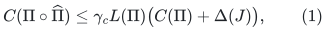
<!-- math-display: 57a9a0e2c294ca46183746af
L(\Pi\circ\widehat\Pi)\leq\gamma_\ell L(\Pi),\qquad
 |E(\widetilde J)|\leq\widetilde O(|V(J)|\gamma_\ell),        \tag{2}
-->
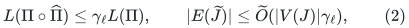
with time
<!-- math-display: 951585b18c5bc0df2ef4a498
\widetilde O(|E(J)|\gamma_\ell^2 L(\Pi)),
-->
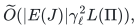
where
<code class="math">\gamma_c,\gamma_\ell= \exp(O((\log m)^{2/3}\log\log m))</code>.

Theorem 7.11 of the incremental paper cites this theorem but omits
<code class="math">L(\Pi)</code> from (1). Its Claim 7.15 then uses precisely that stronger
version. The length factor is present not only in the cited theorem
statement, but also in the congestion threshold and final proof of
Theorem 8.1. Consequently, removing it is a new static lemma, not a
consequence of the verified cited primitive.

This is an interface discrepancy. It is not a counterexample to the
existence of a stronger deterministic static sparsifier.

## 2. A base layer requiring only current degree

Consider one finite period of an undirected multigraph. Let <code class="math">G_0</code>
have <code class="math">n_0</code> vertices and <code class="math">m_0</code> edges. During the period allow edge
deletions, native vertex splits, new isolated vertices, and at most
<code class="math">B</code> new edge lifetimes. Suppose the maximum CURRENT degree is at
most <code class="math">\Delta</code>. Splits partition incidences and preserve edge IDs.
There is no bound on the degree of a historical master vertex
obtained by identifying all its descendants.

Initialize a deterministic static sparsifier <code class="math">H_{\rm init}\subseteq G_0</code> and an embedding <code class="math">\Pi_{\rm init}</code>, using the identity embedding
as input to (1)--(2). It has
<!-- math-display: 9f4a44083a2c2d3f79899dac
|E(H_{\rm init})|=\widetilde O(n_0\gamma_\ell),\quad
 L(\Pi_{\rm init})\leq\gamma_\ell,\quad
 C(\Pi_{\rm init})\leq O(\gamma_c\Delta).                   \tag{3}
-->
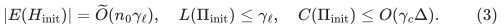

Keep the surviving, natively split copies of the initially selected
edge IDs. Add every new nonloop input edge directly to a base graph
<code class="math">H_{-1}</code>, and give that demand its identity route. Remove its demand
record when the input edge lifetime ends. For each surviving initial
demand retain its old route with deleted edges removed and its
incidence endpoints updated after splits. The result can be a broken
path; that is exactly the permitted base-layer object.

Then throughout the period
<!-- math-display: 1dd308e7a172bebc9eb1c47e
|E(H_{-1})|\leq\widetilde O(n_0\gamma_\ell)+B,\qquad
 L(\Pi_{-1})\leq\max\{1,\gamma_\ell\},                      \tag{4}
-->
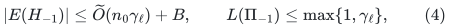
<!-- math-display: c305f2fb7fb5d511a15aca0a
C(\Pi_{-1})\leq O(\gamma_c\Delta)+O(\Delta).               \tag{5}
-->
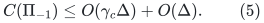

To prove (5), assign each current split descendant its initial
ancestor. Every initial record meeting that descendant met its
ancestor initially. Deletions and incidence partitions cannot add a
new occurrence of an old record at a descendant. Initial records
therefore contribute at most their original ancestor congestion.
Current postinitial identity routes contribute only current incident
edge demands, at most <code class="math">O(\Delta)</code>. Dead postinitial demands must be
removed: retaining them would incorrectly replace current degree by
historical insertion degree.

This proof does not use a cumulative master-degree bound. A new edge
whose endpoints were already involved in earlier deletions or splits
is harmless: its base route is valid at its own birth.

### Loops and empty base paths

Every logical input edge ID, including an initially unselected loop,
must remain in the native input incidence inventory. A loop may use
an empty route, but its record retains its base vertex and CURRENT
demand endpoints. If a split makes its two endpoints distinct, the
two touched descendants enter the repair set. The projected demand
can then be represented using its surviving central edge.

Do not simulate the awakening of many old loop IDs by that many
synthetic InsertEdge operations. Nor may an empty edge list erase
the record's endpoint annotations. These conventions are needed for
the touched-set proof, independently of the congestion estimate.

### What this lemma does not count

The number of selected base edge births is bounded by
<code class="math">\widetilde O(n_0\gamma_\ell)+B</code>. Native vertex splitting does not
create new edge IDs. Encoding a native split by ordinary endpoint
edits, while preserving a physical root interpretation and a
selected-degree cap, is a separate problem. Formula (4) alone does
not bound those endpoint edits.

In particular, this lemma does not replace the KMPG degree feedback
argument. A burst of selected insertions from a higher batching
layer could require a separate amortization or deamortization proof.

## 3. Correctness of attaching the touched-set repair layers

Use the usual layers <code class="math">0,\ldots,K</code>, touched sets, and highest-owner
route selection from Section 7.2 of the incremental paper. Rebuild
layer <code class="math">j</code> at its geometric deletion/split frequency, clear higher
layers, and project every affected demand to its first touched
vertex from each endpoint. Give the projected edge the route
consisting of the two surviving old endpoint prefixes and that
demand's surviving central input edge.

The validity induction needs only the following base property:
each demand had a valid base route when it was born. An initial
demand had it at time zero, and a new demand has its identity route
at birth. If the old route has never met a touched vertex it remains
valid. Otherwise its endpoint prefixes up to the first touched
vertices remain valid, and the static repair reroutes the projected
demand. Thus replacing the incremental base by Section 2 does not
alter the correctness induction.

The static initialization cost and all initial route records are
paid at the period's initialization. If <code class="math">B</code> is at most the allowed
small-child edge budget, adding the postinitial edges directly
preserves the desired base sparsity. Proving that inequality for a
particular parent update system, including degree-feedback splits,
remains necessary.

## 4. The corrected congestion recurrence

Let <code class="math">L_{j-1}\geq1</code> and <code class="math">C_{j-1}\geq\Delta</code> bound the lower-layer
routes used at a rebuild. A projected edge uses at most two such
prefixes plus one central edge, so its preliminary route length is
at most <code class="math">2L_{j-1}+1</code>. Its route congestion and the maximum degree
of the projected graph are each <code class="math">O(C_{j-1}+\Delta)</code>. These bounds
count parallel demand IDs separately.

Applying (1)--(2), then restoring the outside prefixes, gives valid
upper envelopes of the form
<!-- math-display: 88c90bbd68ca77aa087686c5
L_j\leq c_1\gamma_\ell L_{j-1},\qquad
 C_j\leq c_2\gamma_c L_{j-1}C_{j-1}.                      \tag{6}
-->
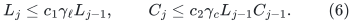
Fixed constants can absorb the additive base contribution between
rebuilds. Consequently
<!-- math-display: a429dc609571a9efe16afb31
L_j\leq L_{-1}(c_1\gamma_\ell)^{j+1},
-->
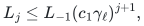
<!-- math-display: 2f133f0529b0f2cd2ef97bf3
C_j\leq C_{-1}(c_2\gamma_c L_{-1})^{j+1}
                 (c_1\gamma_\ell)^{j(j+1)/2}.            \tag{7}
-->
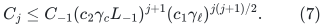

For the static base in Section 2,
<code class="math">\log L_{-1}=O(\log\gamma_\ell)</code> and
<code class="math">\log(C_{-1}/\Delta)=O(\log\gamma_c)</code>.
The verified recurrence therefore has
<!-- math-display: dd6149604c03e73731b7b4f2
\log(C_K/\Delta)
 =O(K\log\gamma_c+K^2\log\gamma_\ell).                    \tag{8}
-->
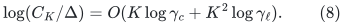
Replacing the expensive incremental base does not remove the
quadratic term.

The affected-demand count at layer <code class="math">j</code> is bounded by the touched
set size times <code class="math">C_{j-1}</code>. Multiplying by its static path cost and
dividing by its rebuild interval gives local work of the form
<!-- math-display: b95e49651143400a5fdcbbd9
\widetilde O\!\left(
    n^{1/K}\Delta(\gamma_c\gamma_\ell)^{O(K^2)}
 \right)                                                 \tag{9}
-->
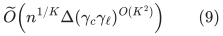
per deletion/split, plus base maintenance and initialization.
Selected sparsity and rebuild recourse can remain much smaller:
their static bound uses <code class="math">&#124;V(J)&#124;\gamma_\ell</code>, not <code class="math">C_j</code>. Equation
(9) concerns the local repair work and explicit demand records.

Equation (8) is a bound obtained by this proof, not a lower bound on
actual congestion or on every possible deterministic algorithm.

## 5. Why the earlier specialized 20/21 theorem is different

The source's Theorem 7.4 distinguishes two incremental parameters:
APSP approximation/path cardinality
<!-- math-display: 127a9cb052e245ff734793d6
\exp(O(U^{6/7}\log U))
-->
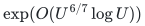
and update time
<!-- math-display: 2816ec5b160a64e8c88e1453
\exp(O(U^{20/21}\log U)),
-->
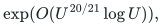
where <code class="math">U=\log m</code>. Lemma 7.8 bounds the base congestion using the
former parameter, up to logarithmic factors. The source packages
both into one larger symbol in Theorem 7.3, but the constructive
proof retains the distinction.

For the specialized batching choice <code class="math">K=O(U^{1/21})</code>, using the
literal length-sensitive static primitive adds exponents at most
<!-- math-display: bc22aa0162064242407aa9f5
K U^{6/7}\log U=O(U^{19/21}\log U),\qquad
 K^2U^{2/3}\log U=O(U^{16/21}\log U).
-->
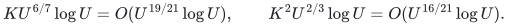
Both fit below the already imported
<code class="math">O(U^{20/21}\log U)</code> time envelope. The path/congestion correction
therefore does not, by itself, invalidate the specialized final
Theorem 5.13 bound.

The unsupported inference is the stronger one: using the displayed
length-free Claim 7.15 for arbitrary growing <code class="math">K</code> and a cheap static
base to replace the local <code class="math">K^2</code> term by <code class="math">K</code>. That requires a
separate improved static congestion theorem or a new repair
analysis.

## 6. Status of alternatives

The later deterministic low-congestion spanner theorem in
[Chuzhoy--Parter, arXiv:2601.20718v1](https://arxiv.org/pdf/2601.20718v1),
Section 9.1, concerns embeddings of a dynamic simple graph into its
own selected subgraph. Its low-congestion guarantee is stated for
edge congestion, and its update interface is edge insertion/deletion.
It does not state (1) without the length factor for an arbitrary
preexisting embedding into a different ambient graph, nor the
native-split selected-degree interface used here. It consequently
does not close this particular gap as a direct import.

The original CKL22 static result has stronger congestion behavior,
but its corresponding sparsification step is randomized. Replacing
it by an unproved deterministic selection would change the target
problem. No such replacement is claimed in this note.
